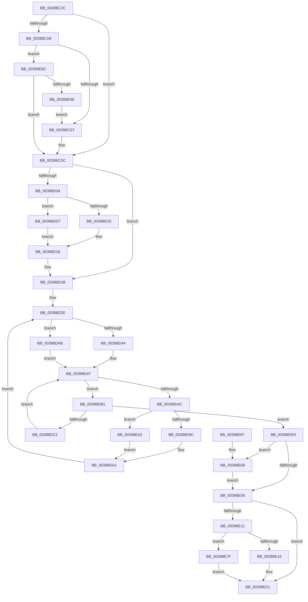

# KeGenericProcessorCallback

- RVA: `0x00398C2C`–`0x00398EAF` (길이 `643` bytes)
- VA: `0x0000000140398C2C`
- 실행 섹션: `.text`
- PDB 이름 있음: `예`; PDB Function 태그: `아니요`
- unwind 정보 RVA: `0x0008165C`
- 디코드: `159`개 명령, `643/643` bytes 표시
- 미해석 바이트: `0` (있으면 어셈블리에 `.byte`로 보존)

> 이 문서는 커널 이미지의 기계어와 PDB 기호를 분석해 생성했습니다. 4번과 5번은 함수 원형과 자료형을 바이너리 사용 방식에서 추정한 C 해석이며 원본 소스 복구 결과는 아닙니다.

## 1. Dependencies

- 직접 호출 지점: **13**; 고유 호출 대상: **11**
- 직접 호출자로 확인된 함수: **10**
- RIP 상대 이미지 참조: **3**

### Outgoing calls
- `0x00398C84` → [memset](../6C/memset_function_006C6C40.md) (function, `0x006C6C40`)
- `0x00398CC3` → [memset](../6C/memset_function_006C6C40.md) (function, `0x006C6C40`)
- `0x00398D13` → [KeSetPriorityBoost](KeSetPriorityBoost_function_00398860.md) (function, `0x00398860`)
- `0x00398D75` → [KeSetSystemGroupAffinityThread](KeSetSystemGroupAffinityThread_function_00399140.md) (function, `0x00399140`)
- `0x00398D9C` → [ExpUpdateTimerConfigurationWorker](../23/ExpUpdateTimerConfigurationWorker_function_00235410.md) (function, `0x00235410`)
- `0x00398DDC` → [KeSetPriorityThread](../2C/KeSetPriorityThread_function_002C76E0.md) (function, `0x002C76E0`)
- `0x00398E1C` → [KiRemoveBoostThread](../21/KiRemoveBoostThread_function_00219128.md) (function, `0x00219128`)
- `0x00398E26` → [KeRevertToUserGroupAffinityThread](KeRevertToUserGroupAffinityThread_function_00398EC0.md) (function, `0x00398EC0`)
- `0x00398E38` → [KiCheckForThreadDispatch](../25/KiCheckForThreadDispatch_function_00250648.md) (function, `0x00250648`)
- `0x00398E47` → [_security_check_cookie](../6A/_security_check_cookie_function_006AC640.md) (function, `0x006AC640`)
- `0x00398E6E` → [KiRaiseIrqlProcessIrqlFlags](../4F/KiRaiseIrqlProcessIrqlFlags_function_004F56FC.md) (function, `0x004F56FC`)
- `0x00398E85` → [KeSetPriorityThread](../2C/KeSetPriorityThread_function_002C76E0.md) (function, `0x002C76E0`)
- `0x00398EA5` → [guard_dispatch_icall](../6B/guard_dispatch_icall_function_006BAAD0.md) (function, `0x006BAAD0`)

### Direct callers
- [ExpUpdateTimerConfiguration](ExpUpdateTimerConfiguration_function_00398B2C.md) at `0x00398BED`
- [KeDisableTimer2](KeDisableTimer2_function_0039FD58.md) at `0x0039FF8F`
- [KeFlushQueuedDpcs](../3C/KeFlushQueuedDpcs_function_003C0300.md) at `0x003C048A`
- [KeSwapDirectoryTableBase](../46/KeSwapDirectoryTableBase_function_0046590C.md) at `0x0046596F`
- [KeGenericCallDpc](../49/KeGenericCallDpc_function_0049F980.md) at `0x0049F9BA`
- [KeUpdateDpcWatchdogConfiguration](../5B/KeUpdateDpcWatchdogConfiguration_function_005B5A34.md) at `0x005B5BE3`
- [sub_006F322E](../6F/Unknown_function_006F322E.md) at `0x006F3402`
- [PspSetVmProcessorHostProcessWorkerRoutine](../../page/78/PspSetVmProcessorHostProcessWorkerRoutine_function_00784830.md) at `0x00784850`
- [KeSetIntervalProfile](../../page/AD/KeSetIntervalProfile_function_00ADB5A8.md) at `0x00ADB626`
- [sub_00B3B096](../../page/B3/Unknown_function_00B3B096.md) at `0x00B3B10D`

### Static image references
- `0x00398C4B` → RVA `0x00E0A740` (`.data`; read)
- `0x00398D83` → RVA `0x00235410` (`ExpUpdateTimerConfigurationWorker`; read)
- `0x00398DF7` → RVA `0x00FC6D20` (`ALMOSTRO`; read)

## 2. Other-region calls and transfers

- 다른 실행 섹션으로 향하는 call: **0**
- 별도 외부 분기/꼬리 이동을 확인하지 못했습니다.

## 3. Assembly (complete function range)

```asm
00398C2C  48 89 5C 24 20                  mov qword ptr [rsp + 0x20], rbx
00398C31  55                              push rbp
00398C32  56                              push rsi
00398C33  57                              push rdi
00398C34  41 54                           push r12
00398C36  41 55                           push r13
00398C38  41 56                           push r14
00398C3A  41 57                           push r15
00398C3C  48 8D AC 24 70 FF FF FF         lea rbp, [rsp - 0x90]
00398C44  48 81 EC 90 01 00 00            sub rsp, 0x190
00398C4B  48 8B 05 EE 1A A7 00            mov rax, qword ptr [rip + 0xa71aee]
00398C52  48 33 C4                        xor rax, rsp
00398C55  48 89 85 80 00 00 00            mov qword ptr [rbp + 0x80], rax
00398C5C  4D 8B E8                        mov r13, r8
00398C5F  48 89 54 24 28                  mov qword ptr [rsp + 0x28], rdx
00398C64  48 8B F9                        mov rdi, rcx
00398C67  44 89 4C 24 20                  mov dword ptr [rsp + 0x20], r9d
00398C6C  0F 57 C0                        xorps xmm0, xmm0
00398C6F  48 8D 4C 24 70                  lea rcx, [rsp + 0x70]
00398C74  33 D2                           xor edx, edx
00398C76  41 B8 08 01 00 00               mov r8d, 0x108
00398C7C  0F 11 44 24 48                  movups xmmword ptr [rsp + 0x48], xmm0
00398C81  45 8B F1                        mov r14d, r9d
00398C84  E8 B7 DF 32 00                  call 0x1406c6c40
00398C89  33 C0                           xor eax, eax
00398C8B  0F 57 C0                        xorps xmm0, xmm0
00398C8E  45 33 C9                        xor r9d, r9d
00398C91  48 89 44 24 40                  mov qword ptr [rsp + 0x40], rax
00398C96  0F 11 44 24 30                  movups xmmword ptr [rsp + 0x30], xmm0
00398C9B  8D 58 01                        lea ebx, [rax + 1]
00398C9E  0F 11 44 24 58                  movups xmmword ptr [rsp + 0x58], xmm0
00398CA3  48 85 FF                        test rdi, rdi
00398CA6  75 34                           jne 0x140398cdc
00398CA8  33 D2                           xor edx, edx
00398CAA  48 C7 44 24 70 01 00 20 00      mov qword ptr [rsp + 0x70], 0x200001
00398CB3  41 B8 00 01 00 00               mov r8d, 0x100
00398CB9  48 8D 4C 24 78                  lea rcx, [rsp + 0x78]
00398CBE  48 8D 7C 24 70                  lea rdi, [rsp + 0x70]
00398CC3  E8 78 DF 32 00                  call 0x1406c6c40
00398CC8  45 33 C9                        xor r9d, r9d
00398CCB  66 44 39 4C 24 70               cmp word ptr [rsp + 0x70], r9w
00398CD1  0F 86 B5 01 00 00               jbe 0x140398e8c
00398CD7  48 09 5C 24 78                  or qword ptr [rsp + 0x78], rbx
00398CDC  65 48 8B 34 25 88 01 00 00      mov rsi, qword ptr gs:[0x188]
00398CE5  4C 8D 64 24 58                  lea r12, [rsp + 0x58]
00398CEA  33 C0                           xor eax, eax
00398CEC  49 8B D9                        mov rbx, r9
00398CEF  89 44 24 52                     mov dword ptr [rsp + 0x52], eax
00398CF3  45 8B F9                        mov r15d, r9d
00398CF6  66 89 44 24 56                  mov word ptr [rsp + 0x56], ax
00398CFB  44 8D 58 02                     lea r11d, [rax + 2]
00398CFF  45 85 F6                        test r14d, r14d
00398D02  74 17                           je 0x140398d1b
00398D04  48 8B CE                        mov rcx, rsi
00398D07  45 84 F3                        test r11b, r14b
00398D0A  0F 85 C7 00 00 00               jne 0x140398dd7
00398D10  8D 50 0F                        lea edx, [rax + 0xf]
00398D13  E8 48 FB FF FF                  call 0x140398860
00398D18  45 33 C9                        xor r9d, r9d
00398D1B  48 8B 57 08                     mov rdx, qword ptr [rdi + 8]
00398D1F  4C 8B 74 24 28                  mov r14, qword ptr [rsp + 0x28]
00398D24  48 89 54 24 38                  mov qword ptr [rsp + 0x38], rdx
00398D29  48 89 7C 24 30                  mov qword ptr [rsp + 0x30], rdi
00398D2E  44 0F B7 44 24 40               movzx r8d, word ptr [rsp + 0x40]
00398D34  41 BA 01 00 00 00               mov r10d, 1
00398D3A  44 89 4C 24 28                  mov dword ptr [rsp + 0x28], r9d
00398D3F  48 85 FF                        test rdi, rdi
00398D42  74 67                           je 0x140398dab
00398D44  0F B7 0F                        movzx ecx, word ptr [rdi]
00398D47  48 85 D2                        test rdx, rdx
00398D4A  74 65                           je 0x140398db1
00398D4C  48 0F BC CA                     bsf rcx, rdx
00398D50  66 44 89 44 24 50               mov word ptr [rsp + 0x50], r8w
00398D56  0F B6 C1                        movzx eax, cl
00398D59  48 0F B3 C2                     btr rdx, rax
00398D5D  49 8B C2                        mov rax, r10
00398D60  48 D3 E0                        shl rax, cl
00398D63  48 8D 4C 24 48                  lea rcx, [rsp + 0x48]
00398D68  48 89 54 24 38                  mov qword ptr [rsp + 0x38], rdx
00398D6D  49 8B D4                        mov rdx, r12
00398D70  48 89 44 24 48                  mov qword ptr [rsp + 0x48], rax
00398D75  E8 C6 03 00 00                  call 0x140399140
00398D7A  65 48 8B 1C 25 20 00 00 00      mov rbx, qword ptr gs:[0x20]
00398D83  48 8D 05 86 C6 E9 FF            lea rax, [rip - 0x16397a]
00398D8A  45 33 E4                        xor r12d, r12d
00398D8D  49 8B D5                        mov rdx, r13
00398D90  48 8B CB                        mov rcx, rbx
00398D93  4C 3B F0                        cmp r14, rax
00398D96  0F 85 06 01 00 00               jne 0x140398ea2
00398D9C  E8 6F C6 E9 FF                  call 0x140235410
00398DA1  48 8B 54 24 38                  mov rdx, qword ptr [rsp + 0x38]
00398DA6  45 33 C9                        xor r9d, r9d
00398DA9  EB 83                           jmp 0x140398d2e
00398DAB  43 8D 0C 02                     lea ecx, [r10 + r8]
00398DAF  EB 96                           jmp 0x140398d47
00398DB1  66 45 03 C2                     add r8w, r10w
00398DB5  41 0F B7 C0                     movzx eax, r8w
00398DB9  66 89 44 24 40                  mov word ptr [rsp + 0x40], ax
00398DBE  3B C1                           cmp eax, ecx
00398DC0  73 27                           jae 0x140398de9
00398DC2  48 8B 54 C7 08                  mov rdx, qword ptr [rdi + rax*8 + 8]
00398DC7  44 0F B7 44 24 40               movzx r8d, word ptr [rsp + 0x40]
00398DCD  48 89 54 24 38                  mov qword ptr [rsp + 0x38], rdx
00398DD2  E9 70 FF FF FF                  jmp 0x140398d47
00398DD7  BA 1E 00 00 00                  mov edx, 0x1e
00398DDC  E8 FF E8 F2 FF                  call 0x1402c76e0
00398DE1  44 8B F8                        mov r15d, eax
00398DE4  E9 2F FF FF FF                  jmp 0x140398d18
00398DE9  44 0F 20 C7                     mov rdi, cr8
00398DED  41 BB 02 00 00 00               mov r11d, 2
00398DF3  45 0F 22 C3                     mov cr8, r11
00398DF7  44 39 0D 22 DF C2 00            cmp dword ptr [rip + 0xc2df22], r9d
00398DFE  44 8B 74 24 20                  mov r14d, dword ptr [rsp + 0x20]
00398E03  75 63                           jne 0x140398e68
00398E05  44 88 93 BA 38 00 00            mov byte ptr [rbx + 0x38ba], r10b
00398E0C  45 85 F6                        test r14d, r14d
00398E0F  74 10                           je 0x140398e21
00398E11  45 84 F3                        test r11b, r14b
00398E14  75 69                           jne 0x140398e7f
00398E16  48 8B D6                        mov rdx, rsi
00398E19  48 8B CB                        mov rcx, rbx
00398E1C  E8 07 03 E8 FF                  call 0x140219128
00398E21  48 8D 4C 24 58                  lea rcx, [rsp + 0x58]
00398E26  E8 95 00 00 00                  call 0x140398ec0
00398E2B  40 8A D7                        mov dl, dil
00398E2E  C6 83 BA 38 00 00 00            mov byte ptr [rbx + 0x38ba], 0
00398E35  48 8B CB                        mov rcx, rbx
00398E38  E8 0B 78 EB FF                  call 0x140250648
00398E3D  48 8B 8D 80 00 00 00            mov rcx, qword ptr [rbp + 0x80]
00398E44  48 33 CC                        xor rcx, rsp
00398E47  E8 F4 37 31 00                  call 0x1406ac640
00398E4C  48 8B 9C 24 E8 01 00 00         mov rbx, qword ptr [rsp + 0x1e8]
00398E54  48 81 C4 90 01 00 00            add rsp, 0x190
00398E5B  41 5F                           pop r15
00398E5D  41 5E                           pop r14
00398E5F  41 5D                           pop r13
00398E61  41 5C                           pop r12
00398E63  5F                              pop rdi
00398E64  5E                              pop rsi
00398E65  5D                              pop rbp
00398E66  C3                              ret
00398E67  CC                              int3
00398E68  41 8A D3                        mov dl, r11b
00398E6B  40 8A CF                        mov cl, dil
00398E6E  E8 89 C8 15 00                  call 0x1404f56fc
00398E73  41 BA 01 00 00 00               mov r10d, 1
00398E79  45 8D 5A 01                     lea r11d, [r10 + 1]
00398E7D  EB 86                           jmp 0x140398e05
00398E7F  41 8B D7                        mov edx, r15d
00398E82  48 8B CE                        mov rcx, rsi
00398E85  E8 56 E8 F2 FF                  call 0x1402c76e0
00398E8A  EB 95                           jmp 0x140398e21
00398E8C  66 44 39 4C 24 72               cmp word ptr [rsp + 0x72], r9w
00398E92  0F 86 44 FE FF FF               jbe 0x140398cdc
00398E98  66 89 5C 24 70                  mov word ptr [rsp + 0x70], bx
00398E9D  E9 35 FE FF FF                  jmp 0x140398cd7
00398EA2  49 8B C6                        mov rax, r14
00398EA5  E8 26 1C 32 00                  call 0x1406baad0
00398EAA  E9 F2 FE FF FF                  jmp 0x140398da1
```

## 4. C-style interpretation (structured pseudocode)

```c
__int64 __fastcall KeGenericProcessorCallback(__int64 a1, __int64 a2, __int64 a3, int a4)
{
    __int64 result;
    __int64 v_r12;
    __int64 v_rsp;
    unsigned __int64 v_stack_m150;
    unsigned __int64 v_stack_m158;
    unsigned __int64 v_stack_m170;
    unsigned __int16 v_stack_m172;
    unsigned int v_stack_m176;
    unsigned __int16 v_stack_m178;
    unsigned __int64 v_stack_m180;
    unsigned __int64 v_stack_m188;
    unsigned __int64 v_stack_m190;
    unsigned __int64 v_stack_m198;
    unsigned __int64 v_stack_m1A0;
    unsigned int v_stack_m1A8;
    unsigned __int64 v_stack_m48;
    unsigned __int64 v_stack_mC8;
    unsigned __int64 v_stack_p20;
    unsigned __int16 v_stack_p70;
    unsigned __int16 v_stack_p72;

    v_stack_p20 = v_rbx;
    v_rsp = (v_rsp) - (400);
    result = (*(unsigned __int64 *)(v_rip + 10951406)) ^ (v_rsp);
    v_stack_m48 = result;
    v_stack_m1A0 = a2;
    v_stack_m1A8 = a4;
    a2 = 0;
    v_stack_m180 = v_xmm0;
    result = memset(v_stack_m158, a2, 264, a4);
    result = 0;
    a4 = 0;
    v_stack_m188 = 0;
    v_stack_m198 = v_xmm0;
    v_stack_m170 = v_xmm0;
    if (a1 != 0) goto loc_00398CDC;
    a2 = 0;
    v_stack_m158 = 0x200001ULL;
    result = memset(v_stack_m150, a2, 256, a4);
    a4 = 0;
    if (v_stack_m158 <= 0) goto loc_00398E8C;
loc_00398CD7:
loc_00398CDC:
    result = 0;
    v_stack_m176 = 0;
    v_stack_m172 = 0;
    if ((unsigned int)((unsigned int)(a4)) == 0) goto loc_00398D1B;
    if ((((unsigned __int8)(result + 2)) & ((unsigned __int8)((unsigned int)(a4)))) != 0) goto loc_00398DD7;
    result = KeSetPriorityBoost(*(unsigned __int64 *)(gs_base + (0 + 392)), result + 15, 256, a4);
loc_00398D18:
    a4 = 0;
loc_00398D1B:
    v_stack_m190 = *(unsigned __int64 *)(v_stack_m158 + 8);
    v_stack_m198 = v_stack_m158;
loc_00398D2E:
    v_stack_m1A0 = 0;
    if (v_stack_m158 == 0) goto loc_00398DAB;
loc_00398D47:
    if (*(unsigned __int64 *)(v_stack_m158 + 8) == 0) goto loc_00398DB1;
    v_stack_m178 = (unsigned __int16)(v_stack_m188);
    result = (1) << ((unsigned __int8)(*(unsigned __int16 *)(v_stack_m158)));
    v_stack_m190 = *(unsigned __int64 *)(v_stack_m158 + 8);
    v_stack_m180 = result;
    result = KeSetSystemGroupAffinityThread(v_stack_m180, v_stack_m170, v_stack_m188, a4);
    v_r12 = 0;
    if (v_stack_m1A0 != (v_rip - 1456506)) goto loc_00398EA2;
    result = ExpUpdateTimerConfigurationWorker(*(unsigned __int64 *)(gs_base + (0 + 32)), a3, v_stack_m188, a4);
loc_00398DA1:
    a4 = 0;
    goto loc_00398D2E;
loc_00398DAB:
    goto loc_00398D47;
loc_00398DB1:
    a3 = (unsigned __int16)((v_stack_m188) + (1));
    v_stack_m188 = (unsigned __int16)((unsigned __int16)(a3));
    if (((unsigned int)((unsigned __int16)(a3))) >= ((unsigned int)(1 + v_stack_m188 * 1))) goto loc_00398DE9;
    v_stack_m190 = *(unsigned __int64 *)(v_stack_m158 + (unsigned __int16)(a3) * 8 + 8);
    goto loc_00398D47;
loc_00398DD7:
    result = KeSetPriorityThread(1 + v_stack_m188 * 1, 30, v_stack_m188, a4);
    goto loc_00398D18;
loc_00398DE9:
    if ((*(unsigned int *)(v_rip + 12771106)) != 0) goto loc_00398E68;
loc_00398E05:
    *(unsigned __int8 *)(*(unsigned __int64 *)(gs_base + (0 + 32)) + 14522) = 1;
    if ((unsigned int)((unsigned int)(v_stack_m1A8)) == 0) goto loc_00398E21;
    if (((2) & ((unsigned __int8)((unsigned int)(v_stack_m1A8)))) != 0) goto loc_00398E7F;
    result = KiRemoveBoostThread(*(unsigned __int64 *)(gs_base + (0 + 32)), *(unsigned __int64 *)(gs_base + (0 + 392)), v_stack_m188, a4);
loc_00398E21:
    result = KeRevertToUserGroupAffinityThread(v_stack_m170, *(unsigned __int64 *)(gs_base + (0 + 392)), v_stack_m188, a4);
    *(unsigned __int8 *)(*(unsigned __int64 *)(gs_base + (0 + 32)) + 14522) = 0;
    result = KiCheckForThreadDispatch(*(unsigned __int64 *)(gs_base + (0 + 32)), (unsigned __int8)(v_cr8), v_stack_m188, a4);
    a1 = (v_stack_m48) ^ (v_rsp);
    result = _security_check_cookie(a1, (unsigned __int8)(v_cr8), v_stack_m188, a4);
    v_rsp = (v_rsp) + (400);
    return result;
loc_00398E68:
    result = KiRaiseIrqlProcessIrqlFlags((unsigned __int8)(v_cr8), 2, v_stack_m188, a4);
    goto loc_00398E05;
loc_00398E7F:
    result = KeSetPriorityThread(*(unsigned __int64 *)(gs_base + (0 + 392)), (unsigned int)((unsigned int)((unsigned int)((unsigned int)(result)))), v_stack_m188, a4);
    goto loc_00398E21;
loc_00398E8C:
    if (v_stack_p72 <= 0) goto loc_00398CDC;
    v_stack_p70 = (unsigned __int16)(v_stack_p20);
    goto loc_00398CD7;
loc_00398EA2:
    result = guard_dispatch_icall(*(unsigned __int64 *)(gs_base + (0 + 392)), (unsigned int)((unsigned int)((unsigned int)((unsigned int)(result)))), v_stack_m188, a4);
    goto loc_00398DA1;
}
```

## 5. (Beta) C Style

```c
int64_t KeGenericProcessorCallback(int64_t Arg1, int64_t Arg2, int64_t Arg3, int32_t Arg4)
{
    int64_t result;
    int64_t local_r12;
    int64_t local_rsp;
    uint64_t v_stack_m150;
    uint64_t v_stack_m158;
    uint64_t v_stack_m170;
    uint16_t v_stack_m172;
    uint32_t v_stack_m176;
    uint16_t v_stack_m178;
    uint64_t v_stack_m180;
    uint64_t v_stack_m188;
    uint64_t v_stack_m190;
    uint64_t v_stack_m198;
    uint64_t v_stack_m1A0;
    uint32_t v_stack_m1A8;
    uint64_t v_stack_m48;
    uint64_t v_stack_mC8;
    uint64_t v_stack_p20;
    uint16_t v_stack_p70;
    uint16_t v_stack_p72;

    v_stack_p20 = local_rbx;
    local_rsp = (local_rsp) - (400);
    result = (*(uint64_t *)(v_rip + 0xA71AEE)) ^ (local_rsp);
    v_stack_m48 = result;
    v_stack_m1A0 = Arg2;
    v_stack_m1A8 = Arg4;
    Arg2 = 0;
    v_stack_m180 = v_xmm0;
    result = memset(v_stack_m158, Arg2, 264, Arg4);
    result = 0;
    Arg4 = 0;
    v_stack_m188 = 0;
    v_stack_m198 = v_xmm0;
    v_stack_m170 = v_xmm0;
    if (Arg1 != 0) goto loc_00398CDC;
    Arg2 = 0;
    v_stack_m158 = 0x200001ULL;
    result = memset(v_stack_m150, Arg2, 256, Arg4);
    Arg4 = 0;
    if (v_stack_m158 <= 0) goto loc_00398E8C;
loc_00398CD7:
loc_00398CDC:
    result = 0;
    v_stack_m176 = 0;
    v_stack_m172 = 0;
    if ((uint32_t)((uint32_t)(Arg4)) == 0) goto loc_00398D1B;
    if ((((uint8_t)(result + 2)) & ((uint8_t)((uint32_t)(Arg4)))) != 0) goto loc_00398DD7;
    result = KeSetPriorityBoost(*(uint64_t *)(gs_base + (0 + 0x188)), result + 15, 256, Arg4);
loc_00398D18:
    Arg4 = 0;
loc_00398D1B:
    v_stack_m190 = *(uint64_t *)(v_stack_m158 + 0x8);
    v_stack_m198 = v_stack_m158;
loc_00398D2E:
    v_stack_m1A0 = 0;
    if (v_stack_m158 == 0) goto loc_00398DAB;
loc_00398D47:
    if (*(uint64_t *)(v_stack_m158 + 0x8) == 0) goto loc_00398DB1;
    v_stack_m178 = (uint16_t)(v_stack_m188);
    result = (1) << ((uint8_t)(*(uint16_t *)(v_stack_m158)));
    v_stack_m190 = *(uint64_t *)(v_stack_m158 + 0x8);
    v_stack_m180 = result;
    result = KeSetSystemGroupAffinityThread(v_stack_m180, v_stack_m170, v_stack_m188, Arg4);
    local_r12 = 0;
    if (v_stack_m1A0 != (v_rip - 1456506)) goto loc_00398EA2;
    result = ExpUpdateTimerConfigurationWorker(*(uint64_t *)(gs_base + (0 + 0x20)), Arg3, v_stack_m188, Arg4);
loc_00398DA1:
    Arg4 = 0;
    goto loc_00398D2E;
loc_00398DAB:
    goto loc_00398D47;
loc_00398DB1:
    Arg3 = (uint16_t)((v_stack_m188) + (1));
    v_stack_m188 = (uint16_t)((uint16_t)(Arg3));
    if (((uint32_t)((uint16_t)(Arg3))) >= ((uint32_t)(1 + v_stack_m188 * 1))) goto loc_00398DE9;
    v_stack_m190 = *(uint64_t *)(v_stack_m158 + (uint16_t)(Arg3) * 8 + 0x8);
    goto loc_00398D47;
loc_00398DD7:
    result = KeSetPriorityThread(1 + v_stack_m188 * 1, 30, v_stack_m188, Arg4);
    goto loc_00398D18;
loc_00398DE9:
    if ((*(uint32_t *)(v_rip + 0xC2DF22)) != 0) goto loc_00398E68;
loc_00398E05:
    *(uint8_t *)(*(uint64_t *)(gs_base + (0 + 0x20)) + 0x38BA) = 1;
    if ((uint32_t)((uint32_t)(v_stack_m1A8)) == 0) goto loc_00398E21;
    if (((2) & ((uint8_t)((uint32_t)(v_stack_m1A8)))) != 0) goto loc_00398E7F;
    result = KiRemoveBoostThread(*(uint64_t *)(gs_base + (0 + 0x20)), *(uint64_t *)(gs_base + (0 + 0x188)), v_stack_m188, Arg4);
loc_00398E21:
    result = KeRevertToUserGroupAffinityThread(v_stack_m170, *(uint64_t *)(gs_base + (0 + 0x188)), v_stack_m188, Arg4);
    *(uint8_t *)(*(uint64_t *)(gs_base + (0 + 0x20)) + 0x38BA) = 0;
    result = KiCheckForThreadDispatch(*(uint64_t *)(gs_base + (0 + 0x20)), (uint8_t)(v_cr8), v_stack_m188, Arg4);
    Arg1 = (v_stack_m48) ^ (local_rsp);
    result = _security_check_cookie(Arg1, (uint8_t)(v_cr8), v_stack_m188, Arg4);
    local_rsp = (local_rsp) + (400);
    return result;
loc_00398E68:
    result = KiRaiseIrqlProcessIrqlFlags((uint8_t)(v_cr8), 2, v_stack_m188, Arg4);
    goto loc_00398E05;
loc_00398E7F:
    result = KeSetPriorityThread(*(uint64_t *)(gs_base + (0 + 0x188)), (uint32_t)((uint32_t)((uint32_t)((uint32_t)(result)))), v_stack_m188, Arg4);
    goto loc_00398E21;
loc_00398E8C:
    if (v_stack_p72 <= 0) goto loc_00398CDC;
    v_stack_p70 = (uint16_t)(v_stack_p20);
    goto loc_00398CD7;
loc_00398EA2:
    result = guard_dispatch_icall(*(uint64_t *)(gs_base + (0 + 0x188)), (uint32_t)((uint32_t)((uint32_t)((uint32_t)(result)))), v_stack_m188, Arg4);
    goto loc_00398DA1;
}
```

## 6. Execution-region graph

[열기: 2D/3D 그래프와 함수 탐색 컨트롤 패널](../../../control-panel.html?section=text&rva=0x00398C2C&view=graph)

- 2D 그래프는 위에서 아래로 흐르고, 3D 그래프는 빈 공간을 드래그해 회전합니다. Shift+드래그는 이동, 휠은 확대·축소, 함수 노드 선택은 대상 보고서 이동입니다.

### Static fallback


