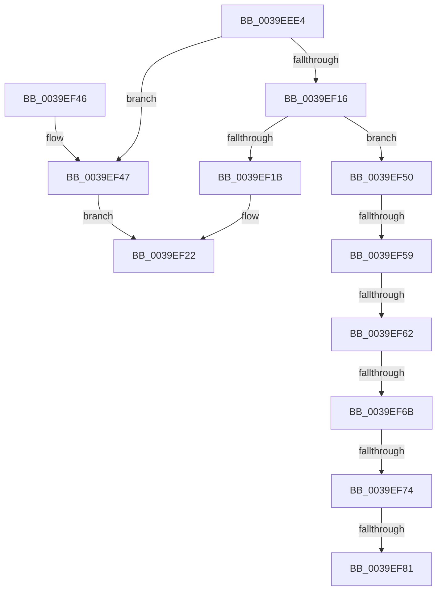

# KeGetTopologySiblingGroupAffinityForProcessor

- RVA: `0x0039EEE4`–`0x0039EF8B` (길이 `167` bytes)
- VA: `0x000000014039EEE4`
- 실행 섹션: `.text`
- PDB 이름 있음: `예`; PDB Function 태그: `예`
- unwind 정보 RVA: `0x00081C28`
- 디코드: `43`개 명령, `167/167` bytes 표시
- 미해석 바이트: `0` (있으면 어셈블리에 `.byte`로 보존)

> 이 문서는 커널 이미지의 기계어와 PDB 기호를 분석해 생성했습니다. 4번과 5번은 함수 원형과 자료형을 바이너리 사용 방식에서 추정한 C 해석이며 원본 소스 복구 결과는 아닙니다.

## 1. Dependencies

- 직접 호출 지점: **1**; 고유 호출 대상: **1**
- 직접 호출자로 확인된 함수: **2**
- RIP 상대 이미지 참조: **0**

### Outgoing calls
- `0x0039EF74` → [Feature_PpmParkEx__private_IsEnabledNoReportingNoInline](../4F/Feature_PpmParkEx__private_IsEnabledNoReportingNoInline_function_004F40E0.md) (function, `0x004F40E0`)

### Direct callers
- [KiBuildShareCountListForSubNodeByAffinity](KiBuildShareCountListForSubNodeByAffinity_function_0039EE1C.md) at `0x0039EEA9`
- [KeInitSystem](../../init/C7/KeInitSystem_function_00C71660.md) at `0x00C71B3B`

### Static image references
- 디코드된 RIP-relative 메모리 참조가 없습니다.

## 2. Other-region calls and transfers

- 다른 실행 섹션으로 향하는 call: **0**
- call이 아닌 외부 분기/꼬리 이동: **6**
  - `0x0039EF53` → [sub_006E6176 + 0x15](../6E/Unknown_function_006E6176.md) (`tail-transfer`)
  - `0x0039EF5C` → [sub_006E6176 + 0xE](../6E/Unknown_function_006E6176.md) (`tail-transfer`)
  - `0x0039EF65` → [sub_006E6176 + 0x7](../6E/Unknown_function_006E6176.md) (`tail-transfer`)
  - `0x0039EF6E` → [sub_006E6176](../6E/Unknown_function_006E6176.md) (`tail-transfer`)
  - `0x0039EF7B` → [sub_006E6176](../6E/Unknown_function_006E6176.md) (`tail-transfer`)
  - `0x0039EF86` → [sub_006E6176 + 0x1A](../6E/Unknown_function_006E6176.md) (`tail-transfer`)

## 3. Assembly (complete function range)

```asm
0039EEE4  48 8B C4                        mov rax, rsp
0039EEE7  48 89 58 08                     mov qword ptr [rax + 8], rbx
0039EEEB  48 89 68 10                     mov qword ptr [rax + 0x10], rbp
0039EEEF  48 89 70 18                     mov qword ptr [rax + 0x18], rsi
0039EEF3  57                              push rdi
0039EEF4  48 83 EC 30                     sub rsp, 0x30
0039EEF8  0F B6 B1 D0 00 00 00            movzx esi, byte ptr [rcx + 0xd0]
0039EEFF  0F 57 C0                        xorps xmm0, xmm0
0039EF02  33 FF                           xor edi, edi
0039EF04  49 8B E8                        mov rbp, r8
0039EF07  48 8B D9                        mov rbx, rcx
0039EF0A  0F 11 40 E8                     movups xmmword ptr [rax - 0x18], xmm0
0039EF0E  66 89 70 F0                     mov word ptr [rax - 0x10], si
0039EF12  85 D2                           test edx, edx
0039EF14  74 31                           je 0x14039ef47
0039EF16  83 FA 01                        cmp edx, 1
0039EF19  75 35                           jne 0x14039ef50
0039EF1B  48 8B 81 60 8E 00 00            mov rax, qword ptr [rcx + 0x8e60]
0039EF22  48 89 44 24 20                  mov qword ptr [rsp + 0x20], rax
0039EF27  0F 10 44 24 20                  movups xmm0, xmmword ptr [rsp + 0x20]
0039EF2C  48 8B 5C 24 40                  mov rbx, qword ptr [rsp + 0x40]
0039EF31  48 8B 74 24 50                  mov rsi, qword ptr [rsp + 0x50]
0039EF36  F3 0F 7F 45 00                  movdqu xmmword ptr [rbp], xmm0
0039EF3B  48 8B 6C 24 48                  mov rbp, qword ptr [rsp + 0x48]
0039EF40  48 83 C4 30                     add rsp, 0x30
0039EF44  5F                              pop rdi
0039EF45  C3                              ret
0039EF46  CC                              int3
0039EF47  48 8B 81 C8 00 00 00            mov rax, qword ptr [rcx + 0xc8]
0039EF4E  EB D2                           jmp 0x14039ef22
0039EF50  83 EA 02                        sub edx, 2
0039EF53  0F 84 32 72 34 00               je 0x1406e618b
0039EF59  83 EA 01                        sub edx, 1
0039EF5C  0F 84 22 72 34 00               je 0x1406e6184
0039EF62  83 EA 01                        sub edx, 1
0039EF65  0F 84 12 72 34 00               je 0x1406e617d
0039EF6B  83 FA 01                        cmp edx, 1
0039EF6E  0F 85 02 72 34 00               jne 0x1406e6176
0039EF74  E8 67 51 15 00                  call 0x1404f40e0
0039EF79  85 C0                           test eax, eax
0039EF7B  0F 84 F5 71 34 00               je 0x1406e6176
0039EF81  B8 40 B9 00 00                  mov eax, 0xb940
0039EF86  E9 05 72 34 00                  jmp 0x1406e6190
```

## 4. C-style interpretation (structured pseudocode)

```c
__int64 __fastcall KeGetTopologySiblingGroupAffinityForProcessor(__int64 a1, int a2, __int64 a3)
{
    __int64 result;
    __int64 v_rdi;
    __int64 v_rsp;
    unsigned __int64 v_stack_m18;
    unsigned __int64 v_stack_p10;
    unsigned __int64 v_stack_p18;
    unsigned __int64 v_stack_p8;

    *(unsigned __int64 *)(v_rsp + 8) = v_rbx;
    *(unsigned __int64 *)(v_rsp + 16) = v_rbp;
    *(unsigned __int64 *)(v_rsp + 24) = v_rsi;
    v_rsp = (v_rsp) - (48);
    v_rdi = 0;
    *(unsigned __int64 *)(v_rsp - 24) = v_xmm0;
    *(unsigned __int16 *)(v_rsp - 16) = (unsigned __int16)(*(unsigned __int8 *)(a1 + 208));
    if (a2 == 0) goto loc_0039EF47;
    if (a2 != 1) goto loc_0039EF50;
loc_0039EF22:
    v_stack_m18 = *(unsigned __int64 *)(a1 + 36448);
    *(unsigned __int64 *)(a3) = v_xmm0;
    v_rsp = (v_rsp) + (48);
    return *(unsigned __int64 *)(a1 + 36448);
loc_0039EF47:
    goto loc_0039EF22;
loc_0039EF50:
    a2 = (unsigned int)((a2) - (2));
    a2 = (unsigned int)((a2) - (1));
    a2 = (unsigned int)((a2) - (1));
    result = Feature_PpmParkEx__private_IsEnabledNoReportingNoInline(a1, a2, a3, a4);
}
```

## 5. (Beta) C Style

```c
int64_t KeGetTopologySiblingGroupAffinityForProcessor(void *Arg1, int32_t Arg2, void *Arg3)
{
    uint8_t *arg1 = (uint8_t *)Arg1;
    uint8_t *arg3 = (uint8_t *)Arg3;

    int64_t result;
    int64_t local_rdi;
    int64_t local_rsp;
    uint64_t v_stack_m18;
    uint64_t v_stack_p10;
    uint64_t v_stack_p18;
    uint64_t v_stack_p8;

    *(uint64_t *)(local_rsp + 0x8) = local_rbx;
    *(uint64_t *)(local_rsp + 0x10) = local_rbp;
    *(uint64_t *)(local_rsp + 0x18) = local_rsi;
    local_rsp = (local_rsp) - (48);
    local_rdi = 0;
    *(uint64_t *)(local_rsp - 0x18) = v_xmm0;
    *(uint16_t *)(local_rsp - 0x10) = (uint16_t)(*(uint8_t *)(arg1 + 0xD0));
    if (Arg2 == 0) goto loc_0039EF47;
    if (Arg2 != 1) goto loc_0039EF50;
loc_0039EF22:
    v_stack_m18 = *(uint64_t *)(arg1 + 0x8E60);
    *(uint64_t *)(arg3) = v_xmm0;
    local_rsp = (local_rsp) + (48);
    return *(uint64_t *)(arg1 + 0x8E60);
loc_0039EF47:
    goto loc_0039EF22;
loc_0039EF50:
    Arg2 = (uint32_t)((Arg2) - (2));
    Arg2 = (uint32_t)((Arg2) - (1));
    Arg2 = (uint32_t)((Arg2) - (1));
    result = Feature_PpmParkEx__private_IsEnabledNoReportingNoInline(Arg1, Arg2, Arg3, a4);
}
```

### 관측된 메모리 오프셋

구조체 형식이 확인되지 않은 접근은 인자 기준의 오프셋으로만 기록했습니다.

| 기준 인자 | 오프셋 표현 | 폭 (bit) | 접근 |
|---|---:|---:|---|
| `Arg1` | `+ 0xC8` | `64` | `R` |
| `Arg1` | `+ 0xD0` | `8` | `R` |
| `Arg1` | `+ 0x8E60` | `64` | `R` |
| `Arg3` | `+ 0x0` | `128` | `W` |

## 6. Execution-region graph

[열기: 2D/3D 그래프와 함수 탐색 컨트롤 패널](../../../control-panel.html?section=text&rva=0x0039EEE4&view=graph)

- 2D 그래프는 위에서 아래로 흐르고, 3D 그래프는 빈 공간을 드래그해 회전합니다. Shift+드래그는 이동, 휠은 확대·축소, 함수 노드 선택은 대상 보고서 이동입니다.

### Static fallback


