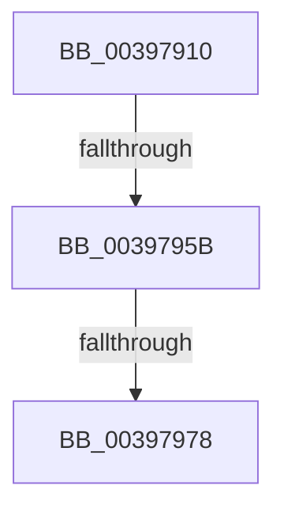

# KeInsertQueueEx

- RVA: `0x00397910`–`0x00397982` (길이 `114` bytes)
- VA: `0x0000000140397910`
- 실행 섹션: `.text`
- PDB 이름 있음: `예`; PDB Function 태그: `아니요`
- unwind 정보 RVA: `0x000813A4`
- 디코드: `27`개 명령, `114/114` bytes 표시
- 미해석 바이트: `0` (있으면 어셈블리에 `.byte`로 보존)

> 이 문서는 커널 이미지의 기계어와 PDB 기호를 분석해 생성했습니다. 4번과 5번은 함수 원형과 자료형을 바이너리 사용 방식에서 추정한 C 해석이며 원본 소스 복구 결과는 아닙니다.

## 1. Dependencies

- 직접 호출 지점: **0**; 고유 호출 대상: **0**
- 직접 호출자로 확인된 함수: **1**
- RIP 상대 이미지 참조: **2**

### Outgoing calls
- 직접 디코드된 call 명령이 없습니다.

### Direct callers
- [IopCompleteRequest](../20/IopCompleteRequest_function_0020AF50.md) at `0x0020B304`

### Static image references
- `0x0039794E` → RVA `0x00FC6D20` (`ALMOSTRO`; read)
- `0x00397964` → RVA `0x00FC6B04` (`ALMOSTRO`; read)

## 2. Other-region calls and transfers

- 다른 실행 섹션으로 향하는 call: **0**
- call이 아닌 외부 분기/꼬리 이동: **3**
  - `0x00397955` → [sub_00397BF0](Unknown_function_00397BF0.md) (`tail-transfer`)
  - `0x00397972` → [sub_00397C33](Unknown_function_00397C33.md) (`tail-transfer`)
  - `0x0039797C` → [sub_00397B8A](Unknown_function_00397B8A.md) (`tail-transfer`)

## 3. Assembly (complete function range)

```asm
00397910  44 88 4C 24 20                  mov byte ptr [rsp + 0x20], r9b
00397915  44 89 44 24 18                  mov dword ptr [rsp + 0x18], r8d
0039791A  48 89 54 24 10                  mov qword ptr [rsp + 0x10], rdx
0039791F  53                              push rbx
00397920  56                              push rsi
00397921  57                              push rdi
00397922  41 54                           push r12
00397924  41 55                           push r13
00397926  41 56                           push r14
00397928  48 83 EC 48                     sub rsp, 0x48
0039792C  41 8B F8                        mov edi, r8d
0039792F  4C 8D 61 08                     lea r12, [rcx + 8]
00397933  48 8B F2                        mov rsi, rdx
00397936  4C 8B F1                        mov r14, rcx
00397939  44 0F 20 C0                     mov rax, cr8
0039793D  48 89 84 24 80 00 00 00         mov qword ptr [rsp + 0x80], rax
00397945  B9 02 00 00 00                  mov ecx, 2
0039794A  44 0F 22 C1                     mov cr8, rcx
0039794E  83 3D CB F3 C2 00 00            cmp dword ptr [rip + 0xc2f3cb], 0
00397955  0F 85 95 02 00 00               jne 0x140397bf0
0039795B  65 4C 8B 2C 25 20 00 00 00      mov r13, qword ptr gs:[0x20]
00397964  F7 05 96 F1 C2 00 00 00 00 01   test dword ptr [rip + 0xc2f196], 0x1000000
0039796E  49 8B 5D 08                     mov rbx, qword ptr [r13 + 8]
00397972  0F 85 BB 02 00 00               jne 0x140397c33
00397978  33 C9                           xor ecx, ecx
0039797A  85 FF                           test edi, edi
0039797C  0F 85 08 02 00 00               jne 0x140397b8a
```

## 4. C-style interpretation (structured pseudocode)

```c
__int64 __fastcall KeInsertQueueEx(__int64 a1, __int64 a2, int a3, unsigned __int8 a4)
{
    __int64 v_rsp;
    unsigned __int64 v_stack_p10;
    unsigned int v_stack_p18;
    unsigned __int8 v_stack_p20;
    unsigned __int64 v_stack_p8;

    v_stack_p20 = a4;
    v_stack_p18 = a3;
    v_stack_p10 = a2;
    v_rsp = (v_rsp) - (72);
    v_stack_p8 = v_cr8;
    a1 = 0;
}
```

## 5. (Beta) C Style

```c
int64_t KeInsertQueueEx(void *Arg1, int64_t Arg2, int32_t Arg3, uint8_t Arg4)
{
    uint8_t *arg1 = (uint8_t *)Arg1;

    int64_t local_rsp;
    uint64_t v_stack_p10;
    uint32_t v_stack_p18;
    uint8_t v_stack_p20;
    uint64_t v_stack_p8;

    v_stack_p20 = Arg4;
    v_stack_p18 = Arg3;
    v_stack_p10 = Arg2;
    local_rsp = (local_rsp) - (72);
    v_stack_p8 = v_cr8;
    Arg1 = 0;
}
```

### 관측된 메모리 오프셋

구조체 형식이 확인되지 않은 접근은 인자 기준의 오프셋으로만 기록했습니다.

| 기준 인자 | 오프셋 표현 | 폭 (bit) | 접근 |
|---|---:|---:|---|
| `Arg1` | `+ 0x8` | `64` | `R` |

## 6. Execution-region graph

[열기: 2D/3D 그래프와 함수 탐색 컨트롤 패널](../../../control-panel.html?section=text&rva=0x00397910&view=graph)

- 2D 그래프는 위에서 아래로 흐르고, 3D 그래프는 빈 공간을 드래그해 회전합니다. Shift+드래그는 이동, 휠은 확대·축소, 함수 노드 선택은 대상 보고서 이동입니다.

### Static fallback


