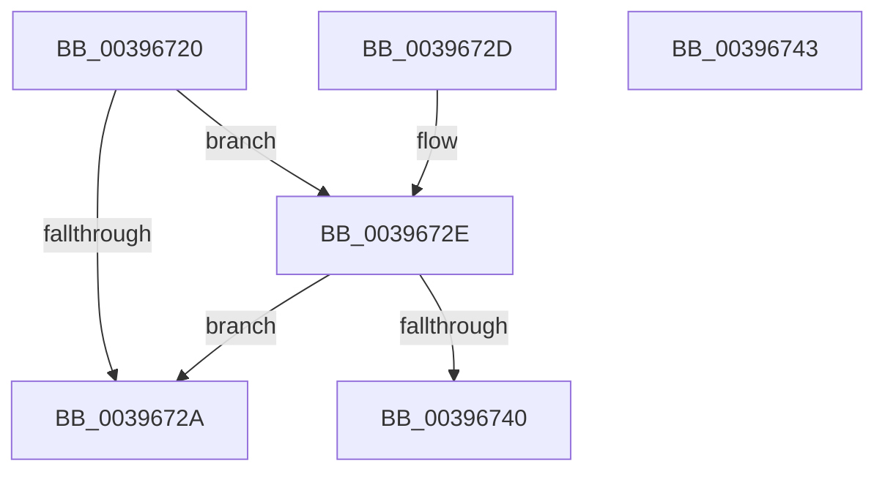

# KeIsThreadRunning

- RVA: `0x00396720`–`0x00396744` (길이 `36` bytes)
- VA: `0x0000000140396720`
- 실행 섹션: `.text`
- PDB 이름 있음: `예`; PDB Function 태그: `아니요`
- unwind 정보 RVA: `0x000DB714`
- 디코드: `13`개 명령, `36/36` bytes 표시
- 미해석 바이트: `0` (있으면 어셈블리에 `.byte`로 보존)

> 이 문서는 커널 이미지의 기계어와 PDB 기호를 분석해 생성했습니다. 4번과 5번은 함수 원형과 자료형을 바이너리 사용 방식에서 추정한 C 해석이며 원본 소스 복구 결과는 아닙니다.

## 1. Dependencies

- 직접 호출 지점: **0**; 고유 호출 대상: **0**
- 직접 호출자로 확인된 함수: **18**
- RIP 상대 이미지 참조: **0**

### Outgoing calls
- 직접 디코드된 call 명령이 없습니다.

### Direct callers
- [KiInsertQueueInternal](../21/KiInsertQueueInternal_function_00219B30.md) at `0x00219D8A`
- [KeInsertPriQueue](../21/KeInsertPriQueue_function_0021EDD0.md) at `0x0021EF7C`
- [IoSetIoCompletionEx3](../24/IoSetIoCompletionEx3_function_0024EEE0.md) at `0x0024F299`
- [IopCompleteIrpInFileObjectList](../24/IopCompleteIrpInFileObjectList_function_0024F330.md) at `0x0024F8D2`
- [IoSetIoCompletionEx](../24/IoSetIoCompletionEx_function_0024FA80.md) at `0x0024FDB7`
- [sub_002501D3](../25/Unknown_function_002501D3.md) at `0x002501D6`
- [AlpcpSignalAndWait](../2F/AlpcpSignalAndWait_function_002F9620.md) at `0x002F99F6`
- [sub_00343C9D](../34/Unknown_function_00343C9D.md) at `0x00343CF9`
- [AlpcpSignal](AlpcpSignal_function_003955E0.md) at `0x00395CAB`
- [AlpcpQueueIoCompletion](AlpcpQueueIoCompletion_function_00397480.md) at `0x0039784A`
- [sub_00397C33](Unknown_function_00397C33.md) at `0x00397C36`
- [AlpcpQueueIoCompletionPort](../3F/AlpcpQueueIoCompletionPort_function_003FF760.md) at `0x003FFD2A`
- [IopPassiveInterruptDpc](../46/IopPassiveInterruptDpc_function_00469D40.md) at `0x00469E5A`
- [KeInsertQueue](../46/KeInsertQueue_function_0046C8F0.md) at `0x0046C9FA`
- [KeTryToInsertQueueApc](../4D/KeTryToInsertQueueApc_function_004D72B8.md) at `0x004D72E5`
- [FsRtlpPostStackOverflow](../58/FsRtlpPostStackOverflow_function_0058351C.md) at `0x005835F7`
- [KeInsertHeadQueue](../5B/KeInsertHeadQueue_function_005BE5D0.md) at `0x005BE631`
- [EtwpCovSampCaptureQueueApc](../65/EtwpCovSampCaptureQueueApc_function_00653CF0.md) at `0x00653E5B`

### Static image references
- 디코드된 RIP-relative 메모리 참조가 없습니다.

## 2. Other-region calls and transfers

- 다른 실행 섹션으로 향하는 call: **0**
- 별도 외부 분기/꼬리 이동을 확인하지 못했습니다.

## 3. Assembly (complete function range)

```asm
00396720  8A 81 84 01 00 00               mov al, byte ptr [rcx + 0x184]
00396726  3C 02                           cmp al, 2
00396728  74 04                           je 0x14039672e
0039672A  32 C0                           xor al, al
0039672C  C3                              ret
0039672D  CC                              int3
0039672E  8B 89 18 02 00 00               mov ecx, dword ptr [rcx + 0x218]
00396734  65 8B 04 25 A4 01 00 00         mov eax, dword ptr gs:[0x1a4]
0039673C  3B C8                           cmp ecx, eax
0039673E  75 EA                           jne 0x14039672a
00396740  B0 01                           mov al, 1
00396742  C3                              ret
00396743  CC                              int3
```

## 4. C-style interpretation (structured pseudocode)

```c
__int64 __fastcall KeIsThreadRunning(__int64 a1)
{
    __int64 result;

    if (((unsigned __int8)(*(unsigned __int8 *)(a1 + 388))) == 2) goto loc_0039672E;
loc_0039672A:
    result = 0;
    return result;
loc_0039672E:
    if (((unsigned int)((unsigned int)(*(unsigned int *)(a1 + 536)))) != ((unsigned int)((unsigned int)(*(unsigned int *)(gs_base + (0 + 420)))))) goto loc_0039672A;
    return 1;
}
```

## 5. (Beta) C Style

```c
int64_t KeIsThreadRunning(void *Arg1)
{
    uint8_t *arg1 = (uint8_t *)Arg1;

    int64_t result;

    if (((uint8_t)(*(uint8_t *)(arg1 + 0x184))) == 2) goto loc_0039672E;
loc_0039672A:
    result = 0;
    return result;
loc_0039672E:
    if (((uint32_t)((uint32_t)(*(uint32_t *)(arg1 + 0x218)))) != ((uint32_t)((uint32_t)(*(uint32_t *)(gs_base + (0 + 0x1A4)))))) goto loc_0039672A;
    return 1;
}
```

### 관측된 메모리 오프셋

구조체 형식이 확인되지 않은 접근은 인자 기준의 오프셋으로만 기록했습니다.

| 기준 인자 | 오프셋 표현 | 폭 (bit) | 접근 |
|---|---:|---:|---|
| `Arg1` | `+ 0x184` | `8` | `R` |
| `Arg1` | `+ 0x218` | `32` | `R` |

## 6. Execution-region graph

[열기: 2D/3D 그래프와 함수 탐색 컨트롤 패널](../../../control-panel.html?section=text&rva=0x00396720&view=graph)

- 2D 그래프는 위에서 아래로 흐르고, 3D 그래프는 빈 공간을 드래그해 회전합니다. Shift+드래그는 이동, 휠은 확대·축소, 함수 노드 선택은 대상 보고서 이동입니다.

### Static fallback


