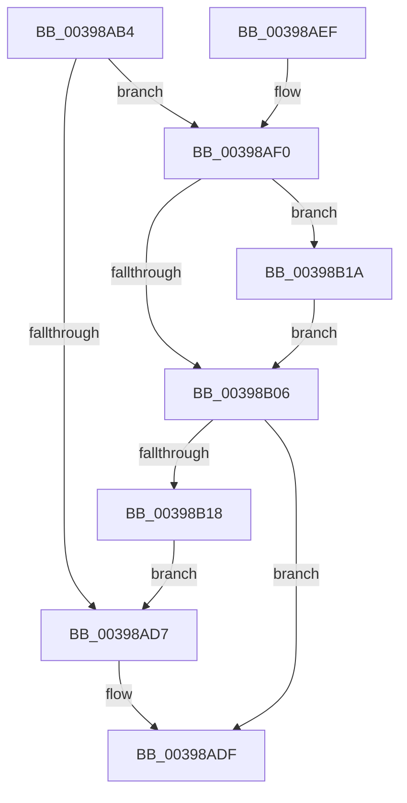

# KeReadyThread

- RVA: `0x00398AB4`–`0x00398B24` (길이 `112` bytes)
- VA: `0x0000000140398AB4`
- 실행 섹션: `.text`
- PDB 이름 있음: `예`; PDB Function 태그: `아니요`
- unwind 정보 RVA: `0x00081628`
- 디코드: `32`개 명령, `112/112` bytes 표시
- 미해석 바이트: `0` (있으면 어셈블리에 `.byte`로 보존)

> 이 문서는 커널 이미지의 기계어와 PDB 기호를 분석해 생성했습니다. 4번과 5번은 함수 원형과 자료형을 바이너리 사용 방식에서 추정한 C 해석이며 원본 소스 복구 결과는 아닙니다.

## 1. Dependencies

- 직접 호출 지점: **3**; 고유 호출 대상: **3**
- 직접 호출자로 확인된 함수: **1**
- RIP 상대 이미지 참조: **1**

### Outgoing calls
- `0x00398ADA` → [KiFastReadyThread](KiFastReadyThread_function_00398548.md) (function, `0x00398548`)
- `0x00398B0F` → [KiInSwapSingleProcess](../35/KiInSwapSingleProcess_function_00355474.md) (function, `0x00355474`)
- `0x00398B1D` → [KiRaiseIrqlProcessIrqlFlags](../4F/KiRaiseIrqlProcessIrqlFlags_function_004F56FC.md) (function, `0x004F56FC`)

### Direct callers
- [PspInsertThread](../../page/9F/PspInsertThread_function_009F0314.md) at `0x009F0CDB`

### Static image references
- `0x00398AFD` → RVA `0x00FC6D20` (`ALMOSTRO`; read)

## 2. Other-region calls and transfers

- 다른 실행 섹션으로 향하는 call: **0**
- 별도 외부 분기/꼬리 이동을 확인하지 못했습니다.

## 3. Assembly (complete function range)

```asm
00398AB4  48 89 5C 24 08                  mov qword ptr [rsp + 8], rbx
00398AB9  48 89 74 24 10                  mov qword ptr [rsp + 0x10], rsi
00398ABE  57                              push rdi
00398ABF  48 83 EC 20                     sub rsp, 0x20
00398AC3  48 8B B9 B8 00 00 00            mov rdi, qword ptr [rcx + 0xb8]
00398ACA  48 8B D9                        mov rbx, rcx
00398ACD  8B 87 08 01 00 00               mov eax, dword ptr [rdi + 0x108]
00398AD3  A8 07                           test al, 7
00398AD5  75 19                           jne 0x140398af0
00398AD7  48 8B CB                        mov rcx, rbx
00398ADA  E8 69 FA FF FF                  call 0x140398548
00398ADF  48 8B 5C 24 30                  mov rbx, qword ptr [rsp + 0x30]
00398AE4  48 8B 74 24 38                  mov rsi, qword ptr [rsp + 0x38]
00398AE9  48 83 C4 20                     add rsp, 0x20
00398AED  5F                              pop rdi
00398AEE  C3                              ret
00398AEF  CC                              int3
00398AF0  44 0F 20 C6                     mov rsi, cr8
00398AF4  BA 02 00 00 00                  mov edx, 2
00398AF9  44 0F 22 C2                     mov cr8, rdx
00398AFD  83 3D 1C E2 C2 00 00            cmp dword ptr [rip + 0xc2e21c], 0
00398B04  75 14                           jne 0x140398b1a
00398B06  44 8A C6                        mov r8b, sil
00398B09  48 8B D7                        mov rdx, rdi
00398B0C  48 8B CB                        mov rcx, rbx
00398B0F  E8 60 C9 FB FF                  call 0x140355474
00398B14  84 C0                           test al, al
00398B16  75 C7                           jne 0x140398adf
00398B18  EB BD                           jmp 0x140398ad7
00398B1A  40 8A CE                        mov cl, sil
00398B1D  E8 DA CB 15 00                  call 0x1404f56fc
00398B22  EB E2                           jmp 0x140398b06
```

## 4. C-style interpretation (structured pseudocode)

```c
__int64 __fastcall KeReadyThread(__int64 a1)
{
    __int64 result;
    __int64 v_rsp;
    unsigned __int64 v_stack_p10;
    unsigned __int64 v_stack_p8;

    v_stack_p8 = v_rbx;
    v_stack_p10 = v_rsi;
    v_rsp = (v_rsp) - (32);
    if ((((unsigned __int8)((unsigned int)(*(unsigned int *)(*(unsigned __int64 *)(a1 + 184) + 264)))) & (7)) != 0) goto loc_00398AF0;
loc_00398AD7:
    result = KiFastReadyThread(a1, a2, a3, a4);
loc_00398ADF:
    v_rsp = (v_rsp) + (32);
    return result;
loc_00398AF0:
    if ((*(unsigned int *)(v_rip + 12771868)) != 0) goto loc_00398B1A;
loc_00398B06:
    result = KiInSwapSingleProcess(v_stack_p8, *(unsigned __int64 *)(a1 + 184), (unsigned __int8)(v_cr8), a4);
    if ((unsigned __int8)(result) != 0) goto loc_00398ADF;
    goto loc_00398AD7;
loc_00398B1A:
    result = KiRaiseIrqlProcessIrqlFlags((unsigned __int8)(v_cr8), *(unsigned __int64 *)(a1 + 184), (unsigned __int8)(v_cr8), a4);
    goto loc_00398B06;
}
```

## 5. (Beta) C Style

```c
int64_t KeReadyThread(void *Arg1)
{
    uint8_t *arg1 = (uint8_t *)Arg1;

    int64_t result;
    int64_t local_rsp;
    uint64_t v_stack_p10;
    uint64_t v_stack_p8;

    v_stack_p8 = local_rbx;
    v_stack_p10 = local_rsi;
    local_rsp = (local_rsp) - (32);
    if ((((uint8_t)((uint32_t)(*(uint32_t *)(*(uint64_t *)(arg1 + 0xB8) + 0x108)))) & (7)) != 0) goto loc_00398AF0;
loc_00398AD7:
    result = KiFastReadyThread(Arg1, a2, a3, a4);
loc_00398ADF:
    local_rsp = (local_rsp) + (32);
    return result;
loc_00398AF0:
    if ((*(uint32_t *)(v_rip + 0xC2E21C)) != 0) goto loc_00398B1A;
loc_00398B06:
    result = KiInSwapSingleProcess(v_stack_p8, *(uint64_t *)(arg1 + 0xB8), (uint8_t)(v_cr8), a4);
    if ((uint8_t)(result) != 0) goto loc_00398ADF;
    goto loc_00398AD7;
loc_00398B1A:
    result = KiRaiseIrqlProcessIrqlFlags((uint8_t)(v_cr8), *(uint64_t *)(arg1 + 0xB8), (uint8_t)(v_cr8), a4);
    goto loc_00398B06;
}
```

### 관측된 메모리 오프셋

구조체 형식이 확인되지 않은 접근은 인자 기준의 오프셋으로만 기록했습니다.

| 기준 인자 | 오프셋 표현 | 폭 (bit) | 접근 |
|---|---:|---:|---|
| `Arg1` | `+ 0xB8` | `64` | `R` |

## 6. Execution-region graph

[열기: 2D/3D 그래프와 함수 탐색 컨트롤 패널](../../../control-panel.html?section=text&rva=0x00398AB4&view=graph)

- 2D 그래프는 위에서 아래로 흐르고, 3D 그래프는 빈 공간을 드래그해 회전합니다. Shift+드래그는 이동, 휠은 확대·축소, 함수 노드 선택은 대상 보고서 이동입니다.

### Static fallback


