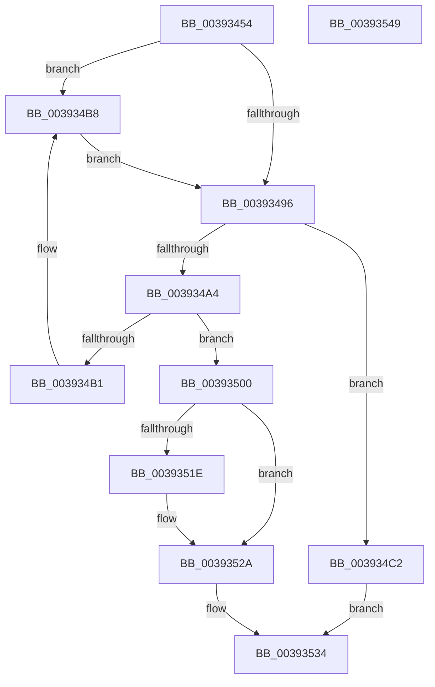

# KeRegisterObjectNotification

- RVA: `0x00393454`–`0x0039354A` (길이 `246` bytes)
- VA: `0x0000000140393454`
- 실행 섹션: `.text`
- PDB 이름 있음: `예`; PDB Function 태그: `아니요`
- unwind 정보 RVA: `0x00066400`
- 디코드: `64`개 명령, `246/246` bytes 표시
- 미해석 바이트: `0` (있으면 어셈블리에 `.byte`로 보존)

> 이 문서는 커널 이미지의 기계어와 PDB 기호를 분석해 생성했습니다. 4번과 5번은 함수 원형과 자료형을 바이너리 사용 방식에서 추정한 C 해석이며 원본 소스 복구 결과는 아닙니다.

## 1. Dependencies

- 직접 호출 지점: **6**; 고유 호출 대상: **6**
- 직접 호출자로 확인된 함수: **6**
- RIP 상대 이미지 참조: **1**

### Outgoing calls
- `0x00393499` → [KiAcquireKobjectLockSafe](../25/KiAcquireKobjectLockSafe_function_00251C90.md) (function, `0x00251C90`)
- `0x003934BB` → [KiRaiseIrqlProcessIrqlFlags](../4F/KiRaiseIrqlProcessIrqlFlags_function_004F56FC.md) (function, `0x004F56FC`)
- `0x003934C5` → [KiWaitSatisfyOther](../41/KiWaitSatisfyOther_function_0041C870.md) (function, `0x0041C870`)
- `0x003934D4` → [KiInsertQueueInternal](../21/KiInsertQueueInternal_function_00219B30.md) (function, `0x00219B30`)
- `0x003934F7` → [KiExitDispatcher](../25/KiExitDispatcher_function_00251CF0.md) (function, `0x00251CF0`)
- `0x00393525` → [KiLowerIrqlProcessIrqlFlags](../4F/KiLowerIrqlProcessIrqlFlags_function_004F5698.md) (function, `0x004F5698`)

### Direct callers
- [ExpTryEnterWorkerFactoryAwayMode](ExpTryEnterWorkerFactoryAwayMode_function_003930B0.md) at `0x00393147`
- [NtWaitForWorkViaWorkerFactory](NtWaitForWorkViaWorkerFactory_function_00394270.md) at `0x00394C47`
- [NtAssociateWaitCompletionPacket](../42/NtAssociateWaitCompletionPacket_function_0042F270.md) at `0x0042F440`
- [ExpWorkerFactoryManagerThread](../65/ExpWorkerFactoryManagerThread_function_0065CCC0.md) at `0x0065CD36`
- [ExpWorkerFactoryManagerThread](../65/ExpWorkerFactoryManagerThread_function_0065CCC0.md) at `0x0065CDF4`
- [NtCreateWorkerFactory](../../page/9A/NtCreateWorkerFactory_function_009A7E10.md) at `0x009A80F4`
- [ExpWorkerFactoryInitialization](../../init/C5/ExpWorkerFactoryInitialization_function_00C54250.md) at `0x00C54364`

### Static image references
- `0x0039348D` → RVA `0x00FC6D20` (`ALMOSTRO`; read)

## 2. Other-region calls and transfers

- 다른 실행 섹션으로 향하는 call: **0**
- 별도 외부 분기/꼬리 이동을 확인하지 못했습니다.

## 3. Assembly (complete function range)

```asm
00393454  48 89 5C 24 08                  mov qword ptr [rsp + 8], rbx
00393459  48 89 6C 24 10                  mov qword ptr [rsp + 0x10], rbp
0039345E  48 89 74 24 18                  mov qword ptr [rsp + 0x18], rsi
00393463  57                              push rdi
00393464  48 83 EC 30                     sub rsp, 0x30
00393468  48 8B EA                        mov rbp, rdx
0039346B  66 41 C7 40 10 02 04            mov word ptr [r8 + 0x10], 0x402
00393472  49 89 68 18                     mov qword ptr [r8 + 0x18], rbp
00393476  49 8B D8                        mov rbx, r8
00393479  48 8B F9                        mov rdi, rcx
0039347C  49 89 48 20                     mov qword ptr [r8 + 0x20], rcx
00393480  BA 02 00 00 00                  mov edx, 2
00393485  44 0F 20 C6                     mov rsi, cr8
00393489  44 0F 22 C2                     mov cr8, rdx
0039348D  83 3D 8C 38 C3 00 00            cmp dword ptr [rip + 0xc3388c], 0
00393494  75 22                           jne 0x1403934b8
00393496  48 8B CF                        mov rcx, rdi
00393499  E8 F2 E7 EB FF                  call 0x140251c90
0039349E  83 7F 04 00                     cmp dword ptr [rdi + 4], 0
003934A2  7F 1E                           jg 0x1403934c2
003934A4  48 8D 47 08                     lea rax, [rdi + 8]
003934A8  48 8B 48 08                     mov rcx, qword ptr [rax + 8]
003934AC  48 39 01                        cmp qword ptr [rcx], rax
003934AF  74 4F                           je 0x140393500
003934B1  B9 03 00 00 00                  mov ecx, 3
003934B6  CD 29                           int 0x29
003934B8  40 8A CE                        mov cl, sil
003934BB  E8 3C 22 16 00                  call 0x1404f56fc
003934C0  EB D4                           jmp 0x140393496
003934C2  48 8B CF                        mov rcx, rdi
003934C5  E8 A6 93 08 00                  call 0x14041c870
003934CA  48 8B D3                        mov rdx, rbx
003934CD  C6 43 11 05                     mov byte ptr [rbx + 0x11], 5
003934D1  48 8B CD                        mov rcx, rbp
003934D4  E8 57 66 E8 FF                  call 0x140219b30
003934D9  F0 81 27 7F FF FF FF            lock and dword ptr [rdi], 0xffffff7f
003934E0  65 48 8B 0C 25 20 00 00 00      mov rcx, qword ptr gs:[0x20]
003934E9  45 33 C9                        xor r9d, r9d
003934EC  33 D2                           xor edx, edx
003934EE  40 88 74 24 20                  mov byte ptr [rsp + 0x20], sil
003934F3  45 8D 41 01                     lea r8d, [r9 + 1]
003934F7  E8 F4 E7 EB FF                  call 0x140251cf0
003934FC  B0 01                           mov al, 1
003934FE  EB 34                           jmp 0x140393534
00393500  48 89 03                        mov qword ptr [rbx], rax
00393503  48 89 4B 08                     mov qword ptr [rbx + 8], rcx
00393507  48 89 19                        mov qword ptr [rcx], rbx
0039350A  48 89 58 08                     mov qword ptr [rax + 8], rbx
0039350E  F0 81 27 7F FF FF FF            lock and dword ptr [rdi], 0xffffff7f
00393515  83 3D 04 38 C3 00 00            cmp dword ptr [rip + 0xc33804], 0
0039351C  74 0C                           je 0x14039352a
0039351E  44 0F 20 C1                     mov rcx, cr8
00393522  40 8A D6                        mov dl, sil
00393525  E8 6E 21 16 00                  call 0x1404f5698
0039352A  40 0F B6 C6                     movzx eax, sil
0039352E  44 0F 22 C0                     mov cr8, rax
00393532  32 C0                           xor al, al
00393534  48 8B 5C 24 40                  mov rbx, qword ptr [rsp + 0x40]
00393539  48 8B 6C 24 48                  mov rbp, qword ptr [rsp + 0x48]
0039353E  48 8B 74 24 50                  mov rsi, qword ptr [rsp + 0x50]
00393543  48 83 C4 30                     add rsp, 0x30
00393547  5F                              pop rdi
00393548  C3                              ret
00393549  CC                              int3
```

## 4. C-style interpretation (structured pseudocode)

```c
__int64 __fastcall KeRegisterObjectNotification(__int64 a1, __int64 a2, __int64 a3, int a4)
{
    __int64 result;
    __int64 v_rsp;
    unsigned __int8 v_stack_m18;
    unsigned __int64 v_stack_p10;
    unsigned __int64 v_stack_p18;
    unsigned __int64 v_stack_p8;

    v_stack_p8 = v_rbx;
    v_stack_p10 = v_rbp;
    v_stack_p18 = v_rsi;
    v_rsp = (v_rsp) - (48);
    *(unsigned __int16 *)(a3 + 16) = 0x402ULL;
    *(unsigned __int64 *)(a3 + 24) = a2;
    *(unsigned __int64 *)(a3 + 32) = a1;
    if ((*(unsigned int *)(v_rip + 12793996)) != 0) goto loc_003934B8;
loc_00393496:
    result = KiAcquireKobjectLockSafe(a1, 2, a3, a4);
    if ((*(unsigned int *)(a1 + 4)) > 0) goto loc_003934C2;
    if ((*(unsigned __int64 *)(*(unsigned __int64 *)(a1 + 8 + 8))) == (a1 + 8)) goto loc_00393500;
loc_003934B8:
    result = KiRaiseIrqlProcessIrqlFlags((unsigned __int8)(v_cr8), 2, a3, a4);
    goto loc_00393496;
loc_003934C2:
    result = KiWaitSatisfyOther(a1, 2, a3, a4);
    *(unsigned __int8 *)(a3 + 17) = 5;
    result = KiInsertQueueInternal(a2, a3, a3, a4);
    a4 = 0;
    a2 = 0;
    v_stack_m18 = (unsigned __int8)(v_cr8);
    result = KiExitDispatcher(*(unsigned __int64 *)(gs_base + (0 + 32)), a2, a4 + 1, a4);
    goto loc_00393534;
loc_00393500:
    *(unsigned __int64 *)(a3) = 1;
    *(unsigned __int64 *)(a3 + 8) = *(unsigned __int64 *)(gs_base + (0 + 32));
    *(unsigned __int64 *)(*(unsigned __int64 *)(gs_base + (0 + 32))) = a3;
    *(unsigned __int64 *)(1 + 8) = a3;
    result = 1;
    if ((*(unsigned int *)(v_rip + 12793860)) != 0) {
        a1 = 2;
        a2 = (unsigned __int8)(v_cr8);
        result = KiLowerIrqlProcessIrqlFlags(a1, a2, a4 + 1, a4);
    }
    result = 0;
loc_00393534:
    v_rsp = (v_rsp) + (48);
    return result;
}
```

## 5. (Beta) C Style

```c
int64_t KeRegisterObjectNotification(void *Arg1, int64_t Arg2, void *Arg3, int32_t Arg4)
{
    uint8_t *arg1 = (uint8_t *)Arg1;
    uint8_t *arg3 = (uint8_t *)Arg3;

    int64_t result;
    int64_t local_rsp;
    uint8_t v_stack_m18;
    uint64_t v_stack_p10;
    uint64_t v_stack_p18;
    uint64_t v_stack_p8;

    v_stack_p8 = local_rbx;
    v_stack_p10 = local_rbp;
    v_stack_p18 = local_rsi;
    local_rsp = (local_rsp) - (48);
    *(uint16_t *)(arg3 + 0x10) = 0x402ULL;
    *(uint64_t *)(arg3 + 0x18) = Arg2;
    *(void **)(arg3 + 0x20) = Arg1;
    if ((*(uint32_t *)(v_rip + 0xC3388C)) != 0) goto loc_003934B8;
loc_00393496:
    result = KiAcquireKobjectLockSafe(Arg1, 2, Arg3, Arg4);
    if ((*(uint32_t *)(arg1 + 0x4)) > 0) goto loc_003934C2;
    if ((*(uint64_t *)(*(uint64_t *)(arg1 + 0x8 + 0x8))) == (Arg1 + 8)) goto loc_00393500;
loc_003934B8:
    result = KiRaiseIrqlProcessIrqlFlags((uint8_t)(v_cr8), 2, Arg3, Arg4);
    goto loc_00393496;
loc_003934C2:
    result = KiWaitSatisfyOther(Arg1, 2, Arg3, Arg4);
    *(uint8_t *)(arg3 + 0x11) = 5;
    result = KiInsertQueueInternal(Arg2, Arg3, Arg3, Arg4);
    Arg4 = 0;
    Arg2 = 0;
    v_stack_m18 = (uint8_t)(v_cr8);
    result = KiExitDispatcher(*(uint64_t *)(gs_base + (0 + 0x20)), Arg2, Arg4 + 1, Arg4);
    goto loc_00393534;
loc_00393500:
    *(uint64_t *)(arg3) = 1;
    *(uint64_t *)(arg3 + 0x8) = *(uint64_t *)(gs_base + (0 + 0x20));
    *(void **)(*(uint64_t *)(gs_base + (0 + 0x20))) = Arg3;
    *(void **)(1 + 0x8) = Arg3;
    result = 1;
    if ((*(uint32_t *)(v_rip + 0xC33804)) != 0) {
        Arg1 = 2;
        Arg2 = (uint8_t)(v_cr8);
        result = KiLowerIrqlProcessIrqlFlags(Arg1, Arg2, Arg4 + 1, Arg4);
    }
    result = 0;
loc_00393534:
    local_rsp = (local_rsp) + (48);
    return result;
}
```

### 관측된 메모리 오프셋

구조체 형식이 확인되지 않은 접근은 인자 기준의 오프셋으로만 기록했습니다.

| 기준 인자 | 오프셋 표현 | 폭 (bit) | 접근 |
|---|---:|---:|---|
| `Arg1` | `+ 0x0` | `32` | `R/W` |
| `Arg1` | `+ 0x4` | `32` | `R` |
| `Arg1` | `+ 0x8` | `64` | `R` |
| `Arg1` | `+ 0x8` | `64` | `W` |
| `Arg3` | `+ 0x0` | `64` | `W` |
| `Arg3` | `+ 0x8` | `64` | `W` |
| `Arg3` | `+ 0x10` | `16` | `W` |
| `Arg3` | `+ 0x11` | `8` | `W` |
| `Arg3` | `+ 0x18` | `64` | `W` |
| `Arg3` | `+ 0x20` | `64` | `W` |

## 6. Execution-region graph

[열기: 2D/3D 그래프와 함수 탐색 컨트롤 패널](../../../control-panel.html?section=text&rva=0x00393454&view=graph)

- 2D 그래프는 위에서 아래로 흐르고, 3D 그래프는 빈 공간을 드래그해 회전합니다. Shift+드래그는 이동, 휠은 확대·축소, 함수 노드 선택은 대상 보고서 이동입니다.

### Static fallback


