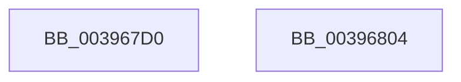

# KeReleaseMutant

- RVA: `0x003967D0`–`0x00396805` (길이 `53` bytes)
- VA: `0x00000001403967D0`
- 실행 섹션: `.text`
- PDB 이름 있음: `예`; PDB Function 태그: `아니요`
- unwind 정보 RVA: `0x0005C788`
- 디코드: `16`개 명령, `53/53` bytes 표시
- 미해석 바이트: `0` (있으면 어셈블리에 `.byte`로 보존)

> 이 문서는 커널 이미지의 기계어와 PDB 기호를 분석해 생성했습니다. 4번과 5번은 함수 원형과 자료형을 바이너리 사용 방식에서 추정한 C 해석이며 원본 소스 복구 결과는 아닙니다.

## 1. Dependencies

- 직접 호출 지점: **1**; 고유 호출 대상: **1**
- 직접 호출자로 확인된 함수: **10**
- RIP 상대 이미지 참조: **0**

### Outgoing calls
- `0x003967F6` → [KeReleaseMutantEx](KeReleaseMutantEx_function_00396850.md) (function, `0x00396850`)

### Direct callers
- [WmipReceiveNotifications](../4E/WmipReceiveNotifications_function_004EC280.md) at `0x004EC6FE`
- [DifKeReleaseMutantWrapper](../63/DifKeReleaseMutantWrapper_function_006317D0.md) at `0x006318BF`
- [DifKeReleaseMutexWrapper](../63/DifKeReleaseMutexWrapper_function_00631960.md) at `0x00631A3B`
- [LdrUnloadAlternateResourceModuleEx$fin$0](../6D/LdrUnloadAlternateResourceModuleEx_fin_0_function_006D3160.md) at `0x006D317A`
- [LdrpGetAlternateResourceModuleHandleEx$fin$0](../6D/LdrpGetAlternateResourceModuleHandleEx_fin_0_function_006D318D.md) at `0x006D31A7`
- [LdrpGetFromMUIMemCache$fin$0](../6D/LdrpGetFromMUIMemCache_fin_0_function_006D31BA.md) at `0x006D31D4`
- [LdrpSetAlternateResourceModuleHandle$fin$0](../6D/LdrpSetAlternateResourceModuleHandle_fin_0_function_006D31E7.md) at `0x006D3201`
- [sub_006EF0FC](../6E/Unknown_function_006EF0FC.md) at `0x006EF26D`
- [sub_006F7340](../6F/Unknown_function_006F7340.md) at `0x006F7360`
- [EtwpFixBootLoggers](../../init/C4/EtwpFixBootLoggers_function_00C4F09C.md) at `0x00C4F23E`

### Static image references
- 디코드된 RIP-relative 메모리 참조가 없습니다.

## 2. Other-region calls and transfers

- 다른 실행 섹션으로 향하는 call: **0**
- 별도 외부 분기/꼬리 이동을 확인하지 못했습니다.

## 3. Assembly (complete function range)

```asm
003967D0  48 83 EC 28                     sub rsp, 0x28
003967D4  33 C0                           xor eax, eax
003967D6  45 84 C0                        test r8b, r8b
003967D9  89 44 24 40                     mov dword ptr [rsp + 0x40], eax
003967DD  0F 95 C0                        setne al
003967E0  83 C0 04                        add eax, 4
003967E3  44 8B C0                        mov r8d, eax
003967E6  41 83 C8 02                     or r8d, 2
003967EA  45 84 C9                        test r9b, r9b
003967ED  4C 8D 4C 24 40                  lea r9, [rsp + 0x40]
003967F2  44 0F 44 C0                     cmove r8d, eax
003967F6  E8 55 00 00 00                  call 0x140396850
003967FB  8B 44 24 40                     mov eax, dword ptr [rsp + 0x40]
003967FF  48 83 C4 28                     add rsp, 0x28
00396803  C3                              ret
00396804  CC                              int3
```

## 4. C-style interpretation (structured pseudocode)

```c
__int64 __fastcall KeReleaseMutant(__int64 a1, __int64 a2, unsigned __int8 a3, unsigned __int8 a4)
{
    __int64 result;
    __int64 v_rsp;
    unsigned int v_stack_p18;

    v_rsp = (v_rsp) - (40);
    result = 0;
    v_stack_p18 = 0;
    result = (a3 != 0) ? 1 : 0;
    result = (unsigned int)((result) + (4));
    a3 = (unsigned int)(((unsigned int)((unsigned int)(result))) | (2));
    if (a4 == 0) { a3 = (unsigned int)(result); }
    result = KeReleaseMutantEx(a1, a2, a3, v_stack_p18);
    v_rsp = (v_rsp) + (40);
    return (unsigned int)(v_stack_p18);
}
```

## 5. (Beta) C Style

```c
int64_t KeReleaseMutant(int64_t Arg1, int64_t Arg2, uint8_t Arg3, uint8_t Arg4)
{
    int64_t result;
    int64_t local_rsp;
    uint32_t v_stack_p18;

    local_rsp = (local_rsp) - (40);
    result = 0;
    v_stack_p18 = 0;
    result = (Arg3 != 0) ? 1 : 0;
    result = (uint32_t)((result) + (4));
    Arg3 = (uint32_t)(((uint32_t)((uint32_t)(result))) | (2));
    if (Arg4 == 0) { Arg3 = (uint32_t)(result); }
    result = KeReleaseMutantEx(Arg1, Arg2, Arg3, v_stack_p18);
    local_rsp = (local_rsp) + (40);
    return (uint32_t)(v_stack_p18);
}
```

## 6. Execution-region graph

[열기: 2D/3D 그래프와 함수 탐색 컨트롤 패널](../../../control-panel.html?section=text&rva=0x003967D0&view=graph)

- 2D 그래프는 위에서 아래로 흐르고, 3D 그래프는 빈 공간을 드래그해 회전합니다. Shift+드래그는 이동, 휠은 확대·축소, 함수 노드 선택은 대상 보고서 이동입니다.

### Static fallback


