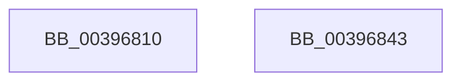

# KeReleaseMutex

- RVA: `0x00396810`–`0x00396844` (길이 `52` bytes)
- VA: `0x0000000140396810`
- 실행 섹션: `.text`
- PDB 이름 있음: `예`; PDB Function 태그: `아니요`
- unwind 정보 RVA: `0x0005C788`
- 디코드: `13`개 명령, `52/52` bytes 표시
- 미해석 바이트: `0` (있으면 어셈블리에 `.byte`로 보존)

> 이 문서는 커널 이미지의 기계어와 PDB 기호를 분석해 생성했습니다. 4번과 5번은 함수 원형과 자료형을 바이너리 사용 방식에서 추정한 C 해석이며 원본 소스 복구 결과는 아닙니다.

## 1. Dependencies

- 직접 호출 지점: **1**; 고유 호출 대상: **1**
- 직접 호출자로 확인된 함수: **91**
- RIP 상대 이미지 참조: **0**

### Outgoing calls
- `0x00396835` → [KeReleaseMutantEx](KeReleaseMutantEx_function_00396850.md) (function, `0x00396850`)

### Direct callers
- [sub_00703B14](../../page/70/Unknown_function_00703B14.md) at `0x00703C43`
- [sub_00703ECC](../../page/70/Unknown_function_00703ECC.md) at `0x00703FCD`
- [IoWMIAllocateInstanceIds](../../page/7B/IoWMIAllocateInstanceIds_function_007B1F70.md) at `0x007B2025`
- [IoWMIAllocateInstanceIds](../../page/7B/IoWMIAllocateInstanceIds_function_007B1F70.md) at `0x007B2087`
- [IoWMIAllocateInstanceIds](../../page/7B/IoWMIAllocateInstanceIds_function_007B1F70.md) at `0x007B209B`
- [WmipGetSysIds](../../page/7B/WmipGetSysIds_function_007B2DB0.md) at `0x007B2E9A`
- [WmipGetSysIds](../../page/7B/WmipGetSysIds_function_007B2DB0.md) at `0x007B301A`
- [WmipEnumerateGuids](../../page/7B/WmipEnumerateGuids_function_007B3560.md) at `0x007B36B5`
- [WmipProcessLegacyEtwRegister](../../page/7B/WmipProcessLegacyEtwRegister_function_007B3F64.md) at `0x007B3FBC`
- [WmipProcessLegacyEtwRegister](../../page/7B/WmipProcessLegacyEtwRegister_function_007B3F64.md) at `0x007B402B`
- [WmipProcessLegacyEtwUnregister](../../page/7B/WmipProcessLegacyEtwUnregister_function_007B404C.md) at `0x007B4085`
- [WmipAddMofResource](../../page/7B/WmipAddMofResource_function_007B4188.md) at `0x007B42BC`
- [WmipAddMofResource](../../page/7B/WmipAddMofResource_function_007B4188.md) at `0x007B430C`
- [WmipWaitForCollectionEnabled](../../page/7B/WmipWaitForCollectionEnabled_function_007B49C0.md) at `0x007B49EF`
- [EtwpSetPmcProfileSource](../../page/7B/EtwpSetPmcProfileSource_function_007B8900.md) at `0x007B89ED`
- [EtwDereferenceSpinLockCounters](../../page/7B/EtwDereferenceSpinLockCounters_function_007BC2E8.md) at `0x007BC332`
- [EtwReferenceSpinLockCounters](../../page/7B/EtwReferenceSpinLockCounters_function_007BC344.md) at `0x007BC398`
- [NtStartProfile](../../page/7D/NtStartProfile_function_007D22C0.md) at `0x007D239E`
- [NtStartProfile](../../page/7D/NtStartProfile_function_007D22C0.md) at `0x007D2449`
- [NtStartProfile](../../page/7D/NtStartProfile_function_007D22C0.md) at `0x007D2529`
- [NtStartProfile](../../page/7D/NtStartProfile_function_007D22C0.md) at `0x007D255C`
- [NtStartProfile](../../page/7D/NtStartProfile_function_007D22C0.md) at `0x007D2578`
- [NtStopProfile](../../page/7D/NtStopProfile_function_007D25C0.md) at `0x007D2639`
- [NtStopProfile](../../page/7D/NtStopProfile_function_007D25C0.md) at `0x007D266D`
- [EtwpQueryTrace](../../page/8B/EtwpQueryTrace_function_008BF8B0.md) at `0x008BF939`
- [EtwpAcquireLoggerContext](../../page/93/EtwpAcquireLoggerContext_function_009326AC.md) at `0x0093281D`
- [PnpDeviceEventWorker](../../page/95/PnpDeviceEventWorker_function_009556B0.md) at `0x00955877`
- [SPCallServerHandleQueryPolicy](../../page/96/SPCallServerHandleQueryPolicy_function_0096AF24.md) at `0x0096B4EC`
- [SPCallServerHandleQueryPolicy](../../page/96/SPCallServerHandleQueryPolicy_function_0096AF24.md) at `0x0096BB6F`
- [sub_0096C058](../../page/96/Unknown_function_0096C058.md) at `0x0096C1FF`
- [EtwpStopTrace](../../page/9B/EtwpStopTrace_function_009BCE84.md) at `0x009BCF6C`
- [EtwpStopTrace](../../page/9B/EtwpStopTrace_function_009BCE84.md) at `0x009BD0BD`
- [WmipUpdateDataSource](../../page/9D/WmipUpdateDataSource_function_009DD474.md) at `0x009DD5C0`
- [WmipUpdateDataSource](../../page/9D/WmipUpdateDataSource_function_009DD474.md) at `0x009DD6AF`
- [WmipRegistrationWorker](../../page/9D/WmipRegistrationWorker_function_009DD820.md) at `0x009DD876`
- [WmipRegistrationWorker](../../page/9D/WmipRegistrationWorker_function_009DD820.md) at `0x009DD8CD`
- [WmipAddDataSource](../../page/9D/WmipAddDataSource_function_009DDC30.md) at `0x009DDD9B`
- [WmipQueryGuidInfo](../../page/9D/WmipQueryGuidInfo_function_009DE66C.md) at `0x009DE6F5`
- [WmipDisableCollectionForRemovedGuid](../../page/9D/WmipDisableCollectionForRemovedGuid_function_009DE88C.md) at `0x009DE917`
- [WmipDisableCollectionForRemovedGuid](../../page/9D/WmipDisableCollectionForRemovedGuid_function_009DE88C.md) at `0x009DE962`
- [WmipIncludeStaticNames](../../page/9D/WmipIncludeStaticNames_function_009DF754.md) at `0x009DF7E7`
- [WmipProcessEvent](../../page/9D/WmipProcessEvent_function_009DFA40.md) at `0x009DFB49`
- [WmipEnableCollectionForNewGuid](../../page/9D/WmipEnableCollectionForNewGuid_function_009DFC0C.md) at `0x009DFC97`
- [WmipEnableCollectionForNewGuid](../../page/9D/WmipEnableCollectionForNewGuid_function_009DFC0C.md) at `0x009DFCDB`
- [WmipIsQuerySetGuid](../../page/9D/WmipIsQuerySetGuid_function_009DFEB0.md) at `0x009DFEF9`
- [WmipOpenBlock](../../page/9E/WmipOpenBlock_function_009E00D0.md) at `0x009E01A8`
- [WmipOpenBlock](../../page/9E/WmipOpenBlock_function_009E00D0.md) at `0x009E02BD`
- [WmipOpenBlock](../../page/9E/WmipOpenBlock_function_009E00D0.md) at `0x009E02CC`
- [WmipFindGEByGuid](../../page/9E/WmipFindGEByGuid_function_009E03A4.md) at `0x009E0443`
- [WmipFindGEByGuid](../../page/9E/WmipFindGEByGuid_function_009E03A4.md) at `0x009E0472`
- [WmipUnreferenceEntry](../../page/9E/WmipUnreferenceEntry_function_009E0CC8.md) at `0x009E0D19`
- [WmipUnreferenceEntry](../../page/9E/WmipUnreferenceEntry_function_009E0CC8.md) at `0x009E0D70`
- [WmipPrepareWnodeSI](../../page/9E/WmipPrepareWnodeSI_function_009E1740.md) at `0x009E18EF`
- [WmipPrepareForWnodeAD](../../page/9E/WmipPrepareForWnodeAD_function_009E1A48.md) at `0x009E1B28`
- [WmipEnableCollectOrEvent](../../page/9E/WmipEnableCollectOrEvent_function_009E221C.md) at `0x009E2293`
- [WmipEnableCollectOrEvent](../../page/9E/WmipEnableCollectOrEvent_function_009E221C.md) at `0x009E22F2`
- [WmipUpdateDeviceStackSize](../../page/9E/WmipUpdateDeviceStackSize_function_009E23B0.md) at `0x009E23E7`
- [WmipDSCleanup](../../page/9E/WmipDSCleanup_function_009E2400.md) at `0x009E24C2`
- [WmipDSCleanup](../../page/9E/WmipDSCleanup_function_009E2400.md) at `0x009E2524`
- [WmipDeleteMethod](../../page/9E/WmipDeleteMethod_function_009E25E0.md) at `0x009E264A`
- [WmipDeleteMethod](../../page/9E/WmipDeleteMethod_function_009E25E0.md) at `0x009E26A9`
- [WmipDisableCollectOrEvent](../../page/9E/WmipDisableCollectOrEvent_function_009E26D0.md) at `0x009E271F`
- [WmipDetermineInstanceBaseIndex](../../page/9E/WmipDetermineInstanceBaseIndex_function_009E2740.md) at `0x009E27DC`
- [WmipRegisterDevice](../../page/9E/WmipRegisterDevice_function_009E2808.md) at `0x009E28D5`
- [WmipRegisterDevice](../../page/9E/WmipRegisterDevice_function_009E2808.md) at `0x009E2927`
- [WmipRegisterDevice](../../page/9E/WmipRegisterDevice_function_009E2808.md) at `0x009E2940`
- [WmipRegisterDevice](../../page/9E/WmipRegisterDevice_function_009E2808.md) at `0x009E296C`
- [WmipSendWmiIrpToTraceDeviceList](../../page/9E/WmipSendWmiIrpToTraceDeviceList_function_009E2988.md) at `0x009E29E2`
- [WmipQueueRegWork](../../page/9E/WmipQueueRegWork_function_009E2AC4.md) at `0x009E2B59`
- [WmipFindISinGEbyName](../../page/9E/WmipFindISinGEbyName_function_009E2BF0.md) at `0x009E2CB7`
- [IoWMIRegistrationControl](../../page/9E/IoWMIRegistrationControl_function_009E2D60.md) at `0x009E2E68`
- [WmipLegacyEtwWorker](../../page/9E/WmipLegacyEtwWorker_function_009E3290.md) at `0x009E330D`
- [WmipLegacyEtwWorker](../../page/9E/WmipLegacyEtwWorker_function_009E3290.md) at `0x009E337B`
- [WmipLegacyEtwCallback](../../page/9E/WmipLegacyEtwCallback_function_009E3480.md) at `0x009E34F4`
- [WmipSendEnableDisableRequest](../../page/9E/WmipSendEnableDisableRequest_function_009E3800.md) at `0x009E38DE`
- [EtwpEnableDisableUMGL](../../page/9E/EtwpEnableDisableUMGL_function_009E3C88.md) at `0x009E3DE9`
- [EtwpCheckLoggerAccessAndDoRundown](../../page/9E/EtwpCheckLoggerAccessAndDoRundown_function_009E3EFC.md) at `0x009E3FAF`
- [sub_009E8C24](../../page/9E/Unknown_function_009E8C24.md) at `0x009E920C`
- [EtwpUpdateDisallowedGuids](../../page/9E/EtwpUpdateDisallowedGuids_function_009EA8FC.md) at `0x009EAAAC`
- [EtwpUpdateDisallowedGuids](../../page/9E/EtwpUpdateDisallowedGuids_function_009EA8FC.md) at `0x009EAB44`
- [EtwpReleaseLoggerContext](../../page/A0/EtwpReleaseLoggerContext_function_00A04160.md) at `0x00A04176`
- [EtwpDisableTraceProviders](../../page/A2/EtwpDisableTraceProviders_function_00A22680.md) at `0x00A2274E`
- [EtwpUpdateGlobalGroupMasks](../../page/A4/EtwpUpdateGlobalGroupMasks_function_00A4F55C.md) at `0x00A4F74B`
- [EtwSetPerformanceTraceInformation](../../page/A5/EtwSetPerformanceTraceInformation_function_00A53928.md) at `0x00A53A88`
- [EtwpRealtimeConnect](../../page/A6/EtwpRealtimeConnect_function_00A65C88.md) at `0x00A66084`
- [EtwpRealtimeConnect](../../page/A6/EtwpRealtimeConnect_function_00A65C88.md) at `0x00A660CD`
- [EtwpUpdatePerProcessTracing](../../page/A6/EtwpUpdatePerProcessTracing_function_00A67374.md) at `0x00A6746F`
- [PdcReleaseRwLockExclusive2](../../page/A7/PdcReleaseRwLockExclusive2_function_00A71898.md) at `0x00A718DB`
- [EtwpSampledProfileRunDown](../../page/A7/EtwpSampledProfileRunDown_function_00A7F60C.md) at `0x00A7F76E`
- [WmipDeregisterDevice](../../page/A7/WmipDeregisterDevice_function_00A7F9D4.md) at `0x00A7FA1E`
- [EtwpCrimsonProvEnableCallback](../../page/A8/EtwpCrimsonProvEnableCallback_function_00A80540.md) at `0x00A8061C`
- [WmipGetGuidObjectInstanceInfo](../../page/A8/WmipGetGuidObjectInstanceInfo_function_00A87470.md) at `0x00A87515`
- [WmipEnumerateMofResources](../../page/A9/WmipEnumerateMofResources_function_00A94410.md) at `0x00A944C3`
- [EtwpStartTrace](../../page/A9/EtwpStartTrace_function_00A99D08.md) at `0x00A99D5D`
- [SPCallServerHandleCallbackPaintComplete](../../page/AA/SPCallServerHandleCallbackPaintComplete_function_00AA16C4.md) at `0x00AA17DD`
- [WmipFindMRByNames](../../page/AB/WmipFindMRByNames_function_00AB0054.md) at `0x00AB00F8`
- [WmipSetTraceNotify](../../page/AB/WmipSetTraceNotify_function_00ABF0E0.md) at `0x00ABF182`
- [IoWMISetNotificationCallback](../../page/AC/IoWMISetNotificationCallback_function_00AC8390.md) at `0x00AC83D3`
- [WmipDereferenceEvent](../../page/AC/WmipDereferenceEvent_function_00ACE6E4.md) at `0x00ACE747`
- [EtwpGetPmcProfileSource](../../page/AD/EtwpGetPmcProfileSource_function_00ADC6EC.md) at `0x00ADC779`
- [EtwpGetPmcProfileSource](../../page/AD/EtwpGetPmcProfileSource_function_00ADC6EC.md) at `0x00ADC790`
- [sub_00B2FD86](../../page/B2/Unknown_function_00B2FD86.md) at `0x00B2FD94`
- [sub_00B2FF46](../../page/B2/Unknown_function_00B2FF46.md) at `0x00B2FF64`
- [sub_00B3C988](../../page/B3/Unknown_function_00B3C988.md) at `0x00B3CB91`
- [MmIsDriverSuspectForVerifier](../../pagevrfy/B9/MmIsDriverSuspectForVerifier_function_00B92CE0.md) at `0x00B92D20`
- [VfDriverApplyDifVerification](../../pagevrfy/B9/VfDriverApplyDifVerification_function_00B9A028.md) at `0x00B9A189`
- [VfDriverEnableVerifier](../../pagevrfy/B9/VfDriverEnableVerifier_function_00B9A240.md) at `0x00B9A379`
- [VfDriverEnableVerifierForAll](../../pagevrfy/B9/VfDriverEnableVerifierForAll_function_00B9A3A4.md) at `0x00B9A466`
- [VfDriverRemoveDifVerification](../../pagevrfy/B9/VfDriverRemoveDifVerification_function_00B9A4E0.md) at `0x00B9A58A`
- [VfDriverUnlock](../../pagevrfy/B9/VfDriverUnlock_function_00B9A62C.md) at `0x00B9A644`
- [ViDriverReApplyVerifierForAll](../../pagevrfy/B9/ViDriverReApplyVerifierForAll_function_00B9A8D4.md) at `0x00B9A968`
- [VfThunkAddDriverThunks](../../pagevrfy/BA/VfThunkAddDriverThunks_function_00BA6E2C.md) at `0x00BA6EAF`
- [VfThunkAddSpecialDriverThunks](../../pagevrfy/BA/VfThunkAddSpecialDriverThunks_function_00BA6EC4.md) at `0x00BA6F5D`
- [VfThunkAddSpecialDriverThunks](../../pagevrfy/BA/VfThunkAddSpecialDriverThunks_function_00BA6EC4.md) at `0x00BA6FE7`
- [VfSuspectApplyDifVolatileVerification](../../pagevrfy/BA/VfSuspectApplyDifVolatileVerification_function_00BAA558.md) at `0x00BAA603`
- [VfSuspectDriversGetVerifierInformation](../../pagevrfy/BA/VfSuspectDriversGetVerifierInformation_function_00BAA884.md) at `0x00BAAACF`
- [VfSuspectDriversLoadCallback](../../pagevrfy/BA/VfSuspectDriversLoadCallback_function_00BAAB2C.md) at `0x00BAAE44`
- [VfSuspectDriversRemove](../../pagevrfy/BA/VfSuspectDriversRemove_function_00BAAE94.md) at `0x00BAAEEE`
- [VfSuspectDriversUnloadCallback](../../pagevrfy/BA/VfSuspectDriversUnloadCallback_function_00BAAF34.md) at `0x00BAB0A8`
- [VfAddVerifierEntry](../../pagevrfy/BA/VfAddVerifierEntry_function_00BAC31C.md) at `0x00BAC37D`
- [VfSetVerifierInformation](../../pagevrfy/BA/VfSetVerifierInformation_function_00BAC4EC.md) at `0x00BAC5F6`
- [VfSetVerifierInformationEx](../../pagevrfy/BA/VfSetVerifierInformationEx_function_00BAC624.md) at `0x00BAC6D0`

### Static image references
- 디코드된 RIP-relative 메모리 참조가 없습니다.

## 2. Other-region calls and transfers

- 다른 실행 섹션으로 향하는 call: **0**
- 별도 외부 분기/꼬리 이동을 확인하지 못했습니다.

## 3. Assembly (complete function range)

```asm
00396810  48 83 EC 28                     sub rsp, 0x28
00396814  B8 04 00 00 00                  mov eax, 4
00396819  C7 44 24 38 00 00 00 00         mov dword ptr [rsp + 0x38], 0
00396821  84 D2                           test dl, dl
00396823  4C 8D 4C 24 38                  lea r9, [rsp + 0x38]
00396828  41 B8 06 00 00 00               mov r8d, 6
0039682E  44 0F 44 C0                     cmove r8d, eax
00396832  8D 50 FD                        lea edx, [rax - 3]
00396835  E8 16 00 00 00                  call 0x140396850
0039683A  8B 44 24 38                     mov eax, dword ptr [rsp + 0x38]
0039683E  48 83 C4 28                     add rsp, 0x28
00396842  C3                              ret
00396843  CC                              int3
```

## 4. C-style interpretation (structured pseudocode)

```c
__int64 __fastcall KeReleaseMutex(__int64 a1, unsigned __int8 a2)
{
    __int64 result;
    __int64 v_rsp;
    unsigned int v_stack_p10;

    v_rsp = (v_rsp) - (40);
    v_stack_p10 = 0;
    a3 = 6;
    if (a2 == 0) { a3 = 4; }
    result = KeReleaseMutantEx(a1, 4 - 3, a3, v_stack_p10);
    v_rsp = (v_rsp) + (40);
    return (unsigned int)(v_stack_p10);
}
```

## 5. (Beta) C Style

```c
int64_t KeReleaseMutex(int64_t Arg1, uint8_t Arg2)
{
    int64_t result;
    int64_t local_rsp;
    uint32_t v_stack_p10;

    local_rsp = (local_rsp) - (40);
    v_stack_p10 = 0;
    a3 = 6;
    if (Arg2 == 0) { a3 = 4; }
    result = KeReleaseMutantEx(Arg1, 4 - 3, a3, v_stack_p10);
    local_rsp = (local_rsp) + (40);
    return (uint32_t)(v_stack_p10);
}
```

## 6. Execution-region graph

[열기: 2D/3D 그래프와 함수 탐색 컨트롤 패널](../../../control-panel.html?section=text&rva=0x00396810&view=graph)

- 2D 그래프는 위에서 아래로 흐르고, 3D 그래프는 빈 공간을 드래그해 회전합니다. Shift+드래그는 이동, 휠은 확대·축소, 함수 노드 선택은 대상 보고서 이동입니다.

### Static fallback


