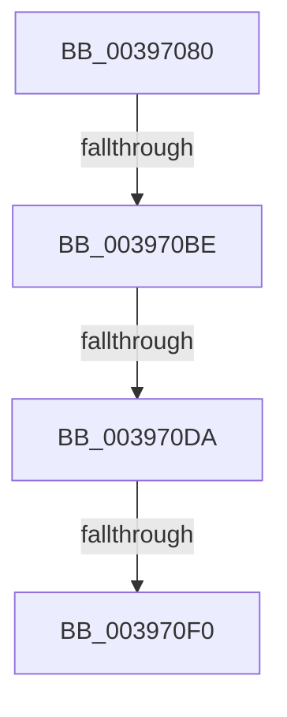

# KeReleaseSemaphore

- RVA: `0x00397080`–`0x003970FA` (길이 `122` bytes)
- VA: `0x0000000140397080`
- 실행 섹션: `.text`
- PDB 이름 있음: `예`; PDB Function 태그: `아니요`
- unwind 정보 RVA: `0x000812B4`
- 디코드: `30`개 명령, `122/122` bytes 표시
- 미해석 바이트: `0` (있으면 어셈블리에 `.byte`로 보존)

> 이 문서는 커널 이미지의 기계어와 PDB 기호를 분석해 생성했습니다. 4번과 5번은 함수 원형과 자료형을 바이너리 사용 방식에서 추정한 C 해석이며 원본 소스 복구 결과는 아닙니다.

## 1. Dependencies

- 직접 호출 지점: **0**; 고유 호출 대상: **0**
- 직접 호출자로 확인된 함수: **30**
- RIP 상대 이미지 참조: **1**

### Outgoing calls
- 직접 디코드된 call 명령이 없습니다.

### Direct callers
- [sub_00235EB4](../23/Unknown_function_00235EB4.md) at `0x00236093`
- [PopPepProcessEvent](../24/PopPepProcessEvent_function_0024B930.md) at `0x0024C590`
- [PopPepProcessEvent](../24/PopPepProcessEvent_function_0024B930.md) at `0x0024C843`
- [PopIrpWorker](../26/PopIrpWorker_function_0026D410.md) at `0x0026D777`
- [PopFxHandleReportDevicePoweredOn](../26/PopFxHandleReportDevicePoweredOn_function_0026D980.md) at `0x0026DA03`
- [PnpDeviceCompletionQueueAddCompletedRequest](../26/PnpDeviceCompletionQueueAddCompletedRequest_function_0026E5BC.md) at `0x0026E5FB`
- [PopHandleDevicePowerIrpCompletion](../26/PopHandleDevicePowerIrpCompletion_function_0026F030.md) at `0x0026F115`
- [PopFxQueueWorkItem](../2B/PopFxQueueWorkItem_function_002BFE08.md) at `0x002BFE61`
- [AlpcpSignalAndWait](../2F/AlpcpSignalAndWait_function_002F9620.md) at `0x002F99C4`
- [PopFxRequestWorkerInternal](PopFxRequestWorkerInternal_function_00397CC4.md) at `0x00397D01`
- [PopPepRequestWork](PopPepRequestWork_function_003986F0.md) at `0x0039873E`
- [PopPepRequestWork](PopPepRequestWork_function_003986F0.md) at `0x003987D5`
- [PopDispatchQuerySetIrp](../47/PopDispatchQuerySetIrp_function_00470CE8.md) at `0x00470D55`
- [PopCompleteDirectedPowerTransitionCallback](../48/PopCompleteDirectedPowerTransitionCallback_function_00483AD0.md) at `0x00483B27`
- [PopCompleteNotifyTransitionCommon](../48/PopCompleteNotifyTransitionCommon_function_00483B4C.md) at `0x00483D49`
- [PnpProcessRebalance](../5A/PnpProcessRebalance_function_005AA7C8.md) at `0x005AA880`
- [sub_006FBF78](../6F/Unknown_function_006FBF78.md) at `0x006FC072`
- [FsRtlDeregisterUncProvider](../../page/71/FsRtlDeregisterUncProvider_function_007141C0.md) at `0x00714207`
- [FsRtlpRegisterUncProvider](../../page/71/FsRtlpRegisterUncProvider_function_007144D0.md) at `0x007145B4`
- [IopAllocateBootResources](../../page/72/IopAllocateBootResources_function_0072E680.md) at `0x0072E6E3`
- [PpProfileCancelHardwareProfileTransition](../../page/73/PpProfileCancelHardwareProfileTransition_function_00737918.md) at `0x0073798F`
- [PpProfileCancelTransitioningDock](../../page/73/PpProfileCancelTransitioningDock_function_007379A0.md) at `0x00737A3A`
- [PpProfileCommitTransitioningDock](../../page/73/PpProfileCommitTransitioningDock_function_00737A4C.md) at `0x00737B83`
- [PnpReallocateResources](../../page/73/PnpReallocateResources_function_0073E924.md) at `0x0073EAE4`
- [IopUncacheInterfaceInformation](../../page/8F/IopUncacheInterfaceInformation_function_008FCC28.md) at `0x008FCCD8`
- [AlpcpDoPortCleanup](../../page/92/AlpcpDoPortCleanup_function_00924E54.md) at `0x00924FA6`
- [IopLegacyResourceAllocation](../../page/A0/IopLegacyResourceAllocation_function_00A07224.md) at `0x00A0748A`
- [IopInsertLegacyBusDeviceNode](../../page/A2/IopInsertLegacyBusDeviceNode_function_00A28154.md) at `0x00A28216`
- [PnpAllocateResources](../../page/A2/PnpAllocateResources_function_00A2ACC4.md) at `0x00A2AD89`
- [NtReleaseKeyedEvent](../../page/A7/NtReleaseKeyedEvent_function_00A70AF0.md) at `0x00A70CCB`
- [NtWaitForKeyedEvent](../../page/A7/NtWaitForKeyedEvent_function_00A71D50.md) at `0x00A720AB`
- [PopSystemIrpCompletion](../../pagelk/B7/PopSystemIrpCompletion_function_00B70CC0.md) at `0x00B70EA0`

### Static image references
- `0x003970B1` → RVA `0x00FC6D20` (`ALMOSTRO`; read)

## 2. Other-region calls and transfers

- 다른 실행 섹션으로 향하는 call: **0**
- call이 아닌 외부 분기/꼬리 이동: **4**
  - `0x003970B8` → [sub_00397288](Unknown_function_00397288.md) (`tail-transfer`)
  - `0x003970D4` → [sub_003972E0](Unknown_function_003972E0.md) (`tail-transfer`)
  - `0x003970EA` → [sub_00397328](Unknown_function_00397328.md) (`tail-transfer`)
  - `0x003970F4` → [sub_00397328](Unknown_function_00397328.md) (`tail-transfer`)

## 3. Assembly (complete function range)

```asm
00397080  44 88 4C 24 20                  mov byte ptr [rsp + 0x20], r9b
00397085  89 54 24 10                     mov dword ptr [rsp + 0x10], edx
00397089  53                              push rbx
0039708A  55                              push rbp
0039708B  56                              push rsi
0039708C  57                              push rdi
0039708D  41 54                           push r12
0039708F  41 57                           push r15
00397091  48 83 EC 58                     sub rsp, 0x58
00397095  41 0F B6 E9                     movzx ebp, r9b
00397099  41 8B F8                        mov edi, r8d
0039709C  4C 8B F9                        mov r15, rcx
0039709F  45 0F 20 C4                     mov r12, cr8
003970A3  4C 89 64 24 38                  mov qword ptr [rsp + 0x38], r12
003970A8  B8 02 00 00 00                  mov eax, 2
003970AD  44 0F 22 C0                     mov cr8, rax
003970B1  83 3D 68 FC C2 00 00            cmp dword ptr [rip + 0xc2fc68], 0
003970B8  0F 85 CA 01 00 00               jne 0x140397288
003970BE  65 48 8B 34 25 20 00 00 00      mov rsi, qword ptr gs:[0x20]
003970C7  33 DB                           xor ebx, ebx
003970C9  F0 41 0F BA 2F 07               lock bts dword ptr [r15], 7
003970CF  48 89 74 24 30                  mov qword ptr [rsp + 0x30], rsi
003970D4  0F 82 06 02 00 00               jb 0x1403972e0
003970DA  41 8B 4F 04                     mov ecx, dword ptr [r15 + 4]
003970DE  89 8C 24 A0 00 00 00            mov dword ptr [rsp + 0xa0], ecx
003970E5  8D 04 39                        lea eax, [rcx + rdi]
003970E8  3B C1                           cmp eax, ecx
003970EA  0F 8C 38 02 00 00               jl 0x140397328
003970F0  41 3B 47 18                     cmp eax, dword ptr [r15 + 0x18]
003970F4  0F 8F 2E 02 00 00               jg 0x140397328
```

## 4. C-style interpretation (structured pseudocode)

```c
__int64 __fastcall KeReleaseSemaphore(__int64 a1, int a2, int a3, unsigned __int8 a4)
{
    __int64 v_rbx;
    __int64 v_rsp;
    unsigned __int64 v_stack_m50;
    unsigned __int64 v_stack_m58;
    unsigned int v_stack_p10;
    unsigned int v_stack_p18;
    unsigned __int8 v_stack_p20;

    v_stack_p20 = a4;
    v_stack_p10 = a2;
    v_rsp = (v_rsp) - (88);
    v_stack_m50 = v_cr8;
    v_rbx = 0;
    v_stack_m58 = *(unsigned __int64 *)(gs_base + (0 + 32));
    v_stack_p18 = (unsigned int)((unsigned int)(*(unsigned int *)(a1 + 4)));
}
```

## 5. (Beta) C Style

```c
int64_t KeReleaseSemaphore(void *Arg1, int32_t Arg2, int32_t Arg3, uint8_t Arg4)
{
    uint8_t *arg1 = (uint8_t *)Arg1;

    int64_t local_rbx;
    int64_t local_rsp;
    uint64_t v_stack_m50;
    uint64_t v_stack_m58;
    uint32_t v_stack_p10;
    uint32_t v_stack_p18;
    uint8_t v_stack_p20;

    v_stack_p20 = Arg4;
    v_stack_p10 = Arg2;
    local_rsp = (local_rsp) - (88);
    v_stack_m50 = v_cr8;
    local_rbx = 0;
    v_stack_m58 = *(uint64_t *)(gs_base + (0 + 0x20));
    v_stack_p18 = (uint32_t)((uint32_t)(*(uint32_t *)(arg1 + 0x4)));
}
```

### 관측된 메모리 오프셋

구조체 형식이 확인되지 않은 접근은 인자 기준의 오프셋으로만 기록했습니다.

| 기준 인자 | 오프셋 표현 | 폭 (bit) | 접근 |
|---|---:|---:|---|
| `Arg1` | `+ 0x0` | `32` | `R/W` |
| `Arg1` | `+ 0x4` | `32` | `R` |
| `Arg1` | `+ 0x18` | `32` | `R` |

## 6. Execution-region graph

[열기: 2D/3D 그래프와 함수 탐색 컨트롤 패널](../../../control-panel.html?section=text&rva=0x00397080&view=graph)

- 2D 그래프는 위에서 아래로 흐르고, 3D 그래프는 빈 공간을 드래그해 회전합니다. Shift+드래그는 이동, 휠은 확대·축소, 함수 노드 선택은 대상 보고서 이동입니다.

### Static fallback


