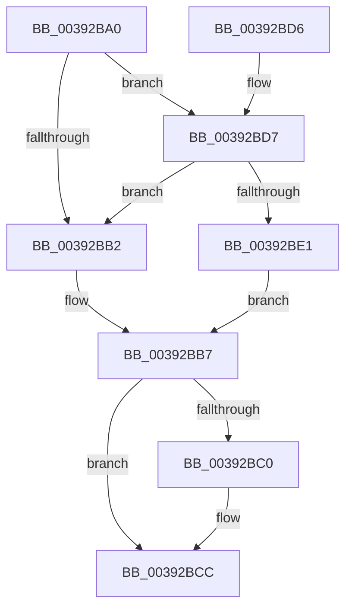

# KeReleaseSpinLock

- RVA: `0x00392BA0`–`0x00392BED` (길이 `77` bytes)
- VA: `0x0000000140392BA0`
- 실행 섹션: `.text`
- PDB 이름 있음: `예`; PDB Function 태그: `아니요`
- unwind 정보 RVA: `0x00068804`
- 디코드: `22`개 명령, `77/77` bytes 표시
- 미해석 바이트: `0` (있으면 어셈블리에 `.byte`로 보존)

> 이 문서는 커널 이미지의 기계어와 PDB 기호를 분석해 생성했습니다. 4번과 5번은 함수 원형과 자료형을 바이너리 사용 방식에서 추정한 C 해석이며 원본 소스 복구 결과는 아닙니다.

## 1. Dependencies

- 직접 호출 지점: **2**; 고유 호출 대상: **2**
- 직접 호출자로 확인된 함수: **482**
- RIP 상대 이미지 참조: **3**

### Outgoing calls
- `0x00392BC7` → [KiLowerIrqlProcessIrqlFlags](../4F/KiLowerIrqlProcessIrqlFlags_function_004F5698.md) (function, `0x004F5698`)
- `0x00392BE6` → [KiReleaseSpinLockInstrumented](KiReleaseSpinLockInstrumented_function_00392EF0.md) (function, `0x00392EF0`)

### Direct callers
- [SMKM_STORE&lt;SM_TRAITS&gt;::SmStReadThread](../20/SMKM_STORE_SM_TRAITS_SmStReadThread_function_00203230.md) at `0x0020336B`
- [sub_002072CB](../20/Unknown_function_002072CB.md) at `0x002072E2`
- [sub_002072CB](../20/Unknown_function_002072CB.md) at `0x00207377`
- [KiRcuFlushCompleted](../20/KiRcuFlushCompleted_function_0020AD38.md) at `0x0020AE6C`
- [IoBoostThreadIoPriority](../21/IoBoostThreadIoPriority_function_00216110.md) at `0x00216428`
- [IoBoostThreadIoPriority](../21/IoBoostThreadIoPriority_function_00216110.md) at `0x002165E8`
- [CmpCompleteLazyWrite](../22/CmpCompleteLazyWrite_function_0022FA10.md) at `0x0022FA69`
- [PspProcessUnbindVirtualizedTimers](../22/PspProcessUnbindVirtualizedTimers_function_0022FC3C.md) at `0x0022FCD5`
- [ExpDeleteTimer](../23/ExpDeleteTimer_function_00230C40.md) at `0x00230CC5`
- [NtCancelTimer](../23/NtCancelTimer_function_00230D90.md) at `0x00230FCB`
- [IopCompleteIrpInFileObjectList](../24/IopCompleteIrpInFileObjectList_function_0024F330.md) at `0x0024F867`
- [PnpDeviceCompletionQueueDispatchedEntryCompleted](../26/PnpDeviceCompletionQueueDispatchedEntryCompleted_function_0026E778.md) at `0x0026E7CC`
- [PopFxNotifyPostDIrpCompletion](../26/PopFxNotifyPostDIrpCompletion_function_0026EA18.md) at `0x0026EA83`
- [PopCompleteIrpWatchdog](../26/PopCompleteIrpWatchdog_function_0026EB94.md) at `0x0026EBF4`
- [PopDequeueQuerySetIrp](../26/PopDequeueQuerySetIrp_function_0026EC34.md) at `0x0026ED94`
- [PopDiagTraceIrpFinishTelemetry](../26/PopDiagTraceIrpFinishTelemetry_function_0026F46C.md) at `0x0026F543`
- [PopFxNotifyPreDIrpIssue](../26/PopFxNotifyPreDIrpIssue_function_0026FD40.md) at `0x0026FDC3`
- [PopFxNotifyPreDIrpIssue](../26/PopFxNotifyPreDIrpIssue_function_0026FD40.md) at `0x0026FE26`
- [PoRunDownDeviceObject](../26/PoRunDownDeviceObject_function_0026FFFC.md) at `0x00270085`
- [PoRegisterDeviceForIdleDetection](../27/PoRegisterDeviceForIdleDetection_function_002700E0.md) at `0x0027013C`
- [PoRegisterDeviceForIdleDetection](../27/PoRegisterDeviceForIdleDetection_function_002700E0.md) at `0x002701B7`
- [IopfCompleteRequest](../29/IopfCompleteRequest_function_0029B5F8.md) at `0x0029BB8A`
- [NtSetInformationFile](../29/NtSetInformationFile_function_0029C5E0.md) at `0x0029D004`
- [NtSetInformationFile](../29/NtSetInformationFile_function_0029C5E0.md) at `0x0029D497`
- [PfSnDeactivateTrace](../2A/PfSnDeactivateTrace_function_002A50CC.md) at `0x002A50FD`
- [PfSnDeactivateTrace](../2A/PfSnDeactivateTrace_function_002A50CC.md) at `0x002A514B`
- [PfSnDeactivateTrace](../2A/PfSnDeactivateTrace_function_002A50CC.md) at `0x002A51A3`
- [PfSnRemoveProcessTrace](../2A/PfSnRemoveProcessTrace_function_002A51CC.md) at `0x002A5208`
- [sub_002BD6E6](../2B/Unknown_function_002BD6E6.md) at `0x002BD806`
- [PopFxActivateComponentDependents](../2B/PopFxActivateComponentDependents_function_002BE9F0.md) at `0x002BEE4A`
- [PopFxActivateComponentDependents](../2B/PopFxActivateComponentDependents_function_002BE9F0.md) at `0x002BEE86`
- [PopFxActivateComponentDependents](../2B/PopFxActivateComponentDependents_function_002BE9F0.md) at `0x002BEEC3`
- [PopFxActivateComponentDependents](../2B/PopFxActivateComponentDependents_function_002BE9F0.md) at `0x002BEEE5`
- [PopQueueQuerySetIrp](../2B/PopQueueQuerySetIrp_function_002BEF18.md) at `0x002BEFE7`
- [PopFxIdleWorker](../2C/PopFxIdleWorker_function_002C04A0.md) at `0x002C053B`
- [PopFxIdleWorker](../2C/PopFxIdleWorker_function_002C04A0.md) at `0x002C0584`
- [KiIntSteerConnect](../2D/KiIntSteerConnect_function_002D44F0.md) at `0x002D47B9`
- [KeIntSteerSnapPerf](../2D/KeIntSteerSnapPerf_function_002D76C0.md) at `0x002D797D`
- [PopFxActivateComponent](../2D/PopFxActivateComponent_function_002D9DBC.md) at `0x002D9F52`
- [PpmMediaBufferingWorker](../2D/PpmMediaBufferingWorker_function_002DA680.md) at `0x002DA6B3`
- [PpmMediaBufferingWorker](../2D/PpmMediaBufferingWorker_function_002DA680.md) at `0x002DA706`
- [CcGetDirtyPages](../2F/CcGetDirtyPages_function_002F0720.md) at `0x002F07A9`
- [CcForEachPartition](../2F/CcForEachPartition_function_002F0828.md) at `0x002F08B0`
- [EtwpEnqueueAvailableBuffer](../2F/EtwpEnqueueAvailableBuffer_function_002FE7DC.md) at `0x002FE8E9`
- [PpmIdleStartCsVetoAccounting](../30/PpmIdleStartCsVetoAccounting_function_0030326C.md) at `0x003032EF`
- [PopIdleWakeNotifyDevicesActive](../30/PopIdleWakeNotifyDevicesActive_function_00303EC0.md) at `0x00303F06`
- [PopFxPlatformStateAvailable](../30/PopFxPlatformStateAvailable_function_00303F6C.md) at `0x00303FB6`
- [PpmIdleCsVetoAccountingResiliencyUpdate](../30/PpmIdleCsVetoAccountingResiliencyUpdate_function_00304028.md) at `0x00304092`
- [PopFxSetDripsBlockedByDeviceActivity](../30/PopFxSetDripsBlockedByDeviceActivity_function_00304154.md) at `0x003041B7`
- [PopFxUpdateDeviceIRPhaseAccounting](../30/PopFxUpdateDeviceIRPhaseAccounting_function_003041D8.md) at `0x00304205`
- [PopUpdateNonAttributedCpuTimeReference](../30/PopUpdateNonAttributedCpuTimeReference_function_00304720.md) at `0x003047BA`
- [PpmUpdatePlatformIdleVeto](../30/PpmUpdatePlatformIdleVeto_function_003047E0.md) at `0x003048C5`
- [HalpIommuMapLogical](../30/HalpIommuMapLogical_function_00308290.md) at `0x0030854F`
- [HalpIommuMapLogical](../30/HalpIommuMapLogical_function_00308290.md) at `0x003085A9`
- [sub_0033D401](../33/Unknown_function_0033D401.md) at `0x0033D405`
- [sub_003422B4](../34/Unknown_function_003422B4.md) at `0x0034250F`
- [PfSnTraceGetLogEntry](../34/PfSnTraceGetLogEntry_function_003437A0.md) at `0x00343908`
- [sub_00344B40](../34/Unknown_function_00344B40.md) at `0x00344B77`
- [CcPostDeferredWrites](../35/CcPostDeferredWrites_function_003590FC.md) at `0x003591AD`
- [IoWMIWriteEvent](../38/IoWMIWriteEvent_function_00386480.md) at `0x00386551`
- [FsRtlUninitializeFileLock](../38/FsRtlUninitializeFileLock_function_00386F50.md) at `0x00386FDC`
- [CcScheduleReadAheadNuma](../38/CcScheduleReadAheadNuma_function_0038883C.md) at `0x003889B6`
- [CcScheduleReadAheadNuma](../38/CcScheduleReadAheadNuma_function_0038883C.md) at `0x00388ABF`
- [sub_0038C58B](../38/Unknown_function_0038C58B.md) at `0x0038C82A`
- [FsRtlFastUnlockSingleExclusive](../38/FsRtlFastUnlockSingleExclusive_function_0038C8E0.md) at `0x0038CB4B`
- [sub_0038D07B](../38/Unknown_function_0038D07B.md) at `0x0038D0D7`
- [sub_0038D07B](../38/Unknown_function_0038D07B.md) at `0x0038D135`
- [sub_0038D07B](../38/Unknown_function_0038D07B.md) at `0x0038D19C`
- [sub_0038D6B0](../38/Unknown_function_0038D6B0.md) at `0x0038D6B7`
- [FsRtlPrivateCheckWaitingLocks](../38/FsRtlPrivateCheckWaitingLocks_function_0038DCBC.md) at `0x0038DDE4`
- [FsRtlPrivateLock](../38/FsRtlPrivateLock_function_0038DF90.md) at `0x0038E2D6`
- [FsRtlPrivateLock](../38/FsRtlPrivateLock_function_0038DF90.md) at `0x0038E45B`
- [PspUnlockQuotaExpansion](PspUnlockQuotaExpansion_function_00390E68.md) at `0x00390E7E`
- [FsRtlFastCheckLockForWrite](FsRtlFastCheckLockForWrite_function_003910D0.md) at `0x003911B5`
- [SMKM_STORE_MGR&lt;SM_TRAITS&gt;::SmAsyncReadQueueInsert](SMKM_STORE_MGR_SM_TRAITS_SmAsyncReadQueueInsert_function_0039120C.md) at `0x003912E0`
- [ExTimerRundown](ExTimerRundown_function_00391394.md) at `0x003913E1`
- [ExTimerRundown](ExTimerRundown_function_00391394.md) at `0x00391420`
- [ExTimerRundown](ExTimerRundown_function_00391394.md) at `0x00391446`
- [ExNotifyCallback](ExNotifyCallback_function_003926B0.md) at `0x00392727`
- [ExNotifyCallback](ExNotifyCallback_function_003926B0.md) at `0x0039274F`
- [IoCsqRemoveNextIrp](IoCsqRemoveNextIrp_function_00392AB0.md) at `0x00392B46`
- [IoCsqRemoveNextIrp](IoCsqRemoveNextIrp_function_00392AB0.md) at `0x00392B79`
- [sub_00393F79](Unknown_function_00393F79.md) at `0x00393F9B`
- [IopTimerDispatch](../3A/IopTimerDispatch_function_003A3900.md) at `0x003A3A13`
- [PsAdjustWin32kPriorityFloor](../3C/PsAdjustWin32kPriorityFloor_function_003C2D00.md) at `0x003C2D5A`
- [CcNotifyEnhancedExternalCaches](../3C/CcNotifyEnhancedExternalCaches_function_003C9294.md) at `0x003C9362`
- [CcNotifyExternalCachesInternal](../3C/CcNotifyExternalCachesInternal_function_003C9E00.md) at `0x003C9F39`
- [CcCoalescingCallBack](../3C/CcCoalescingCallBack_function_003CA040.md) at `0x003CA0B3`
- [HalpDmaStartWcb](../3D/HalpDmaStartWcb_function_003DA6EC.md) at `0x003DA734`
- [HalpDmaGetNextWcb](../3D/HalpDmaGetNextWcb_function_003DABF8.md) at `0x003DAC3F`
- [HalpMmAllocCtxAlloc](../3E/HalpMmAllocCtxAlloc_function_003E10B8.md) at `0x003E12BD`
- [HalpMmAllocCtxAlloc](../3E/HalpMmAllocCtxAlloc_function_003E10B8.md) at `0x003E13A0`
- [HalpMmAllocCtxFree](../3E/HalpMmAllocCtxFree_function_003E1904.md) at `0x003E1A31`
- [PspIumFreePhysicalPages](../3E/PspIumFreePhysicalPages_function_003E7874.md) at `0x003E795F`
- [HalpAllocateCommonBufferVectorInternal](../3E/HalpAllocateCommonBufferVectorInternal_function_003E848C.md) at `0x003E86CE`
- [HalpAllocateCommonBufferEntry](../3E/HalpAllocateCommonBufferEntry_function_003E99F4.md) at `0x003E9AAA`
- [HalpDmaReferenceDomainObject](../3E/HalpDmaReferenceDomainObject_function_003E9B08.md) at `0x003E9B51`
- [IopDequeueIrpFromFileObject](../3E/IopDequeueIrpFromFileObject_function_003ED548.md) at `0x003ED5CE`
- [PnpMapActivatingDeviceNodeToThread](../3E/PnpMapActivatingDeviceNodeToThread_function_003EE1D4.md) at `0x003EE226`
- [PnpUnmapActivatingDeviceNodeToThread](../3E/PnpUnmapActivatingDeviceNodeToThread_function_003EE4C0.md) at `0x003EE4F9`
- [HalpPopCommonBufferEntry](../3F/HalpPopCommonBufferEntry_function_003F68D4.md) at `0x003F6957`
- [HalpDmaDereferenceDomainObject](../3F/HalpDmaDereferenceDomainObject_function_003F69DC.md) at `0x003F6A2F`
- [HalFreeCommonBufferVector](../3F/HalFreeCommonBufferVector_function_003F87C0.md) at `0x003F8836`
- [EtwpTraceStackKey](../3F/EtwpTraceStackKey_function_003FC290.md) at `0x003FC87A`
- [EtwpStackRundown](../3F/EtwpStackRundown_function_003FC8B4.md) at `0x003FC94B`
- [sub_003FD43F](../3F/Unknown_function_003FD43F.md) at `0x003FD4A9`
- [FsRtlPrivateFastUnlockAll](../3F/FsRtlPrivateFastUnlockAll_function_003FD554.md) at `0x003FD6D2`
- [FsRtlPrivateFastUnlockAll](../3F/FsRtlPrivateFastUnlockAll_function_003FD554.md) at `0x003FD864`
- [IopQueueIrpToFileObject](../40/IopQueueIrpToFileObject_function_00409864.md) at `0x004098D0`
- [IopQueueIrpToFileObject](../40/IopQueueIrpToFileObject_function_00409864.md) at `0x00409971`
- [sub_0040FE88](../40/Unknown_function_0040FE88.md) at `0x0040FE8F`
- [EtwpLockUnlockBufferList](../41/EtwpLockUnlockBufferList_function_00419B88.md) at `0x00419BF4`
- [PfSnActivateTrace](../41/PfSnActivateTrace_function_0041BDAC.md) at `0x0041BE3F`
- [PopFxStopDeviceAccounting](../42/PopFxStopDeviceAccounting_function_004261D8.md) at `0x00426312`
- [PopFxStopDeviceAccounting](../42/PopFxStopDeviceAccounting_function_004261D8.md) at `0x00426363`
- [PopFxStopDeviceAccounting](../42/PopFxStopDeviceAccounting_function_004261D8.md) at `0x00426438`
- [IoIncrementKeepAliveCount](../42/IoIncrementKeepAliveCount_function_0042EAD0.md) at `0x0042EBA0`
- [IopAdjustFileObjectKeepAliveCount](../42/IopAdjustFileObjectKeepAliveCount_function_0042EBE8.md) at `0x0042ECDA`
- [IopGetSetStreamIdentifier](../42/IopGetSetStreamIdentifier_function_0042ED7C.md) at `0x0042EE01`
- [NtCancelWaitCompletionPacket](../42/NtCancelWaitCompletionPacket_function_0042F100.md) at `0x0042F199`
- [NtCancelWaitCompletionPacket](../42/NtCancelWaitCompletionPacket_function_0042F100.md) at `0x0042F247`
- [NtAssociateWaitCompletionPacket](../42/NtAssociateWaitCompletionPacket_function_0042F270.md) at `0x0042F450`
- [NtAssociateWaitCompletionPacket](../42/NtAssociateWaitCompletionPacket_function_0042F270.md) at `0x0042F4CD`
- [IopCloseWaitCompletionPacket](../42/IopCloseWaitCompletionPacket_function_0042F520.md) at `0x0042F606`
- [sub_00433495](../43/Unknown_function_00433495.md) at `0x004334DE`
- [PspInsertProperty](../43/PspInsertProperty_function_00434B2C.md) at `0x00434BAB`
- [PspRemoveProperty](../43/PspRemoveProperty_function_00434C10.md) at `0x00434C78`
- [SMKM_STORE_MGR&lt;SM_TRAITS&gt;::SmAsyncReadQueueWorker](../43/SMKM_STORE_MGR_SM_TRAITS_SmAsyncReadQueueWorker_function_004382D0.md) at `0x00438339`
- [SMKM_STORE_MGR&lt;SM_TRAITS&gt;::SmAsyncReadQueueWorker](../43/SMKM_STORE_MGR_SM_TRAITS_SmAsyncReadQueueWorker_function_004382D0.md) at `0x00438449`
- [PopCaptureSleepStudyStatistics](../43/PopCaptureSleepStudyStatistics_function_004399F4.md) at `0x00439C3B`
- [PopCaptureSleepStudyStatistics](../43/PopCaptureSleepStudyStatistics_function_004399F4.md) at `0x00439FBC`
- [PopCaptureSleepStudyStatistics](../43/PopCaptureSleepStudyStatistics_function_004399F4.md) at `0x00439FEA`
- [PopCalculateCsSummary](../43/PopCalculateCsSummary_function_0043A1B0.md) at `0x0043A3E5`
- [PopCalculateCsSummary](../43/PopCalculateCsSummary_function_0043A1B0.md) at `0x0043A6A1`
- [PopDiagTraceCsResiliencyExit](../43/PopDiagTraceCsResiliencyExit_function_0043AB34.md) at `0x0043AD4C`
- [PpmIdleCaptureCsVetoAccounting](../43/PpmIdleCaptureCsVetoAccounting_function_0043B6CC.md) at `0x0043B780`
- [EtwpCovSampCaptureContextStop](../43/EtwpCovSampCaptureContextStop_function_0043BE5C.md) at `0x0043BEE5`
- [EtwpCovSampCaptureCleanupLookasides](../43/EtwpCovSampCaptureCleanupLookasides_function_0043BFE0.md) at `0x0043C08D`
- [EtwpCovSampCaptureFlushSampleBuffers](../43/EtwpCovSampCaptureFlushSampleBuffers_function_0043C0B4.md) at `0x0043C160`
- [EtwpCovSampSampleBufferReserve](../43/EtwpCovSampSampleBufferReserve_function_0043C348.md) at `0x0043C40B`
- [EtwpCovSampSampleBufferReserve](../43/EtwpCovSampSampleBufferReserve_function_0043C348.md) at `0x0043C479`
- [PopFxIdleWorkerTail](../43/PopFxIdleWorkerTail_function_0043CDA0.md) at `0x0043CE02`
- [PopFxIdleWorkerTail](../43/PopFxIdleWorkerTail_function_0043CDA0.md) at `0x0043CEF1`
- [PopFxPauseDeviceAccounting](../43/PopFxPauseDeviceAccounting_function_0043D0C8.md) at `0x0043D193`
- [PopFxPauseDeviceAccounting](../43/PopFxPauseDeviceAccounting_function_0043D0C8.md) at `0x0043D1CF`
- [PopFxUpdateDeviceAccountingEnhanced](../43/PopFxUpdateDeviceAccountingEnhanced_function_0043D250.md) at `0x0043D28A`
- [PopFxResumeDeviceAccounting](../43/PopFxResumeDeviceAccounting_function_0043D4D8.md) at `0x0043D598`
- [PopFxResumeDeviceAccounting](../43/PopFxResumeDeviceAccounting_function_0043D4D8.md) at `0x0043D5D4`
- [PopFxSetGlobalDeviceAccountingEnabled](../43/PopFxSetGlobalDeviceAccountingEnabled_function_0043D678.md) at `0x0043D6DE`
- [PoQueryWatchdogTime](../44/PoQueryWatchdogTime_function_004479B0.md) at `0x00447B81`
- [PoQueryWatchdogTime](../44/PoQueryWatchdogTime_function_004479B0.md) at `0x00447BD9`
- [PopEnableIrpWatchdog](../44/PopEnableIrpWatchdog_function_00447BFC.md) at `0x00447D2D`
- [IopSessionChangeWorker](../45/IopSessionChangeWorker_function_004522B0.md) at `0x00452328`
- [IopSessionChangeWorker](../45/IopSessionChangeWorker_function_004522B0.md) at `0x00452385`
- [ExNotifyWithProcessing](../45/ExNotifyWithProcessing_function_004523F4.md) at `0x004524D9`
- [SleepstudyHelper_ComponentActive](../45/SleepstudyHelper_ComponentActive_function_00453730.md) at `0x0045377E`
- [SleepstudyHelperBlockerActiveDereference](../45/SleepstudyHelperBlockerActiveDereference_function_00453830.md) at `0x00453862`
- [SleepstudyHelperBlockerActiveReference](../45/SleepstudyHelperBlockerActiveReference_function_004538D0.md) at `0x00453920`
- [SshpIterateParentBlockers](../45/SshpIterateParentBlockers_function_0045394C.md) at `0x004539D4`
- [EtwTelemetryCoverageReport](../46/EtwTelemetryCoverageReport_function_00460430.md) at `0x00460533`
- [PopSetWatchdog](../46/PopSetWatchdog_function_00460CAC.md) at `0x00461035`
- [HalpBuddyAllocatorBltFindAndPop](../46/HalpBuddyAllocatorBltFindAndPop_function_0046746C.md) at `0x00467510`
- [HalpBuddyAllocatorBltPopBuddy](../46/HalpBuddyAllocatorBltPopBuddy_function_0046754C.md) at `0x0046758C`
- [ExInitializePagedLookasideListInternal](../46/ExInitializePagedLookasideListInternal_function_00468040.md) at `0x0046811D`
- [ExInitializeNPagedLookasideListInternal](../46/ExInitializeNPagedLookasideListInternal_function_00468720.md) at `0x00468808`
- [ExInitializeLookasideListExInternal](../46/ExInitializeLookasideListExInternal_function_00468890.md) at `0x00468A65`
- [PopDeepSleepEvaluateCallback](../46/PopDeepSleepEvaluateCallback_function_00469F10.md) at `0x00469F5B`
- [PopDeepSleepEvaluateCallback](../46/PopDeepSleepEvaluateCallback_function_00469F10.md) at `0x00469F98`
- [PsInsertVirtualizedTimer](../46/PsInsertVirtualizedTimer_function_0046C130.md) at `0x0046C1AB`
- [WmipFindRegEntryByDevice](../46/WmipFindRegEntryByDevice_function_0046C22C.md) at `0x0046C27C`
- [IoWMIDeviceObjectToProviderId](../46/IoWMIDeviceObjectToProviderId_function_0046C2B0.md) at `0x0046C2E4`
- [PipSetDevNodeState](../47/PipSetDevNodeState_function_00470708.md) at `0x004707D0`
- [IopPowerDispatch](../47/IopPowerDispatch_function_00470BF0.md) at `0x00470C87`
- [PpmEndHighPerfRequest](../47/PpmEndHighPerfRequest_function_00477490.md) at `0x004774D4`
- [PnpRequestDeviceAction](../47/PnpRequestDeviceAction_function_00477FF8.md) at `0x004781BF`
- [PnpRequestDeviceAction](../47/PnpRequestDeviceAction_function_00477FF8.md) at `0x00478206`
- [PnpRequestDeviceAction](../47/PnpRequestDeviceAction_function_00477FF8.md) at `0x0047829A`
- [PnpRequestDeviceAction](../47/PnpRequestDeviceAction_function_00477FF8.md) at `0x004782FE`
- [PnpRequestDeviceAction](../47/PnpRequestDeviceAction_function_00477FF8.md) at `0x0047833F`
- [PnpDeviceActionWorker](../47/PnpDeviceActionWorker_function_00478400.md) at `0x004784DC`
- [PnpDeviceActionWorker](../47/PnpDeviceActionWorker_function_00478400.md) at `0x004785AD`
- [PnpDeviceActionWorker](../47/PnpDeviceActionWorker_function_00478400.md) at `0x004785E7`
- [PnpDeviceActionWorker](../47/PnpDeviceActionWorker_function_00478400.md) at `0x004786F8`
- [PnpDeviceActionWorker](../47/PnpDeviceActionWorker_function_00478400.md) at `0x0047874F`
- [PnpDeviceActionWorker](../47/PnpDeviceActionWorker_function_00478400.md) at `0x0047879F`
- [PnpDeviceActionWorker](../47/PnpDeviceActionWorker_function_00478400.md) at `0x004787FD`
- [PnpDeviceActionWorker](../47/PnpDeviceActionWorker_function_00478400.md) at `0x004788B7`
- [HalpBuddyAllocatorBltAdd](../47/HalpBuddyAllocatorBltAdd_function_0047A968.md) at `0x0047A9C2`
- [IopCancelIrpsInCurrentThreadList](../47/IopCancelIrpsInCurrentThreadList_function_0047AB14.md) at `0x0047ABB3`
- [IopCancelIrpsInCurrentThreadList](../47/IopCancelIrpsInCurrentThreadList_function_0047AB14.md) at `0x0047ABE8`
- [WmipDeregisterRegEntry](../47/WmipDeregisterRegEntry_function_0047B568.md) at `0x0047B5E7`
- [WmipDeregisterRegEntry](../47/WmipDeregisterRegEntry_function_0047B568.md) at `0x0047B679`
- [PoSetPowerState](../48/PoSetPowerState_function_004803E0.md) at `0x00480441`
- [ExpRemoveGeneralLookaside](../48/ExpRemoveGeneralLookaside_function_00481E10.md) at `0x00481E53`
- [PopUserPresentSet](../48/PopUserPresentSet_function_00482B90.md) at `0x00482C03`
- [PopUserPresentSet](../48/PopUserPresentSet_function_00482B90.md) at `0x00482C57`
- [PopCheckForWork](../48/PopCheckForWork_function_00482CAC.md) at `0x00482D15`
- [PopGetPolicyWorker](../48/PopGetPolicyWorker_function_00482D24.md) at `0x00482D47`
- [IoGetSfioStreamIdentifier](../48/IoGetSfioStreamIdentifier_function_004831E0.md) at `0x0048323B`
- [KiIdealProcessorRebalancerWorker](../48/KiIdealProcessorRebalancerWorker_function_00484BB0.md) at `0x00484BC6`
- [KiIdealProcessorRebalancerWorker](../48/KiIdealProcessorRebalancerWorker_function_00484BB0.md) at `0x00484C02`
- [SshpQueryAndResetBlockerAccounting](../48/SshpQueryAndResetBlockerAccounting_function_00484F4C.md) at `0x00485054`
- [SshpSetCollectionActive](../48/SshpSetCollectionActive_function_0048507C.md) at `0x00485134`
- [SshpDereferenceBlocker](../48/SshpDereferenceBlocker_function_00486960.md) at `0x004869EA`
- [SshpDereferenceBlocker](../48/SshpDereferenceBlocker_function_00486960.md) at `0x00486A3D`
- [SshpDereferenceBlocker](../48/SshpDereferenceBlocker_function_00486960.md) at `0x00486AA3`
- [IoDecrementKeepAliveCount](../48/IoDecrementKeepAliveCount_function_004898E0.md) at `0x0048995E`
- [IoDecrementKeepAliveCount](../48/IoDecrementKeepAliveCount_function_004898E0.md) at `0x004899C2`
- [PnpDeviceCompletionQueueIsEmpty](../48/PnpDeviceCompletionQueueIsEmpty_function_0048A070.md) at `0x0048A0B3`
- [CcIsThereDirtyData](../48/CcIsThereDirtyData_function_0048BE30.md) at `0x0048BEB3`
- [PipFindDependencyNodePath](../48/PipFindDependencyNodePath_function_0048D0AC.md) at `0x0048D102`
- [PpmEventPlatformVetoRundown](../49/PpmEventPlatformVetoRundown_function_00490C38.md) at `0x00490D75`
- [PpmEventProcessorVetoRundown](../49/PpmEventProcessorVetoRundown_function_00490D88.md) at `0x00490F77`
- [PpmEventTracePreVetoAccounting](../49/PpmEventTracePreVetoAccounting_function_00490F88.md) at `0x0049107B`
- [SshpReferenceBlocker](../49/SshpReferenceBlocker_function_0049164C.md) at `0x00491684`
- [SshpTracingWriteBlockerStateRundown](../49/SshpTracingWriteBlockerStateRundown_function_00491A20.md) at `0x00491AB3`
- [PopPolicyWorkerThread](../49/PopPolicyWorkerThread_function_00491FD0.md) at `0x00492034`
- [PopPolicyWorkerThread](../49/PopPolicyWorkerThread_function_00491FD0.md) at `0x0049208A`
- [PopFxIdleTimeoutDpcRoutine](../49/PopFxIdleTimeoutDpcRoutine_function_00492B80.md) at `0x00492BC8`
- [WmipBuildTraceDeviceList](../49/WmipBuildTraceDeviceList_function_00494050.md) at `0x00494115`
- [IopKeepAliveWorker](../49/IopKeepAliveWorker_function_00494FD0.md) at `0x0049504C`
- [IopKeepAliveWorker](../49/IopKeepAliveWorker_function_00494FD0.md) at `0x004950AB`
- [IopKeepAliveWorker](../49/IopKeepAliveWorker_function_00494FD0.md) at `0x004950DF`
- [IopKeepAliveWorker](../49/IopKeepAliveWorker_function_00494FD0.md) at `0x0049511F`
- [RtlpStdGetRecordedStackTraceIndex](../49/RtlpStdGetRecordedStackTraceIndex_function_00495C84.md) at `0x00495D35`
- [RtlStdReleaseStackTrace](../49/RtlStdReleaseStackTrace_function_00495D58.md) at `0x00495E36`
- [PnpDeviceCompletionQueueAddDispatchedRequest](../49/PnpDeviceCompletionQueueAddDispatchedRequest_function_0049619C.md) at `0x004961FC`
- [KiIntSteerDisable](../49/KiIntSteerDisable_function_00497144.md) at `0x0049728B`
- [ExpEnumerateCallback](../49/ExpEnumerateCallback_function_00497430.md) at `0x004974AB`
- [IopCancelIrpsInCurrentThreadListSpecialApc](../49/IopCancelIrpsInCurrentThreadListSpecialApc_function_00497B40.md) at `0x00497B9B`
- [IopCancelIrpsInCurrentThreadListSpecialApc](../49/IopCancelIrpsInCurrentThreadListSpecialApc_function_00497B40.md) at `0x00497C1B`
- [EtwpCancelPendingApcs](../49/EtwpCancelPendingApcs_function_00497D88.md) at `0x00497DD6`
- [PopScanIdleList](../49/PopScanIdleList_function_00497F04.md) at `0x00497FD0`
- [PopScanIdleList](../49/PopScanIdleList_function_00497F04.md) at `0x00498187`
- [PfSnStartTraceTimer](../49/PfSnStartTraceTimer_function_00499BEC.md) at `0x00499C72`
- [ExpTimerApcRoutine](../49/ExpTimerApcRoutine_function_0049A5E0.md) at `0x0049A664`
- [SshpQueryBlockerPendingDelete](../49/SshpQueryBlockerPendingDelete_function_0049A814.md) at `0x0049A834`
- [PopFxIsDripsBlockingDevice](../49/PopFxIsDripsBlockingDevice_function_0049BA24.md) at `0x0049BA75`
- [PopFxIsDripsBlockingDevice](../49/PopFxIsDripsBlockingDevice_function_0049BA24.md) at `0x0049BAAD`
- [PopUserPresentSetWorker](../49/PopUserPresentSetWorker_function_0049D4F0.md) at `0x0049D539`
- [PopUserPresentSetWorker](../49/PopUserPresentSetWorker_function_0049D4F0.md) at `0x0049D568`
- [PnpDeviceCompletionQueueRemoveCompletedRequest](../49/PnpDeviceCompletionQueueRemoveCompletedRequest_function_0049D73C.md) at `0x0049D794`
- [ExSetTimerResolution](../49/ExSetTimerResolution_function_0049E7D0.md) at `0x0049E82D`
- [PopAccumulateNonDripsIdleCpuTime](../4A/PopAccumulateNonDripsIdleCpuTime_function_004A09B0.md) at `0x004A0A47`
- [PopAccumulateNonActivatedCpuTime](../4A/PopAccumulateNonActivatedCpuTime_function_004A0AA4.md) at `0x004A0B17`
- [WmiQueryTraceProviderCount](../4A/WmiQueryTraceProviderCount_function_004A24C8.md) at `0x004A253A`
- [FsRtlCheckLockForOplockRequest](../4A/FsRtlCheckLockForOplockRequest_function_004A25E0.md) at `0x004A2650`
- [PopFxStartDeviceAccounting](../4A/PopFxStartDeviceAccounting_function_004A384C.md) at `0x004A3960`
- [PopFxStartDeviceAccounting](../4A/PopFxStartDeviceAccounting_function_004A384C.md) at `0x004A39B2`
- [PopFxStartDeviceAccounting](../4A/PopFxStartDeviceAccounting_function_004A384C.md) at `0x004A39F2`
- [PoFxCompleteDevicePowerNotRequired](../4A/PoFxCompleteDevicePowerNotRequired_function_004A3BE0.md) at `0x004A3C47`
- [PopDevicePowerTransitionInProgressWorker](../4A/PopDevicePowerTransitionInProgressWorker_function_004A3EB0.md) at `0x004A3ED8`
- [PopDevicePowerTransitionInProgressWorker](../4A/PopDevicePowerTransitionInProgressWorker_function_004A3EB0.md) at `0x004A3F32`
- [PnpUnlockDeviceActionQueue](../4A/PnpUnlockDeviceActionQueue_function_004A42F4.md) at `0x004A4350`
- [PnpLockDeviceActionQueue](../4A/PnpLockDeviceActionQueue_function_004A4388.md) at `0x004A43CB`
- [PnpLockDeviceActionQueue](../4A/PnpLockDeviceActionQueue_function_004A4388.md) at `0x004A43E0`
- [PopDisksRegisteredForIdle](../4A/PopDisksRegisteredForIdle_function_004A527C.md) at `0x004A52CE`
- [ExpCheckForLookasideList](../4A/ExpCheckForLookasideList_function_004A5348.md) at `0x004A53BA`
- [PoFxSetDeviceIdleTimeout](../4A/PoFxSetDeviceIdleTimeout_function_004A5C10.md) at `0x004A5C60`
- [PopDeepSleepResiliencyPhaseAccountingBegin](../4A/PopDeepSleepResiliencyPhaseAccountingBegin_function_004A72B4.md) at `0x004A7354`
- [PopDirectedDripsDiagPnpActionQueueAccountingUpdate](../4A/PopDirectedDripsDiagPnpActionQueueAccountingUpdate_function_004A7EEC.md) at `0x004A7F20`
- [PopDisableIrpWatchdog](../4A/PopDisableIrpWatchdog_function_004A95E8.md) at `0x004A9650`
- [PpDevNodeRemoveFromTree](../4A/PpDevNodeRemoveFromTree_function_004AD5A0.md) at `0x004AD62A`
- [PpDevNodeRemoveFromTree](../4A/PpDevNodeRemoveFromTree_function_004AD5A0.md) at `0x004AD685`
- [PopDirectedDripsDiagQueryAndResetPnpAccounting](../4A/PopDirectedDripsDiagQueryAndResetPnpAccounting_function_004AEF34.md) at `0x004AF087`
- [PopDeepSleepResiliencyPhaseAccountingEnd](../4A/PopDeepSleepResiliencyPhaseAccountingEnd_function_004AF6C8.md) at `0x004AF789`
- [PopDeepSleepResiliencyPhaseAccountingEnd](../4A/PopDeepSleepResiliencyPhaseAccountingEnd_function_004AF6C8.md) at `0x004AF798`
- [PopFxClearDeviceConstraints](../4B/PopFxClearDeviceConstraints_function_004B05F8.md) at `0x004B06D7`
- [PopFxClearDeviceConstraints](../4B/PopFxClearDeviceConstraints_function_004B05F8.md) at `0x004B0725`
- [ExCleanTimerResolutionRequest](../4B/ExCleanTimerResolutionRequest_function_004B0C58.md) at `0x004B0CC4`
- [ExpInsertTimerResolutionEntry](../4B/ExpInsertTimerResolutionEntry_function_004B1898.md) at `0x004B18EA`
- [IopErrorLogGetEntry](../4B/IopErrorLogGetEntry_function_004B2554.md) at `0x004B259C`
- [PopIdleWakeNotifyModernStandbyEnter](../4B/PopIdleWakeNotifyModernStandbyEnter_function_004B30A0.md) at `0x004B31D6`
- [ExTraceTimerResolution](../4B/ExTraceTimerResolution_function_004B348C.md) at `0x004B34E4`
- [PopIdleWakeNotifyModernStandbyExit](../4B/PopIdleWakeNotifyModernStandbyExit_function_004B4034.md) at `0x004B4078`
- [PopIdleWakeNotifyIdleResiliencyState](../4B/PopIdleWakeNotifyIdleResiliencyState_function_004B476C.md) at `0x004B47B7`
- [SleepstudyHelper_ComponentInactive](../4B/SleepstudyHelper_ComponentInactive_function_004B5AB0.md) at `0x004B5B09`
- [IoWriteErrorLogEntry](../4B/IoWriteErrorLogEntry_function_004B5B30.md) at `0x004B5BAA`
- [WmipAllocRegEntry](../4B/WmipAllocRegEntry_function_004B6D24.md) at `0x004B6DE6`
- [PopReleaseUserPresentSpinLock](../4B/PopReleaseUserPresentSpinLock_function_004B7A90.md) at `0x004B7A9D`
- [ExUnregisterCallback](../4B/ExUnregisterCallback_function_004B7F80.md) at `0x004B7FB7`
- [ExUnregisterCallback](../4B/ExUnregisterCallback_function_004B7F80.md) at `0x004B800D`
- [PopUpdateAcDcState](../4B/PopUpdateAcDcState_function_004B8C68.md) at `0x004B8CB1`
- [PpmDisableHighPerfRequestDeferredExpiration](../4B/PpmDisableHighPerfRequestDeferredExpiration_function_004BA678.md) at `0x004BA6AF`
- [PopIdleCancelAoAcDozeS4Timer](../4B/PopIdleCancelAoAcDozeS4Timer_function_004BC9C4.md) at `0x004BC9F8`
- [IopReplaceCompletionPort](../4B/IopReplaceCompletionPort_function_004BCA58.md) at `0x004BCAB5`
- [PopDiagTraceDeepSleepConstraintRundown](../4B/PopDiagTraceDeepSleepConstraintRundown_function_004BCDDC.md) at `0x004BCEDA`
- [PopGetModernStandbyTransitionReason](../4B/PopGetModernStandbyTransitionReason_function_004BDF6C.md) at `0x004BDF9E`
- [ExRegisterCallback](../4B/ExRegisterCallback_function_004BDFC0.md) at `0x004BE064`
- [PnpDeviceCompletionQueueGetCompletedRequest](../4B/PnpDeviceCompletionQueueGetCompletedRequest_function_004BE224.md) at `0x004BE281`
- [PopLockGetDoDevicePowerState](../4B/PopLockGetDoDevicePowerState_function_004BE7E8.md) at `0x004BE80F`
- [HalpIommuLeaveDmaDomain](../4B/HalpIommuLeaveDmaDomain_function_004BF220.md) at `0x004BF2C3`
- [PopSetModernStandbyTransitionReason](../4B/PopSetModernStandbyTransitionReason_function_004BFFCC.md) at `0x004C000B`
- [KasanDriverLoadImageInternal](../4C/KasanDriverLoadImageInternal_function_004C2840.md) at `0x004C2D93`
- [PopSetPowerActionWatchdogState](../4C/PopSetPowerActionWatchdogState_function_004C86B8.md) at `0x004C879A`
- [IopInvalidateBusRelationsWorker](../4C/IopInvalidateBusRelationsWorker_function_004C8900.md) at `0x004C89E5`
- [PopFxEndDeviceIRPhaseAccounting](../4C/PopFxEndDeviceIRPhaseAccounting_function_004C9AB0.md) at `0x004C9ADF`
- [PpDevNodeInsertIntoTree](../4C/PpDevNodeInsertIntoTree_function_004CA274.md) at `0x004CA2C9`
- [PopGetDope](../4C/PopGetDope_function_004CB77C.md) at `0x004CB7F0`
- [ExGetWakeTimerList](../4C/ExGetWakeTimerList_function_004CB964.md) at `0x004CBAF4`
- [PopFxBeginDeviceIRPhaseAccounting](../4C/PopFxBeginDeviceIRPhaseAccounting_function_004CDD80.md) at `0x004CDDD5`
- [PopNetUpdateDsAccounting](../4C/PopNetUpdateDsAccounting_function_004CE000.md) at `0x004CE082`
- [PopRecordPoIrpBlackboxInformation](../4C/PopRecordPoIrpBlackboxInformation_function_004CE14C.md) at `0x004CE20C`
- [IopIoRingSetupCompletionWait](../4C/IopIoRingSetupCompletionWait_function_004CFCA0.md) at `0x004CFD59`
- [PopCacheDisplayOnPhaseDuration](../4D/PopCacheDisplayOnPhaseDuration_function_004D291C.md) at `0x004D2971`
- [PopDripsWatchdogGetDeviceActiveTime](../4D/PopDripsWatchdogGetDeviceActiveTime_function_004D2D34.md) at `0x004D2D78`
- [PopRecordPowerWatchdogBlackboxInformation](../4D/PopRecordPowerWatchdogBlackboxInformation_function_004D3A18.md) at `0x004D3B90`
- [FsRtlPrivateCancelFileLockIrp](../4D/FsRtlPrivateCancelFileLockIrp_function_004D4B70.md) at `0x004D4C2A`
- [FsRtlPrivateCancelFileLockIrp](../4D/FsRtlPrivateCancelFileLockIrp_function_004D4B70.md) at `0x004D4C69`
- [PopUpdatePowerButtonHoldState](../4D/PopUpdatePowerButtonHoldState_function_004D4EB4.md) at `0x004D4F64`
- [PopDirectedDripsDiagGetDeviceActiveStamp](../4D/PopDirectedDripsDiagGetDeviceActiveStamp_function_004D5C78.md) at `0x004D5CB4`
- [EtwpGetCrimsonStackKey](../4D/EtwpGetCrimsonStackKey_function_004D68CC.md) at `0x004D6AA1`
- [EtwpGetCrimsonStackKey](../4D/EtwpGetCrimsonStackKey_function_004D68CC.md) at `0x004D6B7C`
- [EtwpGetCrimsonStackKey](../4D/EtwpGetCrimsonStackKey_function_004D68CC.md) at `0x004D6BF4`
- [PipFreeDependencyEdge](../4D/PipFreeDependencyEdge_function_004D7658.md) at `0x004D76F8`
- [HalpIommuGetHardwareDomain](../4D/HalpIommuGetHardwareDomain_function_004D7BCC.md) at `0x004D7D5C`
- [IopErrorLogRequeueEntry](../4D/IopErrorLogRequeueEntry_function_004D88E0.md) at `0x004D8932`
- [PopShutdownListenerInsertCallback](../4D/PopShutdownListenerInsertCallback_function_004D94C4.md) at `0x004D9551`
- [HalpDmaMarkHiberAdapter](../4D/HalpDmaMarkHiberAdapter_function_004DA56C.md) at `0x004DA6F3`
- [KiRcuProcessorInitialize](../4D/KiRcuProcessorInitialize_function_004DF7E8.md) at `0x004DF86F`
- [KiRcuProcessorInitialize](../4D/KiRcuProcessorInitialize_function_004DF7E8.md) at `0x004DF8BA`
- [KiRcuProcessorInitialize](../4D/KiRcuProcessorInitialize_function_004DF7E8.md) at `0x004DF8C7`
- [KiRcuProcessorInitialize](../4D/KiRcuProcessorInitialize_function_004DF7E8.md) at `0x004DF8EE`
- [PopHaltDeviceIdle](../4D/PopHaltDeviceIdle_function_004DFFAC.md) at `0x004E0019`
- [PopDiagTraceCsResiliencyEnter](../4E/PopDiagTraceCsResiliencyEnter_function_004E0194.md) at `0x004E0271`
- [PopIdleArmAoAcDozeS4Timer](../4E/PopIdleArmAoAcDozeS4Timer_function_004E03A8.md) at `0x004E0479`
- [PopThermalEventTransitionDisableDeepSleep](../4E/PopThermalEventTransitionDisableDeepSleep_function_004E1284.md) at `0x004E1305`
- [HalpExtEnvMarkHiberRegions](../4E/HalpExtEnvMarkHiberRegions_function_004E17D0.md) at `0x004E1870`
- [ExpGetLookasideInformation](../4E/ExpGetLookasideInformation_function_004E2468.md) at `0x004E260E`
- [ExpGetLookasideInformation](../4E/ExpGetLookasideInformation_function_004E2468.md) at `0x004E268E`
- [PopResumeDeviceIdle](../4E/PopResumeDeviceIdle_function_004E37D8.md) at `0x004E37F8`
- [PiDrvDbUnloadNodeReset](../4E/PiDrvDbUnloadNodeReset_function_004E3F84.md) at `0x004E3FAC`
- [PopPlUnregisterDevice](../4E/PopPlUnregisterDevice_function_004E3FF4.md) at `0x004E41A3`
- [IopCopyCompleteReadIrp](../4E/IopCopyCompleteReadIrp_function_004E83F0.md) at `0x004E8477`
- [PiCollapseEnumRequests](../4E/PiCollapseEnumRequests_function_004E8890.md) at `0x004E8938`
- [PnpRemoveDeviceActionRequests](../4E/PnpRemoveDeviceActionRequests_function_004E89A4.md) at `0x004E8A86`
- [PnpRemoveDeviceActionRequests](../4E/PnpRemoveDeviceActionRequests_function_004E89A4.md) at `0x004E8AE0`
- [PnpRemoveDeviceActionRequests](../4E/PnpRemoveDeviceActionRequests_function_004E89A4.md) at `0x004E8B21`
- [PspSetProcessFreezeStateCallback](../4E/PspSetProcessFreezeStateCallback_function_004E98E0.md) at `0x004E99E5`
- [IopRemoveHardErrorPacket](../4F/IopRemoveHardErrorPacket_function_004F70E0.md) at `0x004F712A`
- [HalpCmcStartPolling](../4F/HalpCmcStartPolling_function_004F8D40.md) at `0x004F8DD9`
- [KiSrcuProcessorInitialize](../4F/KiSrcuProcessorInitialize_function_004FA6C4.md) at `0x004FA709`
- [KiSrcuProcessorInitialize](../4F/KiSrcuProcessorInitialize_function_004FA6C4.md) at `0x004FA753`
- [PopFxCompleteDirectedPowerTransition](../4F/PopFxCompleteDirectedPowerTransition_function_004FB330.md) at `0x004FB41B`
- [PopThermalEventTransitionEnableDeepSleep](../4F/PopThermalEventTransitionEnableDeepSleep_function_004FB584.md) at `0x004FB5C8`
- [HalpDmaFindAdapterByDeviceId](../53/HalpDmaFindAdapterByDeviceId_function_0053E0CC.md) at `0x0053E152`
- [HalpDmaRemoveFromEmergencyLogicalAddressQueue](../53/HalpDmaRemoveFromEmergencyLogicalAddressQueue_function_0053E3B8.md) at `0x0053E422`
- [HalpDmaRemoveWcb](../53/HalpDmaRemoveWcb_function_0053E450.md) at `0x0053E4BA`
- [HalpDmaReturnEmergencyLogicalAddressResources](../53/HalpDmaReturnEmergencyLogicalAddressResources_function_0053E4E8.md) at `0x0053E550`
- [HalpDmaUseEmergencyLogicalAddressResources](../53/HalpDmaUseEmergencyLogicalAddressResources_function_0053E5C4.md) at `0x0053E638`
- [HalDmaAllocateCrashDumpRegistersEx](../53/HalDmaAllocateCrashDumpRegistersEx_function_0053F6D0.md) at `0x0053FAC4`
- [HalDmaAllocateCrashDumpRegistersEx](../53/HalDmaAllocateCrashDumpRegistersEx_function_0053F6D0.md) at `0x0053FB32`
- [HalpAddAdapterToList](../53/HalpAddAdapterToList_function_0053FBD0.md) at `0x0053FC20`
- [HalpDmaFindAdapterByDeviceObject](../53/HalpDmaFindAdapterByDeviceObject_function_0053FC8C.md) at `0x0053FD02`
- [HalpDmaFindDeviceObjectByToken](../53/HalpDmaFindDeviceObjectByToken_function_0053FD28.md) at `0x0053FDC8`
- [HalpDmaInsertDeviceObjectByToken](../53/HalpDmaInsertDeviceObjectByToken_function_0053FEAC.md) at `0x0053FF61`
- [HalpCmcInitializePolling](../54/HalpCmcInitializePolling_function_005408E4.md) at `0x005409C6`
- [HalpTscFallbackToPlatformSource](../54/HalpTscFallbackToPlatformSource_function_0054AD14.md) at `0x0054AD82`
- [HalpTimerConfigureQpcBypass](../54/HalpTimerConfigureQpcBypass_function_0054BDAC.md) at `0x0054BEAA`
- [HalpDmaFreeChildAdapter](../55/HalpDmaFreeChildAdapter_function_00550E30.md) at `0x00550EA3`
- [HalpFlushMapBuffers](../55/HalpFlushMapBuffers_function_00551358.md) at `0x005514F6`
- [HalpFlushMapBuffers](../55/HalpFlushMapBuffers_function_00551358.md) at `0x005515F3`
- [HalpDmaAllocateDomain](../55/HalpDmaAllocateDomain_function_00551C10.md) at `0x00551CAD`
- [HalpIommuFreeDomainId](../55/HalpIommuFreeDomainId_function_00553658.md) at `0x005536A4`
- [HalpIommuGetDomainId](../55/HalpIommuGetDomainId_function_005537E4.md) at `0x0055384E`
- [HalpIommuDereferenceHardwareDomain](../55/HalpIommuDereferenceHardwareDomain_function_00554E58.md) at `0x00554F1D`
- [HalpIommuLogEarlyFault](../55/HalpIommuLogEarlyFault_function_00555640.md) at `0x00555785`
- [EmonAllocateResources](../55/EmonAllocateResources_function_0055C40C.md) at `0x0055C539`
- [EmonReleaseProfileResources](../55/EmonReleaseProfileResources_function_0055EEC0.md) at `0x0055EF1F`
- [ExtEnvAllocatePhysicalMemory](../56/ExtEnvAllocatePhysicalMemory_function_00561124.md) at `0x005612D7`
- [ExtEnvFreePhysicalMemory](../56/ExtEnvFreePhysicalMemory_function_00561360.md) at `0x0056140C`
- [ExtEnvInitializeSpinLock](../56/ExtEnvInitializeSpinLock_function_00561434.md) at `0x0056147D`
- [HalpRegisterProcessorTraceInterruptHandler](../56/HalpRegisterProcessorTraceInterruptHandler_function_00563F10.md) at `0x00563F95`
- [HalpRegisterProfileSourceInterruptHandler](../56/HalpRegisterProfileSourceInterruptHandler_function_00563FB0.md) at `0x00564035`
- [HalpRegisterTimerInterruptHandler](../56/HalpRegisterTimerInterruptHandler_function_00564050.md) at `0x005640D5`
- [IommuDisableDevicePasid](../56/IommuDisableDevicePasid_function_00564E80.md) at `0x00565113`
- [IommuEnableDevicePasid](../56/IommuEnableDevicePasid_function_00565150.md) at `0x005651BB`
- [IommuProcessPageRequestQueue](../56/IommuProcessPageRequestQueue_function_00565BA0.md) at `0x00565CAE`
- [IommuProcessPageRequestQueue](../56/IommuProcessPageRequestQueue_function_00565BA0.md) at `0x00565DC0`
- [IommuProcessPageRequestQueue](../56/IommuProcessPageRequestQueue_function_00565BA0.md) at `0x00565E98`
- [IommuProcessPageRequestQueue](../56/IommuProcessPageRequestQueue_function_00565BA0.md) at `0x00566014`
- [IommuSetAddressSpace](../56/IommuSetAddressSpace_function_00566060.md) at `0x005661E0`
- [HalpIommuMapLogicalRange](../56/HalpIommuMapLogicalRange_function_005690DC.md) at `0x00569269`
- [HalpIommuMapLogicalRange](../56/HalpIommuMapLogicalRange_function_005690DC.md) at `0x005693A7`
- [HalpBlkPoReadPerfIoPort](../56/HalpBlkPoReadPerfIoPort_function_0056E2E0.md) at `0x0056E3B9`
- [HalpBlkPoReadPerfMsr](../56/HalpBlkPoReadPerfMsr_function_0056E3F0.md) at `0x0056E4B8`
- [HalpBlkPoRegisterIdleState](../56/HalpBlkPoRegisterIdleState_function_0056E4F0.md) at `0x0056E598`
- [HalpBlkPoWritePerfIoPort](../56/HalpBlkPoWritePerfIoPort_function_0056E5C0.md) at `0x0056E67A`
- [HalpBlkPoWritePerfMsr](../56/HalpBlkPoWritePerfMsr_function_0056E6B0.md) at `0x0056E756`
- [IvtFreeDomain](../56/IvtFreeDomain_function_0056F8E0.md) at `0x0056F95B`
- [HsaAllocatePasidTables](../57/HsaAllocatePasidTables_function_005735DC.md) at `0x005737C2`
- [HsaFreePasidTables](../57/HsaFreePasidTables_function_0057401C.md) at `0x00574107`
- [HalpBuddyAllocatorBltRemove](../57/HalpBuddyAllocatorBltRemove_function_00575AC0.md) at `0x00575AEF`
- [CcAddExternalCacheInternal](../57/CcAddExternalCacheInternal_function_0057B304.md) at `0x0057B362`
- [CcAddExternalCacheInternalEx](../57/CcAddExternalCacheInternalEx_function_0057B398.md) at `0x0057B3F6`
- [CcRemoveExternalCache](../57/CcRemoveExternalCache_function_0057C228.md) at `0x0057C294`
- [CcRemoveExternalCacheEx](../57/CcRemoveExternalCacheEx_function_0057C2D4.md) at `0x0057C340`
- [CcDeletePartition](../57/CcDeletePartition_function_0057DE9C.md) at `0x0057DF5C`
- [CcExitPartition](../57/CcExitPartition_function_0057E340.md) at `0x0057E3E2`
- [CcExitPartition](../57/CcExitPartition_function_0057E340.md) at `0x0057E463`
- [FsRtlGetNextFileLock](../58/FsRtlGetNextFileLock_function_00581850.md) at `0x005819F4`
- [HvlpInitializeHvCrashdump](../58/HvlpInitializeHvCrashdump_function_0058BCCC.md) at `0x0058BEA8`
- [HvlpInitializeHvCrashdump](../58/HvlpInitializeHvCrashdump_function_0058BCCC.md) at `0x0058BFCA`
- [IopCheckHardErrorEmpty](../59/IopCheckHardErrorEmpty_function_00596F90.md) at `0x00596FCE`
- [IopDisableTimer](../59/IopDisableTimer_function_00597000.md) at `0x00597042`
- [IopEnableTimer](../59/IopEnableTimer_function_00597240.md) at `0x005972B0`
- [IoFreeSfioStreamIdentifier](../59/IoFreeSfioStreamIdentifier_function_00597AA0.md) at `0x00597B28`
- [IopRemoveTimerFromTimerList](../59/IopRemoveTimerFromTimerList_function_00597F8C.md) at `0x00597FD4`
- [IopIoRingGetAvailableCqSlots](../59/IopIoRingGetAvailableCqSlots_function_00598810.md) at `0x00598850`
- [IopIoRingUpdateCompletionUserEvent](../59/IopIoRingUpdateCompletionUserEvent_function_0059886C.md) at `0x005988D5`
- [IopIoRingWaitForCompletionEvent](../59/IopIoRingWaitForCompletionEvent_function_0059890C.md) at `0x00598973`
- [IopMcCreateBufferEntry](../5A/IopMcCreateBufferEntry_function_005A3AEC.md) at `0x005A3BE5`
- [IopMcWaitAndCleanupBufferEntry](../5A/IopMcWaitAndCleanupBufferEntry_function_005A3F44.md) at `0x005A3FDC`
- [PipCreateNewDependencyEdge](../5A/PipCreateNewDependencyEdge_function_005A55BC.md) at `0x005A56AA`
- [PipMergeDependencyTypes](../5A/PipMergeDependencyTypes_function_005A56CC.md) at `0x005A56F3`
- [PnpGetCurrentlyActiveWorkerThread](../5A/PnpGetCurrentlyActiveWorkerThread_function_005A6AA0.md) at `0x005A6B5C`
- [PipRestoreDevNodeState](../5A/PipRestoreDevNodeState_function_005A7100.md) at `0x005A719B`
- [PnpRemoveDeviceActionRequestFromQueue](../5A/PnpRemoveDeviceActionRequestFromQueue_function_005A83E0.md) at `0x005A846B`
- [PnpRemoveDeviceActionRequestFromQueue](../5A/PnpRemoveDeviceActionRequestFromQueue_function_005A83E0.md) at `0x005A84C4`
- [PnpRemoveDeviceActionRequestFromQueue](../5A/PnpRemoveDeviceActionRequestFromQueue_function_005A83E0.md) at `0x005A84D3`
- [PiCollapseRebalanceRequests](../5A/PiCollapseRebalanceRequests_function_005AA590.md) at `0x005AA621`
- [sub_005AAA71](../5A/Unknown_function_005AAA71.md) at `0x005AAA96`
- [sub_005AAB80](../5A/Unknown_function_005AAB80.md) at `0x005AAB8B`
- [sub_005AAC07](../5A/Unknown_function_005AAC07.md) at `0x005AAC12`
- [KdDeregisterPowerHandler](../5B/KdDeregisterPowerHandler_function_005B05E0.md) at `0x005B066C`
- [KdRegisterPowerHandler](../5B/KdRegisterPowerHandler_function_005B0720.md) at `0x005B07C7`
- [KdCallPowerHandlers](../5B/KdCallPowerHandlers_function_005B083C.md) at `0x005B08C8`
- [KdUpdateTimeSlipEvent](../5B/KdUpdateTimeSlipEvent_function_005B0C1C.md) at `0x005B0C68`
- [KeRegisterNmiCallback](../5B/KeRegisterNmiCallback_function_005B1BE0.md) at `0x005B1C44`
- [KiDeregisterNmiSxCallback](../5B/KiDeregisterNmiSxCallback_function_005B1D4C.md) at `0x005B1DAD`
- [KiDeregisterNmiSxCallback](../5B/KiDeregisterNmiSxCallback_function_005B1D4C.md) at `0x005B1DE2`
- [KiRcuStartGracePeriod](../5B/KiRcuStartGracePeriod_function_005BD2F4.md) at `0x005BD356`
- [KeReleaseSpinLockForDpc](../5B/KeReleaseSpinLockForDpc_function_005BD5D0.md) at `0x005BD5EB`
- [KeSrcuAllocate](../5C/KeSrcuAllocate_function_005C1C40.md) at `0x005C1F3B`
- [KeSrcuFree](../5C/KeSrcuFree_function_005C1F60.md) at `0x005C1FB4`
- [KiSrcuFlushCompleted](../5C/KiSrcuFlushCompleted_function_005C22B4.md) at `0x005C23A2`
- [KiSrcuInitializeTopology](../5C/KiSrcuInitializeTopology_function_005C2408.md) at `0x005C2492`
- [KiSrcuInitializeTopology](../5C/KiSrcuInitializeTopology_function_005C2408.md) at `0x005C2619`
- [KiSrcuStartGracePeriod](../5C/KiSrcuStartGracePeriod_function_005C2E3C.md) at `0x005C2E95`
- [KeIntSteerAssignCpuSet](../5C/KeIntSteerAssignCpuSet_function_005C5668.md) at `0x005C56D4`
- [KeIntSteerAssignCpuSetForGsiv](../5C/KeIntSteerAssignCpuSetForGsiv_function_005C5700.md) at `0x005C5785`
- [PfpServiceMainThreadBoost](../5C/PfpServiceMainThreadBoost_function_005CDBB0.md) at `0x005CDC2B`
- [PfpServiceMainThreadUnboost](../5C/PfpServiceMainThreadUnboost_function_005CDCB0.md) at `0x005CDD12`
- [PfSnUpdatePrefetcherFlags](../5C/PfSnUpdatePrefetcherFlags_function_005CDDF0.md) at `0x005CDE38`
- [PpmIdleInstallNewVetoList](../5C/PpmIdleInstallNewVetoList_function_005CFE90.md) at `0x005CFF7A`
- [PpmIdlePrevetoWatchdog](../5D/PpmIdlePrevetoWatchdog_function_005D0010.md) at `0x005D00D6`
- [PpmUpdateProcessorIdleVeto](../5D/PpmUpdateProcessorIdleVeto_function_005D0C50.md) at `0x005D0CDE`
- [PpmUpdateProcessorIdleVeto](../5D/PpmUpdateProcessorIdleVeto_function_005D0C50.md) at `0x005D0D7E`
- [PopDirectedDripsDisengageTimerCallback](../5D/PopDirectedDripsDisengageTimerCallback_function_005D11E0.md) at `0x005D1212`
- [PopDirectedDripsStartDisengageTimer](../5D/PopDirectedDripsStartDisengageTimer_function_005D1230.md) at `0x005D12B5`
- [PopWnfAirplaneModeCallback](../5D/PopWnfAirplaneModeCallback_function_005D13D0.md) at `0x005D143C`
- [PopWnfBluetoothChargingCallback](../5D/PopWnfBluetoothChargingCallback_function_005D1460.md) at `0x005D14D1`
- [PopDeviceIdleCompletion](../5D/PopDeviceIdleCompletion_function_005D1580.md) at `0x005D15C4`
- [PoFxAddComponentRelation](../5D/PoFxAddComponentRelation_function_005D15E0.md) at `0x005D17B4`
- [PoFxAddComponentRelation](../5D/PoFxAddComponentRelation_function_005D15E0.md) at `0x005D17EB`
- [PoFxRemoveComponentRelation](../5D/PoFxRemoveComponentRelation_function_005D1C90.md) at `0x005D1E27`
- [PoFxRemoveComponentRelation](../5D/PoFxRemoveComponentRelation_function_005D1C90.md) at `0x005D1E7D`
- [PoFxRemoveDeviceRelation](../5D/PoFxRemoveDeviceRelation_function_005D1EF0.md) at `0x005D2056`
- [PoFxRemoveDeviceRelation](../5D/PoFxRemoveDeviceRelation_function_005D1EF0.md) at `0x005D20A6`
- [PopFxComponentRelationsCleanup](../5D/PopFxComponentRelationsCleanup_function_005D221C.md) at `0x005D2404`
- [PopFxDeviceRelationsCleanup](../5D/PopFxDeviceRelationsCleanup_function_005D2660.md) at `0x005D278B`
- [PopFxDeviceWork](../5D/PopFxDeviceWork_function_005D27B0.md) at `0x005D27E2`
- [PopFxDisableBasicAccountingWorker](../5D/PopFxDisableBasicAccountingWorker_function_005D28D0.md) at `0x005D2992`
- [PopFxInsertDeviceRelation](../5D/PopFxInsertDeviceRelation_function_005D2CE0.md) at `0x005D2D71`
- [PopFxInsertDeviceRelation](../5D/PopFxInsertDeviceRelation_function_005D2CE0.md) at `0x005D2DA8`
- [PopFxIssueDirectedPowerTransition](../5D/PopFxIssueDirectedPowerTransition_function_005D2E2C.md) at `0x005D2F2C`
- [PopPowerSettingPendingUpdateWatchdog](../5D/PopPowerSettingPendingUpdateWatchdog_function_005D47A8.md) at `0x005D47F9`
- [PoRegisterSstNotificationHandler](../5D/PoRegisterSstNotificationHandler_function_005D4820.md) at `0x005D48E9`
- [PoUnregisterSstNotificationHandler](../5D/PoUnregisterSstNotificationHandler_function_005D4920.md) at `0x005D4968`
- [PopThermalEventTransitionTimerCallback](../5D/PopThermalEventTransitionTimerCallback_function_005D5550.md) at `0x005D558E`
- [PopThermalSxExit](../5D/PopThermalSxExit_function_005D55F8.md) at `0x005D56BB`
- [PpmHighPerfRequestExpiration](../5D/PpmHighPerfRequestExpiration_function_005D90F0.md) at `0x005D9152`
- [PopShutdownListenerRemoveCallback](../5D/PopShutdownListenerRemoveCallback_function_005D9310.md) at `0x005D93B0`
- [PopGetDozeTimerSource](../5D/PopGetDozeTimerSource_function_005D97F8.md) at `0x005D9822`
- [PopIdleAoAcDozeS4TimerCallback](../5D/PopIdleAoAcDozeS4TimerCallback_function_005D9840.md) at `0x005D9860`
- [PopPowerButtonWorkCallback](../5D/PopPowerButtonWorkCallback_function_005D9A70.md) at `0x005D9B01`
- [PopPowerButtonWorkCallback](../5D/PopPowerButtonWorkCallback_function_005D9A70.md) at `0x005D9D32`
- [PopEsUpdateState](../5D/PopEsUpdateState_function_005DA018.md) at `0x005DA0F9`
- [PopWatchdogDpc](../5D/PopWatchdogDpc_function_005DA160.md) at `0x005DA1E8`
- [PopWatchdogWorker](../5D/PopWatchdogWorker_function_005DA200.md) at `0x005DA2AA`
- [PopWatchdogWorker](../5D/PopWatchdogWorker_function_005DA200.md) at `0x005DA39A`
- [PpmParkRegisterParking](../5D/PpmParkRegisterParking_function_005DB508.md) at `0x005DBD51`
- [PopPlPublishInitialPowerDraw](../5D/PopPlPublishInitialPowerDraw_function_005DDB90.md) at `0x005DDCD9`
- [PopRecordPepWorkorderBlackboxInformation](../5D/PopRecordPepWorkorderBlackboxInformation_function_005DF8F8.md) at `0x005DFA29`
- [PpmParkRegisterParkingEx](../5E/PpmParkRegisterParkingEx_function_005E183C.md) at `0x005E1D39`
- [SleepstudyHelperQueryBlockerStatistics](../5E/SleepstudyHelperQueryBlockerStatistics_function_005E1EB0.md) at `0x005E1F0F`
- [SleepstudyHelper_ReleaseComponentLock](../5E/SleepstudyHelper_ReleaseComponentLock_function_005E1FD0.md) at `0x005E2014`
- [SleepstudyHelper_ResetComponentsStartTime](../5E/SleepstudyHelper_ResetComponentsStartTime_function_005E2030.md) at `0x005E207A`
- [PspSetProcessTimerDelayForKTimers](../5E/PspSetProcessTimerDelayForKTimers_function_005E3C40.md) at `0x005E3D90`
- [RtlpStdExtendLowerWatermark](../5E/RtlpStdExtendLowerWatermark_function_005E6664.md) at `0x005E672A`
- [RtlpStdExtendUpperWatermark](../5E/RtlpStdExtendUpperWatermark_function_005E674C.md) at `0x005E6812`
- [RtlpStdLogCapturedStackTrace](../5E/RtlpStdLogCapturedStackTrace_function_005E68F4.md) at `0x005E6A1A`
- [RtlpTraceDatabaseReleaseLock](../5E/RtlpTraceDatabaseReleaseLock_function_005EEC1C.md) at `0x005EEC33`
- [ViFlushZeroMapRegisterBaseWcbs](../61/ViFlushZeroMapRegisterBaseWcbs_function_00612D2C.md) at `0x00612DBC`
- [ViIsActiveChannelWcb](../61/ViIsActiveChannelWcb_function_00612DE0.md) at `0x00612E35`
- [ViRemoveChannelWcb](../61/ViRemoveChannelWcb_function_00612E5C.md) at `0x00612F06`
- [DifKeRegisterNmiCallbackWrapper](../63/DifKeRegisterNmiCallbackWrapper_function_00630F30.md) at `0x0063104B`
- [DifKeReleaseSpinLockWrapper](../63/DifKeReleaseSpinLockWrapper_function_00631DB0.md) at `0x00631E87`
- [EtwpCoverageHighIrqlCPWorkItemCallback](../65/EtwpCoverageHighIrqlCPWorkItemCallback_function_00651B00.md) at `0x00651B93`
- [EtwpCoverageHighIrqlCPWorkItemCallback](../65/EtwpCoverageHighIrqlCPWorkItemCallback_function_00651B00.md) at `0x00651C04`
- [EtwpCovSampCaptureCancelApcs](../65/EtwpCovSampCaptureCancelApcs_function_00653B44.md) at `0x00653BAF`
- [EtwpCovSampLookasideGrow](../65/EtwpCovSampLookasideGrow_function_0065410C.md) at `0x006541CA`
- [ExRegisterBootDevice](../65/ExRegisterBootDevice_function_00657B90.md) at `0x00657D61`
- [ExpWaitForBootDevices](../65/ExpWaitForBootDevices_function_00657D90.md) at `0x00657DE2`
- [ExDisableAllLookasideLists](../65/ExDisableAllLookasideLists_function_0065911C.md) at `0x00659163`
- [ExDisableAllLookasideLists](../65/ExDisableAllLookasideLists_function_0065911C.md) at `0x0065919C`
- [ExInterlockedExtendZone](../65/ExInterlockedExtendZone_function_00659790.md) at `0x006597D6`
- [WheapDeferredRecoveryServiceDpcRoutine](../66/WheapDeferredRecoveryServiceDpcRoutine_function_006601C0.md) at `0x00660254`
- [WheapDeferredRecoveryServiceWorker](../66/WheapDeferredRecoveryServiceWorker_function_006602B0.md) at `0x006602E2`
- [WheapProcessOfflineList](../66/WheapProcessOfflineList_function_00661D70.md) at `0x00661DD4`
- [CmpLazyWriteWorker](../66/CmpLazyWriteWorker_function_0066ADF0.md) at `0x0066AE5A`
- [UcInitialize](../69/UcInitialize_function_0069AD9C.md) at `0x0069AEA3`
- [UcOnUnexpectedCodePath](../69/UcOnUnexpectedCodePath_function_0069AED0.md) at `0x0069AF6F`
- [UcOnUnexpectedCodePath](../69/UcOnUnexpectedCodePath_function_0069AED0.md) at `0x0069AFEE`
- [FsRtlPrivateLock$fin$0](../6D/FsRtlPrivateLock_fin_0_function_006D2360.md) at `0x006D237F`
- [sub_006D9EE6](../6D/Unknown_function_006D9EE6.md) at `0x006D9EFB`
- [sub_006DAE02](../6D/Unknown_function_006DAE02.md) at `0x006DAE0C`
- [sub_006DAE02](../6D/Unknown_function_006DAE02.md) at `0x006DAE25`
- [sub_006DBF86](../6D/Unknown_function_006DBF86.md) at `0x006DC10D`
- [sub_006E0608](../6E/Unknown_function_006E0608.md) at `0x006E0612`
- [sub_006E4D86](../6E/Unknown_function_006E4D86.md) at `0x006E4DDD`
- [sub_006E5574](../6E/Unknown_function_006E5574.md) at `0x006E5645`
- [sub_006E8790](../6E/Unknown_function_006E8790.md) at `0x006E880B`
- [sub_006EB8E8](../6E/Unknown_function_006EB8E8.md) at `0x006EB950`
- [sub_006EB8E8](../6E/Unknown_function_006EB8E8.md) at `0x006EB96C`
- [sub_006EBD42](../6E/Unknown_function_006EBD42.md) at `0x006EBD48`
- [sub_006EBD42](../6E/Unknown_function_006EBD42.md) at `0x006EBE09`
- [sub_006EE790](../6E/Unknown_function_006EE790.md) at `0x006EE7AB`
- [sub_006EE790](../6E/Unknown_function_006EE790.md) at `0x006EE7F1`
- [sub_006EE810](../6E/Unknown_function_006EE810.md) at `0x006EE816`
- [sub_006EF6EE](../6E/Unknown_function_006EF6EE.md) at `0x006EF6F5`
- [sub_006EF6EE](../6E/Unknown_function_006EF6EE.md) at `0x006EF734`
- [sub_006F23BA](../6F/Unknown_function_006F23BA.md) at `0x006F23D4`
- [sub_006F23BA](../6F/Unknown_function_006F23BA.md) at `0x006F246D`
- [sub_006F52A6](../6F/Unknown_function_006F52A6.md) at `0x006F52B9`
- [sub_006F5DD8](../6F/Unknown_function_006F5DD8.md) at `0x006F5F7C`
- [sub_006F7340](../6F/Unknown_function_006F7340.md) at `0x006F734A`
- [sub_006FBB10](../6F/Unknown_function_006FBB10.md) at `0x006FBB5F`
- [sub_006FBF78](../6F/Unknown_function_006FBF78.md) at `0x006FC023`
- [sub_006FBF78](../6F/Unknown_function_006FBF78.md) at `0x006FC09E`
- [sub_006FC1F6](../6F/Unknown_function_006FC1F6.md) at `0x006FC2DC`
- [sub_006FC1F6](../6F/Unknown_function_006FC1F6.md) at `0x006FC348`
- [sub_006FCAE6](../6F/Unknown_function_006FCAE6.md) at `0x006FCB26`
- [PspCallProcessNotifyRoutines](../../page/90/PspCallProcessNotifyRoutines_function_00904928.md) at `0x00904AD7`
- [PfpStartLoggingHardFaultEvents](../../pagelk/B7/PfpStartLoggingHardFaultEvents_function_00B7D9EC.md) at `0x00B7DA56`
- [ExGetNextWakeTime](../../pagelk/B7/ExGetNextWakeTime_function_00B7E018.md) at `0x00B7E10C`
- [KdRegisterDebuggerDataBlock](../../pagekd/B8/KdRegisterDebuggerDataBlock_function_00B86578.md) at `0x00B865C3`
- [KdRegisterDebuggerDataBlock](../../pagekd/B8/KdRegisterDebuggerDataBlock_function_00B86578.md) at `0x00B86604`
- [KdpTimeSlipWork](../../pagekd/B8/KdpTimeSlipWork_function_00B88650.md) at `0x00B8869A`
- [ViDdiDispatchWmiQueryAllData](../../pagevrfy/B9/ViDdiDispatchWmiQueryAllData_function_00B944D4.md) at `0x00B9459B`
- [VF_FIND_DEVICE_INFORMATION_AND_REMOVE](../../pagevrfy/B9/VF_FIND_DEVICE_INFORMATION_AND_REMOVE_function_00B9502C.md) at `0x00B9508E`
- [VF_FIND_INACTIVE_ADAPTER_AND_REMOVE](../../pagevrfy/B9/VF_FIND_INACTIVE_ADAPTER_AND_REMOVE_function_00B950B0.md) at `0x00B9511D`
- [VfAllocateAdapterChannel](../../pagevrfy/B9/VfAllocateAdapterChannel_function_00B95180.md) at `0x00B952F1`
- [VfAllocateAdapterChannelEx](../../pagevrfy/B9/VfAllocateAdapterChannelEx_function_00B95360.md) at `0x00B9552C`
- [VfBuildMdlFromScatterGatherList](../../pagevrfy/B9/VfBuildMdlFromScatterGatherList_function_00B95940.md) at `0x00B959C5`
- [VfBuildScatterGatherList](../../pagevrfy/B9/VfBuildScatterGatherList_function_00B95AA0.md) at `0x00B95D47`
- [VfFreeAdapterObject](../../pagevrfy/B9/VfFreeAdapterObject_function_00B96530.md) at `0x00B965D2`
- [VfGetScatterGatherList](../../pagevrfy/B9/VfGetScatterGatherList_function_00B96BD0.md) at `0x00B96ED0`
- [VfHalDeleteDevice](../../pagevrfy/B9/VfHalDeleteDevice_function_00B97190.md) at `0x00B97209`
- [VfPutDmaAdapter](../../pagevrfy/B9/VfPutDmaAdapter_function_00B97680.md) at `0x00B97902`
- [VfPutScatterGatherList](../../pagevrfy/B9/VfPutScatterGatherList_function_00B97970.md) at `0x00B97A1C`
- [VfPutScatterGatherList](../../pagevrfy/B9/VfPutScatterGatherList_function_00B97970.md) at `0x00B97A99`
- [ViAdapterCallback](../../pagevrfy/B9/ViAdapterCallback_function_00B97B40.md) at `0x00B97CA0`
- [ViAllocateFromContiguousMemory](../../pagevrfy/B9/ViAllocateFromContiguousMemory_function_00B97E00.md) at `0x00B97E6B`
- [ViAllocateMapRegistersFromFile](../../pagevrfy/B9/ViAllocateMapRegistersFromFile_function_00B980A8.md) at `0x00B98339`
- [ViCheckAdapterBuffers](../../pagevrfy/B9/ViCheckAdapterBuffers_function_00B98358.md) at `0x00B983F5`
- [ViFreeMapRegisterFile](../../pagevrfy/B9/ViFreeMapRegisterFile_function_00B98B8C.md) at `0x00B98BF8`
- [ViFreeToContiguousMemory](../../pagevrfy/B9/ViFreeToContiguousMemory_function_00B98DD8.md) at `0x00B98E44`
- [ViGetAdapterInformationInternal](../../pagevrfy/B9/ViGetAdapterInformationInternal_function_00B98E88.md) at `0x00B98F0B`
- [ViGetAdapterInformationInternal](../../pagevrfy/B9/ViGetAdapterInformationInternal_function_00B98E88.md) at `0x00B98F73`
- [ViHalFreeDomainCommonBuffer](../../pagevrfy/B9/ViHalFreeDomainCommonBuffer_function_00B99168.md) at `0x00B991D6`
- [ViHalTrackDomainCommonBuffer](../../pagevrfy/B9/ViHalTrackDomainCommonBuffer_function_00B99300.md) at `0x00B9934B`
- [ViMapDoubleBuffer](../../pagevrfy/B9/ViMapDoubleBuffer_function_00B99640.md) at `0x00B997C9`
- [ViMapDoubleBuffer](../../pagevrfy/B9/ViMapDoubleBuffer_function_00B99640.md) at `0x00B999AE`
- [ViReleaseDmaAdapter](../../pagevrfy/B9/ViReleaseDmaAdapter_function_00B99A0C.md) at `0x00B99A57`
- [ViSpecialFreeCommonBuffer](../../pagevrfy/B9/ViSpecialFreeCommonBuffer_function_00B99D2C.md) at `0x00B99D8B`
- [ViSpecialFreeCommonBuffer](../../pagevrfy/B9/ViSpecialFreeCommonBuffer_function_00B99D2C.md) at `0x00B99DFC`
- [VerifierPortKeReleaseSpinLockNoXdv](../../pagevrfy/BA/VerifierPortKeReleaseSpinLockNoXdv_function_00BA5FA0.md) at `0x00BA5FC4`
- [VfFaultsInitPhase0](../../pagevrfy/BA/VfFaultsInitPhase0_function_00BA6328.md) at `0x00BA63BE`
- [VfFaultsInitPhase0](../../pagevrfy/BA/VfFaultsInitPhase0_function_00BA6328.md) at `0x00BA6415`
- [VfFaultsInjectPoolAllocationFailure](../../pagevrfy/BA/VfFaultsInjectPoolAllocationFailure_function_00BA6480.md) at `0x00BA652C`
- [VfFaultsRemoveAllApps](../../pagevrfy/BA/VfFaultsRemoveAllApps_function_00BA66AC.md) at `0x00BA6718`
- [VfFaultsRemoveAllTags](../../pagevrfy/BA/VfFaultsRemoveAllTags_function_00BA6744.md) at `0x00BA67B7`
- [ViCreateProcessCallbackInternal](../../pagevrfy/BA/ViCreateProcessCallbackInternal_function_00BA68C0.md) at `0x00BA69B0`
- [ViFaultsAddAppNoDuplicates](../../pagevrfy/BA/ViFaultsAddAppNoDuplicates_function_00BA69E8.md) at `0x00BA6ABA`
- [ViFaultsAddTagNoDuplicates](../../pagevrfy/BA/ViFaultsAddTagNoDuplicates_function_00BA6AE4.md) at `0x00BA6BB6`
- [ViFaultsIsCurrentAppTarget](../../pagevrfy/BA/ViFaultsIsCurrentAppTarget_function_00BA6D54.md) at `0x00BA6D8F`
- [VfIrpLogDeleteDeviceLogs](../../pagevrfy/BA/VfIrpLogDeleteDeviceLogs_function_00BAB58C.md) at `0x00BAB613`
- [VfIrpLogRecordEvent](../../pagevrfy/BA/VfIrpLogRecordEvent_function_00BAB674.md) at `0x00BAB835`
- [VfIrpLogUnlockDatabase](../../pagevrfy/BA/VfIrpLogUnlockDatabase_function_00BABB44.md) at `0x00BABBDD`
- [sub_00BACF40](../../pagevrfy/BA/Unknown_function_00BACF40.md) at `0x00BACF8B`
- [VfIrpDatabaseEntryReleaseLock](../../pagevrfy/BB/VfIrpDatabaseEntryReleaseLock_function_00BB3FD4.md) at `0x00BB40BD`
- [HdlspAddLogEntry](../../pagehdls/BB/HdlspAddLogEntry_function_00BBD008.md) at `0x00BBD1B0`
- [HdlspDispatch](../../pagehdls/BB/HdlspDispatch_function_00BBD320.md) at `0x00BBD3A9`
- [HdlspDispatch](../../pagehdls/BB/HdlspDispatch_function_00BBD320.md) at `0x00BBD3C4`
- [HdlspGetLine](../../pagehdls/BB/HdlspGetLine_function_00BBDAA4.md) at `0x00BBDAEA`
- [HdlspGetLine](../../pagehdls/BB/HdlspGetLine_function_00BBDAA4.md) at `0x00BBDB02`
- [HdlspProcessDumpCommand](../../pagehdls/BB/HdlspProcessDumpCommand_function_00BBDFDC.md) at `0x00BBE078`
- [HdlspProcessDumpCommand](../../pagehdls/BB/HdlspProcessDumpCommand_function_00BBDFDC.md) at `0x00BBE177`
- [HdlspProcessDumpCommand](../../pagehdls/BB/HdlspProcessDumpCommand_function_00BBDFDC.md) at `0x00BBE1EE`
- [sub_00BF16D0](../../init/BF/Unknown_function_00BF16D0.md) at `0x00BF7922`
- [IoInitSystemPreDrivers](../../init/C2/IoInitSystemPreDrivers_function_00C2AC3C.md) at `0x00C2B782`
- [sub_00C368E9](../../init/C3/Unknown_function_00C368E9.md) at `0x00C36AB6`
- [Phase1InitializationIoReady](../../init/C7/Phase1InitializationIoReady_function_00C70458.md) at `0x00C706EA`
- [Phase1InitializationIoReady](../../init/C7/Phase1InitializationIoReady_function_00C70458.md) at `0x00C70750`
- [KiRcuSystemInitialize](../../init/C7/KiRcuSystemInitialize_function_00C733A8.md) at `0x00C7352D`
- [KiRcuSystemInitialize](../../init/C7/KiRcuSystemInitialize_function_00C733A8.md) at `0x00C7353C`
- [KiRcuSystemInitialize](../../init/C7/KiRcuSystemInitialize_function_00C733A8.md) at `0x00C73557`

### Static image references
- `0x00392BA6` → RVA `0x00FC6B06` (`ALMOSTRO`; read)
- `0x00392BB7` → RVA `0x00FC6D20` (`ALMOSTRO`; read)
- `0x00392BD7` → RVA `0x00F0DE58` (`.data`; read)

## 2. Other-region calls and transfers

- 다른 실행 섹션으로 향하는 call: **0**
- 별도 외부 분기/꼬리 이동을 확인하지 못했습니다.

## 3. Assembly (complete function range)

```asm
00392BA0  40 53                           push rbx
00392BA2  48 83 EC 20                     sub rsp, 0x20
00392BA6  F6 05 59 3F C3 00 01            test byte ptr [rip + 0xc33f59], 1
00392BAD  0F B6 DA                        movzx ebx, dl
00392BB0  75 25                           jne 0x140392bd7
00392BB2  F0 48 83 21 00                  lock and qword ptr [rcx], 0
00392BB7  83 3D 62 41 C3 00 00            cmp dword ptr [rip + 0xc34162], 0
00392BBE  74 0C                           je 0x140392bcc
00392BC0  44 0F 20 C1                     mov rcx, cr8
00392BC4  0F B6 D3                        movzx edx, bl
00392BC7  E8 CC 2A 16 00                  call 0x1404f5698
00392BCC  44 0F 22 C3                     mov cr8, rbx
00392BD0  48 83 C4 20                     add rsp, 0x20
00392BD4  5B                              pop rbx
00392BD5  C3                              ret
00392BD6  CC                              int3
00392BD7  8B 05 7B B2 B7 00               mov eax, dword ptr [rip + 0xb7b27b]
00392BDD  85 C0                           test eax, eax
00392BDF  75 D1                           jne 0x140392bb2
00392BE1  48 8B 54 24 28                  mov rdx, qword ptr [rsp + 0x28]
00392BE6  E8 05 03 00 00                  call 0x140392ef0
00392BEB  EB CA                           jmp 0x140392bb7
```

## 4. C-style interpretation (structured pseudocode)

```c
__int64 __fastcall KeReleaseSpinLock(__int64 a1, unsigned __int8 a2)
{
    __int64 result;
    __int64 v_rsp;
    unsigned __int64 v_stack_p28;

    v_rsp = (v_rsp) - (32);
    if (((*(unsigned __int8 *)(v_rip + 12795737)) & (1)) != 0) goto loc_00392BD7;
loc_00392BB2:
loc_00392BB7:
    if ((*(unsigned int *)(v_rip + 12796258)) != 0) {
        a1 = v_cr8;
        a2 = a2;
        result = KiLowerIrqlProcessIrqlFlags(a1, a2, a3, a4);
    }
    v_rsp = (v_rsp) + (32);
    return result;
loc_00392BD7:
    if ((unsigned int)((unsigned int)(*(unsigned int *)(v_rip + 12038779))) != 0) goto loc_00392BB2;
    result = KiReleaseSpinLockInstrumented(a1, v_stack_p28, a3, a4);
    goto loc_00392BB7;
}
```

## 5. (Beta) C Style

```c
int64_t KeReleaseSpinLock(void *Arg1, uint8_t Arg2)
{
    uint8_t *arg1 = (uint8_t *)Arg1;

    int64_t result;
    int64_t local_rsp;
    uint64_t v_stack_p28;

    local_rsp = (local_rsp) - (32);
    if (((*(uint8_t *)(v_rip + 0xC33F59)) & (1)) != 0) goto loc_00392BD7;
loc_00392BB2:
loc_00392BB7:
    if ((*(uint32_t *)(v_rip + 0xC34162)) != 0) {
        Arg1 = v_cr8;
        Arg2 = Arg2;
        result = KiLowerIrqlProcessIrqlFlags(Arg1, Arg2, a3, a4);
    }
    local_rsp = (local_rsp) + (32);
    return result;
loc_00392BD7:
    if ((uint32_t)((uint32_t)(*(uint32_t *)(v_rip + 0xB7B27B))) != 0) goto loc_00392BB2;
    result = KiReleaseSpinLockInstrumented(Arg1, v_stack_p28, a3, a4);
    goto loc_00392BB7;
}
```

### 관측된 메모리 오프셋

구조체 형식이 확인되지 않은 접근은 인자 기준의 오프셋으로만 기록했습니다.

| 기준 인자 | 오프셋 표현 | 폭 (bit) | 접근 |
|---|---:|---:|---|
| `Arg1` | `+ 0x0` | `64` | `R/W` |

## 6. Execution-region graph

[열기: 2D/3D 그래프와 함수 탐색 컨트롤 패널](../../../control-panel.html?section=text&rva=0x00392BA0&view=graph)

- 2D 그래프는 위에서 아래로 흐르고, 3D 그래프는 빈 공간을 드래그해 회전합니다. Shift+드래그는 이동, 휠은 확대·축소, 함수 노드 선택은 대상 보고서 이동입니다.

### Static fallback


