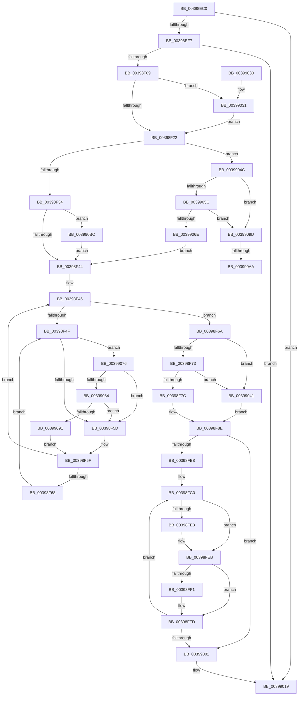

# KeRevertToUserGroupAffinityThread

- RVA: `0x00398EC0`–`0x003990CE` (길이 `526` bytes)
- VA: `0x0000000140398EC0`
- 실행 섹션: `.text`
- PDB 이름 있음: `예`; PDB Function 태그: `예`
- unwind 정보 RVA: `0x00081684`
- 디코드: `132`개 명령, `526/526` bytes 표시
- 미해석 바이트: `0` (있으면 어셈블리에 `.byte`로 보존)

> 이 문서는 커널 이미지의 기계어와 PDB 기호를 분석해 생성했습니다. 4번과 5번은 함수 원형과 자료형을 바이너리 사용 방식에서 추정한 C 해석이며 원본 소스 복구 결과는 아닙니다.

## 1. Dependencies

- 직접 호출 지점: **9**; 고유 호출 대상: **8**
- 직접 호출자로 확인된 함수: **50**
- RIP 상대 이미지 참조: **5**

### Outgoing calls
- `0x00398FA7` → [KiSetSystemAffinityThread](KiSetSystemAffinityThread_function_003993E0.md) (function, `0x003993E0`)
- `0x00398FD2` → [KiDeferredReadySingleThread](../25/KiDeferredReadySingleThread_function_00252FE0.md) (function, `0x00252FE0`)
- `0x00398FF8` → [KiFlushSoftwareInterruptBatch](../25/KiFlushSoftwareInterruptBatch_function_00252200.md) (function, `0x00252200`)
- `0x00399009` → [KiFlushSoftwareInterruptBatch](../25/KiFlushSoftwareInterruptBatch_function_00252200.md) (function, `0x00252200`)
- `0x00399014` → [KiCheckForThreadDispatch](../25/KiCheckForThreadDispatch_function_00250648.md) (function, `0x00250648`)
- `0x00399037` → [KiRaiseIrqlProcessIrqlFlags](../4F/KiRaiseIrqlProcessIrqlFlags_function_004F56FC.md) (function, `0x004F56FC`)
- `0x00399084` → [KiCheckVpBackingLongSpinWaitHypercall](../30/KiCheckVpBackingLongSpinWaitHypercall_function_0030F490.md) (function, `0x0030F490`)
- `0x00399093` → [HvlNotifyLongSpinWait](../30/HvlNotifyLongSpinWait_function_0030F460.md) (function, `0x0030F460`)
- `0x003990B1` → [KiLowerIrqlProcessIrqlFlags](../4F/KiLowerIrqlProcessIrqlFlags_function_004F5698.md) (function, `0x004F5698`)

### Direct callers
- [sub_00209285](../20/Unknown_function_00209285.md) at `0x0020928A`
- [PnpSendIrp](../27/PnpSendIrp_function_00271DF4.md) at `0x00271E95`
- [PnpGetRelatedTargetDevice](../27/PnpGetRelatedTargetDevice_function_00271F54.md) at `0x0027207F`
- [MiSetIdealProcessorThread](../2C/MiSetIdealProcessorThread_function_002C760C.md) at `0x002C767A`
- [KiDisconnectInterruptCommon](../2D/KiDisconnectInterruptCommon_function_002D36A8.md) at `0x002D37DF`
- [KiConnectInterrupt](../2D/KiConnectInterrupt_function_002D3F58.md) at `0x002D4100`
- [KeMaskInterrupt](../2D/KeMaskInterrupt_function_002D42FC.md) at `0x002D44AC`
- [KeGenericProcessorCallback](KeGenericProcessorCallback_function_00398C2C.md) at `0x00398E26`
- [KiInterruptDispatchCommon](KiInterruptDispatchCommon_function_0039F3D0.md) at `0x0039F68C`
- [ExpSaPageGroupDescriptorAllocate](../3B/ExpSaPageGroupDescriptorAllocate_function_003B4224.md) at `0x003B44A2`
- [HalQueryEnvironmentVariableInfoEx](../44/HalQueryEnvironmentVariableInfoEx_function_00448D50.md) at `0x00448E9F`
- [HalSetEnvironmentVariableEx](../44/HalSetEnvironmentVariableEx_function_00448EB0.md) at `0x00449028`
- [HalGetEnvironmentVariableEx](../44/HalGetEnvironmentVariableEx_function_00449100.md) at `0x00449280`
- [HalpEnumerateEnvironmentVariablesWithFilter](../44/HalpEnumerateEnvironmentVariablesWithFilter_function_004492D0.md) at `0x004496EE`
- [IopPassiveInterruptWorker](../45/IopPassiveInterruptWorker_function_0045F3A0.md) at `0x0045F44B`
- [KeRevertToUserAffinityThreadEx](../47/KeRevertToUserAffinityThreadEx_function_0047BA60.md) at `0x0047BA94`
- [HalpAllocatePmcCounterSetEx](../4C/HalpAllocatePmcCounterSetEx_function_004C5E70.md) at `0x004C61C2`
- [ExAllocateCacheAwarePushLock](../4C/ExAllocateCacheAwarePushLock_function_004C68C0.md) at `0x004C6A6D`
- [PpmInstallFeedbackCounters](../4D/PpmInstallFeedbackCounters_function_004D477C.md) at `0x004D491D`
- [PpmSetSimulatedIdle](../4D/PpmSetSimulatedIdle_function_004D74C0.md) at `0x004D75BA`
- [PpmClearSimulatedIdle](../4D/PpmClearSimulatedIdle_function_004D8C9C.md) at `0x004D8D83`
- [ExpWorkerThread](../4E/ExpWorkerThread_function_004ECAF0.md) at `0x004ECEDB`
- [MakeGdtReadOnly](../53/MakeGdtReadOnly_function_0053BA98.md) at `0x0053BB34`
- [HalpCreateMachineCheckErrorRecord](../54/HalpCreateMachineCheckErrorRecord_function_00540B10.md) at `0x00540C25`
- [HalpFreePmcCounterSet](../54/HalpFreePmcCounterSet_function_00547310.md) at `0x00547426`
- [HalpQueryCapsuleCapabilities](../56/HalpQueryCapsuleCapabilities_function_00563CE0.md) at `0x00563E02`
- [HalpUpdateCapsule](../56/HalpUpdateCapsule_function_00563E30.md) at `0x00563EE4`
- [Amd64InitializeUncoreProfilingEnhanced](../56/Amd64InitializeUncoreProfilingEnhanced_function_0056CF58.md) at `0x0056D039`
- [Amd64InitializeUncoreProfilingOriginal](../56/Amd64InitializeUncoreProfilingOriginal_function_0056D068.md) at `0x0056D149`
- [IopLiveDumpUncorralProcessors](../59/IopLiveDumpUncorralProcessors_function_0059F4E0.md) at `0x0059F55F`
- [KiDeregisterNmiSxCallback](../5B/KiDeregisterNmiSxCallback_function_005B1D4C.md) at `0x005B1E26`
- [KiDynamicProcessorInitialization](../5B/KiDynamicProcessorInitialization_function_005B7C6C.md) at `0x005B7CED`
- [KeRevertToUserAffinityThread](../5B/KeRevertToUserAffinityThread_function_005B8F90.md) at `0x005B8FB0`
- [KiInitMachineDependent](../5C/KiInitMachineDependent_function_005C1880.md) at `0x005C19BF`
- [KiDeferredBugcheckRecoveryWorker](../5C/KiDeferredBugcheckRecoveryWorker_function_005C75A0.md) at `0x005C7722`
- [KiStallBugcheckThread](../5C/KiStallBugcheckThread_function_005C7C78.md) at `0x005C7D7B`
- [PpmIdleInstallNewVetoList](../5C/PpmIdleInstallNewVetoList_function_005CFE90.md) at `0x005CFF84`
- [HalpLoadMicrocodeSerialized](../../page/70/HalpLoadMicrocodeSerialized_function_0070B450.md) at `0x0070B4FB`
- [PnpReplacePartitionUnit](../../page/73/PnpReplacePartitionUnit_function_00738550.md) at `0x00738EA4`
- [PpmIdleInitializeConcurrency](../../page/75/PpmIdleInitializeConcurrency_function_00754F30.md) at `0x00754FDA`
- [CmInitializeProcessor](../../page/7E/CmInitializeProcessor_function_007E4BAC.md) at `0x007E4CAA`
- [PnpCallAddDevice](../../page/8F/PnpCallAddDevice_function_008FC164.md) at `0x008FC26C`
- [HalpCmcWorkerRoutine](../../page/A6/HalpCmcWorkerRoutine_function_00A637B0.md) at `0x00A638CC`
- [HalpHandlePreviousMcaErrors](../../pagelk/B5/HalpHandlePreviousMcaErrors_function_00B5B8E4.md) at `0x00B5B9EA`
- [HalpMceInit](../../pagelk/B7/HalpMceInit_function_00B7B144.md) at `0x00B7B24D`
- [HalpCmciInit](../../pagelk/B7/HalpCmciInit_function_00B7C348.md) at `0x00B7C44E`
- [ViIsBTSSupported](../../pagevrfy/BA/ViIsBTSSupported_function_00BA3A44.md) at `0x00BA3B0E`
- [ViIsBTSSupported](../../pagevrfy/BA/ViIsBTSSupported_function_00BA3A44.md) at `0x00BA3B2A`
- [ViSetupBTSPerProcNoEnable](../../pagevrfy/BA/ViSetupBTSPerProcNoEnable_function_00BA3B70.md) at `0x00BA3C01`
- [KiComputeNumaCosts](../../init/C3/KiComputeNumaCosts_function_00C37AD4.md) at `0x00C37E45`
- [CmpInitializeMachineDependentConfiguration](../../init/C5/CmpInitializeMachineDependentConfiguration_function_00C5A02C.md) at `0x00C5A3AC`

### Static image references
- `0x00398F15` → RVA `0x00FC6D20` (`ALMOSTRO`; read)
- `0x00398F51` → RVA `0x00FC52AC` (`ALMOSTRO`; reference)
- `0x0039904C` → RVA `0x00FC7120` (`ALMOSTRO`; read)
- `0x0039905E` → RVA `0x00FC7128` (`ALMOSTRO`; read)
- `0x00399076` → RVA `0x00FC6AB8` (`ALMOSTRO`; read)

## 2. Other-region calls and transfers

- 다른 실행 섹션으로 향하는 call: **0**
- call이 아닌 외부 분기/꼬리 이동: **2**
  - `0x003990A4` → [sub_006E5A1A](../6E/Unknown_function_006E5A1A.md) (`tail-transfer`)
  - `0x003990B7` → [sub_006E5A1A](../6E/Unknown_function_006E5A1A.md) (`tail-transfer`)

## 3. Assembly (complete function range)

```asm
00398EC0  48 89 5C 24 08                  mov qword ptr [rsp + 8], rbx
00398EC5  48 89 6C 24 18                  mov qword ptr [rsp + 0x18], rbp
00398ECA  56                              push rsi
00398ECB  57                              push rdi
00398ECC  41 55                           push r13
00398ECE  41 56                           push r14
00398ED0  41 57                           push r15
00398ED2  48 83 EC 30                     sub rsp, 0x30
00398ED6  45 33 F6                        xor r14d, r14d
00398ED9  48 8B D9                        mov rbx, rcx
00398EDC  45 33 FF                        xor r15d, r15d
00398EDF  44 0F 20 C0                     mov rax, cr8
00398EE3  65 48 8B 3C 25 88 01 00 00      mov rdi, qword ptr gs:[0x188]
00398EEC  8B 47 74                        mov eax, dword ptr [rdi + 0x74]
00398EEF  A8 08                           test al, 8
00398EF1  0F 84 22 01 00 00               je 0x140399019
00398EF7  0F B7 49 0E                     movzx ecx, word ptr [rcx + 0xe]
00398EFB  66 0B 4B 0C                     or cx, word ptr [rbx + 0xc]
00398EFF  66 0B 4B 0A                     or cx, word ptr [rbx + 0xa]
00398F03  0F 85 10 01 00 00               jne 0x140399019
00398F09  44 0F 20 C5                     mov rbp, cr8
00398F0D  45 8D 6E 02                     lea r13d, [r14 + 2]
00398F11  45 0F 22 C5                     mov cr8, r13
00398F15  44 39 35 04 DE C2 00            cmp dword ptr [rip + 0xc2de04], r14d
00398F1C  0F 85 0F 01 00 00               jne 0x140399031
00398F22  65 48 8B 34 25 20 00 00 00      mov rsi, qword ptr gs:[0x20]
00398F2B  4C 39 33                        cmp qword ptr [rbx], r14
00398F2E  0F 85 18 01 00 00               jne 0x14039904c
00398F34  48 8B 8F 50 04 00 00            mov rcx, qword ptr [rdi + 0x450]
00398F3B  48 85 C9                        test rcx, rcx
00398F3E  0F 85 78 01 00 00               jne 0x1403990bc
00398F44  33 DB                           xor ebx, ebx
00398F46  F0 48 0F BA 6F 40 00            lock bts qword ptr [rdi + 0x40], 0
00398F4D  73 1B                           jae 0x140398f6a
00398F4F  FF C3                           inc ebx
00398F51  85 1D 55 C3 C2 00               test dword ptr [rip + 0xc2c355], ebx
00398F57  0F 84 19 01 00 00               je 0x140399076
00398F5D  F3 90                           pause
00398F5F  48 8B 47 40                     mov rax, qword ptr [rdi + 0x40]
00398F63  48 85 C0                        test rax, rax
00398F66  74 DE                           je 0x140398f46
00398F68  EB E5                           jmp 0x140398f4f
00398F6A  4D 85 F6                        test r14, r14
00398F6D  0F 85 CE 00 00 00               jne 0x140399041
00398F73  4D 85 FF                        test r15, r15
00398F76  0F 85 C5 00 00 00               jne 0x140399041
00398F7C  4C 8B B7 28 02 00 00            mov r14, qword ptr [rdi + 0x228]
00398F83  44 8B 8F C4 00 00 00            mov r9d, dword ptr [rdi + 0xc4]
00398F8A  83 67 74 F7                     and dword ptr [rdi + 0x74], 0xfffffff7
00398F8E  48 83 64 24 68 00               and qword ptr [rsp + 0x68], 0
00398F94  48 8D 44 24 68                  lea rax, [rsp + 0x68]
00398F99  4D 8B C7                        mov r8, r15
00398F9C  48 89 44 24 20                  mov qword ptr [rsp + 0x20], rax
00398FA1  49 8B D6                        mov rdx, r14
00398FA4  48 8B CE                        mov rcx, rsi
00398FA7  E8 34 04 00 00                  call 0x1403993e0
00398FAC  48 8B 5C 24 68                  mov rbx, qword ptr [rsp + 0x68]
00398FB1  33 FF                           xor edi, edi
00398FB3  48 85 DB                        test rbx, rbx
00398FB6  74 4A                           je 0x140399002
00398FB8  48 8B 03                        mov rax, qword ptr [rbx]
00398FBB  48 89 44 24 68                  mov qword ptr [rsp + 0x68], rax
00398FC0  48 8D 93 28 FF FF FF            lea rdx, [rbx - 0xd8]
00398FC7  45 33 C9                        xor r9d, r9d
00398FCA  4C 8D 44 24 68                  lea r8, [rsp + 0x68]
00398FCF  48 8B CE                        mov rcx, rsi
00398FD2  E8 09 A0 EB FF                  call 0x140252fe0
00398FD7  48 8B 5C 24 68                  mov rbx, qword ptr [rsp + 0x68]
00398FDC  FF C7                           inc edi
00398FDE  48 85 DB                        test rbx, rbx
00398FE1  74 08                           je 0x140398feb
00398FE3  48 8B 03                        mov rax, qword ptr [rbx]
00398FE6  48 89 44 24 68                  mov qword ptr [rsp + 0x68], rax
00398FEB  40 F6 C7 0F                     test dil, 0xf
00398FEF  75 0C                           jne 0x140398ffd
00398FF1  48 8D 8E D8 35 00 00            lea rcx, [rsi + 0x35d8]
00398FF8  E8 03 92 EB FF                  call 0x140252200
00398FFD  48 85 DB                        test rbx, rbx
00399000  75 BE                           jne 0x140398fc0
00399002  48 8D 8E D8 35 00 00            lea rcx, [rsi + 0x35d8]
00399009  E8 F2 91 EB FF                  call 0x140252200
0039900E  40 8A D5                        mov dl, bpl
00399011  48 8B CE                        mov rcx, rsi
00399014  E8 2F 76 EB FF                  call 0x140250648
00399019  48 8B 5C 24 60                  mov rbx, qword ptr [rsp + 0x60]
0039901E  48 8B 6C 24 70                  mov rbp, qword ptr [rsp + 0x70]
00399023  48 83 C4 30                     add rsp, 0x30
00399027  41 5F                           pop r15
00399029  41 5E                           pop r14
0039902B  41 5D                           pop r13
0039902D  5F                              pop rdi
0039902E  5E                              pop rsi
0039902F  C3                              ret
00399030  CC                              int3
00399031  41 8A D5                        mov dl, r13b
00399034  40 8A CD                        mov cl, bpl
00399037  E8 C0 C6 15 00                  call 0x1404f56fc
0039903C  E9 E1 FE FF FF                  jmp 0x140398f22
00399041  41 B9 00 08 00 00               mov r9d, 0x800
00399047  E9 42 FF FF FF                  jmp 0x140398f8e
0039904C  0F B7 05 CD E0 C2 00            movzx eax, word ptr [rip + 0xc2e0cd]
00399053  0F B7 4B 08                     movzx ecx, word ptr [rbx + 8]
00399057  66 3B C8                        cmp cx, ax
0039905A  73 41                           jae 0x14039909d
0039905C  8B C1                           mov eax, ecx
0039905E  48 8D 0D C3 E0 C2 00            lea rcx, [rip + 0xc2e0c3]
00399065  48 8B 04 C1                     mov rax, qword ptr [rcx + rax*8]
00399069  48 21 03                        and qword ptr [rbx], rax
0039906C  74 2F                           je 0x14039909d
0039906E  4C 8B FB                        mov r15, rbx
00399071  E9 CE FE FF FF                  jmp 0x140398f44
00399076  8B 05 3C DA C2 00               mov eax, dword ptr [rip + 0xc2da3c]
0039907C  A8 40                           test al, 0x40
0039907E  0F 84 D9 FE FF FF               je 0x140398f5d
00399084  E8 07 64 F7 FF                  call 0x14030f490
00399089  84 C0                           test al, al
0039908B  0F 84 CC FE FF FF               je 0x140398f5d
00399091  8B CB                           mov ecx, ebx
00399093  E8 C8 63 F7 FF                  call 0x14030f460
00399098  E9 C2 FE FF FF                  jmp 0x140398f5f
0039909D  44 39 35 7C DC C2 00            cmp dword ptr [rip + 0xc2dc7c], r14d
003990A4  0F 84 70 C9 34 00               je 0x1406e5a1a
003990AA  44 0F 20 C1                     mov rcx, cr8
003990AE  40 8A D5                        mov dl, bpl
003990B1  E8 E2 C5 15 00                  call 0x1404f5698
003990B6  90                              nop
003990B7  E9 5E C9 34 00                  jmp 0x1406e5a1a
003990BC  8A 41 13                        mov al, byte ptr [rcx + 0x13]
003990BF  4C 8B 71 18                     mov r14, qword ptr [rcx + 0x18]
003990C3  41 22 C5                        and al, r13b
003990C6  88 41 12                        mov byte ptr [rcx + 0x12], al
003990C9  E9 76 FE FF FF                  jmp 0x140398f44
```

## 4. C-style interpretation (structured pseudocode)

```c
__int64 __fastcall KeRevertToUserGroupAffinityThread(__int64 a1)
{
    __int64 result;
    __int64 v_r14;
    __int64 v_r15;
    __int64 v_rbx;
    __int64 v_rdi;
    __int64 v_rsp;
    unsigned __int64 v_stack_m38;
    unsigned __int64 v_stack_p10;
    unsigned __int64 v_stack_p18;
    unsigned __int64 v_stack_p8;

    v_stack_p8 = v_rbx;
    v_stack_p18 = v_rbp;
    v_rsp = (v_rsp) - (48);
    v_r14 = 0;
    v_r15 = 0;
    if ((((unsigned __int8)((unsigned int)(*(unsigned int *)(*(unsigned __int64 *)(gs_base + (0 + 392)) + 116)))) & (8)) == 0) goto loc_00399019;
    a1 = (unsigned __int16)((*(unsigned __int16 *)(a1 + 14)) | (*(unsigned __int16 *)(a1 + 12)));
    a1 = (unsigned __int16)((a1) | (*(unsigned __int16 *)(a1 + 10)));
    if (condition_is_not_equal) goto loc_00399019;
    if ((*(unsigned int *)(v_rip + 12770820)) != 0) goto loc_00399031;
loc_00398F22:
    if ((*(unsigned __int64 *)(a1)) != 0) goto loc_0039904C;
    if (*(unsigned __int64 *)(*(unsigned __int64 *)(gs_base + (0 + 392)) + 1104) != 0) goto loc_003990BC;
loc_00398F44:
    v_rbx = 0;
loc_00398F46:
    if (condition_is_above_or_equal) goto loc_00398F6A;
loc_00398F4F:
    v_rbx = (unsigned int)((v_rbx) + 1);
    if (((*(unsigned int *)(v_rip + 12763989)) & ((unsigned int)(v_rbx))) == 0) goto loc_00399076;
loc_00398F5D:
loc_00398F5F:
    if (*(unsigned __int64 *)(*(unsigned __int64 *)(gs_base + (0 + 392)) + 64) == 0) goto loc_00398F46;
    goto loc_00398F4F;
loc_00398F6A:
    if (0 != 0) goto loc_00399041;
    if (0 != 0) goto loc_00399041;
loc_00398F8E:
    v_stack_m38 = v_stack_p10;
    result = KiSetSystemAffinityThread(*(unsigned __int64 *)(gs_base + (0 + 32)), *(unsigned __int64 *)(*(unsigned __int64 *)(gs_base + (0 + 392)) + 552), 0, (unsigned int)(*(unsigned int *)(*(unsigned __int64 *)(gs_base + (0 + 392)) + 196)));
    v_rdi = 0;
    if (v_stack_p10 == 0) goto loc_00399002;
    v_stack_p10 = *(unsigned __int64 *)(v_stack_p10);
loc_00398FC0:
    a4 = 0;
    result = KiDeferredReadySingleThread(*(unsigned __int64 *)(gs_base + (0 + 32)), v_stack_p10 - 216, v_stack_p10, a4);
    v_rdi = (unsigned int)((v_rdi) + 1);
    if (v_stack_p10 != 0) {
        result = *(unsigned __int64 *)(v_stack_p10);
        v_stack_p10 = result;
    }
    if ((((unsigned __int8)(v_rdi)) & (15)) == 0) {
        a1 = *(unsigned __int64 *)(gs_base + (0 + 32)) + 13784;
        result = KiFlushSoftwareInterruptBatch(a1, v_stack_p10 - 216, v_stack_p10, a4);
    }
    if (v_stack_p10 != 0) goto loc_00398FC0;
loc_00399002:
    result = KiFlushSoftwareInterruptBatch(*(unsigned __int64 *)(gs_base + (0 + 32)) + 13784, v_stack_p10 - 216, v_stack_p10, a4);
    result = KiCheckForThreadDispatch(*(unsigned __int64 *)(gs_base + (0 + 32)), (unsigned __int8)(v_cr8), v_stack_p10, a4);
loc_00399019:
    v_rsp = (v_rsp) + (48);
    return result;
loc_00399031:
    result = KiRaiseIrqlProcessIrqlFlags((unsigned __int8)(v_stack_p18), (unsigned __int8)(v_r14 + 2), v_stack_p10, a4);
    goto loc_00398F22;
loc_00399041:
    goto loc_00398F8E;
loc_0039904C:
    if (((unsigned __int16)(*(unsigned __int16 *)(v_stack_p8 + 8))) >= ((unsigned __int16)(*(unsigned __int16 *)(v_rip + 12771533)))) goto loc_0039909D;
    if (((unsigned __int16)(*(unsigned __int16 *)(v_stack_p8 + 8))) == ((unsigned __int16)(*(unsigned __int16 *)(v_rip + 12771533)))) goto loc_0039909D;
    goto loc_00398F44;
loc_00399076:
    if ((((unsigned __int8)((unsigned int)(*(unsigned int *)(v_rip + 12769852)))) & (64)) == 0) goto loc_00398F5D;
    result = KiCheckVpBackingLongSpinWaitHypercall(v_rip + 12771523, (unsigned __int8)(v_r14 + 2), v_stack_p10, (unsigned int)(0x800ULL));
    if ((unsigned __int8)(result) == 0) goto loc_00398F5D;
    result = HvlNotifyLongSpinWait((unsigned int)((unsigned int)(v_stack_p8)), (unsigned __int8)(v_r14 + 2), v_stack_p10, (unsigned int)(0x800ULL));
    goto loc_00398F5F;
loc_0039909D:
    result = KiLowerIrqlProcessIrqlFlags(v_r14 + 2, (unsigned __int8)(v_stack_p18), v_stack_p10, (unsigned int)(0x800ULL));
loc_003990BC:
    result = (unsigned __int8)((*(unsigned __int8 *)(v_r14 + 2 + 19)) & ((unsigned __int8)(v_r14 + 2)));
    *(unsigned __int8 *)(v_r14 + 2 + 18) = (unsigned __int8)(result);
    goto loc_00398F44;
}
```

## 5. (Beta) C Style

```c
int64_t KeRevertToUserGroupAffinityThread(void *Arg1)
{
    uint8_t *arg1 = (uint8_t *)Arg1;

    int64_t result;
    int64_t local_r14;
    int64_t local_r15;
    int64_t local_rbx;
    int64_t local_rdi;
    int64_t local_rsp;
    uint64_t v_stack_m38;
    uint64_t v_stack_p10;
    uint64_t v_stack_p18;
    uint64_t v_stack_p8;

    v_stack_p8 = local_rbx;
    v_stack_p18 = local_rbp;
    local_rsp = (local_rsp) - (48);
    local_r14 = 0;
    local_r15 = 0;
    if ((((uint8_t)((uint32_t)(*(uint32_t *)(*(uint64_t *)(gs_base + (0 + 0x188)) + 0x74)))) & (8)) == 0) goto loc_00399019;
    Arg1 = (uint16_t)((*(uint16_t *)(arg1 + 0xE)) | (*(uint16_t *)(arg1 + 0xC)));
    Arg1 = (uint16_t)((Arg1) | (*(uint16_t *)(arg1 + 0xA)));
    if (condition_is_not_equal) goto loc_00399019;
    if ((*(uint32_t *)(v_rip + 0xC2DE04)) != 0) goto loc_00399031;
loc_00398F22:
    if ((*(uint64_t *)(arg1)) != 0) goto loc_0039904C;
    if (*(uint64_t *)(*(uint64_t *)(gs_base + (0 + 0x188)) + 0x450) != 0) goto loc_003990BC;
loc_00398F44:
    local_rbx = 0;
loc_00398F46:
    if (condition_is_above_or_equal) goto loc_00398F6A;
loc_00398F4F:
    local_rbx = (uint32_t)((local_rbx) + 1);
    if (((*(uint32_t *)(v_rip + 0xC2C355)) & ((uint32_t)(local_rbx))) == 0) goto loc_00399076;
loc_00398F5D:
loc_00398F5F:
    if (*(uint64_t *)(*(uint64_t *)(gs_base + (0 + 0x188)) + 0x40) == 0) goto loc_00398F46;
    goto loc_00398F4F;
loc_00398F6A:
    if (0 != 0) goto loc_00399041;
    if (0 != 0) goto loc_00399041;
loc_00398F8E:
    v_stack_m38 = v_stack_p10;
    result = KiSetSystemAffinityThread(*(uint64_t *)(gs_base + (0 + 0x20)), *(uint64_t *)(*(uint64_t *)(gs_base + (0 + 0x188)) + 0x228), 0, (uint32_t)(*(uint32_t *)(*(uint64_t *)(gs_base + (0 + 0x188)) + 0xC4)));
    local_rdi = 0;
    if (v_stack_p10 == 0) goto loc_00399002;
    v_stack_p10 = *(uint64_t *)(v_stack_p10);
loc_00398FC0:
    a4 = 0;
    result = KiDeferredReadySingleThread(*(uint64_t *)(gs_base + (0 + 0x20)), v_stack_p10 - 216, v_stack_p10, a4);
    local_rdi = (uint32_t)((local_rdi) + 1);
    if (v_stack_p10 != 0) {
        result = *(uint64_t *)(v_stack_p10);
        v_stack_p10 = result;
    }
    if ((((uint8_t)(local_rdi)) & (15)) == 0) {
        Arg1 = *(uint64_t *)(gs_base + (0 + 0x20)) + 13784;
        result = KiFlushSoftwareInterruptBatch(Arg1, v_stack_p10 - 216, v_stack_p10, a4);
    }
    if (v_stack_p10 != 0) goto loc_00398FC0;
loc_00399002:
    result = KiFlushSoftwareInterruptBatch(*(uint64_t *)(gs_base + (0 + 0x20)) + 13784, v_stack_p10 - 216, v_stack_p10, a4);
    result = KiCheckForThreadDispatch(*(uint64_t *)(gs_base + (0 + 0x20)), (uint8_t)(v_cr8), v_stack_p10, a4);
loc_00399019:
    local_rsp = (local_rsp) + (48);
    return result;
loc_00399031:
    result = KiRaiseIrqlProcessIrqlFlags((uint8_t)(v_stack_p18), (uint8_t)(local_r14 + 2), v_stack_p10, a4);
    goto loc_00398F22;
loc_00399041:
    goto loc_00398F8E;
loc_0039904C:
    if (((uint16_t)(*(uint16_t *)(v_stack_p8 + 0x8))) >= ((uint16_t)(*(uint16_t *)(v_rip + 0xC2E0CD)))) goto loc_0039909D;
    if (((uint16_t)(*(uint16_t *)(v_stack_p8 + 0x8))) == ((uint16_t)(*(uint16_t *)(v_rip + 0xC2E0CD)))) goto loc_0039909D;
    goto loc_00398F44;
loc_00399076:
    if ((((uint8_t)((uint32_t)(*(uint32_t *)(v_rip + 0xC2DA3C)))) & (64)) == 0) goto loc_00398F5D;
    result = KiCheckVpBackingLongSpinWaitHypercall(v_rip + 12771523, (uint8_t)(local_r14 + 2), v_stack_p10, (uint32_t)(0x800ULL));
    if ((uint8_t)(result) == 0) goto loc_00398F5D;
    result = HvlNotifyLongSpinWait((uint32_t)((uint32_t)(v_stack_p8)), (uint8_t)(local_r14 + 2), v_stack_p10, (uint32_t)(0x800ULL));
    goto loc_00398F5F;
loc_0039909D:
    result = KiLowerIrqlProcessIrqlFlags(local_r14 + 2, (uint8_t)(v_stack_p18), v_stack_p10, (uint32_t)(0x800ULL));
loc_003990BC:
    result = (uint8_t)((*(uint8_t *)(local_r14 + 0x2 + 0x13)) & ((uint8_t)(local_r14 + 2)));
    *(uint8_t *)(local_r14 + 0x2 + 0x12) = (uint8_t)(result);
    goto loc_00398F44;
}
```

### 관측된 메모리 오프셋

구조체 형식이 확인되지 않은 접근은 인자 기준의 오프셋으로만 기록했습니다.

| 기준 인자 | 오프셋 표현 | 폭 (bit) | 접근 |
|---|---:|---:|---|
| `Arg1` | `+ 0x0` | `64` | `R` |
| `Arg1` | `+ 0x0` | `64` | `R/W` |
| `Arg1` | `+ 0x8` | `16` | `R` |
| `Arg1` | `+ 0xA` | `16` | `R` |
| `Arg1` | `+ 0xC` | `16` | `R` |
| `Arg1` | `+ 0xE` | `16` | `R` |

## 6. Execution-region graph

[열기: 2D/3D 그래프와 함수 탐색 컨트롤 패널](../../../control-panel.html?section=text&rva=0x00398EC0&view=graph)

- 2D 그래프는 위에서 아래로 흐르고, 3D 그래프는 빈 공간을 드래그해 회전합니다. Shift+드래그는 이동, 휠은 확대·축소, 함수 노드 선택은 대상 보고서 이동입니다.

### Static fallback


