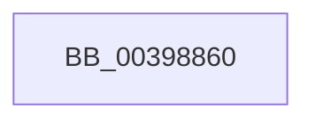

# KeSetPriorityBoost

- RVA: `0x00398860`–`0x00398882` (길이 `34` bytes)
- VA: `0x0000000140398860`
- 실행 섹션: `.text`
- PDB 이름 있음: `예`; PDB Function 태그: `아니요`
- unwind 정보 RVA: `0x0008152C`
- 디코드: `8`개 명령, `34/34` bytes 표시
- 미해석 바이트: `0` (있으면 어셈블리에 `.byte`로 보존)

> 이 문서는 커널 이미지의 기계어와 PDB 기호를 분석해 생성했습니다. 4번과 5번은 함수 원형과 자료형을 바이너리 사용 방식에서 추정한 C 해석이며 원본 소스 복구 결과는 아닙니다.

## 1. Dependencies

- 직접 호출 지점: **0**; 고유 호출 대상: **0**
- 직접 호출자로 확인된 함수: **3**
- RIP 상대 이미지 참조: **1**

### Outgoing calls
- 직접 디코드된 call 명령이 없습니다.

### Direct callers
- [KeGenericProcessorCallback](KeGenericProcessorCallback_function_00398C2C.md) at `0x00398D13`
- [FsRtlpWaitForIoAtEof](../41/FsRtlpWaitForIoAtEof_function_00415298.md) at `0x004153B1`
- [FsRtlpDoBoost](../48/FsRtlpDoBoost_function_0048B198.md) at `0x0048B234`

### Static image references
- `0x00398868` → RVA `0x00FCFF00` (`CACHEALI`; read)

## 2. Other-region calls and transfers

- 다른 실행 섹션으로 향하는 call: **0**
- call이 아닌 외부 분기/꼬리 이동: **1**
  - `0x0039887C` → [sub_003989C5](Unknown_function_003989C5.md) (`tail-transfer`)

## 3. Assembly (complete function range)

```asm
00398860  40 53                           push rbx
00398862  41 56                           push r14
00398864  48 83 EC 48                     sub rsp, 0x48
00398868  48 8D 05 91 76 C3 00            lea rax, [rip + 0xc37691]
0039886F  44 8B F2                        mov r14d, edx
00398872  48 8B D9                        mov rbx, rcx
00398875  48 39 81 20 02 00 00            cmp qword ptr [rcx + 0x220], rax
0039887C  0F 84 43 01 00 00               je 0x1403989c5
```

## 4. C-style interpretation (structured pseudocode)

```c
__int64 __fastcall KeSetPriorityBoost(__int64 a1, int a2)
{
    __int64 v_rsp;

    v_rsp = (v_rsp) - (72);
}
```

## 5. (Beta) C Style

```c
int64_t KeSetPriorityBoost(void *Arg1, int32_t Arg2)
{
    uint8_t *arg1 = (uint8_t *)Arg1;

    int64_t local_rsp;

    local_rsp = (local_rsp) - (72);
}
```

### 관측된 메모리 오프셋

구조체 형식이 확인되지 않은 접근은 인자 기준의 오프셋으로만 기록했습니다.

| 기준 인자 | 오프셋 표현 | 폭 (bit) | 접근 |
|---|---:|---:|---|
| `Arg1` | `+ 0x220` | `64` | `R` |

## 6. Execution-region graph

[열기: 2D/3D 그래프와 함수 탐색 컨트롤 패널](../../../control-panel.html?section=text&rva=0x00398860&view=graph)

- 2D 그래프는 위에서 아래로 흐르고, 3D 그래프는 빈 공간을 드래그해 회전합니다. Shift+드래그는 이동, 휠은 확대·축소, 함수 노드 선택은 대상 보고서 이동입니다.

### Static fallback


