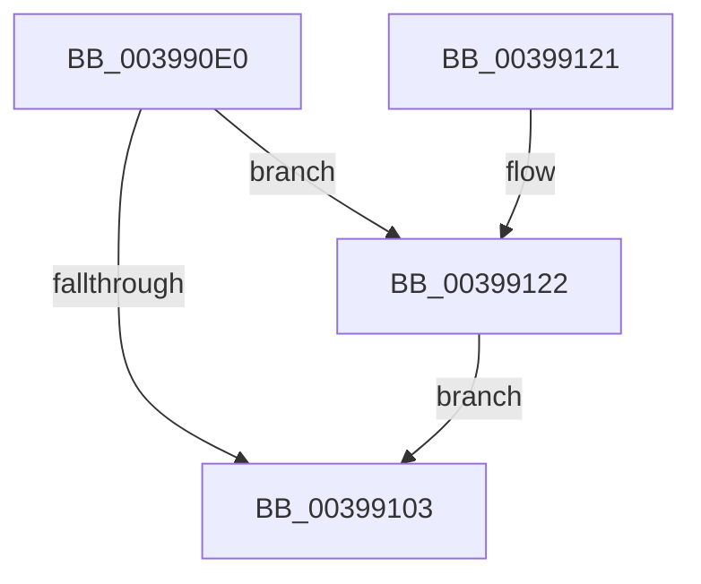

# KeSetSystemAffinityThreadEx

- RVA: `0x003990E0`–`0x0039912E` (길이 `78` bytes)
- VA: `0x00000001403990E0`
- 실행 섹션: `.text`
- PDB 이름 있음: `예`; PDB Function 태그: `아니요`
- unwind 정보 RVA: `0x000816B0`
- 디코드: `20`개 명령, `78/78` bytes 표시
- 미해석 바이트: `0` (있으면 어셈블리에 `.byte`로 보존)

> 이 문서는 커널 이미지의 기계어와 PDB 기호를 분석해 생성했습니다. 4번과 5번은 함수 원형과 자료형을 바이너리 사용 방식에서 추정한 C 해석이며 원본 소스 복구 결과는 아닙니다.

## 1. Dependencies

- 직접 호출 지점: **1**; 고유 호출 대상: **1**
- 직접 호출자로 확인된 함수: **1**
- RIP 상대 이미지 참조: **2**

### Outgoing calls
- `0x00399112` → [KeSetSystemGroupAffinityThread](KeSetSystemGroupAffinityThread_function_00399140.md) (function, `0x00399140`)

### Direct callers
- [KeSetSystemAffinityThread](../4C/KeSetSystemAffinityThread_function_004CC0C0.md) at `0x004CC0C4`

### Static image references
- `0x003990E9` → RVA `0x00FC6AF2` (`ALMOSTRO`; read)
- `0x00399122` → RVA `0x00FC5018` (`ALMOSTRO`; read)

## 2. Other-region calls and transfers

- 다른 실행 섹션으로 향하는 call: **0**
- 별도 외부 분기/꼬리 이동을 확인하지 못했습니다.

## 3. Assembly (complete function range)

```asm
003990E0  48 83 EC 48                     sub rsp, 0x48
003990E4  0F 57 C9                        xorps xmm1, xmm1
003990E7  33 C0                           xor eax, eax
003990E9  38 05 03 DA C2 00               cmp byte ptr [rip + 0xc2da03], al
003990EF  0F 57 C0                        xorps xmm0, xmm0
003990F2  0F 11 4C 24 20                  movups xmmword ptr [rsp + 0x20], xmm1
003990F7  48 89 4C 24 20                  mov qword ptr [rsp + 0x20], rcx
003990FC  0F 11 44 24 30                  movups xmmword ptr [rsp + 0x30], xmm0
00399101  75 1F                           jne 0x140399122
00399103  48 8D 54 24 30                  lea rdx, [rsp + 0x30]
00399108  66 89 44 24 28                  mov word ptr [rsp + 0x28], ax
0039910D  48 8D 4C 24 20                  lea rcx, [rsp + 0x20]
00399112  E8 29 00 00 00                  call 0x140399140
00399117  48 8B 44 24 30                  mov rax, qword ptr [rsp + 0x30]
0039911C  48 83 C4 48                     add rsp, 0x48
00399120  C3                              ret
00399121  CC                              int3
00399122  0F B7 05 EF BE C2 00            movzx eax, word ptr [rip + 0xc2beef]
00399129  66 FF C8                        dec ax
0039912C  EB D5                           jmp 0x140399103
```

## 4. C-style interpretation (structured pseudocode)

```c
__int64 __fastcall KeSetSystemAffinityThreadEx(__int64 a1)
{
    __int64 result;
    __int64 v_rsp;
    unsigned __int64 v_stack_m18;
    unsigned __int16 v_stack_m20;
    unsigned __int64 v_stack_m28;

    v_rsp = (v_rsp) - (72);
    result = 0;
    v_stack_m28 = v_xmm1;
    v_stack_m28 = a1;
    v_stack_m18 = v_xmm0;
    if ((*(unsigned __int8 *)(v_rip + 12769795)) != 0) goto loc_00399122;
loc_00399103:
    v_stack_m20 = 0;
    result = KeSetSystemGroupAffinityThread(v_stack_m28, v_stack_m18, a3, a4);
    v_rsp = (v_rsp) + (72);
    return v_stack_m18;
loc_00399122:
    result = (unsigned __int16)((*(unsigned __int16 *)(v_rip + 12762863)) - 1);
    goto loc_00399103;
}
```

## 5. (Beta) C Style

```c
int64_t KeSetSystemAffinityThreadEx(int64_t Arg1)
{
    int64_t result;
    int64_t local_rsp;
    uint64_t v_stack_m18;
    uint16_t v_stack_m20;
    uint64_t v_stack_m28;

    local_rsp = (local_rsp) - (72);
    result = 0;
    v_stack_m28 = v_xmm1;
    v_stack_m28 = Arg1;
    v_stack_m18 = v_xmm0;
    if ((*(uint8_t *)(v_rip + 0xC2DA03)) != 0) goto loc_00399122;
loc_00399103:
    v_stack_m20 = 0;
    result = KeSetSystemGroupAffinityThread(v_stack_m28, v_stack_m18, a3, a4);
    local_rsp = (local_rsp) + (72);
    return v_stack_m18;
loc_00399122:
    result = (uint16_t)((*(uint16_t *)(v_rip + 0xC2BEEF)) - 1);
    goto loc_00399103;
}
```

## 6. Execution-region graph

[열기: 2D/3D 그래프와 함수 탐색 컨트롤 패널](../../../control-panel.html?section=text&rva=0x003990E0&view=graph)

- 2D 그래프는 위에서 아래로 흐르고, 3D 그래프는 빈 공간을 드래그해 회전합니다. Shift+드래그는 이동, 휠은 확대·축소, 함수 노드 선택은 대상 보고서 이동입니다.

### Static fallback


