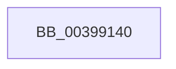

# KeSetSystemGroupAffinityThread

- RVA: `0x00399140`–`0x00399149` (길이 `9` bytes)
- VA: `0x0000000140399140`
- 실행 섹션: `.text`
- PDB 이름 있음: `예`; PDB Function 태그: `예`
- unwind 정보 RVA: `0x000816BC`
- 디코드: `3`개 명령, `9/9` bytes 표시
- 미해석 바이트: `0` (있으면 어셈블리에 `.byte`로 보존)

> 이 문서는 커널 이미지의 기계어와 PDB 기호를 분석해 생성했습니다. 4번과 5번은 함수 원형과 자료형을 바이너리 사용 방식에서 추정한 C 해석이며 원본 소스 복구 결과는 아닙니다.

## 1. Dependencies

- 직접 호출 지점: **0**; 고유 호출 대상: **0**
- 직접 호출자로 확인된 함수: **47**
- RIP 상대 이미지 참조: **0**

### Outgoing calls
- 직접 디코드된 call 명령이 없습니다.

### Direct callers
- [PnpSetDeviceAffinityThread](../27/PnpSetDeviceAffinityThread_function_00271EA4.md) at `0x00271F42`
- [MiSetIdealProcessorThread](../2C/MiSetIdealProcessorThread_function_002C760C.md) at `0x002C7670`
- [KiDisconnectInterruptCommon](../2D/KiDisconnectInterruptCommon_function_002D36A8.md) at `0x002D377A`
- [KiConnectInterrupt](../2D/KiConnectInterrupt_function_002D3F58.md) at `0x002D400B`
- [KeGenericProcessorCallback](KeGenericProcessorCallback_function_00398C2C.md) at `0x00398D75`
- [KeSetSystemAffinityThreadEx](KeSetSystemAffinityThreadEx_function_003990E0.md) at `0x00399112`
- [KiInterruptDispatchCommon](KiInterruptDispatchCommon_function_0039F3D0.md) at `0x0039F4FC`
- [HalQueryEnvironmentVariableInfoEx](../44/HalQueryEnvironmentVariableInfoEx_function_00448D50.md) at `0x00448E82`
- [HalSetEnvironmentVariableEx](../44/HalSetEnvironmentVariableEx_function_00448EB0.md) at `0x00448FA5`
- [HalGetEnvironmentVariableEx](../44/HalGetEnvironmentVariableEx_function_00449100.md) at `0x004491F5`
- [HalpEnumerateEnvironmentVariablesWithFilter](../44/HalpEnumerateEnvironmentVariablesWithFilter_function_004492D0.md) at `0x004493F2`
- [IopPassiveInterruptWorker](../45/IopPassiveInterruptWorker_function_0045F3A0.md) at `0x0045F3E6`
- [KiAcquireInterruptConnectLock](../48/KiAcquireInterruptConnectLock_function_00489850.md) at `0x00489893`
- [HalpAllocatePmcCounterSetEx](../4C/HalpAllocatePmcCounterSetEx_function_004C5E70.md) at `0x004C5F2B`
- [ExAllocateCacheAwarePushLock](../4C/ExAllocateCacheAwarePushLock_function_004C68C0.md) at `0x004C6A17`
- [ExAllocateCacheAwarePushLock](../4C/ExAllocateCacheAwarePushLock_function_004C68C0.md) at `0x004C6A23`
- [PpmInstallFeedbackCounters](../4D/PpmInstallFeedbackCounters_function_004D477C.md) at `0x004D47F7`
- [PpmSetSimulatedIdle](../4D/PpmSetSimulatedIdle_function_004D74C0.md) at `0x004D7542`
- [PpmClearSimulatedIdle](../4D/PpmClearSimulatedIdle_function_004D8C9C.md) at `0x004D8D12`
- [MakeGdtReadOnly](../53/MakeGdtReadOnly_function_0053BA98.md) at `0x0053BB07`
- [HalpCreateMachineCheckErrorRecord](../54/HalpCreateMachineCheckErrorRecord_function_00540B10.md) at `0x00540B95`
- [HalpFreePmcCounterSet](../54/HalpFreePmcCounterSet_function_00547310.md) at `0x0054738B`
- [HalpQueryCapsuleCapabilities](../56/HalpQueryCapsuleCapabilities_function_00563CE0.md) at `0x00563D75`
- [HalpUpdateCapsule](../56/HalpUpdateCapsule_function_00563E30.md) at `0x00563EC0`
- [Amd64InitializeUncoreProfilingEnhanced](../56/Amd64InitializeUncoreProfilingEnhanced_function_0056CF58.md) at `0x0056CFF9`
- [Amd64InitializeUncoreProfilingEnhanced](../56/Amd64InitializeUncoreProfilingEnhanced_function_0056CF58.md) at `0x0056D004`
- [Amd64InitializeUncoreProfilingOriginal](../56/Amd64InitializeUncoreProfilingOriginal_function_0056D068.md) at `0x0056D109`
- [Amd64InitializeUncoreProfilingOriginal](../56/Amd64InitializeUncoreProfilingOriginal_function_0056D068.md) at `0x0056D114`
- [IopLiveDumpCorralProcessors](../59/IopLiveDumpCorralProcessors_function_0059B720.md) at `0x0059B7B3`
- [KiDynamicProcessorInitialization](../5B/KiDynamicProcessorInitialization_function_005B7C6C.md) at `0x005B7CD0`
- [KiSetSystemAffinityThreadToProcessor](../5C/KiSetSystemAffinityThreadToProcessor_function_005C4588.md) at `0x005C45CA`
- [KiDeferredBugcheckRecoveryWorker](../5C/KiDeferredBugcheckRecoveryWorker_function_005C75A0.md) at `0x005C762A`
- [KiStallBugcheckThread](../5C/KiStallBugcheckThread_function_005C7C78.md) at `0x005C7D24`
- [PpmIdleInstallNewVetoList](../5C/PpmIdleInstallNewVetoList_function_005CFE90.md) at `0x005CFEE0`
- [sub_006E72E8](../6E/Unknown_function_006E72E8.md) at `0x006E72EA`
- [HalpLoadMicrocodeSerialized](../../page/70/HalpLoadMicrocodeSerialized_function_0070B450.md) at `0x0070B4D1`
- [HalpLoadMicrocodeSerialized](../../page/70/HalpLoadMicrocodeSerialized_function_0070B450.md) at `0x0070B4DD`
- [PnpReplacePartitionUnit](../../page/73/PnpReplacePartitionUnit_function_00738550.md) at `0x00738E93`
- [PpmIdleInitializeConcurrency](../../page/75/PpmIdleInitializeConcurrency_function_00754F30.md) at `0x00754FBC`
- [CmInitializeProcessor](../../page/7E/CmInitializeProcessor_function_007E4BAC.md) at `0x007E4C92`
- [HalpCmcWorkerRoutine](../../page/A6/HalpCmcWorkerRoutine_function_00A637B0.md) at `0x00A6385D`
- [HalpHandlePreviousMcaErrors](../../pagelk/B5/HalpHandlePreviousMcaErrors_function_00B5B8E4.md) at `0x00B5B9A2`
- [HalpInitializeMce](../../pagelk/B5/HalpInitializeMce_function_00B5BC04.md) at `0x00B5BD38`
- [PopEndMirroring](../../pagelk/B7/PopEndMirroring_function_00B75E50.md) at `0x00B75FC4`
- [PopInvokeSystemStateHandler](../../pagelk/B7/PopInvokeSystemStateHandler_function_00B76A6C.md) at `0x00B76BE6`
- [HalpMceInit](../../pagelk/B7/HalpMceInit_function_00B7B144.md) at `0x00B7B203`
- [HalpCmciInit](../../pagelk/B7/HalpCmciInit_function_00B7C348.md) at `0x00B7C3F6`
- [ViIsBTSSupported](../../pagevrfy/BA/ViIsBTSSupported_function_00BA3A44.md) at `0x00BA3ABC`
- [ViSetupBTSPerProcNoEnable](../../pagevrfy/BA/ViSetupBTSPerProcNoEnable_function_00BA3B70.md) at `0x00BA3BDE`
- [KiComputeNumaCosts](../../init/C3/KiComputeNumaCosts_function_00C37AD4.md) at `0x00C37CED`
- [CmpInitializeMachineDependentConfiguration](../../init/C5/CmpInitializeMachineDependentConfiguration_function_00C5A02C.md) at `0x00C5A2FE`

### Static image references
- 디코드된 RIP-relative 메모리 참조가 없습니다.

## 2. Other-region calls and transfers

- 다른 실행 섹션으로 향하는 call: **0**
- 별도 외부 분기/꼬리 이동을 확인하지 못했습니다.

## 3. Assembly (complete function range)

```asm
00399140  48 8B C4                        mov rax, rsp
00399143  41 57                           push r15
00399145  48 83 EC 60                     sub rsp, 0x60
```

## 4. C-style interpretation (structured pseudocode)

```c
__int64 __fastcall KeSetSystemGroupAffinityThread(void)
{
    __int64 v_rsp;

    v_rsp = (v_rsp) - (96);
    return v_rsp;
}
```

## 5. (Beta) C Style

```c
void KeSetSystemGroupAffinityThread(void)
{
    int64_t local_rsp;

    local_rsp = (local_rsp) - (96);
    return local_rsp;
}
```

## 6. Execution-region graph

[열기: 2D/3D 그래프와 함수 탐색 컨트롤 패널](../../../control-panel.html?section=text&rva=0x00399140&view=graph)

- 2D 그래프는 위에서 아래로 흐르고, 3D 그래프는 빈 공간을 드래그해 회전합니다. Shift+드래그는 이동, 휠은 확대·축소, 함수 노드 선택은 대상 보고서 이동입니다.

### Static fallback


