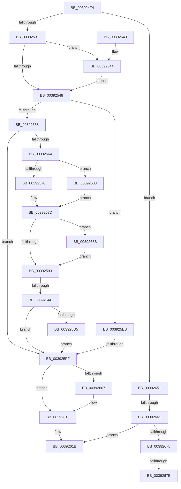

# KeUpdatePendingQosRequest

- RVA: `0x003924F4`–`0x0039269D` (길이 `425` bytes)
- VA: `0x00000001403924F4`
- 실행 섹션: `.text`
- PDB 이름 있음: `예`; PDB Function 태그: `예`
- unwind 정보 RVA: `0x00080CD0`
- 디코드: `98`개 명령, `425/425` bytes 표시
- 미해석 바이트: `0` (있으면 어셈블리에 `.byte`로 보존)

> 이 문서는 커널 이미지의 기계어와 PDB 기호를 분석해 생성했습니다. 4번과 5번은 함수 원형과 자료형을 바이너리 사용 방식에서 추정한 C 해석이며 원본 소스 복구 결과는 아닙니다.

## 1. Dependencies

- 직접 호출 지점: **7**; 고유 호출 대상: **6**
- 직접 호출자로 확인된 함수: **3**
- RIP 상대 이미지 참조: **7**

### Outgoing calls
- `0x00392575` → [RtlGetInterruptTimePrecise](../20/RtlGetInterruptTimePrecise_function_0020A4C0.md) (function, `0x0020A4C0`)
- `0x003925CC` → [KiShouldRearmClockTimer](KiShouldRearmClockTimer_function_0039E134.md) (function, `0x0039E134`)
- `0x003925E4` → [KiSetNextClockTickDueTime](../23/KiSetNextClockTickDueTime_function_002363F0.md) (function, `0x002363F0`)
- `0x0039260E` → [KiLowerIrqlProcessIrqlFlags](../4F/KiLowerIrqlProcessIrqlFlags_function_004F5698.md) (function, `0x004F5698`)
- `0x00392622` → [_security_check_cookie](../6A/_security_check_cookie_function_006AC640.md) (function, `0x006AC640`)
- `0x00392647` → [KiRaiseIrqlProcessIrqlFlags](../4F/KiRaiseIrqlProcessIrqlFlags_function_004F56FC.md) (function, `0x004F56FC`)
- `0x00392690` → [RtlGetInterruptTimePrecise](../20/RtlGetInterruptTimePrecise_function_0020A4C0.md) (function, `0x0020A4C0`)

### Direct callers
- [PpmPerfSetProcessorIdle](../2C/PpmPerfSetProcessorIdle_function_002CFD7C.md) at `0x002CFE97`
- [sub_00391A20](Unknown_function_00391A20.md) at `0x00391A23`
- [KiCheckForPendingQosUpdate](KiCheckForPendingQosUpdate_function_0039DD48.md) at `0x0039DDFE`
- [KiCheckForPendingQosUpdate](KiCheckForPendingQosUpdate_function_0039DD48.md) at `0x0039DE65`

### Static image references
- `0x00392512` → RVA `0x00E0A740` (`.data`; read)
- `0x00392525` → RVA `0x00FC6A85` (`ALMOSTRO`; read)
- `0x0039253C` → RVA `0x00FC6D20` (`ALMOSTRO`; read)
- `0x00392558` → RVA `0x00FC6CE4` (`ALMOSTRO`; read)
- `0x00392564` → RVA `0x00FC6AA5` (`ALMOSTRO`; read)
- `0x00392599` → RVA `0x00E070D8` (`.data`; read)
- `0x00392666` → RVA `0x00E66894` (`.data`; read/write)

## 2. Other-region calls and transfers

- 다른 실행 섹션으로 향하는 call: **0**
- call이 아닌 외부 분기/꼬리 이동: **5**
  - `0x003925A0` → [sub_006E57E2 + 0xBB](../6E/Unknown_function_006E57E2.md) (`tail-transfer`)
  - `0x003925F9` → [sub_006E57E2 + 0x60](../6E/Unknown_function_006E57E2.md) (`tail-transfer`)
  - `0x0039265B` → [sub_006E57E2](../6E/Unknown_function_006E57E2.md) (`tail-transfer`)
  - `0x00392678` → [sub_006E57E2 + 0x1B](../6E/Unknown_function_006E57E2.md) (`tail-transfer`)
  - `0x0039267E` → [sub_006E57E2 + 0x28](../6E/Unknown_function_006E57E2.md) (`tail-transfer`)

## 3. Assembly (complete function range)

```asm
003924F4  48 89 5C 24 10                  mov qword ptr [rsp + 0x10], rbx
003924F9  48 89 74 24 18                  mov qword ptr [rsp + 0x18], rsi
003924FE  55                              push rbp
003924FF  57                              push rdi
00392500  41 54                           push r12
00392502  41 56                           push r14
00392504  41 57                           push r15
00392506  48 8D 6C 24 B0                  lea rbp, [rsp - 0x50]
0039250B  48 81 EC 50 01 00 00            sub rsp, 0x150
00392512  48 8B 05 27 82 A7 00            mov rax, qword ptr [rip + 0xa78227]
00392519  48 33 C4                        xor rax, rsp
0039251C  48 89 45 40                     mov qword ptr [rbp + 0x40], rax
00392520  33 DB                           xor ebx, ebx
00392522  48 8B F9                        mov rdi, rcx
00392525  38 1D 5A 45 C3 00               cmp byte ptr [rip + 0xc3455a], bl
0039252B  0F 84 20 01 00 00               je 0x140392651
00392531  45 0F 20 C7                     mov r15, cr8
00392535  8D 53 0F                        lea edx, [rbx + 0xf]
00392538  44 0F 22 C2                     mov cr8, rdx
0039253C  39 1D DE 47 C3 00               cmp dword ptr [rip + 0xc347de], ebx
00392542  0F 85 FC 00 00 00               jne 0x140392644
00392548  F7 87 EC 00 00 00 00 01 00 00   test dword ptr [rdi + 0xec], 0x100
00392552  0F 84 93 00 00 00               je 0x1403925eb
00392558  39 1D 86 47 C3 00               cmp dword ptr [rip + 0xc34786], ebx
0039255E  0F 86 9B 00 00 00               jbe 0x1403925ff
00392564  38 1D 3B 45 C3 00               cmp byte ptr [rip + 0xc3453b], bl
0039256A  0F 84 13 01 00 00               je 0x140392683
00392570  48 8D 4C 24 40                  lea rcx, [rsp + 0x40]
00392575  E8 46 7F E7 FF                  call 0x14020a4c0
0039257A  48 8B F0                        mov rsi, rax
0039257D  44 8B 35 60 47 C3 00            mov r14d, dword ptr [rip + 0xc34760]
00392584  49 F7 DE                        neg r14
00392587  38 1D 18 45 C3 00               cmp byte ptr [rip + 0xc34518], bl
0039258D  0F 84 F8 00 00 00               je 0x14039268b
00392593  4C 8B E6                        mov r12, rsi
00392596  4D 2B E6                        sub r12, r14
00392599  83 3D 38 4B A7 00 05            cmp dword ptr [rip + 0xa74b38], 5
003925A0  0F 87 F7 32 35 00               ja 0x1406e589d
003925A6  8A 87 04 96 00 00               mov al, byte ptr [rdi + 0x9604]
003925AC  41 B0 01                        mov r8b, 1
003925AF  24 FD                           and al, 0xfd
003925B1  4C 89 A7 F8 95 00 00            mov qword ptr [rdi + 0x95f8], r12
003925B8  0C 01                           or al, 1
003925BA  89 9F 00 96 00 00               mov dword ptr [rdi + 0x9600], ebx
003925C0  48 8B D6                        mov rdx, rsi
003925C3  88 87 04 96 00 00               mov byte ptr [rdi + 0x9604], al
003925C9  48 8B CF                        mov rcx, rdi
003925CC  E8 63 BB 00 00                  call 0x14039e134
003925D1  84 C0                           test al, al
003925D3  74 2A                           je 0x1403925ff
003925D5  B2 01                           mov dl, 1
003925D7  C7 87 90 95 00 00 02 00 00 00   mov dword ptr [rdi + 0x9590], 2
003925E1  48 8B CE                        mov rcx, rsi
003925E4  E8 07 3E EA FF                  call 0x1402363f0
003925E9  EB 14                           jmp 0x1403925ff
003925EB  80 A7 04 96 00 00 FE            and byte ptr [rdi + 0x9604], 0xfe
003925F2  83 3D DF 4A A7 00 05            cmp dword ptr [rip + 0xa74adf], 5
003925F9  0F 87 43 32 35 00               ja 0x1406e5842
003925FF  39 1D 1B 47 C3 00               cmp dword ptr [rip + 0xc3471b], ebx
00392605  74 0C                           je 0x140392613
00392607  44 0F 20 C1                     mov rcx, cr8
0039260B  41 8A D7                        mov dl, r15b
0039260E  E8 85 30 16 00                  call 0x1404f5698
00392613  41 0F B6 C7                     movzx eax, r15b
00392617  44 0F 22 C0                     mov cr8, rax
0039261B  48 8B 4D 40                     mov rcx, qword ptr [rbp + 0x40]
0039261F  48 33 CC                        xor rcx, rsp
00392622  E8 19 A0 31 00                  call 0x1406ac640
00392627  4C 8D 9C 24 50 01 00 00         lea r11, [rsp + 0x150]
0039262F  49 8B 5B 38                     mov rbx, qword ptr [r11 + 0x38]
00392633  49 8B 73 40                     mov rsi, qword ptr [r11 + 0x40]
00392637  49 8B E3                        mov rsp, r11
0039263A  41 5F                           pop r15
0039263C  41 5E                           pop r14
0039263E  41 5C                           pop r12
00392640  5F                              pop rdi
00392641  5D                              pop rbp
00392642  C3                              ret
00392643  CC                              int3
00392644  41 8A CF                        mov cl, r15b
00392647  E8 B0 30 16 00                  call 0x1404f56fc
0039264C  E9 F7 FE FF FF                  jmp 0x140392548
00392651  F7 81 EC 00 00 00 00 01 00 00   test dword ptr [rcx + 0xec], 0x100
0039265B  0F 84 81 31 35 00               je 0x1406e57e2
00392661  B8 01 00 00 00                  mov eax, 1
00392666  F0 0F C1 05 26 42 AD 00         lock xadd dword ptr [rip + 0xad4226], eax
0039266E  FF C0                           inc eax
00392670  83 F8 01                        cmp eax, 1
00392673  75 A6                           jne 0x14039261b
00392675  38 59 21                        cmp byte ptr [rcx + 0x21], bl
00392678  0F 85 7F 31 35 00               jne 0x1406e57fd
0039267E  E9 87 31 35 00                  jmp 0x1406e580a
00392683  48 8B F3                        mov rsi, rbx
00392686  E9 F2 FE FF FF                  jmp 0x14039257d
0039268B  48 8D 4C 24 40                  lea rcx, [rsp + 0x40]
00392690  E8 2B 7E E7 FF                  call 0x14020a4c0
00392695  48 8B F0                        mov rsi, rax
00392698  E9 F6 FE FF FF                  jmp 0x140392593
```

## 4. C-style interpretation (structured pseudocode)

```c
__int64 __fastcall KeUpdatePendingQosRequest(__int64 a1)
{
    __int64 result;
    __int64 v_r12;
    __int64 v_r14;
    __int64 v_rbx;
    __int64 v_rsp;
    unsigned __int64 v_stack_m110;
    unsigned __int64 v_stack_m138;
    unsigned __int64 v_stack_m28;
    unsigned __int64 v_stack_m38;
    unsigned __int64 v_stack_m78;
    unsigned __int64 v_stack_p10;
    unsigned __int64 v_stack_p18;

    v_stack_p10 = v_rbx;
    v_stack_p18 = v_rsi;
    v_rsp = (v_rsp) - (336);
    result = (*(unsigned __int64 *)(v_rip + 10977831)) ^ (v_rsp);
    v_stack_m38 = result;
    v_rbx = 0;
    if ((*(unsigned __int8 *)(v_rip + 12797274)) == 0) goto loc_00392651;
    if ((*(unsigned int *)(v_rip + 12797918)) != 0) goto loc_00392644;
loc_00392548:
    if (((*(unsigned int *)(a1 + 236)) & (256)) == 0) goto loc_003925EB;
    if ((*(unsigned int *)(v_rip + 12797830)) <= 0) goto loc_003925FF;
    if ((*(unsigned __int8 *)(v_rip + 12797243)) == 0) goto loc_00392683;
    result = RtlGetInterruptTimePrecise(v_stack_m138, v_rbx + 15, a3, a4);
loc_0039257D:
    v_r14 = -((unsigned int)(*(unsigned int *)(v_rip + 12797792)));
    if ((*(unsigned __int8 *)(v_rip + 12797208)) == 0) goto loc_0039268B;
loc_00392593:
    v_r12 = (result) - (v_r14);
    result = (unsigned __int8)((*(unsigned __int8 *)(a1 + 38404)) & (253));
    *(unsigned __int64 *)(a1 + 38392) = v_r12;
    result = (unsigned __int8)((result) | (1));
    *(unsigned int *)(a1 + 38400) = 0;
    *(unsigned __int8 *)(a1 + 38404) = (unsigned __int8)(result);
    result = KiShouldRearmClockTimer(a1, result, 1, a4);
    if ((unsigned __int8)(result) == 0) goto loc_003925FF;
    *(unsigned int *)(a1 + 38288) = 2;
    result = KiSetNextClockTickDueTime(result, 1, 1, a4);
    goto loc_003925FF;
loc_003925EB:
loc_003925FF:
    if ((*(unsigned int *)(v_rip + 12797723)) != 0) {
        a1 = v_rbx + 15;
        a2 = (unsigned __int8)(v_cr8);
        result = KiLowerIrqlProcessIrqlFlags(a1, a2, 1, a4);
    }
loc_0039261B:
    a1 = (v_stack_m38) ^ (v_rsp);
    result = _security_check_cookie(a1, a2, 1, a4);
    return result;
loc_00392644:
    result = KiRaiseIrqlProcessIrqlFlags((unsigned __int8)(v_cr8), a2, 1, a4);
    goto loc_00392548;
loc_00392651:
    result = (unsigned int)((1) + 1);
    if (((unsigned int)(result)) != 1) goto loc_0039261B;
loc_00392683:
    goto loc_0039257D;
loc_0039268B:
    result = RtlGetInterruptTimePrecise(v_stack_m110, a2, 1, a4);
    goto loc_00392593;
}
```

## 5. (Beta) C Style

```c
int64_t KeUpdatePendingQosRequest(void *Arg1)
{
    uint8_t *arg1 = (uint8_t *)Arg1;

    int64_t result;
    int64_t local_r12;
    int64_t local_r14;
    int64_t local_rbx;
    int64_t local_rsp;
    uint64_t v_stack_m110;
    uint64_t v_stack_m138;
    uint64_t v_stack_m28;
    uint64_t v_stack_m38;
    uint64_t v_stack_m78;
    uint64_t v_stack_p10;
    uint64_t v_stack_p18;

    v_stack_p10 = local_rbx;
    v_stack_p18 = local_rsi;
    local_rsp = (local_rsp) - (336);
    result = (*(uint64_t *)(v_rip + 0xA78227)) ^ (local_rsp);
    v_stack_m38 = result;
    local_rbx = 0;
    if ((*(uint8_t *)(v_rip + 0xC3455A)) == 0) goto loc_00392651;
    if ((*(uint32_t *)(v_rip + 0xC347DE)) != 0) goto loc_00392644;
loc_00392548:
    if (((*(uint32_t *)(arg1 + 0xEC)) & (256)) == 0) goto loc_003925EB;
    if ((*(uint32_t *)(v_rip + 0xC34786)) <= 0) goto loc_003925FF;
    if ((*(uint8_t *)(v_rip + 0xC3453B)) == 0) goto loc_00392683;
    result = RtlGetInterruptTimePrecise(v_stack_m138, local_rbx + 15, a3, a4);
loc_0039257D:
    local_r14 = -((uint32_t)(*(uint32_t *)(v_rip + 0xC34760)));
    if ((*(uint8_t *)(v_rip + 0xC34518)) == 0) goto loc_0039268B;
loc_00392593:
    local_r12 = (result) - (local_r14);
    result = (uint8_t)((*(uint8_t *)(arg1 + 0x9604)) & (253));
    *(uint64_t *)(arg1 + 0x95F8) = local_r12;
    result = (uint8_t)((result) | (1));
    *(uint32_t *)(arg1 + 0x9600) = 0;
    *(uint8_t *)(arg1 + 0x9604) = (uint8_t)(result);
    result = KiShouldRearmClockTimer(Arg1, result, 1, a4);
    if ((uint8_t)(result) == 0) goto loc_003925FF;
    *(uint32_t *)(arg1 + 0x9590) = 2;
    result = KiSetNextClockTickDueTime(result, 1, 1, a4);
    goto loc_003925FF;
loc_003925EB:
loc_003925FF:
    if ((*(uint32_t *)(v_rip + 0xC3471B)) != 0) {
        Arg1 = local_rbx + 15;
        a2 = (uint8_t)(v_cr8);
        result = KiLowerIrqlProcessIrqlFlags(Arg1, a2, 1, a4);
    }
loc_0039261B:
    Arg1 = (v_stack_m38) ^ (local_rsp);
    result = _security_check_cookie(Arg1, a2, 1, a4);
    return result;
loc_00392644:
    result = KiRaiseIrqlProcessIrqlFlags((uint8_t)(v_cr8), a2, 1, a4);
    goto loc_00392548;
loc_00392651:
    result = (uint32_t)((1) + 1);
    if (((uint32_t)(result)) != 1) goto loc_0039261B;
loc_00392683:
    goto loc_0039257D;
loc_0039268B:
    result = RtlGetInterruptTimePrecise(v_stack_m110, a2, 1, a4);
    goto loc_00392593;
}
```

### 관측된 메모리 오프셋

구조체 형식이 확인되지 않은 접근은 인자 기준의 오프셋으로만 기록했습니다.

| 기준 인자 | 오프셋 표현 | 폭 (bit) | 접근 |
|---|---:|---:|---|
| `Arg1` | `+ 0x21` | `8` | `R` |
| `Arg1` | `+ 0xEC` | `32` | `R` |
| `Arg1` | `+ 0x9590` | `32` | `W` |
| `Arg1` | `+ 0x95F8` | `64` | `W` |
| `Arg1` | `+ 0x9600` | `32` | `W` |
| `Arg1` | `+ 0x9604` | `8` | `R` |
| `Arg1` | `+ 0x9604` | `8` | `R/W` |
| `Arg1` | `+ 0x9604` | `8` | `W` |

## 6. Execution-region graph

[열기: 2D/3D 그래프와 함수 탐색 컨트롤 패널](../../../control-panel.html?section=text&rva=0x003924F4&view=graph)

- 2D 그래프는 위에서 아래로 흐르고, 3D 그래프는 빈 공간을 드래그해 회전합니다. Shift+드래그는 이동, 휠은 확대·축소, 함수 노드 선택은 대상 보고서 이동입니다.

### Static fallback


