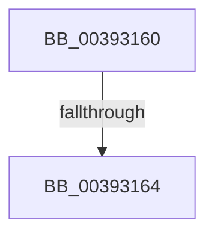

# KiAcquireMultiplePrcbLocks

- RVA: `0x00393160`–`0x00393169` (길이 `9` bytes)
- VA: `0x0000000140393160`
- 실행 섹션: `.text`
- PDB 이름 있음: `예`; PDB Function 태그: `아니요`
- unwind 정보 RVA: `0x00080E14`
- 디코드: `4`개 명령, `9/9` bytes 표시
- 미해석 바이트: `0` (있으면 어셈블리에 `.byte`로 보존)

> 이 문서는 커널 이미지의 기계어와 PDB 기호를 분석해 생성했습니다. 4번과 5번은 함수 원형과 자료형을 바이너리 사용 방식에서 추정한 C 해석이며 원본 소스 복구 결과는 아닙니다.

## 1. Dependencies

- 직접 호출 지점: **0**; 고유 호출 대상: **0**
- 직접 호출자로 확인된 함수: **4**
- RIP 상대 이미지 참조: **0**

### Outgoing calls
- 직접 디코드된 call 명령이 없습니다.

### Direct callers
- [KiSetPriorityThread](../22/KiSetPriorityThread_function_00220E78.md) at `0x00221115`
- [sub_00251E24](../25/Unknown_function_00251E24.md) at `0x00251E4D`
- [KiExecuteAllDpcs](../25/KiExecuteAllDpcs_function_0025B740.md) at `0x0025C598`
- [KeApplyWobBamQos](KeApplyWobBamQos_function_003937AC.md) at `0x0039399D`

### Static image references
- 디코드된 RIP-relative 메모리 참조가 없습니다.

## 2. Other-region calls and transfers

- 다른 실행 섹션으로 향하는 call: **0**
- call이 아닌 외부 분기/꼬리 이동: **1**
  - `0x00393162` → [sub_00393169 + 0x43](Unknown_function_00393169.md) (`tail-transfer`)

## 3. Assembly (complete function range)

```asm
00393160  85 D2                           test edx, edx
00393162  74 48                           je 0x1403931ac
00393164  57                              push rdi
00393165  48 83 EC 20                     sub rsp, 0x20
```

## 4. C-style interpretation (structured pseudocode)

```c
void __fastcall KiAcquireMultiplePrcbLocks(__int64 a1, int a2)
{
    __int64 v_rsp;

    v_rsp = (v_rsp) - (32);
    return;
}
```

## 5. (Beta) C Style

```c
void KiAcquireMultiplePrcbLocks(int64_t Arg1, int32_t Arg2)
{
    int64_t local_rsp;

    local_rsp = (local_rsp) - (32);
    return;
}
```

## 6. Execution-region graph

[열기: 2D/3D 그래프와 함수 탐색 컨트롤 패널](../../../control-panel.html?section=text&rva=0x00393160&view=graph)

- 2D 그래프는 위에서 아래로 흐르고, 3D 그래프는 빈 공간을 드래그해 회전합니다. Shift+드래그는 이동, 휠은 확대·축소, 함수 노드 선택은 대상 보고서 이동입니다.

### Static fallback


