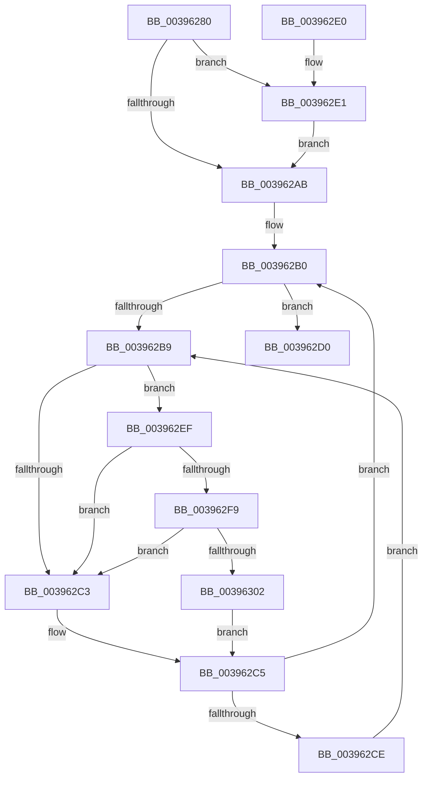

# KiAcquireThreadLockRaiseToDpc

- RVA: `0x00396280`–`0x0039630B` (길이 `139` bytes)
- VA: `0x0000000140396280`
- 실행 섹션: `.text`
- PDB 이름 있음: `예`; PDB Function 태그: `아니요`
- unwind 정보 RVA: `0x00081218`
- 디코드: `42`개 명령, `139/139` bytes 표시
- 미해석 바이트: `0` (있으면 어셈블리에 `.byte`로 보존)

> 이 문서는 커널 이미지의 기계어와 PDB 기호를 분석해 생성했습니다. 4번과 5번은 함수 원형과 자료형을 바이너리 사용 방식에서 추정한 C 해석이며 원본 소스 복구 결과는 아닙니다.

## 1. Dependencies

- 직접 호출 지점: **3**; 고유 호출 대상: **3**
- 직접 호출자로 확인된 함수: **33**
- RIP 상대 이미지 참조: **3**

### Outgoing calls
- `0x003962E8` → [KiRaiseIrqlProcessIrqlFlags](../4F/KiRaiseIrqlProcessIrqlFlags_function_004F56FC.md) (function, `0x004F56FC`)
- `0x003962F9` → [KiCheckVpBackingLongSpinWaitHypercall](../30/KiCheckVpBackingLongSpinWaitHypercall_function_0030F490.md) (function, `0x0030F490`)
- `0x00396304` → [HvlNotifyLongSpinWait](../30/HvlNotifyLongSpinWait_function_0030F460.md) (function, `0x0030F460`)

### Direct callers
- [KiSchedulerApc](../20/KiSchedulerApc_function_00202BC0.md) at `0x00202E27`
- [KiSchedulerApc](../20/KiSchedulerApc_function_00202BC0.md) at `0x00202E5C`
- [sub_002177B0](../21/Unknown_function_002177B0.md) at `0x002177D7`
- [sub_00218280](../21/Unknown_function_00218280.md) at `0x002182A7`
- [sub_00218AB1](../21/Unknown_function_00218AB1.md) at `0x00218ADC`
- [sub_0028F390](../28/Unknown_function_0028F390.md) at `0x0028F3BC`
- [KiClearSystemPriority](../2C/KiClearSystemPriority_function_002C05A8.md) at `0x002C05C7`
- [PopFxActivateComponent](../2D/PopFxActivateComponent_function_002D9DBC.md) at `0x002D9ED1`
- [KiSetSystemPriorityThread](../2D/KiSetSystemPriorityThread_function_002D9FF8.md) at `0x002DA022`
- [PpmReleaseLock](../2D/PpmReleaseLock_function_002DA428.md) at `0x002DA464`
- [KeSetIdealProcessorThreadEx](../2D/KeSetIdealProcessorThreadEx_function_002DD36C.md) at `0x002DD392`
- [KeSetThreadSchedulerAssist](../30/KeSetThreadSchedulerAssist_function_003038F8.md) at `0x00303959`
- [KeSetThreadSchedulerAssist](../30/KeSetThreadSchedulerAssist_function_003038F8.md) at `0x003039AF`
- [KeSetThreadSchedulerAssist](../30/KeSetThreadSchedulerAssist_function_003038F8.md) at `0x00303ACE`
- [KeQueryTotalCycleTimeThread](../37/KeQueryTotalCycleTimeThread_function_0037EF20.md) at `0x0037F749`
- [sub_00395304](Unknown_function_00395304.md) at `0x00395316`
- [PspSynchronizeThreadIsolationDomains](../3C/PspSynchronizeThreadIsolationDomains_function_003C479C.md) at `0x003C47C5`
- [KeRemoveQueueApc](../3C/KeRemoveQueueApc_function_003C4820.md) at `0x003C483E`
- [KiUpdateTebSchedulingPropertiesCurrentThread](../3C/KiUpdateTebSchedulingPropertiesCurrentThread_function_003C4938.md) at `0x003C496F`
- [KiFlushQueueApc](../3C/KiFlushQueueApc_function_003C653C.md) at `0x003C6574`
- [KiFlushQueueApc](../3C/KiFlushQueueApc_function_003C653C.md) at `0x003C65B0`
- [KeSetThreadPpmPolicy](../3C/KeSetThreadPpmPolicy_function_003C6C30.md) at `0x003C6C56`
- [KeQueryPrimaryGroupAffinityThread](../3C/KeQueryPrimaryGroupAffinityThread_function_003C7238.md) at `0x003C7262`
- [sub_003C76A0](../3C/Unknown_function_003C76A0.md) at `0x003C76CB`
- [sub_003C7C10](../3C/Unknown_function_003C7C10.md) at `0x003C7C37`
- [KeQueryEffectivePriorityThread](../3C/KeQueryEffectivePriorityThread_function_003C7CA0.md) at `0x003C7D3D`
- [KeQueryCpuSetsThread](../3C/KeQueryCpuSetsThread_function_003C7F9C.md) at `0x003C7FEF`
- [KeCleanupThreadState](../44/KeCleanupThreadState_function_0044B518.md) at `0x0044B531`
- [KeUpdateThreadTag](../47/KeUpdateThreadTag_function_00475770.md) at `0x004757D7`
- [KeAttachProcess](../48/KeAttachProcess_function_00486540.md) at `0x00486597`
- [KeRequestTerminationThread](../48/KeRequestTerminationThread_function_00489A58.md) at `0x00489AA4`
- [KiUpdateVpBackingThreadPriorityOnPriorityQuery](../4B/KiUpdateVpBackingThreadPriorityOnPriorityQuery_function_004BF550.md) at `0x004BF569`
- [KeEnumerateQueueApc](../5B/KeEnumerateQueueApc_function_005BE290.md) at `0x005BE2CA`
- [KeQueryCurrentWaitInformationThread](../5C/KeQueryCurrentWaitInformationThread_function_005C3650.md) at `0x005C3681`
- [KiRequestSchedulerApcThread](../5C/KiRequestSchedulerApcThread_function_005C44E4.md) at `0x005C450A`
- [KeAbCrossThreadDelete](../5C/KeAbCrossThreadDelete_function_005C517C.md) at `0x005C5267`
- [sub_006E0538](../6E/Unknown_function_006E0538.md) at `0x006E054C`

### Static image references
- `0x003962A2` → RVA `0x00FC6D20` (`ALMOSTRO`; read)
- `0x003962BB` → RVA `0x00FC52AC` (`ALMOSTRO`; reference)
- `0x003962EF` → RVA `0x00FC6AB8` (`ALMOSTRO`; read)

## 2. Other-region calls and transfers

- 다른 실행 섹션으로 향하는 call: **0**
- 별도 외부 분기/꼬리 이동을 확인하지 못했습니다.

## 3. Assembly (complete function range)

```asm
00396280  48 89 5C 24 08                  mov qword ptr [rsp + 8], rbx
00396285  48 89 74 24 10                  mov qword ptr [rsp + 0x10], rsi
0039628A  57                              push rdi
0039628B  48 83 EC 20                     sub rsp, 0x20
0039628F  48 8B F2                        mov rsi, rdx
00396292  48 8B D9                        mov rbx, rcx
00396295  44 0F 20 C7                     mov rdi, cr8
00396299  B8 02 00 00 00                  mov eax, 2
0039629E  44 0F 22 C0                     mov cr8, rax
003962A2  83 3D 77 0A C3 00 00            cmp dword ptr [rip + 0xc30a77], 0
003962A9  75 36                           jne 0x1403962e1
003962AB  40 88 3E                        mov byte ptr [rsi], dil
003962AE  33 FF                           xor edi, edi
003962B0  F0 48 0F BA 6B 40 00            lock bts qword ptr [rbx + 0x40], 0
003962B7  73 17                           jae 0x1403962d0
003962B9  FF C7                           inc edi
003962BB  85 3D EB EF C2 00               test dword ptr [rip + 0xc2efeb], edi
003962C1  74 2C                           je 0x1403962ef
003962C3  F3 90                           pause
003962C5  48 8B 43 40                     mov rax, qword ptr [rbx + 0x40]
003962C9  48 85 C0                        test rax, rax
003962CC  74 E2                           je 0x1403962b0
003962CE  EB E9                           jmp 0x1403962b9
003962D0  48 8B 5C 24 30                  mov rbx, qword ptr [rsp + 0x30]
003962D5  48 8B 74 24 38                  mov rsi, qword ptr [rsp + 0x38]
003962DA  48 83 C4 20                     add rsp, 0x20
003962DE  5F                              pop rdi
003962DF  C3                              ret
003962E0  CC                              int3
003962E1  0F B6 D0                        movzx edx, al
003962E4  40 0F B6 CF                     movzx ecx, dil
003962E8  E8 0F F4 15 00                  call 0x1404f56fc
003962ED  EB BC                           jmp 0x1403962ab
003962EF  8B 05 C3 07 C3 00               mov eax, dword ptr [rip + 0xc307c3]
003962F5  A8 40                           test al, 0x40
003962F7  74 CA                           je 0x1403962c3
003962F9  E8 92 91 F7 FF                  call 0x14030f490
003962FE  84 C0                           test al, al
00396300  74 C1                           je 0x1403962c3
00396302  8B CF                           mov ecx, edi
00396304  E8 57 91 F7 FF                  call 0x14030f460
00396309  EB BA                           jmp 0x1403962c5
```

## 4. C-style interpretation (structured pseudocode)

```c
__int64 __fastcall KiAcquireThreadLockRaiseToDpc(__int64 a1, __int64 a2)
{
    __int64 result;
    __int64 v_rdi;
    __int64 v_rsp;
    unsigned __int64 v_stack_p10;
    unsigned __int64 v_stack_p8;

    v_stack_p8 = v_rbx;
    v_stack_p10 = v_rsi;
    v_rsp = (v_rsp) - (32);
    if ((*(unsigned int *)(v_rip + 12782199)) != 0) goto loc_003962E1;
loc_003962AB:
    *(unsigned __int8 *)(a2) = (unsigned __int8)(v_cr8);
    v_rdi = 0;
loc_003962B0:
    if (condition_is_above_or_equal) goto loc_003962D0;
loc_003962B9:
    v_rdi = (unsigned int)((v_rdi) + 1);
    if (((*(unsigned int *)(v_rip + 12775403)) & ((unsigned int)(v_rdi))) == 0) goto loc_003962EF;
loc_003962C3:
loc_003962C5:
    if (*(unsigned __int64 *)(a1 + 64) == 0) goto loc_003962B0;
    goto loc_003962B9;
loc_003962D0:
    v_rsp = (v_rsp) + (32);
    return *(unsigned __int64 *)(a1 + 64);
loc_003962E1:
    result = KiRaiseIrqlProcessIrqlFlags((unsigned __int8)(v_rdi), (unsigned __int8)(*(unsigned __int64 *)(a1 + 64)), a3, a4);
    goto loc_003962AB;
loc_003962EF:
    if ((((unsigned __int8)((unsigned int)(*(unsigned int *)(v_rip + 12781507)))) & (64)) == 0) goto loc_003962C3;
    result = KiCheckVpBackingLongSpinWaitHypercall((unsigned __int8)(v_rdi), (unsigned __int8)(*(unsigned __int64 *)(a1 + 64)), a3, a4);
    if ((unsigned __int8)(result) == 0) goto loc_003962C3;
    result = HvlNotifyLongSpinWait((unsigned int)((unsigned int)(v_rdi)), (unsigned __int8)(*(unsigned __int64 *)(a1 + 64)), a3, a4);
    goto loc_003962C5;
}
```

## 5. (Beta) C Style

```c
int64_t KiAcquireThreadLockRaiseToDpc(void *Arg1, void *Arg2)
{
    uint8_t *arg1 = (uint8_t *)Arg1;
    uint8_t *arg2 = (uint8_t *)Arg2;

    int64_t result;
    int64_t local_rdi;
    int64_t local_rsp;
    uint64_t v_stack_p10;
    uint64_t v_stack_p8;

    v_stack_p8 = local_rbx;
    v_stack_p10 = local_rsi;
    local_rsp = (local_rsp) - (32);
    if ((*(uint32_t *)(v_rip + 0xC30A77)) != 0) goto loc_003962E1;
loc_003962AB:
    *(uint8_t *)(arg2) = (uint8_t)(v_cr8);
    local_rdi = 0;
loc_003962B0:
    if (condition_is_above_or_equal) goto loc_003962D0;
loc_003962B9:
    local_rdi = (uint32_t)((local_rdi) + 1);
    if (((*(uint32_t *)(v_rip + 0xC2EFEB)) & ((uint32_t)(local_rdi))) == 0) goto loc_003962EF;
loc_003962C3:
loc_003962C5:
    if (*(uint64_t *)(arg1 + 0x40) == 0) goto loc_003962B0;
    goto loc_003962B9;
loc_003962D0:
    local_rsp = (local_rsp) + (32);
    return *(uint64_t *)(arg1 + 0x40);
loc_003962E1:
    result = KiRaiseIrqlProcessIrqlFlags((uint8_t)(local_rdi), (uint8_t)(*(uint64_t *)(arg1 + 0x40)), a3, a4);
    goto loc_003962AB;
loc_003962EF:
    if ((((uint8_t)((uint32_t)(*(uint32_t *)(v_rip + 0xC307C3)))) & (64)) == 0) goto loc_003962C3;
    result = KiCheckVpBackingLongSpinWaitHypercall((uint8_t)(local_rdi), (uint8_t)(*(uint64_t *)(arg1 + 0x40)), a3, a4);
    if ((uint8_t)(result) == 0) goto loc_003962C3;
    result = HvlNotifyLongSpinWait((uint32_t)((uint32_t)(local_rdi)), (uint8_t)(*(uint64_t *)(arg1 + 0x40)), a3, a4);
    goto loc_003962C5;
}
```

### 관측된 메모리 오프셋

구조체 형식이 확인되지 않은 접근은 인자 기준의 오프셋으로만 기록했습니다.

| 기준 인자 | 오프셋 표현 | 폭 (bit) | 접근 |
|---|---:|---:|---|
| `Arg1` | `+ 0x40` | `64` | `R` |
| `Arg1` | `+ 0x40` | `64` | `R/W` |
| `Arg2` | `+ 0x0` | `8` | `W` |

## 6. Execution-region graph

[열기: 2D/3D 그래프와 함수 탐색 컨트롤 패널](../../../control-panel.html?section=text&rva=0x00396280&view=graph)

- 2D 그래프는 위에서 아래로 흐르고, 3D 그래프는 빈 공간을 드래그해 회전합니다. Shift+드래그는 이동, 휠은 확대·축소, 함수 노드 선택은 대상 보고서 이동입니다.

### Static fallback


