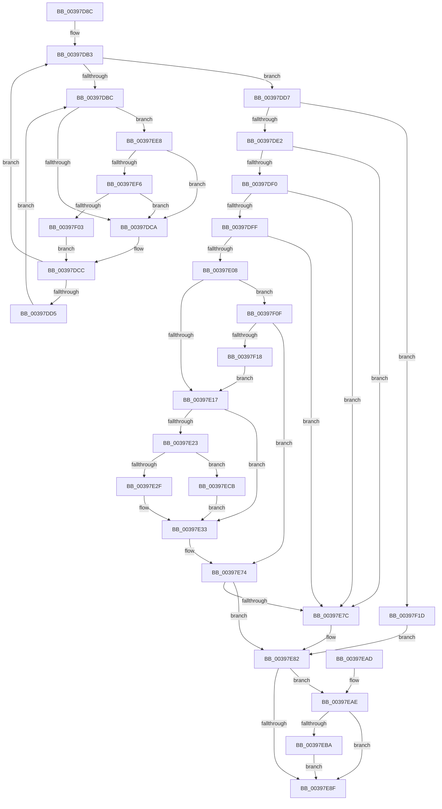

# KiAlertSingleThreadByThreadId

- RVA: `0x00397D8C`–`0x00397F25` (길이 `409` bytes)
- VA: `0x0000000140397D8C`
- 실행 섹션: `.text`
- PDB 이름 있음: `예`; PDB Function 태그: `아니요`
- unwind 정보 RVA: `0x0008144C`
- 디코드: `101`개 명령, `409/409` bytes 표시
- 미해석 바이트: `0` (있으면 어셈블리에 `.byte`로 보존)

> 이 문서는 커널 이미지의 기계어와 PDB 기호를 분석해 생성했습니다. 4번과 5번은 함수 원형과 자료형을 바이너리 사용 방식에서 추정한 C 해석이며 원본 소스 복구 결과는 아닙니다.

## 1. Dependencies

- 직접 호출 지점: **5**; 고유 호출 대상: **5**
- 직접 호출자로 확인된 함수: **2**
- RIP 상대 이미지 참조: **2**

### Outgoing calls
- `0x00397E36` → [KiRemovePrcbWaitEntry](../25/KiRemovePrcbWaitEntry_function_002502D0.md) (function, `0x002502D0`)
- `0x00397E3E` → [KiEnterDeferredReadyState](KiEnterDeferredReadyState_function_00397420.md) (function, `0x00397420`)
- `0x00397EC4` → [KeAbPreWakeupThread](../35/KeAbPreWakeupThread_function_0035034C.md) (function, `0x0035034C`)
- `0x00397EF6` → [KiCheckVpBackingLongSpinWaitHypercall](../30/KiCheckVpBackingLongSpinWaitHypercall_function_0030F490.md) (function, `0x0030F490`)
- `0x00397F05` → [HvlNotifyLongSpinWait](../30/HvlNotifyLongSpinWait_function_0030F460.md) (function, `0x0030F460`)

### Direct callers
- [KeAlertThreadByThreadIdEx](KeAlertThreadByThreadIdEx_function_003984BC.md) at `0x003984FE`
- [KeAlertMultipleThreadByThreadId](../5B/KeAlertMultipleThreadByThreadId_function_005B8DA0.md) at `0x005B8E06`

### Static image references
- `0x00397DBE` → RVA `0x00FC52AC` (`ALMOSTRO`; reference)
- `0x00397EE8` → RVA `0x00FC6AB8` (`ALMOSTRO`; read)

## 2. Other-region calls and transfers

- 다른 실행 섹션으로 향하는 call: **0**
- 별도 외부 분기/꼬리 이동을 확인하지 못했습니다.

## 3. Assembly (complete function range)

```asm
00397D8C  48 8B C4                        mov rax, rsp
00397D8F  48 89 58 08                     mov qword ptr [rax + 8], rbx
00397D93  48 89 68 10                     mov qword ptr [rax + 0x10], rbp
00397D97  48 89 70 18                     mov qword ptr [rax + 0x18], rsi
00397D9B  48 89 78 20                     mov qword ptr [rax + 0x20], rdi
00397D9F  41 56                           push r14
00397DA1  48 83 EC 20                     sub rsp, 0x20
00397DA5  33 F6                           xor esi, esi
00397DA7  49 8B E8                        mov rbp, r8
00397DAA  48 8B DA                        mov rbx, rdx
00397DAD  4C 8B F1                        mov r14, rcx
00397DB0  8D 7E 01                        lea edi, [rsi + 1]
00397DB3  F0 48 0F BA 6B 40 00            lock bts qword ptr [rbx + 0x40], 0
00397DBA  73 1B                           jae 0x140397dd7
00397DBC  03 F7                           add esi, edi
00397DBE  85 35 E8 D4 C2 00               test dword ptr [rip + 0xc2d4e8], esi
00397DC4  0F 84 1E 01 00 00               je 0x140397ee8
00397DCA  F3 90                           pause
00397DCC  48 8B 43 40                     mov rax, qword ptr [rbx + 0x40]
00397DD0  48 85 C0                        test rax, rax
00397DD3  74 DE                           je 0x140397db3
00397DD5  EB E5                           jmp 0x140397dbc
00397DD7  8B 43 78                        mov eax, dword ptr [rbx + 0x78]
00397DDA  A8 10                           test al, 0x10
00397DDC  0F 85 3B 01 00 00               jne 0x140397f1d
00397DE2  8A 83 84 01 00 00               mov al, byte ptr [rbx + 0x184]
00397DE8  3C 05                           cmp al, 5
00397DEA  0F 85 8C 00 00 00               jne 0x140397e7c
00397DF0  0F B6 4B 70                     movzx ecx, byte ptr [rbx + 0x70]
00397DF4  8A C1                           mov al, cl
00397DF6  24 07                           and al, 7
00397DF8  2C 03                           sub al, 3
00397DFA  40 3A C7                        cmp al, dil
00397DFD  76 7D                           jbe 0x140397e7c
00397DFF  80 BB 83 02 00 00 25            cmp byte ptr [rbx + 0x283], 0x25
00397E06  75 74                           jne 0x140397e7c
00397E08  8B C1                           mov eax, ecx
00397E0A  32 C9                           xor cl, cl
00397E0C  83 E0 07                        and eax, 7
00397E0F  3B C7                           cmp eax, edi
00397E11  0F 85 F8 00 00 00               jne 0x140397f0f
00397E17  48 8B 8B E8 00 00 00            mov rcx, qword ptr [rbx + 0xe8]
00397E1E  48 85 C9                        test rcx, rcx
00397E21  74 10                           je 0x140397e33
00397E23  8A 01                           mov al, byte ptr [rcx]
00397E25  24 7F                           and al, 0x7f
00397E27  3C 15                           cmp al, 0x15
00397E29  0F 84 9C 00 00 00               je 0x140397ecb
00397E2F  F0 01 79 28                     lock add dword ptr [rcx + 0x28], edi
00397E33  48 8B CB                        mov rcx, rbx
00397E36  E8 95 84 EB FF                  call 0x1402502d0
00397E3B  48 8B CB                        mov rcx, rbx
00397E3E  E8 DD F5 FF FF                  call 0x140397420
00397E43  49 8B 86 08 2D 00 00            mov rax, qword ptr [r14 + 0x2d08]
00397E4A  48 8D 8B D8 00 00 00            lea rcx, [rbx + 0xd8]
00397E51  48 89 01                        mov qword ptr [rcx], rax
00397E54  49 89 8E 08 2D 00 00            mov qword ptr [r14 + 0x2d08], rcx
00397E5B  40 8A CF                        mov cl, dil
00397E5E  48 C7 83 C8 00 00 00 01 01 00 00  mov qword ptr [rbx + 0xc8], 0x101
00397E69  48 C7 83 D0 03 00 00 00 00 00 00  mov qword ptr [rbx + 0x3d0], 0
00397E74  80 4B 70 80                     or byte ptr [rbx + 0x70], 0x80
00397E78  84 C9                           test cl, cl
00397E7A  75 06                           jne 0x140397e82
00397E7C  F0 0F BA 6B 78 04               lock bts dword ptr [rbx + 0x78], 4
00397E82  48 C7 43 40 00 00 00 00         mov qword ptr [rbx + 0x40], 0
00397E8A  48 85 ED                        test rbp, rbp
00397E8D  75 1F                           jne 0x140397eae
00397E8F  48 8B 5C 24 30                  mov rbx, qword ptr [rsp + 0x30]
00397E94  40 8A C7                        mov al, dil
00397E97  48 8B 7C 24 48                  mov rdi, qword ptr [rsp + 0x48]
00397E9C  48 8B 6C 24 38                  mov rbp, qword ptr [rsp + 0x38]
00397EA1  48 8B 74 24 40                  mov rsi, qword ptr [rsp + 0x40]
00397EA6  48 83 C4 20                     add rsp, 0x20
00397EAA  41 5E                           pop r14
00397EAC  C3                              ret
00397EAD  CC                              int3
00397EAE  49 8B 8E 08 2D 00 00            mov rcx, qword ptr [r14 + 0x2d08]
00397EB5  48 85 C9                        test rcx, rcx
00397EB8  74 D5                           je 0x140397e8f
00397EBA  48 81 C1 28 FF FF FF            add rcx, -0xd8
00397EC1  48 8B D5                        mov rdx, rbp
00397EC4  E8 83 84 FB FF                  call 0x14035034c
00397EC9  EB C4                           jmp 0x140397e8f
00397ECB  81 A3 1C 02 00 00 FF 00 00 00   and dword ptr [rbx + 0x21c], 0xff
00397ED5  8B 83 1C 02 00 00               mov eax, dword ptr [rbx + 0x21c]
00397EDB  F0 01 BC 81 18 02 00 00         lock add dword ptr [rcx + rax*4 + 0x218], edi
00397EE3  E9 4B FF FF FF                  jmp 0x140397e33
00397EE8  8B 05 CA EB C2 00               mov eax, dword ptr [rip + 0xc2ebca]
00397EEE  A8 40                           test al, 0x40
00397EF0  0F 84 D4 FE FF FF               je 0x140397dca
00397EF6  E8 95 75 F7 FF                  call 0x14030f490
00397EFB  84 C0                           test al, al
00397EFD  0F 84 C7 FE FF FF               je 0x140397dca
00397F03  8B CE                           mov ecx, esi
00397F05  E8 56 75 F7 FF                  call 0x14030f460
00397F0A  E9 BD FE FF FF                  jmp 0x140397dcc
00397F0F  83 F8 04                        cmp eax, 4
00397F12  0F 85 5C FF FF FF               jne 0x140397e74
00397F18  E9 FA FE FF FF                  jmp 0x140397e17
00397F1D  40 32 FF                        xor dil, dil
00397F20  E9 5D FF FF FF                  jmp 0x140397e82
```

## 4. C-style interpretation (structured pseudocode)

```c
__int64 __fastcall KiAlertSingleThreadByThreadId(__int64 a1, __int64 a2, __int64 a3)
{
    __int64 result;
    __int64 v_rdi;
    __int64 v_rsi;
    __int64 v_rsp;
    unsigned __int64 v_stack_p10;
    unsigned __int64 v_stack_p18;
    unsigned __int64 v_stack_p20;
    unsigned __int64 v_stack_p8;

    *(unsigned __int64 *)(v_rsp + 8) = v_rbx;
    *(unsigned __int64 *)(v_rsp + 16) = v_rbp;
    *(unsigned __int64 *)(v_rsp + 24) = v_rsi;
    *(unsigned __int64 *)(v_rsp + 32) = v_rdi;
    v_rsp = (v_rsp) - (32);
    v_rsi = 0;
loc_00397DB3:
    if (condition_is_above_or_equal) goto loc_00397DD7;
loc_00397DBC:
    v_rsi = (unsigned int)((v_rsi) + ((unsigned int)(v_rsi + 1)));
    if (((*(unsigned int *)(v_rip + 12768488)) & ((unsigned int)(v_rsi))) == 0) goto loc_00397EE8;
loc_00397DCA:
loc_00397DCC:
    if (*(unsigned __int64 *)(a2 + 64) == 0) goto loc_00397DB3;
    goto loc_00397DBC;
loc_00397DD7:
    if ((((unsigned __int8)((unsigned int)(*(unsigned int *)(a2 + 120)))) & (16)) != 0) goto loc_00397F1D;
    if (((unsigned __int8)(*(unsigned __int8 *)(a2 + 388))) != 5) goto loc_00397E7C;
    result = (unsigned __int8)(((unsigned __int8)(*(unsigned __int8 *)(a2 + 112))) & (7));
    result = (unsigned __int8)((result) - (3));
    if (((unsigned __int8)(result)) <= ((unsigned __int8)(v_rsi + 1))) goto loc_00397E7C;
    if ((*(unsigned __int8 *)(a2 + 643)) != 37) goto loc_00397E7C;
    a1 = 0;
    result = (unsigned int)(((unsigned int)((unsigned int)(*(unsigned __int8 *)(a2 + 112)))) & (7));
    if (((unsigned int)(result)) != ((unsigned int)(v_rsi + 1))) goto loc_00397F0F;
loc_00397E17:
    if (*(unsigned __int64 *)(a2 + 232) == 0) goto loc_00397E33;
    result = (unsigned __int8)((*(unsigned __int8 *)(*(unsigned __int64 *)(a2 + 232))) & (127));
    if (((unsigned __int8)(result)) == 21) goto loc_00397ECB;
loc_00397E33:
    result = KiRemovePrcbWaitEntry(a2, a2, a3, a4);
    result = KiEnterDeferredReadyState(a2, a2, a3, a4);
    *(unsigned __int64 *)(a2 + 216) = *(unsigned __int64 *)(a1 + 11528);
    *(unsigned __int64 *)(a1 + 11528) = a2 + 216;
    *(unsigned __int64 *)(a2 + 200) = 257;
    *(unsigned __int64 *)(a2 + 976) = 0;
loc_00397E74:
    if ((unsigned __int8)((unsigned __int8)(v_rsi + 1)) == 0) {
    }
    *(unsigned __int64 *)(a2 + 64) = 0;
    if (a3 != 0) goto loc_00397EAE;
loc_00397E8F:
    v_rsp = (v_rsp) + (32);
    return (unsigned __int8)(v_rsi + 1);
loc_00397EAE:
    if (*(unsigned __int64 *)(a1 + 11528) == 0) goto loc_00397E8F;
    a1 = (*(unsigned __int64 *)(a1 + 11528)) + (-216);
    result = KeAbPreWakeupThread(a1, v_stack_p10, a3, a4);
    goto loc_00397E8F;
loc_00397ECB:
    goto loc_00397E33;
loc_00397EE8:
    if ((((unsigned __int8)((unsigned int)(*(unsigned int *)(v_rip + 12774346)))) & (64)) == 0) goto loc_00397DCA;
    result = KiCheckVpBackingLongSpinWaitHypercall(a1, v_stack_p10, a3, a4);
    if ((unsigned __int8)(result) == 0) goto loc_00397DCA;
    result = HvlNotifyLongSpinWait((unsigned int)((unsigned int)(v_stack_p18)), v_stack_p10, a3, a4);
    goto loc_00397DCC;
loc_00397F0F:
    if (((unsigned int)(result)) != 4) goto loc_00397E74;
    goto loc_00397E17;
loc_00397F1D:
    v_rdi = 0;
    goto loc_00397E82;
}
```

## 5. (Beta) C Style

```c
int64_t KiAlertSingleThreadByThreadId(void *Arg1, void *Arg2, int64_t Arg3)
{
    uint8_t *arg1 = (uint8_t *)Arg1;
    uint8_t *arg2 = (uint8_t *)Arg2;

    int64_t result;
    int64_t local_rdi;
    int64_t local_rsi;
    int64_t local_rsp;
    uint64_t v_stack_p10;
    uint64_t v_stack_p18;
    uint64_t v_stack_p20;
    uint64_t v_stack_p8;

    *(uint64_t *)(local_rsp + 0x8) = local_rbx;
    *(uint64_t *)(local_rsp + 0x10) = local_rbp;
    *(uint64_t *)(local_rsp + 0x18) = local_rsi;
    *(uint64_t *)(local_rsp + 0x20) = local_rdi;
    local_rsp = (local_rsp) - (32);
    local_rsi = 0;
loc_00397DB3:
    if (condition_is_above_or_equal) goto loc_00397DD7;
loc_00397DBC:
    local_rsi = (uint32_t)((local_rsi) + ((uint32_t)(local_rsi + 1)));
    if (((*(uint32_t *)(v_rip + 0xC2D4E8)) & ((uint32_t)(local_rsi))) == 0) goto loc_00397EE8;
loc_00397DCA:
loc_00397DCC:
    if (*(uint64_t *)(arg2 + 0x40) == 0) goto loc_00397DB3;
    goto loc_00397DBC;
loc_00397DD7:
    if ((((uint8_t)((uint32_t)(*(uint32_t *)(arg2 + 0x78)))) & (16)) != 0) goto loc_00397F1D;
    if (((uint8_t)(*(uint8_t *)(arg2 + 0x184))) != 5) goto loc_00397E7C;
    result = (uint8_t)(((uint8_t)(*(uint8_t *)(arg2 + 0x70))) & (7));
    result = (uint8_t)((result) - (3));
    if (((uint8_t)(result)) <= ((uint8_t)(local_rsi + 1))) goto loc_00397E7C;
    if ((*(uint8_t *)(arg2 + 0x283)) != 37) goto loc_00397E7C;
    Arg1 = 0;
    result = (uint32_t)(((uint32_t)((uint32_t)(*(uint8_t *)(arg2 + 0x70)))) & (7));
    if (((uint32_t)(result)) != ((uint32_t)(local_rsi + 1))) goto loc_00397F0F;
loc_00397E17:
    if (*(uint64_t *)(arg2 + 0xE8) == 0) goto loc_00397E33;
    result = (uint8_t)((*(uint8_t *)(*(uint64_t *)(arg2 + 0xE8))) & (127));
    if (((uint8_t)(result)) == 21) goto loc_00397ECB;
loc_00397E33:
    result = KiRemovePrcbWaitEntry(Arg2, Arg2, Arg3, a4);
    result = KiEnterDeferredReadyState(Arg2, Arg2, Arg3, a4);
    *(uint64_t *)(arg2 + 0xD8) = *(uint64_t *)(arg1 + 0x2D08);
    *(void **)(arg1 + 0x2D08) = Arg2 + 216;
    *(uint64_t *)(arg2 + 0xC8) = 257;
    *(uint64_t *)(arg2 + 0x3D0) = 0;
loc_00397E74:
    if ((uint8_t)((uint8_t)(local_rsi + 1)) == 0) {
    }
    *(uint64_t *)(arg2 + 0x40) = 0;
    if (Arg3 != 0) goto loc_00397EAE;
loc_00397E8F:
    local_rsp = (local_rsp) + (32);
    return (uint8_t)(local_rsi + 1);
loc_00397EAE:
    if (*(uint64_t *)(arg1 + 0x2D08) == 0) goto loc_00397E8F;
    Arg1 = (*(uint64_t *)(arg1 + 0x2D08)) + (-216);
    result = KeAbPreWakeupThread(Arg1, v_stack_p10, Arg3, a4);
    goto loc_00397E8F;
loc_00397ECB:
    goto loc_00397E33;
loc_00397EE8:
    if ((((uint8_t)((uint32_t)(*(uint32_t *)(v_rip + 0xC2EBCA)))) & (64)) == 0) goto loc_00397DCA;
    result = KiCheckVpBackingLongSpinWaitHypercall(Arg1, v_stack_p10, Arg3, a4);
    if ((uint8_t)(result) == 0) goto loc_00397DCA;
    result = HvlNotifyLongSpinWait((uint32_t)((uint32_t)(v_stack_p18)), v_stack_p10, Arg3, a4);
    goto loc_00397DCC;
loc_00397F0F:
    if (((uint32_t)(result)) != 4) goto loc_00397E74;
    goto loc_00397E17;
loc_00397F1D:
    local_rdi = 0;
    goto loc_00397E82;
}
```

### 관측된 메모리 오프셋

구조체 형식이 확인되지 않은 접근은 인자 기준의 오프셋으로만 기록했습니다.

| 기준 인자 | 오프셋 표현 | 폭 (bit) | 접근 |
|---|---:|---:|---|
| `Arg1` | `+ 0x2D08` | `64` | `R` |
| `Arg1` | `+ 0x2D08` | `64` | `W` |
| `Arg2` | `+ 0x0` | `64` | `W` |
| `Arg2` | `+ 0x40` | `64` | `R` |
| `Arg2` | `+ 0x40` | `64` | `R/W` |
| `Arg2` | `+ 0x40` | `64` | `W` |
| `Arg2` | `+ 0x70` | `8` | `R` |
| `Arg2` | `+ 0x70` | `8` | `R/W` |
| `Arg2` | `+ 0x78` | `32` | `R` |
| `Arg2` | `+ 0x78` | `32` | `R/W` |
| `Arg2` | `+ 0xC8` | `64` | `W` |
| `Arg2` | `+ 0xD8` | `64` | `R` |
| `Arg2` | `+ 0xE8` | `64` | `R` |
| `Arg2` | `+ 0x184` | `8` | `R` |
| `Arg2` | `+ 0x21C` | `32` | `R` |
| `Arg2` | `+ 0x21C` | `32` | `R/W` |
| `Arg2` | `+ 0x283` | `8` | `R` |
| `Arg2` | `+ 0x3D0` | `64` | `W` |

## 6. Execution-region graph

[열기: 2D/3D 그래프와 함수 탐색 컨트롤 패널](../../../control-panel.html?section=text&rva=0x00397D8C&view=graph)

- 2D 그래프는 위에서 아래로 흐르고, 3D 그래프는 빈 공간을 드래그해 회전합니다. Shift+드래그는 이동, 휠은 확대·축소, 함수 노드 선택은 대상 보고서 이동입니다.

### Static fallback


