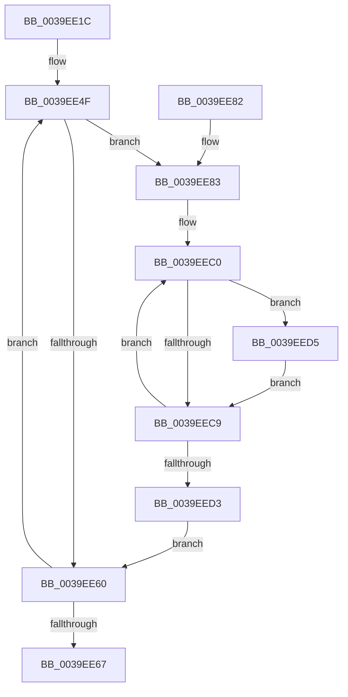

# KiBuildShareCountListForSubNodeByAffinity

- RVA: `0x0039EE1C`–`0x0039EEDD` (길이 `193` bytes)
- VA: `0x000000014039EE1C`
- 실행 섹션: `.text`
- PDB 이름 있음: `예`; PDB Function 태그: `아니요`
- unwind 정보 RVA: `0x00081C0C`
- 디코드: `58`개 명령, `193/193` bytes 표시
- 미해석 바이트: `0` (있으면 어셈블리에 `.byte`로 보존)

> 이 문서는 커널 이미지의 기계어와 PDB 기호를 분석해 생성했습니다. 4번과 5번은 함수 원형과 자료형을 바이너리 사용 방식에서 추정한 C 해석이며 원본 소스 복구 결과는 아닙니다.

## 1. Dependencies

- 직접 호출 지점: **2**; 고유 호출 대상: **2**
- 직접 호출자로 확인된 함수: **2**
- RIP 상대 이미지 참조: **2**

### Outgoing calls
- `0x0039EE48` → [memset](../6C/memset_function_006C6C40.md) (function, `0x006C6C40`)
- `0x0039EEA9` → [KeGetTopologySiblingGroupAffinityForProcessor](KeGetTopologySiblingGroupAffinityForProcessor_function_0039EEE4.md) (function, `0x0039EEE4`)

### Direct callers
- [KiPerformHeteroSoftParkElection](KiPerformHeteroSoftParkElection_function_0039E490.md) at `0x0039E50B`
- [KiCompleteKernelInit](../../pagelk/B6/KiCompleteKernelInit_function_00B66090.md) at `0x00B662FC`
- [KiCompleteKernelInit](../../pagelk/B6/KiCompleteKernelInit_function_00B66090.md) at `0x00B66339`

### Static image references
- `0x0039EE94` → RVA `0x00F231B8` (`.data`; read)
- `0x0039EE9E` → RVA `0x00FC8C40` (`ALMOSTRO`; read)

## 2. Other-region calls and transfers

- 다른 실행 섹션으로 향하는 call: **0**
- 별도 외부 분기/꼬리 이동을 확인하지 못했습니다.

## 3. Assembly (complete function range)

```asm
0039EE1C  48 8B C4                        mov rax, rsp
0039EE1F  48 89 58 08                     mov qword ptr [rax + 8], rbx
0039EE23  48 89 68 10                     mov qword ptr [rax + 0x10], rbp
0039EE27  48 89 70 18                     mov qword ptr [rax + 0x18], rsi
0039EE2B  48 89 78 20                     mov qword ptr [rax + 0x20], rdi
0039EE2F  41 56                           push r14
0039EE31  48 83 EC 30                     sub rsp, 0x30
0039EE35  44 0F B7 F2                     movzx r14d, dx
0039EE39  49 8B E8                        mov rbp, r8
0039EE3C  33 D2                           xor edx, edx
0039EE3E  49 8B F1                        mov rsi, r9
0039EE41  48 8B F9                        mov rdi, rcx
0039EE44  44 8D 42 40                     lea r8d, [rdx + 0x40]
0039EE48  E8 F3 7D 32 00                  call 0x1406c6c40
0039EE4D  32 DB                           xor bl, bl
0039EE4F  0F B6 CB                        movzx ecx, bl
0039EE52  0F 57 C0                        xorps xmm0, xmm0
0039EE55  48 0F A3 CE                     bt rsi, rcx
0039EE59  0F 11 44 24 20                  movups xmmword ptr [rsp + 0x20], xmm0
0039EE5E  72 23                           jb 0x14039ee83
0039EE60  FE C3                           inc bl
0039EE62  80 FB 40                        cmp bl, 0x40
0039EE65  72 E8                           jb 0x14039ee4f
0039EE67  48 8B 5C 24 40                  mov rbx, qword ptr [rsp + 0x40]
0039EE6C  48 8B 6C 24 48                  mov rbp, qword ptr [rsp + 0x48]
0039EE71  48 8B 74 24 50                  mov rsi, qword ptr [rsp + 0x50]
0039EE76  48 8B 7C 24 58                  mov rdi, qword ptr [rsp + 0x58]
0039EE7B  48 83 C4 30                     add rsp, 0x30
0039EE7F  41 5E                           pop r14
0039EE81  C3                              ret
0039EE82  CC                              int3
0039EE83  8B 54 24 60                     mov edx, dword ptr [rsp + 0x60]
0039EE87  4C 8D 44 24 20                  lea r8, [rsp + 0x20]
0039EE8C  41 8B C6                        mov eax, r14d
0039EE8F  C1 E0 06                        shl eax, 6
0039EE92  03 C8                           add ecx, eax
0039EE94  48 8B 05 1D 43 B8 00            mov rax, qword ptr [rip + 0xb8431d]
0039EE9B  8B 04 88                        mov eax, dword ptr [rax + rcx*4]
0039EE9E  48 8D 0D 9B 9D C2 00            lea rcx, [rip + 0xc29d9b]
0039EEA5  48 8B 0C C1                     mov rcx, qword ptr [rcx + rax*8]
0039EEA9  E8 36 00 00 00                  call 0x14039eee4
0039EEAE  4C 8B 44 24 20                  mov r8, qword ptr [rsp + 0x20]
0039EEB3  48 8B D7                        mov rdx, rdi
0039EEB6  4C 23 C5                        and r8, rbp
0039EEB9  4C 89 44 24 20                  mov qword ptr [rsp + 0x20], r8
0039EEBE  32 C9                           xor cl, cl
0039EEC0  0F B6 C1                        movzx eax, cl
0039EEC3  49 0F A3 C0                     bt r8, rax
0039EEC7  72 0C                           jb 0x14039eed5
0039EEC9  FE C1                           inc cl
0039EECB  48 FF C2                        inc rdx
0039EECE  80 F9 40                        cmp cl, 0x40
0039EED1  72 ED                           jb 0x14039eec0
0039EED3  EB 8B                           jmp 0x14039ee60
0039EED5  8A 02                           mov al, byte ptr [rdx]
0039EED7  FE C0                           inc al
0039EED9  88 02                           mov byte ptr [rdx], al
0039EEDB  EB EC                           jmp 0x14039eec9
```

## 4. C-style interpretation (structured pseudocode)

```c
__int64 __fastcall KiBuildShareCountListForSubNodeByAffinity(__int64 a1, int a2, __int64 a3, __int64 a4, unsigned int a5)
{
    __int64 result;
    __int64 v_rbx;
    __int64 v_rsp;
    unsigned __int64 v_stack_m18;
    unsigned __int64 v_stack_p10;
    unsigned __int64 v_stack_p18;
    unsigned __int64 v_stack_p20;
    unsigned __int64 v_stack_p8;

    *(unsigned __int64 *)(v_rsp + 8) = v_rbx;
    *(unsigned __int64 *)(v_rsp + 16) = v_rbp;
    *(unsigned __int64 *)(v_rsp + 24) = v_rsi;
    *(unsigned __int64 *)(v_rsp + 32) = v_rdi;
    v_rsp = (v_rsp) - (48);
    a2 = 0;
    result = memset(a1, a2, a2 + 64, a4);
    v_rbx = 0;
loc_0039EE4F:
    v_stack_m18 = v_xmm0;
    if (condition_is_below) goto loc_0039EE83;
loc_0039EE60:
    v_rbx = (unsigned __int8)((v_rbx) + 1);
    if (((unsigned __int8)(v_rbx)) < 64) goto loc_0039EE4F;
    v_rsp = (v_rsp) + (48);
    return result;
loc_0039EE83:
    result = (unsigned int)(((unsigned int)((unsigned int)((unsigned __int16)(a2)))) << (6));
    a1 = (unsigned int)((0) + ((unsigned int)(result)));
    result = KeGetTopologySiblingGroupAffinityForProcessor(*(unsigned __int64 *)(v_rip + 12754331 + (unsigned int)(*(unsigned int *)(*(unsigned __int64 *)(v_rip + 12075805) + a1 * 4)) * 8), (unsigned int)(a5), v_stack_p20, a4);
    a3 = (v_stack_p20) & (v_stack_p10);
    v_stack_p20 = a3;
    a1 = 0;
loc_0039EEC0:
    if (condition_is_below) goto loc_0039EED5;
loc_0039EEC9:
    a1 = (unsigned __int8)((a1) + 1);
    a2 = (v_stack_p20) + 1;
    if (((unsigned __int8)(a1)) < 64) goto loc_0039EEC0;
    goto loc_0039EE60;
loc_0039EED5:
    result = (unsigned __int8)((*(unsigned __int8 *)(a2)) + 1);
    *(unsigned __int8 *)(a2) = (unsigned __int8)(result);
    goto loc_0039EEC9;
}
```

## 5. (Beta) C Style

```c
int64_t KiBuildShareCountListForSubNodeByAffinity(int64_t Arg1, int32_t Arg2, int64_t Arg3, int64_t Arg4, uint32_t Arg5)
{
    int64_t result;
    int64_t local_rbx;
    int64_t local_rsp;
    uint64_t v_stack_m18;
    uint64_t v_stack_p10;
    uint64_t v_stack_p18;
    uint64_t v_stack_p20;
    uint64_t v_stack_p8;

    *(uint64_t *)(local_rsp + 0x8) = local_rbx;
    *(uint64_t *)(local_rsp + 0x10) = local_rbp;
    *(uint64_t *)(local_rsp + 0x18) = local_rsi;
    *(uint64_t *)(local_rsp + 0x20) = local_rdi;
    local_rsp = (local_rsp) - (48);
    Arg2 = 0;
    result = memset(Arg1, Arg2, Arg2 + 64, Arg4);
    local_rbx = 0;
loc_0039EE4F:
    v_stack_m18 = v_xmm0;
    if (condition_is_below) goto loc_0039EE83;
loc_0039EE60:
    local_rbx = (uint8_t)((local_rbx) + 1);
    if (((uint8_t)(local_rbx)) < 64) goto loc_0039EE4F;
    local_rsp = (local_rsp) + (48);
    return result;
loc_0039EE83:
    result = (uint32_t)(((uint32_t)((uint32_t)((uint16_t)(Arg2)))) << (6));
    Arg1 = (uint32_t)((0) + ((uint32_t)(result)));
    result = KeGetTopologySiblingGroupAffinityForProcessor(*(uint64_t *)(v_rip + 0xC29D9B + (uint32_t)(*(uint32_t *)(*(uint64_t *)(v_rip + 0xB8431D) + Arg1 * 4)) * 8), (uint32_t)(Arg5), v_stack_p20, Arg4);
    Arg3 = (v_stack_p20) & (v_stack_p10);
    v_stack_p20 = Arg3;
    Arg1 = 0;
loc_0039EEC0:
    if (condition_is_below) goto loc_0039EED5;
loc_0039EEC9:
    Arg1 = (uint8_t)((Arg1) + 1);
    Arg2 = (v_stack_p20) + 1;
    if (((uint8_t)(Arg1)) < 64) goto loc_0039EEC0;
    goto loc_0039EE60;
loc_0039EED5:
    result = (uint8_t)((*(uint8_t *)(Arg2)) + 1);
    *(uint8_t *)(Arg2) = (uint8_t)(result);
    goto loc_0039EEC9;
}
```

## 6. Execution-region graph

[열기: 2D/3D 그래프와 함수 탐색 컨트롤 패널](../../../control-panel.html?section=text&rva=0x0039EE1C&view=graph)

- 2D 그래프는 위에서 아래로 흐르고, 3D 그래프는 빈 공간을 드래그해 회전합니다. Shift+드래그는 이동, 휠은 확대·축소, 함수 노드 선택은 대상 보고서 이동입니다.

### Static fallback


