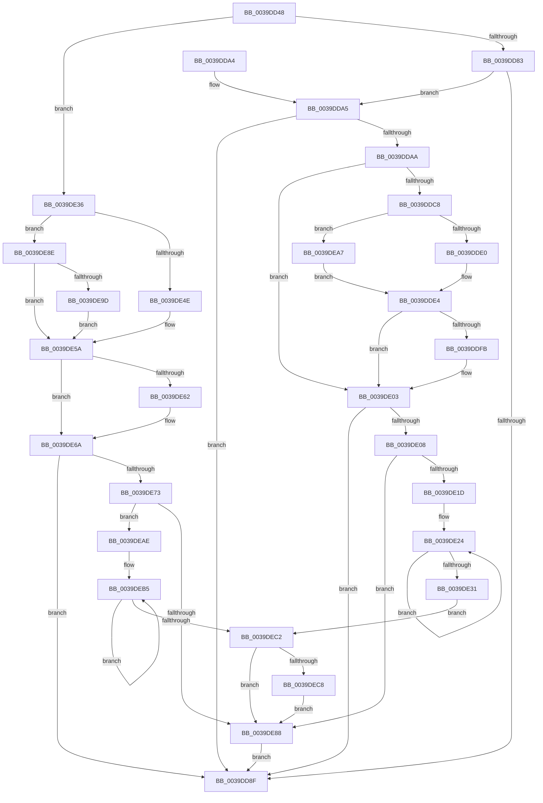

# KiCheckForPendingQosUpdate

- RVA: `0x0039DD48`–`0x0039DECF` (길이 `391` bytes)
- VA: `0x000000014039DD48`
- 실행 섹션: `.text`
- PDB 이름 있음: `예`; PDB Function 태그: `아니요`
- unwind 정보 RVA: `0x00081B58`
- 디코드: `100`개 명령, `391/391` bytes 표시
- 미해석 바이트: `0` (있으면 어셈블리에 `.byte`로 보존)

> 이 문서는 커널 이미지의 기계어와 PDB 기호를 분석해 생성했습니다. 4번과 5번은 함수 원형과 자료형을 바이너리 사용 방식에서 추정한 C 해석이며 원본 소스 복구 결과는 아닙니다.

## 1. Dependencies

- 직접 호출 지점: **7**; 고유 호출 대상: **4**
- 직접 호출자로 확인된 함수: **1**
- RIP 상대 이미지 참조: **1**

### Outgoing calls
- `0x0039DDAA` → [KeDisableInterrupts](../21/KeDisableInterrupts_function_00217BE0.md) (function, `0x00217BE0`)
- `0x0039DDCD` → [PoSetProcessorQos](PoSetProcessorQos_function_00391C60.md) (function, `0x00391C60`)
- `0x0039DDFE` → [KeUpdatePendingQosRequest](KeUpdatePendingQosRequest_function_003924F4.md) (function, `0x003924F4`)
- `0x0039DE36` → [KeDisableInterrupts](../21/KeDisableInterrupts_function_00217BE0.md) (function, `0x00217BE0`)
- `0x0039DE65` → [KeUpdatePendingQosRequest](KeUpdatePendingQosRequest_function_003924F4.md) (function, `0x003924F4`)
- `0x0039DE94` → [PoSetProcessorQos](PoSetProcessorQos_function_00391C60.md) (function, `0x00391C60`)
- `0x0039DEC8` → [KiRemoveSystemWorkPriorityKick](../26/KiRemoveSystemWorkPriorityKick_function_002631D0.md) (function, `0x002631D0`)

### Direct callers
- [KiUpdateRunTime](KiUpdateRunTime_function_0039BB70.md) at `0x0039BDED`

### Static image references
- `0x0039DD83` → RVA `0x00FC6C6C` (`ALMOSTRO`; read)

## 2. Other-region calls and transfers

- 다른 실행 섹션으로 향하는 call: **0**
- 별도 외부 분기/꼬리 이동을 확인하지 못했습니다.

## 3. Assembly (complete function range)

```asm
0039DD48  48 89 5C 24 08                  mov qword ptr [rsp + 8], rbx
0039DD4D  48 89 6C 24 10                  mov qword ptr [rsp + 0x10], rbp
0039DD52  48 89 74 24 18                  mov qword ptr [rsp + 0x18], rsi
0039DD57  57                              push rdi
0039DD58  48 83 EC 20                     sub rsp, 0x20
0039DD5C  65 48 8B 1C 25 20 00 00 00      mov rbx, qword ptr gs:[0x20]
0039DD65  BD 00 01 00 00                  mov ebp, 0x100
0039DD6A  44 0F B6 89 04 02 00 00         movzx r9d, byte ptr [rcx + 0x204]
0039DD72  4C 8B C1                        mov r8, rcx
0039DD75  8B 83 EC 00 00 00               mov eax, dword ptr [rbx + 0xec]
0039DD7B  85 C5                           test ebp, eax
0039DD7D  0F 85 B3 00 00 00               jne 0x14039de36
0039DD83  83 3D E2 8E C2 00 00            cmp dword ptr [rip + 0xc28ee2], 0
0039DD8A  0F B6 C0                        movzx eax, al
0039DD8D  75 16                           jne 0x14039dda5
0039DD8F  48 8B 5C 24 30                  mov rbx, qword ptr [rsp + 0x30]
0039DD94  48 8B 6C 24 38                  mov rbp, qword ptr [rsp + 0x38]
0039DD99  48 8B 74 24 40                  mov rsi, qword ptr [rsp + 0x40]
0039DD9E  48 83 C4 20                     add rsp, 0x20
0039DDA2  5F                              pop rdi
0039DDA3  C3                              ret
0039DDA4  CC                              int3
0039DDA5  44 3B C8                        cmp r9d, eax
0039DDA8  74 E5                           je 0x14039dd8f
0039DDAA  E8 31 9E E7 FF                  call 0x140217be0
0039DDAF  41 0F B6 90 04 02 00 00         movzx edx, byte ptr [r8 + 0x204]
0039DDB7  40 8A F0                        mov sil, al
0039DDBA  8B BB EC 00 00 00               mov edi, dword ptr [rbx + 0xec]
0039DDC0  40 0F B6 CF                     movzx ecx, dil
0039DDC4  3B D1                           cmp edx, ecx
0039DDC6  74 3B                           je 0x14039de03
0039DDC8  48 8B CB                        mov rcx, rbx
0039DDCB  23 FD                           and edi, ebp
0039DDCD  E8 8E 3E FF FF                  call 0x140391c60
0039DDD2  8B 8B EC 00 00 00               mov ecx, dword ptr [rbx + 0xec]
0039DDD8  84 C0                           test al, al
0039DDDA  0F 84 C7 00 00 00               je 0x14039dea7
0039DDE0  0F BA F1 08                     btr ecx, 8
0039DDE4  33 C0                           xor eax, eax
0039DDE6  89 8B EC 00 00 00               mov dword ptr [rbx + 0xec], ecx
0039DDEC  C1 E9 08                        shr ecx, 8
0039DDEF  83 E1 01                        and ecx, 1
0039DDF2  85 FF                           test edi, edi
0039DDF4  0F 95 C0                        setne al
0039DDF7  3B C1                           cmp eax, ecx
0039DDF9  74 08                           je 0x14039de03
0039DDFB  48 8B CB                        mov rcx, rbx
0039DDFE  E8 F1 46 FF FF                  call 0x1403924f4
0039DE03  40 84 F6                        test sil, sil
0039DE06  74 87                           je 0x14039dd8f
0039DE08  65 48 8B 0C 25 20 00 00 00      mov rcx, qword ptr gs:[0x20]
0039DE11  4C 8B 81 B8 8E 00 00            mov r8, qword ptr [rcx + 0x8eb8]
0039DE18  4D 85 C0                        test r8, r8
0039DE1B  74 6B                           je 0x14039de88
0039DE1D  41 0F 0D 08                     prefetchw byte ptr [r8]
0039DE21  41 8B 00                        mov eax, dword ptr [r8]
0039DE24  8B D0                           mov edx, eax
0039DE26  0F BA F2 15                     btr edx, 0x15
0039DE2A  F0 41 0F B1 10                  lock cmpxchg dword ptr [r8], edx
0039DE2F  75 F3                           jne 0x14039de24
0039DE31  E9 8C 00 00 00                  jmp 0x14039dec2
0039DE36  E8 A5 9D E7 FF                  call 0x140217be0
0039DE3B  44 8B 83 EC 00 00 00            mov r8d, dword ptr [rbx + 0xec]
0039DE42  40 8A F8                        mov dil, al
0039DE45  41 0F B6 C8                     movzx ecx, r8b
0039DE49  44 3B C9                        cmp r9d, ecx
0039DE4C  75 40                           jne 0x14039de8e
0039DE4E  41 0F BA F0 08                  btr r8d, 8
0039DE53  44 89 83 EC 00 00 00            mov dword ptr [rbx + 0xec], r8d
0039DE5A  85 AB EC 00 00 00               test dword ptr [rbx + 0xec], ebp
0039DE60  75 08                           jne 0x14039de6a
0039DE62  48 8B CB                        mov rcx, rbx
0039DE65  E8 8A 46 FF FF                  call 0x1403924f4
0039DE6A  40 84 FF                        test dil, dil
0039DE6D  0F 84 1C FF FF FF               je 0x14039dd8f
0039DE73  65 48 8B 0C 25 20 00 00 00      mov rcx, qword ptr gs:[0x20]
0039DE7C  4C 8B 81 B8 8E 00 00            mov r8, qword ptr [rcx + 0x8eb8]
0039DE83  4D 85 C0                        test r8, r8
0039DE86  75 26                           jne 0x14039deae
0039DE88  FB                              sti
0039DE89  E9 01 FF FF FF                  jmp 0x14039dd8f
0039DE8E  41 8B D1                        mov edx, r9d
0039DE91  48 8B CB                        mov rcx, rbx
0039DE94  E8 C7 3D FF FF                  call 0x140391c60
0039DE99  84 C0                           test al, al
0039DE9B  74 BD                           je 0x14039de5a
0039DE9D  0F BA B3 EC 00 00 00 08         btr dword ptr [rbx + 0xec], 8
0039DEA5  EB B3                           jmp 0x14039de5a
0039DEA7  0B CD                           or ecx, ebp
0039DEA9  E9 36 FF FF FF                  jmp 0x14039dde4
0039DEAE  41 0F 0D 08                     prefetchw byte ptr [r8]
0039DEB2  41 8B 00                        mov eax, dword ptr [r8]
0039DEB5  8B D0                           mov edx, eax
0039DEB7  0F BA F2 15                     btr edx, 0x15
0039DEBB  F0 41 0F B1 10                  lock cmpxchg dword ptr [r8], edx
0039DEC0  75 F3                           jne 0x14039deb5
0039DEC2  0F BA E0 15                     bt eax, 0x15
0039DEC6  73 C0                           jae 0x14039de88
0039DEC8  E8 03 53 EC FF                  call 0x1402631d0
0039DECD  EB B9                           jmp 0x14039de88
```

## 4. C-style interpretation (structured pseudocode)

```c
__int64 __fastcall KiCheckForPendingQosUpdate(__int64 a1)
{
    __int64 result;
    __int64 v_rdi;
    __int64 v_rsp;
    unsigned __int64 v_stack_p10;
    unsigned __int64 v_stack_p18;
    unsigned __int64 v_stack_p8;

    v_stack_p8 = v_rbx;
    v_stack_p10 = v_rbp;
    v_stack_p18 = v_rsi;
    v_rsp = (v_rsp) - (32);
    if (((256) & ((unsigned int)((unsigned int)(*(unsigned int *)(*(unsigned __int64 *)(gs_base + (0 + 32)) + 236))))) != 0) goto loc_0039DE36;
    if ((*(unsigned int *)(v_rip + 12750562)) != 0) goto loc_0039DDA5;
loc_0039DD8F:
    v_rsp = (v_rsp) + (32);
    return (unsigned __int8)((unsigned int)(*(unsigned int *)(*(unsigned __int64 *)(gs_base + (0 + 32)) + 236)));
loc_0039DDA5:
    if (((unsigned int)(*(unsigned __int8 *)(a1 + 516))) == ((unsigned int)((unsigned __int8)((unsigned int)(*(unsigned int *)(*(unsigned __int64 *)(gs_base + (0 + 32)) + 236)))))) goto loc_0039DD8F;
    result = KeDisableInterrupts(a1, a2, a1, *(unsigned __int8 *)(a1 + 516));
    if (((unsigned int)(*(unsigned __int8 *)(a1 + 516))) == ((unsigned int)((unsigned __int8)((unsigned int)(*(unsigned int *)(v_stack_p8 + 236)))))) goto loc_0039DE03;
    v_rdi = (unsigned int)(((unsigned int)(*(unsigned int *)(v_stack_p8 + 236))) & ((unsigned int)(v_stack_p10)));
    result = PoSetProcessorQos(v_stack_p8, *(unsigned __int8 *)(a1 + 516), a1, *(unsigned __int8 *)(a1 + 516));
    if ((unsigned __int8)(result) == 0) goto loc_0039DEA7;
loc_0039DDE4:
    result = 0;
    *(unsigned int *)(v_stack_p8 + 236) = (unsigned int)((unsigned int)(*(unsigned int *)(v_stack_p8 + 236)));
    a1 = (unsigned int)(((unsigned int)(*(unsigned int *)(v_stack_p8 + 236))) >> (8));
    a1 = (unsigned int)((a1) & (1));
    result = ((unsigned int)(v_rdi) != 0) ? 1 : 0;
    if (((unsigned int)(result)) != ((unsigned int)(a1))) {
        a1 = v_stack_p8;
        result = KeUpdatePendingQosRequest(a1, *(unsigned __int8 *)(a1 + 516), a1, *(unsigned __int8 *)(a1 + 516));
    }
    if ((unsigned __int8)((unsigned __int8)(result)) == 0) goto loc_0039DD8F;
    if (*(unsigned __int64 *)(*(unsigned __int64 *)(gs_base + (0 + 32)) + 36536) == 0) goto loc_0039DE88;
loc_0039DE24:
    if (*(unsigned __int64 *)(*(unsigned __int64 *)(gs_base + (0 + 32)) + 36536) != 0) goto loc_0039DE24;
    goto loc_0039DEC2;
loc_0039DE36:
    result = KeDisableInterrupts(*(unsigned __int64 *)(gs_base + (0 + 32)), (unsigned int)((unsigned int)((unsigned int)(*(unsigned int *)(*(unsigned __int64 *)(*(unsigned __int64 *)(gs_base + (0 + 32)) + 36536))))), *(unsigned __int64 *)(*(unsigned __int64 *)(gs_base + (0 + 32)) + 36536), *(unsigned __int8 *)(a1 + 516));
    if (((unsigned int)(*(unsigned __int8 *)(a1 + 516))) != ((unsigned int)((unsigned __int8)((unsigned int)(*(unsigned int *)(v_stack_p8 + 236)))))) goto loc_0039DE8E;
    *(unsigned int *)(v_stack_p8 + 236) = (unsigned int)((unsigned int)(*(unsigned int *)(v_stack_p8 + 236)));
loc_0039DE5A:
    if (((*(unsigned int *)(v_stack_p8 + 236)) & ((unsigned int)(v_stack_p10))) == 0) {
        a1 = v_stack_p8;
        result = KeUpdatePendingQosRequest(a1, (unsigned int)((unsigned int)((unsigned int)(*(unsigned int *)(*(unsigned __int64 *)(*(unsigned __int64 *)(gs_base + (0 + 32)) + 36536))))), (unsigned int)(*(unsigned int *)(v_stack_p8 + 236)), *(unsigned __int8 *)(a1 + 516));
    }
    if ((unsigned __int8)((unsigned __int8)(result)) == 0) goto loc_0039DD8F;
    if (*(unsigned __int64 *)(*(unsigned __int64 *)(gs_base + (0 + 32)) + 36536) != 0) goto loc_0039DEAE;
loc_0039DE88:
    goto loc_0039DD8F;
loc_0039DE8E:
    result = PoSetProcessorQos(v_stack_p8, (unsigned int)((unsigned int)(*(unsigned __int8 *)(a1 + 516))), *(unsigned __int64 *)(*(unsigned __int64 *)(gs_base + (0 + 32)) + 36536), *(unsigned __int8 *)(a1 + 516));
    if ((unsigned __int8)(result) == 0) goto loc_0039DE5A;
    goto loc_0039DE5A;
loc_0039DEA7:
    a1 = (unsigned int)((v_stack_p8) | ((unsigned int)(v_stack_p10)));
    goto loc_0039DDE4;
loc_0039DEAE:
loc_0039DEB5:
    if (condition_is_not_equal) goto loc_0039DEB5;
loc_0039DEC2:
    if (condition_is_above_or_equal) goto loc_0039DE88;
    result = KiRemoveSystemWorkPriorityKick(a1, (unsigned int)((unsigned int)((unsigned int)(*(unsigned int *)(*(unsigned __int64 *)(*(unsigned __int64 *)(gs_base + (0 + 32)) + 36536))))), *(unsigned __int64 *)(*(unsigned __int64 *)(gs_base + (0 + 32)) + 36536), *(unsigned __int8 *)(a1 + 516));
    goto loc_0039DE88;
}
```

## 5. (Beta) C Style

```c
int64_t KiCheckForPendingQosUpdate(void *Arg1)
{
    uint8_t *arg1 = (uint8_t *)Arg1;

    int64_t result;
    int64_t local_rdi;
    int64_t local_rsp;
    uint64_t v_stack_p10;
    uint64_t v_stack_p18;
    uint64_t v_stack_p8;

    v_stack_p8 = local_rbx;
    v_stack_p10 = local_rbp;
    v_stack_p18 = local_rsi;
    local_rsp = (local_rsp) - (32);
    if (((256) & ((uint32_t)((uint32_t)(*(uint32_t *)(*(uint64_t *)(gs_base + (0 + 0x20)) + 0xEC))))) != 0) goto loc_0039DE36;
    if ((*(uint32_t *)(v_rip + 0xC28EE2)) != 0) goto loc_0039DDA5;
loc_0039DD8F:
    local_rsp = (local_rsp) + (32);
    return (uint8_t)((uint32_t)(*(uint32_t *)(*(uint64_t *)(gs_base + (0 + 0x20)) + 0xEC)));
loc_0039DDA5:
    if (((uint32_t)(*(uint8_t *)(arg1 + 0x204))) == ((uint32_t)((uint8_t)((uint32_t)(*(uint32_t *)(*(uint64_t *)(gs_base + (0 + 0x20)) + 0xEC)))))) goto loc_0039DD8F;
    result = KeDisableInterrupts(Arg1, a2, Arg1, *(uint8_t *)(arg1 + 0x204));
    if (((uint32_t)(*(uint8_t *)(arg1 + 0x204))) == ((uint32_t)((uint8_t)((uint32_t)(*(uint32_t *)(v_stack_p8 + 0xEC)))))) goto loc_0039DE03;
    local_rdi = (uint32_t)(((uint32_t)(*(uint32_t *)(v_stack_p8 + 0xEC))) & ((uint32_t)(v_stack_p10)));
    result = PoSetProcessorQos(v_stack_p8, *(uint8_t *)(arg1 + 0x204), Arg1, *(uint8_t *)(arg1 + 0x204));
    if ((uint8_t)(result) == 0) goto loc_0039DEA7;
loc_0039DDE4:
    result = 0;
    *(uint32_t *)(v_stack_p8 + 0xEC) = (uint32_t)((uint32_t)(*(uint32_t *)(v_stack_p8 + 0xEC)));
    Arg1 = (uint32_t)(((uint32_t)(*(uint32_t *)(v_stack_p8 + 0xEC))) >> (8));
    Arg1 = (uint32_t)((Arg1) & (1));
    result = ((uint32_t)(local_rdi) != 0) ? 1 : 0;
    if (((uint32_t)(result)) != ((uint32_t)(Arg1))) {
        Arg1 = v_stack_p8;
        result = KeUpdatePendingQosRequest(Arg1, *(uint8_t *)(arg1 + 0x204), Arg1, *(uint8_t *)(arg1 + 0x204));
    }
    if ((uint8_t)((uint8_t)(result)) == 0) goto loc_0039DD8F;
    if (*(uint64_t *)(*(uint64_t *)(gs_base + (0 + 0x20)) + 0x8EB8) == 0) goto loc_0039DE88;
loc_0039DE24:
    if (*(uint64_t *)(*(uint64_t *)(gs_base + (0 + 0x20)) + 0x8EB8) != 0) goto loc_0039DE24;
    goto loc_0039DEC2;
loc_0039DE36:
    result = KeDisableInterrupts(*(uint64_t *)(gs_base + (0 + 0x20)), (uint32_t)((uint32_t)((uint32_t)(*(uint32_t *)(*(uint64_t *)(*(uint64_t *)(gs_base + (0 + 0x20)) + 0x8EB8))))), *(uint64_t *)(*(uint64_t *)(gs_base + (0 + 0x20)) + 0x8EB8), *(uint8_t *)(arg1 + 0x204));
    if (((uint32_t)(*(uint8_t *)(arg1 + 0x204))) != ((uint32_t)((uint8_t)((uint32_t)(*(uint32_t *)(v_stack_p8 + 0xEC)))))) goto loc_0039DE8E;
    *(uint32_t *)(v_stack_p8 + 0xEC) = (uint32_t)((uint32_t)(*(uint32_t *)(v_stack_p8 + 0xEC)));
loc_0039DE5A:
    if (((*(uint32_t *)(v_stack_p8 + 0xEC)) & ((uint32_t)(v_stack_p10))) == 0) {
        Arg1 = v_stack_p8;
        result = KeUpdatePendingQosRequest(Arg1, (uint32_t)((uint32_t)((uint32_t)(*(uint32_t *)(*(uint64_t *)(*(uint64_t *)(gs_base + (0 + 0x20)) + 0x8EB8))))), (uint32_t)(*(uint32_t *)(v_stack_p8 + 0xEC)), *(uint8_t *)(arg1 + 0x204));
    }
    if ((uint8_t)((uint8_t)(result)) == 0) goto loc_0039DD8F;
    if (*(uint64_t *)(*(uint64_t *)(gs_base + (0 + 0x20)) + 0x8EB8) != 0) goto loc_0039DEAE;
loc_0039DE88:
    goto loc_0039DD8F;
loc_0039DE8E:
    result = PoSetProcessorQos(v_stack_p8, (uint32_t)((uint32_t)(*(uint8_t *)(arg1 + 0x204))), *(uint64_t *)(*(uint64_t *)(gs_base + (0 + 0x20)) + 0x8EB8), *(uint8_t *)(arg1 + 0x204));
    if ((uint8_t)(result) == 0) goto loc_0039DE5A;
    goto loc_0039DE5A;
loc_0039DEA7:
    Arg1 = (uint32_t)((v_stack_p8) | ((uint32_t)(v_stack_p10)));
    goto loc_0039DDE4;
loc_0039DEAE:
loc_0039DEB5:
    if (condition_is_not_equal) goto loc_0039DEB5;
loc_0039DEC2:
    if (condition_is_above_or_equal) goto loc_0039DE88;
    result = KiRemoveSystemWorkPriorityKick(Arg1, (uint32_t)((uint32_t)((uint32_t)(*(uint32_t *)(*(uint64_t *)(*(uint64_t *)(gs_base + (0 + 0x20)) + 0x8EB8))))), *(uint64_t *)(*(uint64_t *)(gs_base + (0 + 0x20)) + 0x8EB8), *(uint8_t *)(arg1 + 0x204));
    goto loc_0039DE88;
}
```

### 관측된 메모리 오프셋

구조체 형식이 확인되지 않은 접근은 인자 기준의 오프셋으로만 기록했습니다.

| 기준 인자 | 오프셋 표현 | 폭 (bit) | 접근 |
|---|---:|---:|---|
| `Arg1` | `+ 0x204` | `8` | `R` |

## 6. Execution-region graph

[열기: 2D/3D 그래프와 함수 탐색 컨트롤 패널](../../../control-panel.html?section=text&rva=0x0039DD48&view=graph)

- 2D 그래프는 위에서 아래로 흐르고, 3D 그래프는 빈 공간을 드래그해 회전합니다. Shift+드래그는 이동, 휠은 확대·축소, 함수 노드 선택은 대상 보고서 이동입니다.

### Static fallback


