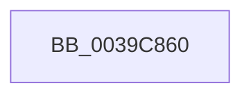

# KiCheckForTimerExpiration

- RVA: `0x0039C860`–`0x0039C884` (길이 `36` bytes)
- VA: `0x000000014039C860`
- 실행 섹션: `.text`
- PDB 이름 있음: `예`; PDB Function 태그: `아니요`
- unwind 정보 RVA: `0x00081994`
- 디코드: `11`개 명령, `36/36` bytes 표시
- 미해석 바이트: `0` (있으면 어셈블리에 `.byte`로 보존)

> 이 문서는 커널 이미지의 기계어와 PDB 기호를 분석해 생성했습니다. 4번과 5번은 함수 원형과 자료형을 바이너리 사용 방식에서 추정한 C 해석이며 원본 소스 복구 결과는 아닙니다.

## 1. Dependencies

- 직접 호출 지점: **0**; 고유 호출 대상: **0**
- 직접 호출자로 확인된 함수: **1**
- RIP 상대 이미지 참조: **1**

### Outgoing calls
- 직접 디코드된 call 명령이 없습니다.

### Direct callers
- [KeAccumulateTicks](KeAccumulateTicks_function_0039C140.md) at `0x0039C168`

### Static image references
- `0x0039C876` → RVA `0x00E0A740` (`.data`; read)

## 2. Other-region calls and transfers

- 다른 실행 섹션으로 향하는 call: **0**
- 별도 외부 분기/꼬리 이동을 확인하지 못했습니다.

## 3. Assembly (complete function range)

```asm
0039C860  4C 8B DC                        mov r11, rsp
0039C863  55                              push rbp
0039C864  53                              push rbx
0039C865  41 54                           push r12
0039C867  41 55                           push r13
0039C869  41 56                           push r14
0039C86B  49 8D 6B A1                     lea rbp, [r11 - 0x5f]
0039C86F  48 81 EC B0 00 00 00            sub rsp, 0xb0
0039C876  48 8B 05 C3 DE A6 00            mov rax, qword ptr [rip + 0xa6dec3]
0039C87D  48 33 C4                        xor rax, rsp
0039C880  48 89 45 2F                     mov qword ptr [rbp + 0x2f], rax
```

## 4. C-style interpretation (structured pseudocode)

```c
__int64 __fastcall KiCheckForTimerExpiration(void)
{
    __int64 result;
    __int64 v_rsp;

    v_rsp = (v_rsp) - (176);
    result = (*(unsigned __int64 *)(v_rip + 10936003)) ^ (v_rsp);
    *(unsigned __int64 *)(v_rsp - 95 + 47) = result;
    return result;
}
```

## 5. (Beta) C Style

```c
void KiCheckForTimerExpiration(void)
{
    int64_t result;
    int64_t local_rsp;

    local_rsp = (local_rsp) - (176);
    result = (*(uint64_t *)(v_rip + 0xA6DEC3)) ^ (local_rsp);
    *(uint64_t *)(local_rsp - 0x5F + 0x2F) = result;
    return result;
}
```

## 6. Execution-region graph

[열기: 2D/3D 그래프와 함수 탐색 컨트롤 패널](../../../control-panel.html?section=text&rva=0x0039C860&view=graph)

- 2D 그래프는 위에서 아래로 흐르고, 3D 그래프는 빈 공간을 드래그해 회전합니다. Shift+드래그는 이동, 휠은 확대·축소, 함수 노드 선택은 대상 보고서 이동입니다.

### Static fallback


