# KiCheckPreferredHeteroProcessor

- RVA: `0x0039D72C`–`0x0039DB24` (길이 `1,016` bytes)
- VA: `0x000000014039D72C`
- 실행 섹션: `.text`
- PDB 이름 있음: `예`; PDB Function 태그: `아니요`
- unwind 정보 RVA: `0x00081AB4`
- 디코드: `252`개 명령, `1,016/1,016` bytes 표시
- 미해석 바이트: `0` (있으면 어셈블리에 `.byte`로 보존)

> 이 문서는 커널 이미지의 기계어와 PDB 기호를 분석해 생성했습니다. 4번과 5번은 함수 원형과 자료형을 바이너리 사용 방식에서 추정한 C 해석이며 원본 소스 복구 결과는 아닙니다.

## 1. Dependencies

- 직접 호출 지점: **14**; 고유 호출 대상: **10**
- 직접 호출자로 확인된 함수: **4**
- RIP 상대 이미지 참조: **5**

### Outgoing calls
- `0x0039D788` → [memset](../6C/memset_function_006C6C40.md) (function, `0x006C6C40`)
- `0x0039D7AB` → [KiHeteroComputeThreadWorkloadProperties](KiHeteroComputeThreadWorkloadProperties_function_0039F030.md) (function, `0x0039F030`)
- `0x0039D7FB` → [KiGenerateHeteroSets](KiGenerateHeteroSets_function_0039ED50.md) (function, `0x0039ED50`)
- `0x0039D811` → [Feature_HeteroRescheduleFixes__private_IsEnabledNoReportingNoInline](../35/Feature_HeteroRescheduleFixes__private_IsEnabledNoReportingNoInline_function_00355C60.md) (function, `0x00355C60`)
- `0x0039D82B` → [KiIsQosGroupingActive](KiIsQosGroupingActive_function_0039F004.md) (function, `0x0039F004`)
- `0x0039D849` → [Feature_HeteroRescheduleFixes__private_IsEnabledNoReportingNoInline](../35/Feature_HeteroRescheduleFixes__private_IsEnabledNoReportingNoInline_function_00355C60.md) (function, `0x00355C60`)
- `0x0039D892` → [RtlCopyVolatileMemory](../6B/RtlCopyVolatileMemory_function_006BC9D0.md) (function, `0x006BC9D0`)
- `0x0039D8C3` → [Feature_HeteroRescheduleFixes__private_IsEnabledNoReportingNoInline](../35/Feature_HeteroRescheduleFixes__private_IsEnabledNoReportingNoInline_function_00355C60.md) (function, `0x00355C60`)
- `0x0039D8E9` → [KiGetProcessorClassForPolicy](../48/KiGetProcessorClassForPolicy_function_004801E4.md) (function, `0x004801E4`)
- `0x0039D932` → [_security_check_cookie](../6A/_security_check_cookie_function_006AC640.md) (function, `0x006AC640`)
- `0x0039D9F9` → [RtlCopyVolatileMemory](../6B/RtlCopyVolatileMemory_function_006BC9D0.md) (function, `0x006BC9D0`)
- `0x0039DA58` → [KiHeteroScanQueueForPreemptionSwapTarget](../3C/KiHeteroScanQueueForPreemptionSwapTarget_function_003C133C.md) (function, `0x003C133C`)
- `0x0039DA91` → [KiFindBiasedProcessorIndex](../3C/KiFindBiasedProcessorIndex_function_003C185C.md) (function, `0x003C185C`)
- `0x0039DACA` → [KiGetProcessorClassForPolicy](../48/KiGetProcessorClassForPolicy_function_004801E4.md) (function, `0x004801E4`)

### Direct callers
- [sub_0021BAB9](../21/Unknown_function_0021BAB9.md) at `0x0021BC48`
- [KiSendHeteroRescheduleIntRequestHelper](../35/KiSendHeteroRescheduleIntRequestHelper_function_0035420C.md) at `0x00354306`
- [KiSendHeteroRescheduleIntRequestHelper](../35/KiSendHeteroRescheduleIntRequestHelper_function_0035420C.md) at `0x0035459D`
- [KiSendHeteroRescheduleIntRequestHelper](../35/KiSendHeteroRescheduleIntRequestHelper_function_0035420C.md) at `0x0035466E`
- [KiUpdateRunTime](KiUpdateRunTime_function_0039BB70.md) at `0x0039BDDD`
- [KeUpdateThreadTag](../47/KeUpdateThreadTag_function_00475770.md) at `0x00475BE5`
- [KeUpdateThreadTag](../47/KeUpdateThreadTag_function_00475770.md) at `0x00475CE5`

### Static image references
- `0x0039D748` → RVA `0x00E0A740` (`.data`; read)
- `0x0039D798` → RVA `0x00FC6B78` (`ALMOSTRO`; read)
- `0x0039D8F1` → RVA `0x00FC8C40` (`ALMOSTRO`; read)
- `0x0039D983` → RVA `0x00FC6C6C` (`ALMOSTRO`; read)
- `0x0039DAA6` → RVA `0x00F231B8` (`.data`; read)

## 2. Other-region calls and transfers

- 다른 실행 섹션으로 향하는 call: **0**
- 별도 외부 분기/꼬리 이동을 확인하지 못했습니다.

## 3. Assembly (complete function range)

```asm
0039D72C  48 89 5C 24 18                  mov qword ptr [rsp + 0x18], rbx
0039D731  55                              push rbp
0039D732  56                              push rsi
0039D733  57                              push rdi
0039D734  41 54                           push r12
0039D736  41 55                           push r13
0039D738  41 56                           push r14
0039D73A  41 57                           push r15
0039D73C  48 8D 6C 24 D9                  lea rbp, [rsp - 0x27]
0039D741  48 81 EC C0 00 00 00            sub rsp, 0xc0
0039D748  48 8B 05 F1 CF A6 00            mov rax, qword ptr [rip + 0xa6cff1]
0039D74F  48 33 C4                        xor rax, rsp
0039D752  48 89 45 17                     mov qword ptr [rbp + 0x17], rax
0039D756  33 C0                           xor eax, eax
0039D758  44 89 45 97                     mov dword ptr [rbp - 0x69], r8d
0039D75C  0F 57 C0                        xorps xmm0, xmm0
0039D75F  48 89 4D CF                     mov qword ptr [rbp - 0x31], rcx
0039D763  45 8B F8                        mov r15d, r8d
0039D766  48 89 45 C7                     mov qword ptr [rbp - 0x39], rax
0039D76A  4C 8B F2                        mov r14, rdx
0039D76D  89 45 AF                        mov dword ptr [rbp - 0x51], eax
0039D770  48 8B F9                        mov rdi, rcx
0039D773  88 45 B3                        mov byte ptr [rbp - 0x4d], al
0039D776  44 8D 40 40                     lea r8d, [rax + 0x40]
0039D77A  33 D2                           xor edx, edx
0039D77C  48 8D 4D D7                     lea rcx, [rbp - 0x29]
0039D780  0F 11 45 B7                     movups xmmword ptr [rbp - 0x49], xmm0
0039D784  0F 11 45 9F                     movups xmmword ptr [rbp - 0x61], xmm0
0039D788  E8 B3 94 32 00                  call 0x1406c6c40
0039D78D  65 4C 8B 24 25 20 00 00 00      mov r12, qword ptr gs:[0x20]
0039D796  33 DB                           xor ebx, ebx
0039D798  39 1D DA 93 C2 00               cmp dword ptr [rip + 0xc293da], ebx
0039D79E  0F 84 85 01 00 00               je 0x14039d929
0039D7A4  48 8D 55 9F                     lea rdx, [rbp - 0x61]
0039D7A8  48 8B CF                        mov rcx, rdi
0039D7AB  E8 80 18 00 00                  call 0x14039f030
0039D7B0  49 8B B6 C0 00 00 00            mov rsi, qword ptr [r14 + 0xc0]
0039D7B7  48 8B 97 40 02 00 00            mov rdx, qword ptr [rdi + 0x240]
0039D7BE  0F B7 86 88 00 00 00            movzx eax, word ptr [rsi + 0x88]
0039D7C5  66 3B 02                        cmp ax, word ptr [rdx]
0039D7C8  0F 83 27 03 00 00               jae 0x14039daf5
0039D7CE  48 8B 54 C2 08                  mov rdx, qword ptr [rdx + rax*8 + 8]
0039D7D3  48 85 96 80 00 00 00            test qword ptr [rsi + 0x80], rdx
0039D7DA  0F 84 49 01 00 00               je 0x14039d929
0039D7E0  44 8B 4D A3                     mov r9d, dword ptr [rbp - 0x5d]
0039D7E4  48 8D 45 B7                     lea rax, [rbp - 0x49]
0039D7E8  44 8A 45 AF                     mov r8b, byte ptr [rbp - 0x51]
0039D7EC  48 8B CE                        mov rcx, rsi
0039D7EF  48 89 44 24 28                  mov qword ptr [rsp + 0x28], rax
0039D7F4  8B 45 A7                        mov eax, dword ptr [rbp - 0x59]
0039D7F7  89 44 24 20                     mov dword ptr [rsp + 0x20], eax
0039D7FB  E8 50 15 00 00                  call 0x14039ed50
0039D800  49 8B 86 C8 00 00 00            mov rax, qword ptr [r14 + 0xc8]
0039D807  48 85 45 C7                     test qword ptr [rbp - 0x39], rax
0039D80B  0F 84 55 02 00 00               je 0x14039da66
0039D811  E8 4A 84 FB FF                  call 0x140355c60
0039D816  48 8B 7E 08                     mov rdi, qword ptr [rsi + 8]
0039D81A  85 C0                           test eax, eax
0039D81C  74 0D                           je 0x14039d82b
0039D81E  45 85 FF                        test r15d, r15d
0039D821  75 08                           jne 0x14039d82b
0039D823  49 23 BC 24 C8 00 00 00         and rdi, qword ptr [r12 + 0xc8]
0039D82B  E8 D4 17 00 00                  call 0x14039f004
0039D830  84 C0                           test al, al
0039D832  0F 85 3B 01 00 00               jne 0x14039d973
0039D838  49 8B 86 C8 00 00 00            mov rax, qword ptr [r14 + 0xc8]
0039D83F  48 85 45 B7                     test qword ptr [rbp - 0x49], rax
0039D843  0F 85 E0 00 00 00               jne 0x14039d929
0039D849  E8 12 84 FB FF                  call 0x140355c60
0039D84E  85 C0                           test eax, eax
0039D850  0F 84 A7 02 00 00               je 0x14039dafd
0039D856  4C 8B 6E 10                     mov r13, qword ptr [rsi + 0x10]
0039D85A  4C 8B FF                        mov r15, rdi
0039D85D  48 8B 46 18                     mov rax, qword ptr [rsi + 0x18]
0039D861  49 8B 8E 60 8E 00 00            mov rcx, qword ptr [r14 + 0x8e60]
0039D868  4C 23 F8                        and r15, rax
0039D86B  4D 0B AE C8 00 00 00            or r13, qword ptr [r14 + 0xc8]
0039D872  48 8B C1                        mov rax, rcx
0039D875  49 23 C5                        and rax, r13
0039D878  48 3B C1                        cmp rax, rcx
0039D87B  0F 85 65 02 00 00               jne 0x14039dae6
0039D881  48 8D 96 40 02 00 00            lea rdx, [rsi + 0x240]
0039D888  41 B8 40 00 00 00               mov r8d, 0x40
0039D88E  48 8D 4D D7                     lea rcx, [rbp - 0x29]
0039D892  E8 39 F1 31 00                  call 0x1406bc9d0
0039D897  8A D3                           mov dl, bl
0039D899  4C 8B C3                        mov r8, rbx
0039D89C  4C 8B E3                        mov r12, rbx
0039D89F  0F B6 C2                        movzx eax, dl
0039D8A2  49 0F A3 C7                     bt r15, rax
0039D8A6  0F 82 A7 00 00 00               jb 0x14039d953
0039D8AC  FE C2                           inc dl
0039D8AE  49 FF C0                        inc r8
0039D8B1  80 FA 40                        cmp dl, 0x40
0039D8B4  72 E9                           jb 0x14039d89f
0039D8B6  48 8B 7D B7                     mov rdi, qword ptr [rbp - 0x49]
0039D8BA  4C 85 E7                        test rdi, r12
0039D8BD  0F 85 A3 01 00 00               jne 0x14039da66
0039D8C3  E8 98 83 FB FF                  call 0x140355c60
0039D8C8  85 C0                           test eax, eax
0039D8CA  74 05                           je 0x14039d8d1
0039D8CC  39 5D 97                        cmp dword ptr [rbp - 0x69], ebx
0039D8CF  74 58                           je 0x14039d929
0039D8D1  44 8B 55 AB                     mov r10d, dword ptr [rbp - 0x55]
0039D8D5  48 F7 D7                        not rdi
0039D8D8  44 8A 45 AF                     mov r8b, byte ptr [rbp - 0x51]
0039D8DC  49 23 FC                        and rdi, r12
0039D8DF  48 23 7D BF                     and rdi, qword ptr [rbp - 0x41]
0039D8E3  41 8B D2                        mov edx, r10d
0039D8E6  49 8B CE                        mov rcx, r14
0039D8E9  E8 F6 28 0E 00                  call 0x1404801e4
0039D8EE  44 8A F8                        mov r15b, al
0039D8F1  4C 8D 25 48 B3 C2 00            lea r12, [rip + 0xc2b348]
0039D8F8  48 85 FF                        test rdi, rdi
0039D8FB  0F 85 9D 01 00 00               jne 0x14039da9e
0039D901  39 5D A3                        cmp dword ptr [rbp - 0x5d], ebx
0039D904  75 23                           jne 0x14039d929
0039D906  83 7D A7 01                     cmp dword ptr [rbp - 0x59], 1
0039D90A  75 1D                           jne 0x14039d929
0039D90C  41 8D 42 FF                     lea eax, [r10 - 1]
0039D910  83 F8 01                        cmp eax, 1
0039D913  77 14                           ja 0x14039d929
0039D915  39 5D B3                        cmp dword ptr [rbp - 0x4d], ebx
0039D918  75 0F                           jne 0x14039d929
0039D91A  41 8B 86 D8 83 00 00            mov eax, dword ptr [r14 + 0x83d8]
0039D921  85 C0                           test eax, eax
0039D923  0F 84 8A 00 00 00               je 0x14039d9b3
0039D929  33 C0                           xor eax, eax
0039D92B  48 8B 4D 17                     mov rcx, qword ptr [rbp + 0x17]
0039D92F  48 33 CC                        xor rcx, rsp
0039D932  E8 09 ED 30 00                  call 0x1406ac640
0039D937  48 8B 9C 24 10 01 00 00         mov rbx, qword ptr [rsp + 0x110]
0039D93F  48 81 C4 C0 00 00 00            add rsp, 0xc0
0039D946  41 5F                           pop r15
0039D948  41 5E                           pop r14
0039D94A  41 5D                           pop r13
0039D94C  41 5C                           pop r12
0039D94E  5F                              pop rdi
0039D94F  5E                              pop rsi
0039D950  5D                              pop rbp
0039D951  C3                              ret
0039D952  CC                              int3
0039D953  41 0F B6 86 D1 00 00 00         movzx eax, byte ptr [r14 + 0xd1]
0039D95B  42 8A 4C 05 D7                  mov cl, byte ptr [rbp + r8 - 0x29]
0039D960  3A 4C 05 D7                     cmp cl, byte ptr [rbp + rax - 0x29]
0039D964  0F 83 42 FF FF FF               jae 0x14039d8ac
0039D96A  4D 0F AB C4                     bts r12, r8
0039D96E  E9 39 FF FF FF                  jmp 0x14039d8ac
0039D973  8B 45 A3                        mov eax, dword ptr [rbp - 0x5d]
0039D976  FF C8                           dec eax
0039D978  A9 FA FF FF FF                  test eax, 0xfffffffa
0039D97D  0F 85 B5 FE FF FF               jne 0x14039d838
0039D983  39 1D E3 92 C2 00               cmp dword ptr [rip + 0xc292e3], ebx
0039D989  0F 84 A9 FE FF FF               je 0x14039d838
0039D98F  48 8B 96 48 01 00 00            mov rdx, qword ptr [rsi + 0x148]
0039D996  49 85 96 C8 00 00 00            test qword ptr [r14 + 0xc8], rdx
0039D99D  0F 94 C1                        sete cl
0039D9A0  48 85 D7                        test rdi, rdx
0039D9A3  0F 95 C0                        setne al
0039D9A6  84 C8                           test al, cl
0039D9A8  0F 84 8A FE FF FF               je 0x14039d838
0039D9AE  E9 B3 00 00 00                  jmp 0x14039da66
0039D9B3  49 8B 86 48 8E 00 00            mov rax, qword ptr [r14 + 0x8e48]
0039D9BA  8B 40 08                        mov eax, dword ptr [rax + 8]
0039D9BD  85 C0                           test eax, eax
0039D9BF  0F 85 64 FF FF FF               jne 0x14039d929
0039D9C5  48 8B 46 50                     mov rax, qword ptr [rsi + 0x50]
0039D9C9  49 8B FD                        mov rdi, r13
0039D9CC  49 8B 8E 60 8E 00 00            mov rcx, qword ptr [r14 + 0x8e60]
0039D9D3  48 F7 D7                        not rdi
0039D9D6  48 23 7D BF                     and rdi, qword ptr [rbp - 0x41]
0039D9DA  48 23 F8                        and rdi, rax
0039D9DD  48 8B C1                        mov rax, rcx
0039D9E0  49 23 C5                        and rax, r13
0039D9E3  48 3B C1                        cmp rax, rcx
0039D9E6  75 34                           jne 0x14039da1c
0039D9E8  48 8D 96 00 02 00 00            lea rdx, [rsi + 0x200]
0039D9EF  41 B8 40 00 00 00               mov r8d, 0x40
0039D9F5  48 8D 4D D7                     lea rcx, [rbp - 0x29]
0039D9F9  E8 D2 EF 31 00                  call 0x1406bc9d0
0039D9FE  48 8B CB                        mov rcx, rbx
0039DA01  8A D3                           mov dl, bl
0039DA03  4C 8B C3                        mov r8, rbx
0039DA06  0F B6 C2                        movzx eax, dl
0039DA09  48 0F A3 C7                     bt rdi, rax
0039DA0D  72 61                           jb 0x14039da70
0039DA0F  FE C2                           inc dl
0039DA11  49 FF C0                        inc r8
0039DA14  80 FA 40                        cmp dl, 0x40
0039DA17  72 ED                           jb 0x14039da06
0039DA19  48 8B F9                        mov rdi, rcx
0039DA1C  48 85 FF                        test rdi, rdi
0039DA1F  0F 84 04 FF FF FF               je 0x14039d929
0039DA25  48 8B 45 CF                     mov rax, qword ptr [rbp - 0x31]
0039DA29  8B 80 4C 02 00 00               mov eax, dword ptr [rax + 0x24c]
0039DA2F  4D 8B 14 C4                     mov r10, qword ptr [r12 + rax*8]
0039DA33  49 85 BA 40 8E 00 00            test qword ptr [r10 + 0x8e40], rdi
0039DA3A  74 42                           je 0x14039da7e
0039DA3C  49 8B CA                        mov rcx, r10
0039DA3F  48 8B 89 48 8E 00 00            mov rcx, qword ptr [rcx + 0x8e48]
0039DA46  48 8D 55 9F                     lea rdx, [rbp - 0x61]
0039DA4A  48 89 54 24 20                  mov qword ptr [rsp + 0x20], rdx
0039DA4F  4C 8B CF                        mov r9, rdi
0039DA52  49 8B D2                        mov rdx, r10
0039DA55  4D 8B C6                        mov r8, r14
0039DA58  E8 DF 38 02 00                  call 0x1403c133c
0039DA5D  48 85 C0                        test rax, rax
0039DA60  0F 84 C3 FE FF FF               je 0x14039d929
0039DA66  B8 01 00 00 00                  mov eax, 1
0039DA6B  E9 BB FE FF FF                  jmp 0x14039d92b
0039DA70  42 80 7C 05 D7 01               cmp byte ptr [rbp + r8 - 0x29], 1
0039DA76  75 97                           jne 0x14039da0f
0039DA78  4C 0F AB C1                     bts rcx, r8
0039DA7C  EB 91                           jmp 0x14039da0f
0039DA7E  41 0F B6 92 D1 00 00 00         movzx edx, byte ptr [r10 + 0xd1]
0039DA86  4C 8B C7                        mov r8, rdi
0039DA89  41 0F B6 8A D0 00 00 00         movzx ecx, byte ptr [r10 + 0xd0]
0039DA91  E8 C6 3D 02 00                  call 0x1403c185c
0039DA96  8B C8                           mov ecx, eax
0039DA98  49 8B 0C CC                     mov rcx, qword ptr [r12 + rcx*8]
0039DA9C  EB A1                           jmp 0x14039da3f
0039DA9E  44 0F B7 86 88 00 00 00         movzx r8d, word ptr [rsi + 0x88]
0039DAA6  48 8B 05 0B 57 B8 00            mov rax, qword ptr [rip + 0xb8570b]
0039DAAD  41 C1 E0 06                     shl r8d, 6
0039DAB1  48 0F BD D7                     bsr rdx, rdi
0039DAB5  44 03 C2                        add r8d, edx
0039DAB8  41 8B D2                        mov edx, r10d
0039DABB  42 8B 0C 80                     mov ecx, dword ptr [rax + r8*4]
0039DABF  44 8A 45 AF                     mov r8b, byte ptr [rbp - 0x51]
0039DAC3  4D 8B 1C CC                     mov r11, qword ptr [r12 + rcx*8]
0039DAC7  49 8B CB                        mov rcx, r11
0039DACA  E8 15 27 0E 00                  call 0x1404801e4
0039DACF  41 3A C7                        cmp al, r15b
0039DAD2  77 92                           ja 0x14039da66
0039DAD4  49 8B 83 C8 00 00 00            mov rax, qword ptr [r11 + 0xc8]
0039DADB  48 F7 D0                        not rax
0039DADE  48 23 F8                        and rdi, rax
0039DAE1  E9 12 FE FF FF                  jmp 0x14039d8f8
0039DAE6  4D 85 FF                        test r15, r15
0039DAE9  49 0F 45 FF                     cmovne rdi, r15
0039DAED  4C 8B FF                        mov r15, rdi
0039DAF0  E9 8C FD FF FF                  jmp 0x14039d881
0039DAF5  48 8B D3                        mov rdx, rbx
0039DAF8  E9 D6 FC FF FF                  jmp 0x14039d7d3
0039DAFD  45 85 FF                        test r15d, r15d
0039DB00  0F 85 50 FD FF FF               jne 0x14039d856
0039DB06  65 48 8B 0C 25 20 00 00 00      mov rcx, qword ptr gs:[0x20]
0039DB0F  48 8B 91 C8 00 00 00            mov rdx, qword ptr [rcx + 0xc8]
0039DB16  48 85 55 B7                     test qword ptr [rbp - 0x49], rdx
0039DB1A  0F 95 C3                        setne bl
0039DB1D  8B C3                           mov eax, ebx
0039DB1F  E9 07 FE FF FF                  jmp 0x14039d92b
```

## 4. C-style interpretation (structured pseudocode)

```c
__int64 __fastcall KiCheckPreferredHeteroProcessor(__int64 a1, __int64 a2, int a3)
{
    __int64 result;
    __int64 v_r13;
    __int64 v_r15;
    __int64 v_rbx;
    __int64 v_rdi;
    __int64 v_rsp;
    unsigned __int64 v_stack_m48;
    unsigned __int64 v_stack_m5F;
    unsigned __int64 v_stack_m88;
    unsigned __int64 v_stack_m90;
    unsigned __int64 v_stack_m98;
    unsigned __int64 v_stack_mA0;
    unsigned __int64 v_stack_mA8;
    unsigned __int8 v_stack_mAC;
    unsigned int v_stack_mB0;
    unsigned int v_stack_mB4;
    unsigned int v_stack_mB8;
    unsigned int v_stack_mBC;
    unsigned __int64 v_stack_mC0;
    unsigned int v_stack_mC8;
    unsigned __int64 v_stack_mD0;
    unsigned int v_stack_mD8;
    unsigned __int64 v_stack_p18;
    unsigned __int64 v_stack_p20;

    v_stack_p18 = v_rbx;
    v_rsp = (v_rsp) - (192);
    result = (*(unsigned __int64 *)(v_rip + 10932209)) ^ (v_rsp);
    v_stack_m48 = result;
    result = 0;
    v_stack_mC8 = a3;
    v_stack_m90 = a1;
    v_stack_m98 = 0;
    v_stack_mB0 = 0;
    v_stack_mAC = 0;
    a2 = 0;
    v_stack_mA8 = v_xmm0;
    v_stack_mC0 = v_xmm0;
    result = memset(v_stack_m88, a2, result + 64, a4);
    v_rbx = 0;
    if ((*(unsigned int *)(v_rip + 12751834)) == 0) goto loc_0039D929;
    result = KiHeteroComputeThreadWorkloadProperties(a1, v_stack_mC0, result + 64, a4);
    if (((unsigned __int16)(*(unsigned __int16 *)(*(unsigned __int64 *)(a2 + 192) + 136))) >= (*(unsigned __int16 *)(*(unsigned __int64 *)(a1 + 576)))) goto loc_0039DAF5;
loc_0039D7D3:
    if (((*(unsigned __int64 *)(*(unsigned __int64 *)(a2 + 192) + 128)) & (*(unsigned __int64 *)(*(unsigned __int64 *)(a1 + 576) + *(unsigned __int16 *)(*(unsigned __int64 *)(a2 + 192) + 136) * 8 + 8))) == 0) goto loc_0039D929;
    v_stack_mD0 = v_stack_mA8;
    v_stack_mD8 = (unsigned int)((unsigned int)(v_stack_mB8));
    result = KiGenerateHeteroSets(*(unsigned __int64 *)(a2 + 192), *(unsigned __int64 *)(*(unsigned __int64 *)(a1 + 576) + *(unsigned __int16 *)(*(unsigned __int64 *)(a2 + 192) + 136) * 8 + 8), v_stack_mB0, (unsigned int)(v_stack_mBC));
    if (((v_stack_m98) & (*(unsigned __int64 *)(a2 + 200))) == 0) goto loc_0039DA66;
    result = Feature_HeteroRescheduleFixes__private_IsEnabledNoReportingNoInline(*(unsigned __int64 *)(a2 + 192), *(unsigned __int64 *)(*(unsigned __int64 *)(a1 + 576) + *(unsigned __int16 *)(*(unsigned __int64 *)(a2 + 192) + 136) * 8 + 8), v_stack_mB0, (unsigned int)(v_stack_mBC));
    if ((unsigned int)(result) == 0) goto loc_0039D82B;
    v_rdi = *(unsigned __int64 *)(*(unsigned __int64 *)(a2 + 192) + 8);
    if ((unsigned int)((unsigned int)(a3)) == 0) {
        v_rdi = (*(unsigned __int64 *)(*(unsigned __int64 *)(a2 + 192) + 8)) & (*(unsigned __int64 *)(*(unsigned __int64 *)(gs_base + (0 + 32)) + 200));
    }
    result = KiIsQosGroupingActive(*(unsigned __int64 *)(a2 + 192), *(unsigned __int64 *)(*(unsigned __int64 *)(a1 + 576) + *(unsigned __int16 *)(*(unsigned __int64 *)(a2 + 192) + 136) * 8 + 8), v_stack_mB0, (unsigned int)(v_stack_mBC));
    if ((unsigned __int8)(result) != 0) goto loc_0039D973;
loc_0039D838:
    if (((v_stack_mA8) & (*(unsigned __int64 *)(a2 + 200))) != 0) goto loc_0039D929;
    result = Feature_HeteroRescheduleFixes__private_IsEnabledNoReportingNoInline(*(unsigned __int64 *)(a2 + 192), *(unsigned __int64 *)(*(unsigned __int64 *)(a1 + 576) + *(unsigned __int16 *)(*(unsigned __int64 *)(a2 + 192) + 136) * 8 + 8), v_stack_mB0, (unsigned int)(v_stack_mBC));
    if ((unsigned int)(result) == 0) goto loc_0039DAFD;
loc_0039D856:
    v_r15 = (v_rdi) & (*(unsigned __int64 *)(*(unsigned __int64 *)(a2 + 192) + 24));
    v_r13 = (*(unsigned __int64 *)(*(unsigned __int64 *)(a2 + 192) + 16)) | (*(unsigned __int64 *)(a2 + 200));
    result = (*(unsigned __int64 *)(a2 + 36448)) & (v_r13);
    if (result != (*(unsigned __int64 *)(a2 + 36448))) goto loc_0039DAE6;
loc_0039D881:
    result = RtlCopyVolatileMemory(v_stack_m88, *(unsigned __int64 *)(a2 + 192) + 576, 64, (unsigned int)(v_stack_mBC));
loc_0039D89F:
    if (result < (*(unsigned __int64 *)(a2 + 36448))) goto loc_0039D953;
loc_0039D8AC:
    a2 = (unsigned __int8)((0) + 1);
    a3 = (0) + 1;
    if (((unsigned __int8)(a2)) < 64) goto loc_0039D89F;
    if (((v_stack_mA8) & (0)) != 0) goto loc_0039DA66;
    result = Feature_HeteroRescheduleFixes__private_IsEnabledNoReportingNoInline(v_stack_m88, a2, a3, (unsigned int)(v_stack_mBC));
    if ((unsigned int)(result) == 0) goto loc_0039D8D1;
    if (v_stack_mC8 == 0) goto loc_0039D929;
loc_0039D8D1:
    v_rdi = ~(v_stack_mA8);
    v_rdi = (v_rdi) & (0);
    v_rdi = (v_rdi) & (v_stack_mA0);
    result = KiGetProcessorClassForPolicy(a2, (unsigned int)((unsigned int)((unsigned int)(v_stack_mB4))), v_stack_mB0, (unsigned int)(v_stack_mBC));
loc_0039D8F8:
    if (v_rdi != 0) goto loc_0039DA9E;
    if (v_stack_mBC != 0) goto loc_0039D929;
    if (v_stack_mB8 != 1) goto loc_0039D929;
    if (((unsigned int)((unsigned int)(v_stack_mB4) - 1)) > 1) goto loc_0039D929;
    if (v_stack_mAC != 0) goto loc_0039D929;
    if ((unsigned int)((unsigned int)(*(unsigned int *)(a2 + 33752))) == 0) goto loc_0039D9B3;
loc_0039D929:
    result = 0;
loc_0039D92B:
    a1 = (v_stack_m48) ^ (v_rsp);
    result = _security_check_cookie(a1, (unsigned int)((unsigned int)((unsigned int)(v_stack_mB4))), v_stack_mB0, (unsigned int)(v_stack_mBC));
    v_rsp = (v_rsp) + (192);
    return result;
loc_0039D953:
    if (((unsigned __int8)(*(unsigned __int8 *)(v_stack_m5F + v_stack_mB0 * 1 - 41))) >= (*(unsigned __int8 *)(v_stack_m5F + *(unsigned __int8 *)(a2 + 209) * 1 - 41))) goto loc_0039D8AC;
    goto loc_0039D8AC;
loc_0039D973:
    result = (unsigned int)(((unsigned int)(v_stack_mBC)) - 1);
    if ((((unsigned int)(result)) & (0xFFFFFFFAULL)) != 0) goto loc_0039D838;
    if ((*(unsigned int *)(v_rip + 12751587)) == ((unsigned int)(v_stack_p18))) goto loc_0039D838;
    a1 = (((*(unsigned __int64 *)(a2 + 200)) & (*(unsigned __int64 *)(*(unsigned __int64 *)(a2 + 192) + 328))) == 0) ? 1 : 0;
    result = (((v_rdi) & (*(unsigned __int64 *)(*(unsigned __int64 *)(a2 + 192) + 328))) != 0) ? 1 : 0;
    if ((((unsigned __int8)(result)) & ((unsigned __int8)(a1))) == 0) goto loc_0039D838;
    goto loc_0039DA66;
loc_0039D9B3:
    if ((unsigned int)((unsigned int)(*(unsigned int *)(*(unsigned __int64 *)(a2 + 36424) + 8))) != 0) goto loc_0039D929;
    v_rdi = ~(v_r13);
    v_rdi = (v_rdi) & (v_stack_mA0);
    v_rdi = (v_rdi) & (*(unsigned __int64 *)(*(unsigned __int64 *)(a2 + 192) + 80));
    result = (*(unsigned __int64 *)(a2 + 36448)) & (v_r13);
    if (result != (*(unsigned __int64 *)(a2 + 36448))) goto loc_0039DA1C;
    result = RtlCopyVolatileMemory(v_stack_m88, *(unsigned __int64 *)(a2 + 192) + 512, 64, (unsigned int)(v_stack_mBC));
loc_0039DA06:
    if (result < (*(unsigned __int64 *)(a2 + 36448))) goto loc_0039DA70;
loc_0039DA0F:
    a2 = (unsigned __int8)(((unsigned __int8)(v_stack_p18)) + 1);
    a3 = (v_stack_p18) + 1;
    if (((unsigned __int8)(a2)) < 64) goto loc_0039DA06;
loc_0039DA1C:
    if (v_stack_p18 == 0) goto loc_0039D929;
    if (((*(unsigned __int64 *)(*(unsigned __int64 *)(v_rip + 12759880 + (unsigned int)(*(unsigned int *)(v_stack_m90 + 588)) * 8) + 36416)) & (v_stack_p18)) == 0) goto loc_0039DA7E;
loc_0039DA3F:
    v_stack_p20 = v_stack_mC0;
    result = KiHeteroScanQueueForPreemptionSwapTarget(*(unsigned __int64 *)(*(unsigned __int64 *)(v_rip + 12759880 + (unsigned int)(*(unsigned int *)(v_stack_m90 + 588)) * 8) + 36424), *(unsigned __int64 *)(v_rip + 12759880 + (unsigned int)(*(unsigned int *)(v_stack_m90 + 588)) * 8), a2, v_stack_p18);
    if (result == 0) goto loc_0039D929;
loc_0039DA66:
    goto loc_0039D92B;
loc_0039DA70:
    if ((*(unsigned __int8 *)(v_stack_m5F + a2 * 1 - 41)) != 1) goto loc_0039DA0F;
    goto loc_0039DA0F;
loc_0039DA7E:
    result = KiFindBiasedProcessorIndex(*(unsigned __int8 *)(*(unsigned __int64 *)(v_rip + 12759880 + (unsigned int)(*(unsigned int *)(v_stack_m90 + 588)) * 8) + 208), *(unsigned __int8 *)(*(unsigned __int64 *)(v_rip + 12759880 + (unsigned int)(*(unsigned int *)(v_stack_m90 + 588)) * 8) + 209), v_stack_p18, v_stack_p18);
    goto loc_0039DA3F;
loc_0039DA9E:
    a3 = (unsigned int)((*(unsigned __int16 *)(*(unsigned __int64 *)(a2 + 192) + 136)) << (6));
    a3 = (unsigned int)((a3) + ((unsigned int)(*(unsigned __int8 *)(*(unsigned __int64 *)(v_rip + 12759880 + (unsigned int)(*(unsigned int *)(v_stack_m90 + 588)) * 8) + 209))));
    result = KiGetProcessorClassForPolicy(*(unsigned __int64 *)(v_rip + 12759880 + (unsigned int)(*(unsigned int *)(*(unsigned __int64 *)(v_rip + 12080907) + a3 * 4)) * 8), (unsigned int)((unsigned int)(*(unsigned __int64 *)(v_rip + 12759880 + (unsigned int)(*(unsigned int *)(v_stack_m90 + 588)) * 8))), v_stack_mB0, v_stack_p18);
    if (((unsigned __int8)(result)) > ((unsigned __int8)((unsigned __int8)(result)))) goto loc_0039DA66;
    result = ~(*(unsigned __int64 *)(*(unsigned __int64 *)(v_rip + 12759880 + (unsigned int)(*(unsigned int *)(*(unsigned __int64 *)(v_rip + 12080907) + a3 * 4)) * 8) + 200));
    v_rdi = (v_stack_p18) & (result);
    goto loc_0039D8F8;
loc_0039DAE6:
    if ((unsigned __int8)(result) != 0) { v_rdi = (unsigned __int8)(result); }
    goto loc_0039D881;
loc_0039DAF5:
    goto loc_0039D7D3;
loc_0039DAFD:
    if ((unsigned int)(v_rdi) != 0) goto loc_0039D856;
    v_rbx = (((v_stack_mA8) & (*(unsigned __int64 *)(*(unsigned __int64 *)(gs_base + (0 + 32)) + 200))) != 0) ? 1 : 0;
    goto loc_0039D92B;
}
```

## 5. (Beta) C Style

```c
int64_t KiCheckPreferredHeteroProcessor(void *Arg1, void *Arg2, int32_t Arg3)
{
    uint8_t *arg1 = (uint8_t *)Arg1;
    uint8_t *arg2 = (uint8_t *)Arg2;

    int64_t result;
    int64_t local_r13;
    int64_t local_r15;
    int64_t local_rbx;
    int64_t local_rdi;
    int64_t local_rsp;
    uint64_t v_stack_m48;
    uint64_t v_stack_m5F;
    uint64_t v_stack_m88;
    uint64_t v_stack_m90;
    uint64_t v_stack_m98;
    uint64_t v_stack_mA0;
    uint64_t v_stack_mA8;
    uint8_t v_stack_mAC;
    uint32_t v_stack_mB0;
    uint32_t v_stack_mB4;
    uint32_t v_stack_mB8;
    uint32_t v_stack_mBC;
    uint64_t v_stack_mC0;
    uint32_t v_stack_mC8;
    uint64_t v_stack_mD0;
    uint32_t v_stack_mD8;
    uint64_t v_stack_p18;
    uint64_t v_stack_p20;

    v_stack_p18 = local_rbx;
    local_rsp = (local_rsp) - (192);
    result = (*(uint64_t *)(v_rip + 0xA6CFF1)) ^ (local_rsp);
    v_stack_m48 = result;
    result = 0;
    v_stack_mC8 = Arg3;
    v_stack_m90 = Arg1;
    v_stack_m98 = 0;
    v_stack_mB0 = 0;
    v_stack_mAC = 0;
    Arg2 = 0;
    v_stack_mA8 = v_xmm0;
    v_stack_mC0 = v_xmm0;
    result = memset(v_stack_m88, Arg2, result + 64, a4);
    local_rbx = 0;
    if ((*(uint32_t *)(v_rip + 0xC293DA)) == 0) goto loc_0039D929;
    result = KiHeteroComputeThreadWorkloadProperties(Arg1, v_stack_mC0, result + 64, a4);
    if (((uint16_t)(*(uint16_t *)(*(uint64_t *)(arg2 + 0xC0) + 0x88))) >= (*(uint16_t *)(*(uint64_t *)(arg1 + 0x240)))) goto loc_0039DAF5;
loc_0039D7D3:
    if (((*(uint64_t *)(*(uint64_t *)(arg2 + 0xC0) + 0x80)) & (*(uint64_t *)(*(uint64_t *)(arg1 + 0x240) + *(uint16_t *)(*(uint64_t *)(arg2 + 0xC0) + 0x88) * 8 + 0x8))) == 0) goto loc_0039D929;
    v_stack_mD0 = v_stack_mA8;
    v_stack_mD8 = (uint32_t)((uint32_t)(v_stack_mB8));
    result = KiGenerateHeteroSets(*(uint64_t *)(arg2 + 0xC0), *(uint64_t *)(*(uint64_t *)(arg1 + 0x240) + *(uint16_t *)(*(uint64_t *)(arg2 + 0xC0) + 0x88) * 8 + 0x8), v_stack_mB0, (uint32_t)(v_stack_mBC));
    if (((v_stack_m98) & (*(uint64_t *)(arg2 + 0xC8))) == 0) goto loc_0039DA66;
    result = Feature_HeteroRescheduleFixes__private_IsEnabledNoReportingNoInline(*(uint64_t *)(arg2 + 0xC0), *(uint64_t *)(*(uint64_t *)(arg1 + 0x240) + *(uint16_t *)(*(uint64_t *)(arg2 + 0xC0) + 0x88) * 8 + 0x8), v_stack_mB0, (uint32_t)(v_stack_mBC));
    if ((uint32_t)(result) == 0) goto loc_0039D82B;
    local_rdi = *(uint64_t *)(*(uint64_t *)(arg2 + 0xC0) + 0x8);
    if ((uint32_t)((uint32_t)(Arg3)) == 0) {
        local_rdi = (*(uint64_t *)(*(uint64_t *)(arg2 + 0xC0) + 0x8)) & (*(uint64_t *)(*(uint64_t *)(gs_base + (0 + 0x20)) + 0xC8));
    }
    result = KiIsQosGroupingActive(*(uint64_t *)(arg2 + 0xC0), *(uint64_t *)(*(uint64_t *)(arg1 + 0x240) + *(uint16_t *)(*(uint64_t *)(arg2 + 0xC0) + 0x88) * 8 + 0x8), v_stack_mB0, (uint32_t)(v_stack_mBC));
    if ((uint8_t)(result) != 0) goto loc_0039D973;
loc_0039D838:
    if (((v_stack_mA8) & (*(uint64_t *)(arg2 + 0xC8))) != 0) goto loc_0039D929;
    result = Feature_HeteroRescheduleFixes__private_IsEnabledNoReportingNoInline(*(uint64_t *)(arg2 + 0xC0), *(uint64_t *)(*(uint64_t *)(arg1 + 0x240) + *(uint16_t *)(*(uint64_t *)(arg2 + 0xC0) + 0x88) * 8 + 0x8), v_stack_mB0, (uint32_t)(v_stack_mBC));
    if ((uint32_t)(result) == 0) goto loc_0039DAFD;
loc_0039D856:
    local_r15 = (local_rdi) & (*(uint64_t *)(*(uint64_t *)(arg2 + 0xC0) + 0x18));
    local_r13 = (*(uint64_t *)(*(uint64_t *)(arg2 + 0xC0) + 0x10)) | (*(uint64_t *)(arg2 + 0xC8));
    result = (*(uint64_t *)(arg2 + 0x8E60)) & (local_r13);
    if (result != (*(uint64_t *)(arg2 + 0x8E60))) goto loc_0039DAE6;
loc_0039D881:
    result = RtlCopyVolatileMemory(v_stack_m88, *(uint64_t *)(arg2 + 0xC0) + 576, 64, (uint32_t)(v_stack_mBC));
loc_0039D89F:
    if (result < (*(uint64_t *)(arg2 + 0x8E60))) goto loc_0039D953;
loc_0039D8AC:
    Arg2 = (uint8_t)((0) + 1);
    Arg3 = (0) + 1;
    if (((uint8_t)(Arg2)) < 64) goto loc_0039D89F;
    if (((v_stack_mA8) & (0)) != 0) goto loc_0039DA66;
    result = Feature_HeteroRescheduleFixes__private_IsEnabledNoReportingNoInline(v_stack_m88, Arg2, Arg3, (uint32_t)(v_stack_mBC));
    if ((uint32_t)(result) == 0) goto loc_0039D8D1;
    if (v_stack_mC8 == 0) goto loc_0039D929;
loc_0039D8D1:
    local_rdi = ~(v_stack_mA8);
    local_rdi = (local_rdi) & (0);
    local_rdi = (local_rdi) & (v_stack_mA0);
    result = KiGetProcessorClassForPolicy(Arg2, (uint32_t)((uint32_t)((uint32_t)(v_stack_mB4))), v_stack_mB0, (uint32_t)(v_stack_mBC));
loc_0039D8F8:
    if (local_rdi != 0) goto loc_0039DA9E;
    if (v_stack_mBC != 0) goto loc_0039D929;
    if (v_stack_mB8 != 1) goto loc_0039D929;
    if (((uint32_t)((uint32_t)(v_stack_mB4) - 1)) > 1) goto loc_0039D929;
    if (v_stack_mAC != 0) goto loc_0039D929;
    if ((uint32_t)((uint32_t)(*(uint32_t *)(arg2 + 0x83D8))) == 0) goto loc_0039D9B3;
loc_0039D929:
    result = 0;
loc_0039D92B:
    Arg1 = (v_stack_m48) ^ (local_rsp);
    result = _security_check_cookie(Arg1, (uint32_t)((uint32_t)((uint32_t)(v_stack_mB4))), v_stack_mB0, (uint32_t)(v_stack_mBC));
    local_rsp = (local_rsp) + (192);
    return result;
loc_0039D953:
    if (((uint8_t)(*(uint8_t *)(v_stack_m5F + v_stack_mB0 * 1 - 0x29))) >= (*(uint8_t *)(v_stack_m5F + *(uint8_t *)(arg2 + 0xD1) * 1 - 0x29))) goto loc_0039D8AC;
    goto loc_0039D8AC;
loc_0039D973:
    result = (uint32_t)(((uint32_t)(v_stack_mBC)) - 1);
    if ((((uint32_t)(result)) & (0xFFFFFFFAULL)) != 0) goto loc_0039D838;
    if ((*(uint32_t *)(v_rip + 0xC292E3)) == ((uint32_t)(v_stack_p18))) goto loc_0039D838;
    Arg1 = (((*(uint64_t *)(arg2 + 0xC8)) & (*(uint64_t *)(*(uint64_t *)(arg2 + 0xC0) + 0x148))) == 0) ? 1 : 0;
    result = (((local_rdi) & (*(uint64_t *)(*(uint64_t *)(arg2 + 0xC0) + 0x148))) != 0) ? 1 : 0;
    if ((((uint8_t)(result)) & ((uint8_t)(Arg1))) == 0) goto loc_0039D838;
    goto loc_0039DA66;
loc_0039D9B3:
    if ((uint32_t)((uint32_t)(*(uint32_t *)(*(uint64_t *)(arg2 + 0x8E48) + 0x8))) != 0) goto loc_0039D929;
    local_rdi = ~(local_r13);
    local_rdi = (local_rdi) & (v_stack_mA0);
    local_rdi = (local_rdi) & (*(uint64_t *)(*(uint64_t *)(arg2 + 0xC0) + 0x50));
    result = (*(uint64_t *)(arg2 + 0x8E60)) & (local_r13);
    if (result != (*(uint64_t *)(arg2 + 0x8E60))) goto loc_0039DA1C;
    result = RtlCopyVolatileMemory(v_stack_m88, *(uint64_t *)(arg2 + 0xC0) + 512, 64, (uint32_t)(v_stack_mBC));
loc_0039DA06:
    if (result < (*(uint64_t *)(arg2 + 0x8E60))) goto loc_0039DA70;
loc_0039DA0F:
    Arg2 = (uint8_t)(((uint8_t)(v_stack_p18)) + 1);
    Arg3 = (v_stack_p18) + 1;
    if (((uint8_t)(Arg2)) < 64) goto loc_0039DA06;
loc_0039DA1C:
    if (v_stack_p18 == 0) goto loc_0039D929;
    if (((*(uint64_t *)(*(uint64_t *)(v_rip + 0xC2B348 + (uint32_t)(*(uint32_t *)(v_stack_m90 + 0x24C)) * 8) + 0x8E40)) & (v_stack_p18)) == 0) goto loc_0039DA7E;
loc_0039DA3F:
    v_stack_p20 = v_stack_mC0;
    result = KiHeteroScanQueueForPreemptionSwapTarget(*(uint64_t *)(*(uint64_t *)(v_rip + 0xC2B348 + (uint32_t)(*(uint32_t *)(v_stack_m90 + 0x24C)) * 8) + 0x8E48), *(uint64_t *)(v_rip + 0xC2B348 + (uint32_t)(*(uint32_t *)(v_stack_m90 + 0x24C)) * 8), Arg2, v_stack_p18);
    if (result == 0) goto loc_0039D929;
loc_0039DA66:
    goto loc_0039D92B;
loc_0039DA70:
    if ((*(uint8_t *)(v_stack_m5F + arg2 * 1 - 0x29)) != 1) goto loc_0039DA0F;
    goto loc_0039DA0F;
loc_0039DA7E:
    result = KiFindBiasedProcessorIndex(*(uint8_t *)(*(uint64_t *)(v_rip + 0xC2B348 + (uint32_t)(*(uint32_t *)(v_stack_m90 + 0x24C)) * 8) + 0xD0), *(uint8_t *)(*(uint64_t *)(v_rip + 0xC2B348 + (uint32_t)(*(uint32_t *)(v_stack_m90 + 0x24C)) * 8) + 0xD1), v_stack_p18, v_stack_p18);
    goto loc_0039DA3F;
loc_0039DA9E:
    Arg3 = (uint32_t)((*(uint16_t *)(*(uint64_t *)(arg2 + 0xC0) + 0x88)) << (6));
    Arg3 = (uint32_t)((Arg3) + ((uint32_t)(*(uint8_t *)(*(uint64_t *)(v_rip + 0xC2B348 + (uint32_t)(*(uint32_t *)(v_stack_m90 + 0x24C)) * 8) + 0xD1))));
    result = KiGetProcessorClassForPolicy(*(uint64_t *)(v_rip + 0xC2B348 + (uint32_t)(*(uint32_t *)(*(uint64_t *)(v_rip + 0xB8570B) + Arg3 * 4)) * 8), (uint32_t)((uint32_t)(*(uint64_t *)(v_rip + 0xC2B348 + (uint32_t)(*(uint32_t *)(v_stack_m90 + 0x24C)) * 8))), v_stack_mB0, v_stack_p18);
    if (((uint8_t)(result)) > ((uint8_t)((uint8_t)(result)))) goto loc_0039DA66;
    result = ~(*(uint64_t *)(*(uint64_t *)(v_rip + 0xC2B348 + (uint32_t)(*(uint32_t *)(*(uint64_t *)(v_rip + 0xB8570B) + Arg3 * 4)) * 8) + 0xC8));
    local_rdi = (v_stack_p18) & (result);
    goto loc_0039D8F8;
loc_0039DAE6:
    if ((uint8_t)(result) != 0) { local_rdi = (uint8_t)(result); }
    goto loc_0039D881;
loc_0039DAF5:
    goto loc_0039D7D3;
loc_0039DAFD:
    if ((uint32_t)(local_rdi) != 0) goto loc_0039D856;
    local_rbx = (((v_stack_mA8) & (*(uint64_t *)(*(uint64_t *)(gs_base + (0 + 0x20)) + 0xC8))) != 0) ? 1 : 0;
    goto loc_0039D92B;
}
```

### 관측된 메모리 오프셋

구조체 형식이 확인되지 않은 접근은 인자 기준의 오프셋으로만 기록했습니다.

| 기준 인자 | 오프셋 표현 | 폭 (bit) | 접근 |
|---|---:|---:|---|
| `Arg1` | `+ 0x240` | `64` | `R` |
| `Arg2` | `+ 0xC0` | `64` | `R` |
| `Arg2` | `+ 0xC8` | `64` | `R` |
| `Arg2` | `+ 0xD1` | `8` | `R` |
| `Arg2` | `+ 0x83D8` | `32` | `R` |
| `Arg2` | `+ 0x8E48` | `64` | `R` |
| `Arg2` | `+ 0x8E60` | `64` | `R` |

## 6. Execution-region graph

[열기: 2D/3D 그래프와 함수 탐색 컨트롤 패널](../../../control-panel.html?section=text&rva=0x0039D72C&view=graph)

- 2D 그래프는 위에서 아래로 흐르고, 3D 그래프는 빈 공간을 드래그해 회전합니다. Shift+드래그는 이동, 휠은 확대·축소, 함수 노드 선택은 대상 보고서 이동입니다.

### Static fallback

```mermaid
flowchart TD
  bb_0039D72C[BB_0039D72C]
  bb_0039D7A4[BB_0039D7A4]
  bb_0039D7CE[BB_0039D7CE]
  bb_0039D7D3[BB_0039D7D3]
  bb_0039D7E0[BB_0039D7E0]
  bb_0039D811[BB_0039D811]
  bb_0039D81E[BB_0039D81E]
  bb_0039D823[BB_0039D823]
  bb_0039D82B[BB_0039D82B]
  bb_0039D838[BB_0039D838]
  bb_0039D849[BB_0039D849]
  bb_0039D856[BB_0039D856]
  bb_0039D881[BB_0039D881]
  bb_0039D89F[BB_0039D89F]
  bb_0039D8AC[BB_0039D8AC]
  bb_0039D8B6[BB_0039D8B6]
  bb_0039D8C3[BB_0039D8C3]
  bb_0039D8CC[BB_0039D8CC]
  bb_0039D8D1[BB_0039D8D1]
  bb_0039D8F8[BB_0039D8F8]
  bb_0039D901[BB_0039D901]
  bb_0039D906[BB_0039D906]
  bb_0039D90C[BB_0039D90C]
  bb_0039D915[BB_0039D915]
  bb_0039D91A[BB_0039D91A]
  bb_0039D929[BB_0039D929]
  bb_0039D92B[BB_0039D92B]
  bb_0039D952[BB_0039D952]
  bb_0039D953[BB_0039D953]
  bb_0039D96A[BB_0039D96A]
  bb_0039D973[BB_0039D973]
  bb_0039D983[BB_0039D983]
  bb_0039D98F[BB_0039D98F]
  bb_0039D9AE[BB_0039D9AE]
  bb_0039D9B3[BB_0039D9B3]
  bb_0039D9C5[BB_0039D9C5]
  bb_0039D9E8[BB_0039D9E8]
  bb_0039DA06[BB_0039DA06]
  bb_0039DA0F[BB_0039DA0F]
  bb_0039DA19[BB_0039DA19]
  bb_0039DA1C[BB_0039DA1C]
  bb_0039DA25[BB_0039DA25]
  bb_0039DA3C[BB_0039DA3C]
  bb_0039DA3F[BB_0039DA3F]
  bb_0039DA66[BB_0039DA66]
  bb_0039DA70[BB_0039DA70]
  bb_0039DA78[BB_0039DA78]
  bb_0039DA7E[BB_0039DA7E]
  bb_0039DA9E[BB_0039DA9E]
  bb_0039DAD4[BB_0039DAD4]
  bb_0039DAE6[BB_0039DAE6]
  bb_0039DAF5[BB_0039DAF5]
  bb_0039DAFD[BB_0039DAFD]
  bb_0039DB06[BB_0039DB06]
  bb_0039D72C -->|branch| bb_0039D929
  bb_0039D72C -->|fallthrough| bb_0039D7A4
  bb_0039D7A4 -->|branch| bb_0039DAF5
  bb_0039D7A4 -->|fallthrough| bb_0039D7CE
  bb_0039D7CE -->|flow| bb_0039D7D3
  bb_0039D7D3 -->|branch| bb_0039D929
  bb_0039D7D3 -->|fallthrough| bb_0039D7E0
  bb_0039D7E0 -->|branch| bb_0039DA66
  bb_0039D7E0 -->|fallthrough| bb_0039D811
  bb_0039D811 -->|branch| bb_0039D82B
  bb_0039D811 -->|fallthrough| bb_0039D81E
  bb_0039D81E -->|branch| bb_0039D82B
  bb_0039D81E -->|fallthrough| bb_0039D823
  bb_0039D823 -->|flow| bb_0039D82B
  bb_0039D82B -->|branch| bb_0039D973
  bb_0039D82B -->|fallthrough| bb_0039D838
  bb_0039D838 -->|branch| bb_0039D929
  bb_0039D838 -->|fallthrough| bb_0039D849
  bb_0039D849 -->|branch| bb_0039DAFD
  bb_0039D849 -->|fallthrough| bb_0039D856
  bb_0039D856 -->|branch| bb_0039DAE6
  bb_0039D856 -->|fallthrough| bb_0039D881
  bb_0039D881 -->|flow| bb_0039D89F
  bb_0039D89F -->|branch| bb_0039D953
  bb_0039D89F -->|fallthrough| bb_0039D8AC
  bb_0039D8AC -->|branch| bb_0039D89F
  bb_0039D8AC -->|fallthrough| bb_0039D8B6
  bb_0039D8B6 -->|branch| bb_0039DA66
  bb_0039D8B6 -->|fallthrough| bb_0039D8C3
  bb_0039D8C3 -->|branch| bb_0039D8D1
  bb_0039D8C3 -->|fallthrough| bb_0039D8CC
  bb_0039D8CC -->|branch| bb_0039D929
  bb_0039D8CC -->|fallthrough| bb_0039D8D1
  bb_0039D8D1 -->|flow| bb_0039D8F8
  bb_0039D8F8 -->|branch| bb_0039DA9E
  bb_0039D8F8 -->|fallthrough| bb_0039D901
  bb_0039D901 -->|branch| bb_0039D929
  bb_0039D901 -->|fallthrough| bb_0039D906
  bb_0039D906 -->|branch| bb_0039D929
  bb_0039D906 -->|fallthrough| bb_0039D90C
  bb_0039D90C -->|branch| bb_0039D929
  bb_0039D90C -->|fallthrough| bb_0039D915
  bb_0039D915 -->|branch| bb_0039D929
  bb_0039D915 -->|fallthrough| bb_0039D91A
  bb_0039D91A -->|branch| bb_0039D9B3
  bb_0039D91A -->|fallthrough| bb_0039D929
  bb_0039D929 -->|flow| bb_0039D92B
  bb_0039D952 -->|flow| bb_0039D953
  bb_0039D953 -->|branch| bb_0039D8AC
  bb_0039D953 -->|fallthrough| bb_0039D96A
  bb_0039D96A -->|branch| bb_0039D8AC
  bb_0039D973 -->|branch| bb_0039D838
  bb_0039D973 -->|fallthrough| bb_0039D983
  bb_0039D983 -->|branch| bb_0039D838
  bb_0039D983 -->|fallthrough| bb_0039D98F
  bb_0039D98F -->|branch| bb_0039D838
  bb_0039D98F -->|fallthrough| bb_0039D9AE
  bb_0039D9AE -->|branch| bb_0039DA66
  bb_0039D9B3 -->|branch| bb_0039D929
  bb_0039D9B3 -->|fallthrough| bb_0039D9C5
  bb_0039D9C5 -->|branch| bb_0039DA1C
  bb_0039D9C5 -->|fallthrough| bb_0039D9E8
  bb_0039D9E8 -->|flow| bb_0039DA06
  bb_0039DA06 -->|branch| bb_0039DA70
  bb_0039DA06 -->|fallthrough| bb_0039DA0F
  bb_0039DA0F -->|branch| bb_0039DA06
  bb_0039DA0F -->|fallthrough| bb_0039DA19
  bb_0039DA19 -->|flow| bb_0039DA1C
  bb_0039DA1C -->|branch| bb_0039D929
  bb_0039DA1C -->|fallthrough| bb_0039DA25
  bb_0039DA25 -->|branch| bb_0039DA7E
  bb_0039DA25 -->|fallthrough| bb_0039DA3C
  bb_0039DA3C -->|flow| bb_0039DA3F
  bb_0039DA3F -->|branch| bb_0039D929
  bb_0039DA3F -->|fallthrough| bb_0039DA66
  bb_0039DA66 -->|branch| bb_0039D92B
  bb_0039DA70 -->|branch| bb_0039DA0F
  bb_0039DA70 -->|fallthrough| bb_0039DA78
  bb_0039DA78 -->|branch| bb_0039DA0F
  bb_0039DA7E -->|branch| bb_0039DA3F
  bb_0039DA9E -->|branch| bb_0039DA66
  bb_0039DA9E -->|fallthrough| bb_0039DAD4
  bb_0039DAD4 -->|branch| bb_0039D8F8
  bb_0039DAE6 -->|branch| bb_0039D881
  bb_0039DAF5 -->|branch| bb_0039D7D3
  bb_0039DAFD -->|branch| bb_0039D856
  bb_0039DAFD -->|fallthrough| bb_0039DB06
  bb_0039DB06 -->|branch| bb_0039D92B
```


