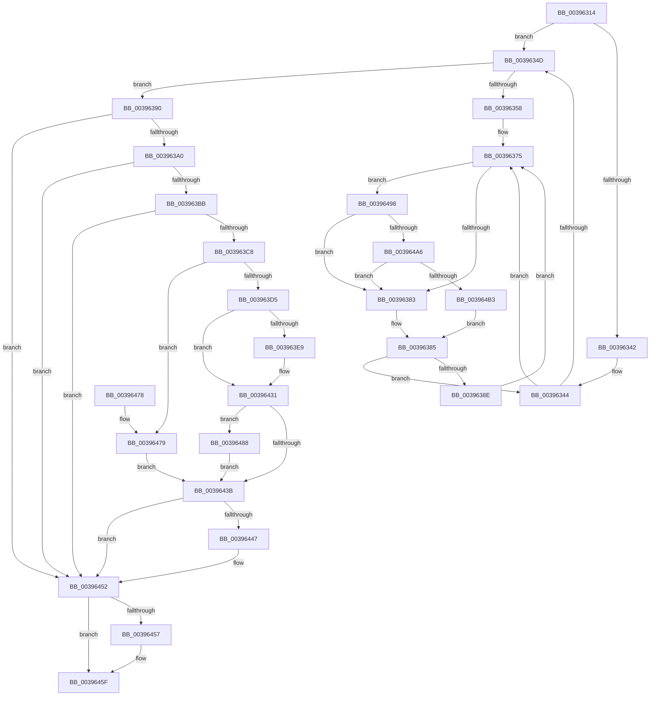

# KiClearPriorityFloor

- RVA: `0x00396314`–`0x003964BF` (길이 `427` bytes)
- VA: `0x0000000140396314`
- 실행 섹션: `.text`
- PDB 이름 있음: `예`; PDB Function 태그: `아니요`
- unwind 정보 RVA: `0x0008122C`
- 디코드: `115`개 명령, `427/427` bytes 표시
- 미해석 바이트: `0` (있으면 어셈블리에 `.byte`로 보존)

> 이 문서는 커널 이미지의 기계어와 PDB 기호를 분석해 생성했습니다. 4번과 5번은 함수 원형과 자료형을 바이너리 사용 방식에서 추정한 C 해석이며 원본 소스 복구 결과는 아닙니다.

## 1. Dependencies

- 직접 호출 지점: **6**; 고유 호출 대상: **6**
- 직접 호출자로 확인된 함수: **5**
- RIP 상대 이미지 참조: **2**

### Outgoing calls
- `0x0039636F` → [KeBugCheckEx](../4F/KeBugCheckEx_function_004FD660.md) (function, `0x004FD660`)
- `0x003963C8` → [Feature_StackingDecayBoosts__private_IsEnabledNoReportingNoInline](../4E/Feature_StackingDecayBoosts__private_IsEnabledNoReportingNoInline_function_004EF7C0.md) (function, `0x004EF7C0`)
- `0x0039644D` → [KiSetPriorityThread](../22/KiSetPriorityThread_function_00220E78.md) (function, `0x00220E78`)
- `0x0039647E` → [KiComputeThreadPriorityNonStacking](../5C/KiComputeThreadPriorityNonStacking_function_005CA81C.md) (function, `0x005CA81C`)
- `0x003964A6` → [KiCheckVpBackingLongSpinWaitHypercall](../30/KiCheckVpBackingLongSpinWaitHypercall_function_0030F490.md) (function, `0x0030F490`)
- `0x003964B5` → [HvlNotifyLongSpinWait](../30/HvlNotifyLongSpinWait_function_0030F460.md) (function, `0x0030F460`)

### Direct callers
- [KiClearSystemPriority](../2C/KiClearSystemPriority_function_002C05A8.md) at `0x002C05EB`
- [PopFxActivateComponent](../2D/PopFxActivateComponent_function_002D9DBC.md) at `0x002D9EE6`
- [PpmReleaseLock](../2D/PpmReleaseLock_function_002DA428.md) at `0x002DA47A`
- [sub_00395304](Unknown_function_00395304.md) at `0x00395335`
- [sub_006E0538](../6E/Unknown_function_006E0538.md) at `0x006E056C`

### Static image references
- `0x00396377` → RVA `0x00FC52AC` (`ALMOSTRO`; reference)
- `0x00396498` → RVA `0x00FC6AB8` (`ALMOSTRO`; read)

## 2. Other-region calls and transfers

- 다른 실행 섹션으로 향하는 call: **0**
- 별도 외부 분기/꼬리 이동을 확인하지 못했습니다.

## 3. Assembly (complete function range)

```asm
00396314  48 89 5C 24 08                  mov qword ptr [rsp + 8], rbx
00396319  48 89 6C 24 10                  mov qword ptr [rsp + 0x10], rbp
0039631E  48 89 74 24 18                  mov qword ptr [rsp + 0x18], rsi
00396323  57                              push rdi
00396324  41 56                           push r14
00396326  41 57                           push r15
00396328  48 83 EC 30                     sub rsp, 0x30
0039632C  49 63 E8                        movsxd rbp, r8d
0039632F  45 8A F1                        mov r14b, r9b
00396332  4C 8B FA                        mov r15, rdx
00396335  48 8B D9                        mov rbx, rcx
00396338  BF 01 00 00 00                  mov edi, 1
0039633D  45 84 C9                        test r9b, r9b
00396340  75 0B                           jne 0x14039634d
00396342  33 F6                           xor esi, esi
00396344  F0 48 0F BA 6B 40 00            lock bts qword ptr [rbx + 0x40], 0
0039634B  72 28                           jb 0x140396375
0039634D  8A 84 1D 38 03 00 00            mov al, byte ptr [rbp + rbx + 0x338]
00396354  84 C0                           test al, al
00396356  75 38                           jne 0x140396390
00396358  48 83 64 24 20 00               and qword ptr [rsp + 0x20], 0
0039635E  41 B9 02 00 00 00               mov r9d, 2
00396364  4C 8B C5                        mov r8, rbp
00396367  48 8B D3                        mov rdx, rbx
0039636A  B9 57 01 00 00                  mov ecx, 0x157
0039636F  E8 EC 72 16 00                  call 0x1404fd660
00396374  CC                              int3
00396375  03 F7                           add esi, edi
00396377  85 35 2F EF C2 00               test dword ptr [rip + 0xc2ef2f], esi
0039637D  0F 84 15 01 00 00               je 0x140396498
00396383  F3 90                           pause
00396385  48 8B 43 40                     mov rax, qword ptr [rbx + 0x40]
00396389  48 85 C0                        test rax, rax
0039638C  74 B6                           je 0x140396344
0039638E  EB E5                           jmp 0x140396375
00396390  40 2A C7                        sub al, dil
00396393  88 84 1D 38 03 00 00            mov byte ptr [rbp + rbx + 0x338], al
0039639A  0F 85 B2 00 00 00               jne 0x140396452
003963A0  8B 83 58 03 00 00               mov eax, dword ptr [rbx + 0x358]
003963A6  8B CD                           mov ecx, ebp
003963A8  0F BB E8                        btc eax, ebp
003963AB  D3 E7                           shl edi, cl
003963AD  89 83 58 03 00 00               mov dword ptr [rbx + 0x358], eax
003963B3  3B C7                           cmp eax, edi
003963B5  0F 83 97 00 00 00               jae 0x140396452
003963BB  80 BB C3 00 00 00 1F            cmp byte ptr [rbx + 0xc3], 0x1f
003963C2  0F 8F 8A 00 00 00               jg 0x140396452
003963C8  E8 F3 93 15 00                  call 0x1404ef7c0
003963CD  85 C0                           test eax, eax
003963CF  0F 84 A4 00 00 00               je 0x140396479
003963D5  44 0F BE 83 33 02 00 00         movsx r8d, byte ptr [rbx + 0x233]
003963DD  45 8B D0                        mov r10d, r8d
003963E0  45 8B C8                        mov r9d, r8d
003963E3  41 83 F8 10                     cmp r8d, 0x10
003963E7  7D 48                           jge 0x140396431
003963E9  0F B7 93 06 02 00 00            movzx edx, word ptr [rbx + 0x206]
003963F0  41 BB 0F 00 00 00               mov r11d, 0xf
003963F6  0F B6 8B 66 03 00 00            movzx ecx, byte ptr [rbx + 0x366]
003963FD  8B C2                           mov eax, edx
003963FF  41 23 C3                        and eax, r11d
00396402  41 03 C0                        add eax, r8d
00396405  41 3B C1                        cmp eax, r9d
00396408  44 8B C0                        mov r8d, eax
0039640B  45 0F 4E C1                     cmovle r8d, r9d
0039640F  33 C0                           xor eax, eax
00396411  84 C9                           test cl, cl
00396413  0F 4F C1                        cmovg eax, ecx
00396416  0F BE C0                        movsx eax, al
00396419  44 03 C0                        add r8d, eax
0039641C  41 83 F8 10                     cmp r8d, 0x10
00396420  45 0F 4D C3                     cmovge r8d, r11d
00396424  C1 EA 04                        shr edx, 4
00396427  0F B6 C2                        movzx eax, dl
0039642A  41 3B C0                        cmp eax, r8d
0039642D  44 0F 4F C0                     cmovg r8d, eax
00396431  8B 83 58 03 00 00               mov eax, dword ptr [rbx + 0x358]
00396437  85 C0                           test eax, eax
00396439  75 4D                           jne 0x140396488
0039643B  0F BE 83 C3 00 00 00            movsx eax, byte ptr [rbx + 0xc3]
00396442  44 3B C0                        cmp r8d, eax
00396445  7D 0B                           jge 0x140396452
00396447  49 8B D7                        mov rdx, r15
0039644A  48 8B CB                        mov rcx, rbx
0039644D  E8 26 AA E8 FF                  call 0x140220e78
00396452  45 84 F6                        test r14b, r14b
00396455  75 08                           jne 0x14039645f
00396457  48 C7 43 40 00 00 00 00         mov qword ptr [rbx + 0x40], 0
0039645F  48 8B 5C 24 50                  mov rbx, qword ptr [rsp + 0x50]
00396464  48 8B 6C 24 58                  mov rbp, qword ptr [rsp + 0x58]
00396469  48 8B 74 24 60                  mov rsi, qword ptr [rsp + 0x60]
0039646E  48 83 C4 30                     add rsp, 0x30
00396472  41 5F                           pop r15
00396474  41 5E                           pop r14
00396476  5F                              pop rdi
00396477  C3                              ret
00396478  CC                              int3
00396479  33 D2                           xor edx, edx
0039647B  48 8B CB                        mov rcx, rbx
0039647E  E8 99 43 23 00                  call 0x1405ca81c
00396483  44 8B C0                        mov r8d, eax
00396486  EB B3                           jmp 0x14039643b
00396488  0F BD C0                        bsr eax, eax
0039648B  44 3B C0                        cmp r8d, eax
0039648E  89 44 24 68                     mov dword ptr [rsp + 0x68], eax
00396492  44 0F 4C C0                     cmovl r8d, eax
00396496  EB A3                           jmp 0x14039643b
00396498  8B 05 1A 06 C3 00               mov eax, dword ptr [rip + 0xc3061a]
0039649E  A8 40                           test al, 0x40
003964A0  0F 84 DD FE FF FF               je 0x140396383
003964A6  E8 E5 8F F7 FF                  call 0x14030f490
003964AB  84 C0                           test al, al
003964AD  0F 84 D0 FE FF FF               je 0x140396383
003964B3  8B CE                           mov ecx, esi
003964B5  E8 A6 8F F7 FF                  call 0x14030f460
003964BA  E9 C6 FE FF FF                  jmp 0x140396385
```

## 4. C-style interpretation (structured pseudocode)

```c
__int64 __fastcall KiClearPriorityFloor(__int64 a1, __int64 a2, int a3, unsigned __int8 a4)
{
    __int64 result;
    __int64 v_r11;
    __int64 v_rdi;
    __int64 v_rsi;
    __int64 v_rsp;
    unsigned __int64 v_stack_m28;
    unsigned __int64 v_stack_p10;
    unsigned __int64 v_stack_p18;
    unsigned int v_stack_p68;
    unsigned __int64 v_stack_p8;

    v_stack_p8 = v_rbx;
    v_stack_p10 = v_rbp;
    v_stack_p18 = v_rsi;
    v_rsp = (v_rsp) - (48);
    if (a4 != 0) goto loc_0039634D;
    v_rsi = 0;
loc_00396344:
    if (condition_is_below) goto loc_00396375;
loc_0039634D:
    if ((unsigned __int8)(*(unsigned __int8 *)((int)(a3) + a1 * 1 + 824)) != 0) goto loc_00396390;
    result = KeBugCheckEx(343, a1, (int)(a3), 2);
loc_00396375:
    v_rsi = (unsigned int)((v_rsi) + (1));
    if (((*(unsigned int *)(v_rip + 12775215)) & ((unsigned int)(v_rsi))) == 0) goto loc_00396498;
loc_00396383:
loc_00396385:
    if (*(unsigned __int64 *)(a1 + 64) == 0) goto loc_00396344;
    goto loc_00396375;
loc_00396390:
    result = (unsigned __int8)((*(unsigned __int64 *)(a1 + 64)) - (1));
    *(unsigned __int8 *)((int)(a3) + a1 * 1 + 824) = (unsigned __int8)(result);
    if (condition_is_not_equal) goto loc_00396452;
    v_rdi = (unsigned int)((1) << ((unsigned __int8)((unsigned int)((unsigned int)((int)(a3))))));
    *(unsigned int *)(a1 + 856) = (unsigned int)((unsigned int)(*(unsigned int *)(a1 + 856)));
    if (((unsigned int)((unsigned int)(*(unsigned int *)(a1 + 856)))) >= ((unsigned int)(v_rdi))) goto loc_00396452;
    if ((*(unsigned __int8 *)(a1 + 195)) > 31) goto loc_00396452;
    result = Feature_StackingDecayBoosts__private_IsEnabledNoReportingNoInline((unsigned int)((unsigned int)((int)(a3))), a1, (int)(a3), 2);
    if ((unsigned int)(result) == 0) goto loc_00396479;
    if (((unsigned int)((__int8)(*(unsigned __int8 *)(a1 + 563)))) < 16) {
        a2 = *(unsigned __int16 *)(a1 + 518);
        v_r11 = 15;
        a1 = *(unsigned __int8 *)(a1 + 870);
        result = (unsigned int)(a2);
        result = (unsigned int)((result) & ((unsigned int)(v_r11)));
        result = (unsigned int)((result) + ((unsigned int)((__int8)(*(unsigned __int8 *)(a1 + 563)))));
        a3 = (unsigned int)(result);
        if (((unsigned int)(result)) <= ((unsigned int)((unsigned int)((unsigned int)((__int8)(*(unsigned __int8 *)(a1 + 563))))))) { a3 = (unsigned int)((unsigned int)((unsigned int)((__int8)(*(unsigned __int8 *)(a1 + 563))))); }
        result = 0;
        if (condition_is_greater) { result = (unsigned int)(a1); }
        result = (__int8)((unsigned __int8)(result));
        a3 = (unsigned int)((a3) + ((unsigned int)(result)));
        if (a3 >= 16) { a3 = (unsigned int)(v_r11); }
        a2 = (unsigned int)((a2) >> (4));
        result = (unsigned __int8)(a2);
        if (((unsigned int)(result)) > a3) { a3 = (unsigned int)(result); }
    }
    if ((unsigned int)((unsigned int)(*(unsigned int *)(a1 + 856))) != 0) goto loc_00396488;
loc_0039643B:
    result = (__int8)(*(unsigned __int8 *)(a1 + 195));
    if (a3 < ((unsigned int)((__int8)(*(unsigned __int8 *)(a1 + 195))))) {
        a2 = a2;
        a1 = a1;
        result = KiSetPriorityThread(a1, a2, a3, (unsigned int)((unsigned int)((__int8)(*(unsigned __int8 *)(a1 + 563)))));
    }
    if (a4 == 0) {
        *(unsigned __int64 *)(a1 + 64) = 0;
    }
    v_rsp = (v_rsp) + (48);
    return result;
loc_00396479:
    a2 = 0;
    result = KiComputeThreadPriorityNonStacking(v_stack_p8, a2, a3, (unsigned int)((unsigned int)((__int8)(*(unsigned __int8 *)(a1 + 563)))));
    goto loc_0039643B;
loc_00396488:
    v_stack_p68 = (unsigned int)(result);
    a3 = (unsigned int)((unsigned int)(result));
    if (((unsigned int)((unsigned int)((unsigned int)(result)))) < ((unsigned int)(result))) { a3 = (unsigned int)(result); }
    goto loc_0039643B;
loc_00396498:
    if ((((unsigned __int8)((unsigned int)(*(unsigned int *)(v_rip + 12781082)))) & (64)) == 0) goto loc_00396383;
    result = KiCheckVpBackingLongSpinWaitHypercall(v_stack_p8, a2, a3, (unsigned int)((unsigned int)((__int8)(*(unsigned __int8 *)(a1 + 563)))));
    if ((unsigned __int8)(result) == 0) goto loc_00396383;
    result = HvlNotifyLongSpinWait((unsigned int)((unsigned int)(v_stack_p18)), a2, a3, (unsigned int)((unsigned int)((__int8)(*(unsigned __int8 *)(a1 + 563)))));
    goto loc_00396385;
}
```

## 5. (Beta) C Style

```c
int64_t KiClearPriorityFloor(void *Arg1, int64_t Arg2, void *Arg3, uint8_t Arg4)
{
    uint8_t *arg1 = (uint8_t *)Arg1;
    uint8_t *arg3 = (uint8_t *)Arg3;

    int64_t result;
    int64_t local_r11;
    int64_t local_rdi;
    int64_t local_rsi;
    int64_t local_rsp;
    uint64_t v_stack_m28;
    uint64_t v_stack_p10;
    uint64_t v_stack_p18;
    uint32_t v_stack_p68;
    uint64_t v_stack_p8;

    v_stack_p8 = local_rbx;
    v_stack_p10 = local_rbp;
    v_stack_p18 = local_rsi;
    local_rsp = (local_rsp) - (48);
    if (Arg4 != 0) goto loc_0039634D;
    local_rsi = 0;
loc_00396344:
    if (condition_is_below) goto loc_00396375;
loc_0039634D:
    if ((uint8_t)(*(uint8_t *)((int32_t)(arg3) + arg1 * 1 + 0x338)) != 0) goto loc_00396390;
    result = KeBugCheckEx(343, Arg1, (int32_t)(Arg3), 2);
loc_00396375:
    local_rsi = (uint32_t)((local_rsi) + (1));
    if (((*(uint32_t *)(v_rip + 0xC2EF2F)) & ((uint32_t)(local_rsi))) == 0) goto loc_00396498;
loc_00396383:
loc_00396385:
    if (*(uint64_t *)(arg1 + 0x40) == 0) goto loc_00396344;
    goto loc_00396375;
loc_00396390:
    result = (uint8_t)((*(uint64_t *)(arg1 + 0x40)) - (1));
    *(uint8_t *)((int32_t)(arg3) + arg1 * 1 + 0x338) = (uint8_t)(result);
    if (condition_is_not_equal) goto loc_00396452;
    local_rdi = (uint32_t)((1) << ((uint8_t)((uint32_t)((uint32_t)((int32_t)(Arg3))))));
    *(uint32_t *)(arg1 + 0x358) = (uint32_t)((uint32_t)(*(uint32_t *)(arg1 + 0x358)));
    if (((uint32_t)((uint32_t)(*(uint32_t *)(arg1 + 0x358)))) >= ((uint32_t)(local_rdi))) goto loc_00396452;
    if ((*(uint8_t *)(arg1 + 0xC3)) > 31) goto loc_00396452;
    result = Feature_StackingDecayBoosts__private_IsEnabledNoReportingNoInline((uint32_t)((uint32_t)((int32_t)(Arg3))), Arg1, (int32_t)(Arg3), 2);
    if ((uint32_t)(result) == 0) goto loc_00396479;
    if (((uint32_t)((int8_t)(*(uint8_t *)(arg1 + 0x233)))) < 16) {
        Arg2 = *(uint16_t *)(arg1 + 0x206);
        local_r11 = 15;
        Arg1 = *(uint8_t *)(arg1 + 0x366);
        result = (uint32_t)(Arg2);
        result = (uint32_t)((result) & ((uint32_t)(local_r11)));
        result = (uint32_t)((result) + ((uint32_t)((int8_t)(*(uint8_t *)(arg1 + 0x233)))));
        Arg3 = (uint32_t)(result);
        if (((uint32_t)(result)) <= ((uint32_t)((uint32_t)((uint32_t)((int8_t)(*(uint8_t *)(arg1 + 0x233))))))) { Arg3 = (uint32_t)((uint32_t)((uint32_t)((int8_t)(*(uint8_t *)(arg1 + 0x233))))); }
        result = 0;
        if (condition_is_greater) { result = (uint32_t)(Arg1); }
        result = (int8_t)((uint8_t)(result));
        Arg3 = (uint32_t)((Arg3) + ((uint32_t)(result)));
        if (Arg3 >= 16) { Arg3 = (uint32_t)(local_r11); }
        Arg2 = (uint32_t)((Arg2) >> (4));
        result = (uint8_t)(Arg2);
        if (((uint32_t)(result)) > Arg3) { Arg3 = (uint32_t)(result); }
    }
    if ((uint32_t)((uint32_t)(*(uint32_t *)(arg1 + 0x358))) != 0) goto loc_00396488;
loc_0039643B:
    result = (int8_t)(*(uint8_t *)(arg1 + 0xC3));
    if (Arg3 < ((uint32_t)((int8_t)(*(uint8_t *)(arg1 + 0xC3))))) {
        Arg2 = Arg2;
        Arg1 = Arg1;
        result = KiSetPriorityThread(Arg1, Arg2, Arg3, (uint32_t)((uint32_t)((int8_t)(*(uint8_t *)(arg1 + 0x233)))));
    }
    if (Arg4 == 0) {
        *(uint64_t *)(arg1 + 0x40) = 0;
    }
    local_rsp = (local_rsp) + (48);
    return result;
loc_00396479:
    Arg2 = 0;
    result = KiComputeThreadPriorityNonStacking(v_stack_p8, Arg2, Arg3, (uint32_t)((uint32_t)((int8_t)(*(uint8_t *)(arg1 + 0x233)))));
    goto loc_0039643B;
loc_00396488:
    v_stack_p68 = (uint32_t)(result);
    Arg3 = (uint32_t)((uint32_t)(result));
    if (((uint32_t)((uint32_t)((uint32_t)(result)))) < ((uint32_t)(result))) { Arg3 = (uint32_t)(result); }
    goto loc_0039643B;
loc_00396498:
    if ((((uint8_t)((uint32_t)(*(uint32_t *)(v_rip + 0xC3061A)))) & (64)) == 0) goto loc_00396383;
    result = KiCheckVpBackingLongSpinWaitHypercall(v_stack_p8, Arg2, Arg3, (uint32_t)((uint32_t)((int8_t)(*(uint8_t *)(arg1 + 0x233)))));
    if ((uint8_t)(result) == 0) goto loc_00396383;
    result = HvlNotifyLongSpinWait((uint32_t)((uint32_t)(v_stack_p18)), Arg2, Arg3, (uint32_t)((uint32_t)((int8_t)(*(uint8_t *)(arg1 + 0x233)))));
    goto loc_00396385;
}
```

### 관측된 메모리 오프셋

구조체 형식이 확인되지 않은 접근은 인자 기준의 오프셋으로만 기록했습니다.

| 기준 인자 | 오프셋 표현 | 폭 (bit) | 접근 |
|---|---:|---:|---|
| `Arg1` | `+ 0x40` | `64` | `R` |
| `Arg1` | `+ 0x40` | `64` | `R/W` |
| `Arg1` | `+ 0x40` | `64` | `W` |
| `Arg1` | `+ 0xC3` | `8` | `R` |
| `Arg1` | `+ 0x206` | `16` | `R` |
| `Arg1` | `+ 0x233` | `8` | `R` |
| `Arg1` | `+ 0x358` | `32` | `R` |
| `Arg1` | `+ 0x358` | `32` | `W` |
| `Arg1` | `+ 0x366` | `8` | `R` |
| `Arg3` | `+ 0x338 + rbx*1` | `8` | `R` |
| `Arg3` | `+ 0x338 + rbx*1` | `8` | `W` |

## 6. Execution-region graph

[열기: 2D/3D 그래프와 함수 탐색 컨트롤 패널](../../../control-panel.html?section=text&rva=0x00396314&view=graph)

- 2D 그래프는 위에서 아래로 흐르고, 3D 그래프는 빈 공간을 드래그해 회전합니다. Shift+드래그는 이동, 휠은 확대·축소, 함수 노드 선택은 대상 보고서 이동입니다.

### Static fallback


