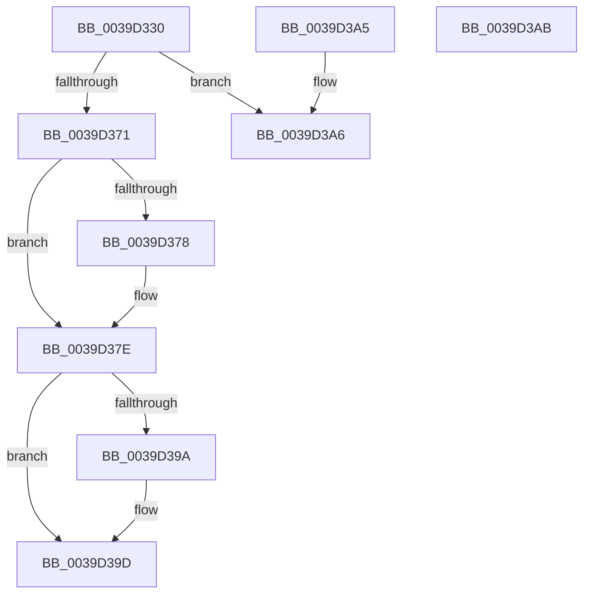

# KiComputeNewInterruptTime

- RVA: `0x0039D330`–`0x0039D3AC` (길이 `124` bytes)
- VA: `0x000000014039D330`
- 실행 섹션: `.text`
- PDB 이름 있음: `예`; PDB Function 태그: `아니요`
- unwind 정보 RVA: `0x000DB714`
- 디코드: `33`개 명령, `124/124` bytes 표시
- 미해석 바이트: `0` (있으면 어셈블리에 `.byte`로 보존)

> 이 문서는 커널 이미지의 기계어와 PDB 기호를 분석해 생성했습니다. 4번과 5번은 함수 원형과 자료형을 바이너리 사용 방식에서 추정한 C 해석이며 원본 소스 복구 결과는 아닙니다.

## 1. Dependencies

- 직접 호출 지점: **0**; 고유 호출 대상: **0**
- 직접 호출자로 확인된 함수: **2**
- RIP 상대 이미지 참조: **2**

### Outgoing calls
- 직접 디코드된 call 명령이 없습니다.

### Direct callers
- [KiUpdateTime](KiUpdateTime_function_0039B530.md) at `0x0039B5E3`
- [KiUpdateTime](KiUpdateTime_function_0039B530.md) at `0x0039B658`
- [KiUpdateTimeAssist](KiUpdateTimeAssist_function_0039E230.md) at `0x0039E293`
- [KiUpdateTimeAssist](KiUpdateTimeAssist_function_0039E230.md) at `0x0039E317`

### Static image references
- `0x0039D37E` → RVA `0x00E668A0` (`.data`; read)
- `0x0039D38E` → RVA `0x00E668A0` (`.data`; write)

## 2. Other-region calls and transfers

- 다른 실행 섹션으로 향하는 call: **0**
- 별도 외부 분기/꼬리 이동을 확인하지 못했습니다.

## 3. Assembly (complete function range)

```asm
0039D330  A0 69 03 00 00 80 F7 FF FF      movabs al, byte ptr [0xfffff78000000369]
0039D339  4C 8B C1                        mov r8, rcx
0039D33C  4C 8B CA                        mov r9, rdx
0039D33F  45 33 DB                        xor r11d, r11d
0039D342  48 B9 50 03 00 00 80 F7 FF FF   movabs rcx, 0xfffff78000000350
0039D34C  49 BA 08 00 00 00 80 F7 FF FF   movabs r10, 0xfffff78000000008
0039D356  48 BA 60 03 00 00 80 F7 FF FF   movabs rdx, 0xfffff78000000360
0039D360  4D 89 19                        mov qword ptr [r9], r11
0039D363  48 8B 09                        mov rcx, qword ptr [rcx]
0039D366  4D 8B 12                        mov r10, qword ptr [r10]
0039D369  48 8B 12                        mov rdx, qword ptr [rdx]
0039D36C  4C 3B C1                        cmp r8, rcx
0039D36F  76 35                           jbe 0x14039d3a6
0039D371  4C 2B C1                        sub r8, rcx
0039D374  84 C0                           test al, al
0039D376  74 06                           je 0x14039d37e
0039D378  0F B6 C8                        movzx ecx, al
0039D37B  49 D3 E0                        shl r8, cl
0039D37E  48 8B 0D 1B 95 AC 00            mov rcx, qword ptr [rip + 0xac951b]
0039D385  48 8B C2                        mov rax, rdx
0039D388  49 F7 E0                        mul r8
0039D38B  48 03 C8                        add rcx, rax
0039D38E  48 89 0D 0B 95 AC 00            mov qword ptr [rip + 0xac950b], rcx
0039D395  48 3B C8                        cmp rcx, rax
0039D398  73 03                           jae 0x14039d39d
0039D39A  48 FF C2                        inc rdx
0039D39D  49 89 11                        mov qword ptr [r9], rdx
0039D3A0  4A 8D 04 12                     lea rax, [rdx + r10]
0039D3A4  C3                              ret
0039D3A5  CC                              int3
0039D3A6  4B 8D 04 13                     lea rax, [r11 + r10]
0039D3AA  C3                              ret
0039D3AB  CC                              int3
```

## 4. C-style interpretation (structured pseudocode)

```c
__int64 __fastcall KiComputeNewInterruptTime(__int64 a1, __int64 a2)
{
    __int64 v_r11;

    v_r11 = 0;
    *(unsigned __int64 *)(a2) = 0;
    if (a1 <= (*(unsigned __int64 *)(a1))) goto loc_0039D3A6;
    a3 = (a1) - (*(unsigned __int64 *)(a1));
    if ((unsigned __int8)(result) != 0) {
        a1 = (unsigned __int8)(result);
        a3 = (a3) << ((unsigned __int8)(a1));
    }
    a1 = (*(unsigned __int64 *)(v_rip + 11310363)) + (*(unsigned __int64 *)(a2));
    *(unsigned __int64 *)(v_rip + 11310347) = a1;
    if (a1 < (*(unsigned __int64 *)(a2))) {
        a2 = (*(unsigned __int64 *)(a2)) + 1;
    }
    *(unsigned __int64 *)(a2) = a2;
    return a2 + *(unsigned __int64 *)(v_r10) * 1;
loc_0039D3A6:
    return v_r11 + *(unsigned __int64 *)(v_r10) * 1;
}
```

## 5. (Beta) C Style

```c
int64_t KiComputeNewInterruptTime(int64_t Arg1, void *Arg2)
{
    uint8_t *arg2 = (uint8_t *)Arg2;

    int64_t local_r11;

    local_r11 = 0;
    *(uint64_t *)(arg2) = 0;
    if (Arg1 <= (*(uint64_t *)(Arg1))) goto loc_0039D3A6;
    a3 = (Arg1) - (*(uint64_t *)(Arg1));
    if ((uint8_t)(result) != 0) {
        Arg1 = (uint8_t)(result);
        a3 = (a3) << ((uint8_t)(Arg1));
    }
    Arg1 = (*(uint64_t *)(v_rip + 0xAC951B)) + (*(uint64_t *)(arg2));
    *(uint64_t *)(v_rip + 0xAC950B) = Arg1;
    if (Arg1 < (*(uint64_t *)(arg2))) {
        Arg2 = (*(uint64_t *)(arg2)) + 1;
    }
    *(void **)(arg2) = Arg2;
    return Arg2 + *(uint64_t *)(local_r10) * 1;
loc_0039D3A6:
    return local_r11 + *(uint64_t *)(local_r10) * 1;
}
```

### 관측된 메모리 오프셋

구조체 형식이 확인되지 않은 접근은 인자 기준의 오프셋으로만 기록했습니다.

| 기준 인자 | 오프셋 표현 | 폭 (bit) | 접근 |
|---|---:|---:|---|
| `Arg2` | `+ 0x0` | `64` | `W` |

## 6. Execution-region graph

[열기: 2D/3D 그래프와 함수 탐색 컨트롤 패널](../../../control-panel.html?section=text&rva=0x0039D330&view=graph)

- 2D 그래프는 위에서 아래로 흐르고, 3D 그래프는 빈 공간을 드래그해 회전합니다. Shift+드래그는 이동, 휠은 확대·축소, 함수 노드 선택은 대상 보고서 이동입니다.

### Static fallback


