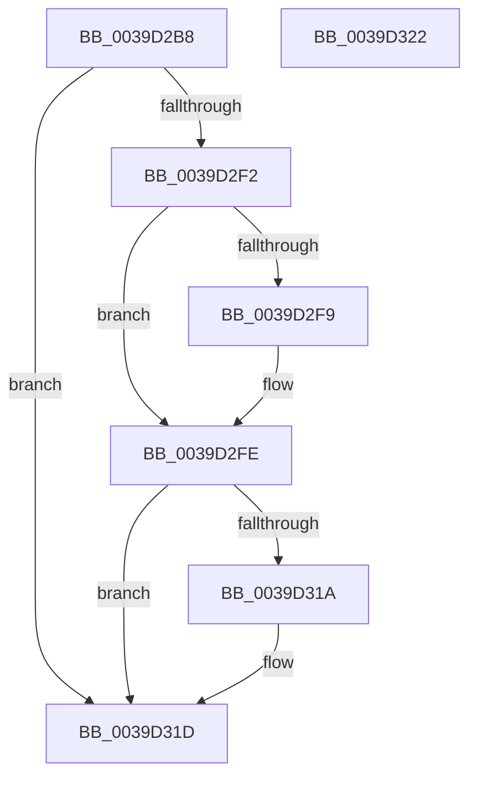

# KiComputeNewSystemTime

- RVA: `0x0039D2B8`–`0x0039D323` (길이 `107` bytes)
- VA: `0x000000014039D2B8`
- 실행 섹션: `.text`
- PDB 이름 있음: `예`; PDB Function 태그: `아니요`
- unwind 정보 RVA: `0x000DB714`
- 디코드: `27`개 명령, `107/107` bytes 표시
- 미해석 바이트: `0` (있으면 어셈블리에 `.byte`로 보존)

> 이 문서는 커널 이미지의 기계어와 PDB 기호를 분석해 생성했습니다. 4번과 5번은 함수 원형과 자료형을 바이너리 사용 방식에서 추정한 C 해석이며 원본 소스 복구 결과는 아닙니다.

## 1. Dependencies

- 직접 호출 지점: **0**; 고유 호출 대상: **0**
- 직접 호출자로 확인된 함수: **3**
- RIP 상대 이미지 참조: **2**

### Outgoing calls
- 직접 디코드된 call 명령이 없습니다.

### Direct callers
- [KiUpdateTime](KiUpdateTime_function_0039B530.md) at `0x0039B643`
- [KiUpdateTimeAssist](KiUpdateTimeAssist_function_0039E230.md) at `0x0039E302`
- [KiUpdateSystemTime](../4B/KiUpdateSystemTime_function_004B1570.md) at `0x004B15B9`

### Static image references
- `0x0039D2FE` → RVA `0x00E668C0` (`.data`; read)
- `0x0039D30E` → RVA `0x00E668C0` (`.data`; write)

## 2. Other-region calls and transfers

- 다른 실행 섹션으로 향하는 call: **0**
- 별도 외부 분기/꼬리 이동을 확인하지 못했습니다.

## 3. Assembly (complete function range)

```asm
0039D2B8  A0 68 03 00 00 80 F7 FF FF      movabs al, byte ptr [0xfffff78000000368]
0039D2C1  4C 8B C1                        mov r8, rcx
0039D2C4  48 B9 48 03 00 00 80 F7 FF FF   movabs rcx, 0xfffff78000000348
0039D2CE  49 B9 14 00 00 00 80 F7 FF FF   movabs r9, 0xfffff78000000014
0039D2D8  49 BA 58 03 00 00 80 F7 FF FF   movabs r10, 0xfffff78000000358
0039D2E2  33 D2                           xor edx, edx
0039D2E4  48 8B 09                        mov rcx, qword ptr [rcx]
0039D2E7  4D 8B 09                        mov r9, qword ptr [r9]
0039D2EA  4D 8B 12                        mov r10, qword ptr [r10]
0039D2ED  4C 3B C1                        cmp r8, rcx
0039D2F0  76 2B                           jbe 0x14039d31d
0039D2F2  4C 2B C1                        sub r8, rcx
0039D2F5  84 C0                           test al, al
0039D2F7  74 05                           je 0x14039d2fe
0039D2F9  8A C8                           mov cl, al
0039D2FB  49 D3 E0                        shl r8, cl
0039D2FE  48 8B 0D BB 95 AC 00            mov rcx, qword ptr [rip + 0xac95bb]
0039D305  49 8B C2                        mov rax, r10
0039D308  49 F7 E0                        mul r8
0039D30B  48 03 C8                        add rcx, rax
0039D30E  48 89 0D AB 95 AC 00            mov qword ptr [rip + 0xac95ab], rcx
0039D315  48 3B C8                        cmp rcx, rax
0039D318  73 03                           jae 0x14039d31d
0039D31A  48 FF C2                        inc rdx
0039D31D  4A 8D 04 0A                     lea rax, [rdx + r9]
0039D321  C3                              ret
0039D322  CC                              int3
```

## 4. C-style interpretation (structured pseudocode)

```c
__int64 __fastcall KiComputeNewSystemTime(__int64 a1, int a2)
{
    a2 = 0;
    if (a1 <= (*(unsigned __int64 *)(a1))) goto loc_0039D31D;
    a3 = (a1) - (*(unsigned __int64 *)(a1));
    if ((unsigned __int8)(result) != 0) {
        a1 = (unsigned __int8)(result);
        a3 = (a3) << ((unsigned __int8)(a1));
    }
    a1 = (*(unsigned __int64 *)(v_rip + 11310523)) + (*(unsigned __int64 *)(v_r10));
    *(unsigned __int64 *)(v_rip + 11310507) = a1;
    if (a1 < (*(unsigned __int64 *)(v_r10))) {
        a2 = (a2) + 1;
    }
    return a2 + *(unsigned __int64 *)(a4) * 1;
}
```

## 5. (Beta) C Style

```c
int64_t KiComputeNewSystemTime(int64_t Arg1, int32_t Arg2)
{
    Arg2 = 0;
    if (Arg1 <= (*(uint64_t *)(Arg1))) goto loc_0039D31D;
    a3 = (Arg1) - (*(uint64_t *)(Arg1));
    if ((uint8_t)(result) != 0) {
        Arg1 = (uint8_t)(result);
        a3 = (a3) << ((uint8_t)(Arg1));
    }
    Arg1 = (*(uint64_t *)(v_rip + 0xAC95BB)) + (*(uint64_t *)(local_r10));
    *(uint64_t *)(v_rip + 0xAC95AB) = Arg1;
    if (Arg1 < (*(uint64_t *)(local_r10))) {
        Arg2 = (Arg2) + 1;
    }
    return Arg2 + *(uint64_t *)(a4) * 1;
}
```

## 6. Execution-region graph

[열기: 2D/3D 그래프와 함수 탐색 컨트롤 패널](../../../control-panel.html?section=text&rva=0x0039D2B8&view=graph)

- 2D 그래프는 위에서 아래로 흐르고, 3D 그래프는 빈 공간을 드래그해 회전합니다. Shift+드래그는 이동, 휠은 확대·축소, 함수 노드 선택은 대상 보고서 이동입니다.

### Static fallback


