# KiComputeThreadAffinity

- RVA: `0x00399DE0`–`0x0039A1AE` (길이 `974` bytes)
- VA: `0x0000000140399DE0`
- 실행 섹션: `.text`
- PDB 이름 있음: `예`; PDB Function 태그: `아니요`
- unwind 정보 RVA: `0x0008180C`
- 디코드: `243`개 명령, `974/974` bytes 표시
- 미해석 바이트: `0` (있으면 어셈블리에 `.byte`로 보존)

> 이 문서는 커널 이미지의 기계어와 PDB 기호를 분석해 생성했습니다. 4번과 5번은 함수 원형과 자료형을 바이너리 사용 방식에서 추정한 C 해석이며 원본 소스 복구 결과는 아닙니다.

## 1. Dependencies

- 직접 호출 지점: **11**; 고유 호출 대상: **9**
- 직접 호출자로 확인된 함수: **7**
- RIP 상대 이미지 참조: **3**

### Outgoing calls
- `0x00399E29` → [memset](../6C/memset_function_006C6C40.md) (function, `0x006C6C40`)
- `0x00399E73` → [memset](../6C/memset_function_006C6C40.md) (function, `0x006C6C40`)
- `0x00399EFB` → [KiComputeCpuSetAffinity](KiComputeCpuSetAffinity_function_0039A1C0.md) (function, `0x0039A1C0`)
- `0x0039A003` → [_security_check_cookie](../6A/_security_check_cookie_function_006AC640.md) (function, `0x006AC640`)
- `0x0039A04E` → [KiCopyAffinityEx](../2C/KiCopyAffinityEx_function_002CE860.md) (function, `0x002CE860`)
- `0x0039A06F` → [KeCheckProcessorAffinityEx](../30/KeCheckProcessorAffinityEx_function_00305150.md) (function, `0x00305150`)
- `0x0039A0A3` → [KiUpdateSharedReadyQueueAffinityThread](../2C/KiUpdateSharedReadyQueueAffinityThread_function_002CE470.md) (function, `0x002CE470`)
- `0x0039A0AB` → [KiUpdateNodeAffinitizedFlag](KiUpdateNodeAffinitizedFlag_function_00399B1C.md) (function, `0x00399B1C`)
- `0x0039A0F4` → [memcpy](../6C/memcpy_function_006C6840.md) (function, `0x006C6840`)
- `0x0039A11C` → [memcpy](../6C/memcpy_function_006C6840.md) (function, `0x006C6840`)
- `0x0039A194` → [KiReselectIdealProcessorAfterAffinityChange](../2C/KiReselectIdealProcessorAfterAffinityChange_function_002CF894.md) (function, `0x002CF894`)

### Direct callers
- [KiQueueReadyThread](../21/KiQueueReadyThread_function_0021C7B0.md) at `0x0021D15E`
- [sub_0021D7F8](../21/Unknown_function_0021D7F8.md) at `0x0021E44A`
- [sub_002546EC](../25/Unknown_function_002546EC.md) at `0x00254857`
- [KiSetAffinityThread](../2C/KiSetAffinityThread_function_002CE010.md) at `0x002CE152`
- [KiUpdateThreadCpuSets](../30/KiUpdateThreadCpuSets_function_0030313C.md) at `0x0030319C`
- [KiUpdateGlobalCpuSetConfiguration](../30/KiUpdateGlobalCpuSetConfiguration_function_00305AB8.md) at `0x00305CCE`
- [KiSetSystemAffinityThread](KiSetSystemAffinityThread_function_003993E0.md) at `0x00399707`

### Static image references
- `0x00399E03` → RVA `0x00E0A740` (`.data`; read)
- `0x00399E50` → RVA `0x00FC6BF8` (`ALMOSTRO`; read)
- `0x0039A05A` → RVA `0x00FC8C40` (`ALMOSTRO`; read)

## 2. Other-region calls and transfers

- 다른 실행 섹션으로 향하는 call: **0**
- 별도 외부 분기/꼬리 이동을 확인하지 못했습니다.

## 3. Assembly (complete function range)

```asm
00399DE0  48 8B C4                        mov rax, rsp
00399DE3  48 89 58 10                     mov qword ptr [rax + 0x10], rbx
00399DE7  48 89 70 18                     mov qword ptr [rax + 0x18], rsi
00399DEB  48 89 78 20                     mov qword ptr [rax + 0x20], rdi
00399DEF  55                              push rbp
00399DF0  41 54                           push r12
00399DF2  41 55                           push r13
00399DF4  41 56                           push r14
00399DF6  41 57                           push r15
00399DF8  48 8D 68 88                     lea rbp, [rax - 0x78]
00399DFC  48 81 EC 50 01 00 00            sub rsp, 0x150
00399E03  48 8B 05 36 09 A7 00            mov rax, qword ptr [rip + 0xa70936]
00399E0A  48 33 C4                        xor rax, rsp
00399E0D  48 89 45 40                     mov qword ptr [rbp + 0x40], rax
00399E11  4C 8B F1                        mov r14, rcx
00399E14  0F 57 C0                        xorps xmm0, xmm0
00399E17  48 8D 4C 24 38                  lea rcx, [rsp + 0x38]
00399E1C  33 D2                           xor edx, edx
00399E1E  41 B8 00 01 00 00               mov r8d, 0x100
00399E24  0F 11 44 24 20                  movups xmmword ptr [rsp + 0x20], xmm0
00399E29  E8 12 CE 32 00                  call 0x1406c6c40
00399E2E  41 8B 46 74                     mov eax, dword ptr [r14 + 0x74]
00399E32  45 33 E4                        xor r12d, r12d
00399E35  4D 8B AE 20 02 00 00            mov r13, qword ptr [r14 + 0x220]
00399E3C  45 8B FC                        mov r15d, r12d
00399E3F  41 8D 7C 24 01                  lea edi, [r12 + 1]
00399E44  A8 08                           test al, 8
00399E46  0F 85 F1 02 00 00               jne 0x14039a13d
00399E4C  EB 02                           jmp 0x140399e50
00399E4E  F3 90                           pause
00399E50  48 8B 35 A1 CD C2 00            mov rsi, qword ptr [rip + 0xc2cda1]
00399E57  40 84 F7                        test dil, sil
00399E5A  75 F2                           jne 0x140399e4e
00399E5C  B8 20 00 00 00                  mov eax, 0x20
00399E61  48 8D 4C 24 38                  lea rcx, [rsp + 0x38]
00399E66  33 D2                           xor edx, edx
00399E68  66 89 44 24 32                  mov word ptr [rsp + 0x32], ax
00399E6D  41 B8 00 01 00 00               mov r8d, 0x100
00399E73  E8 C8 CD 32 00                  call 0x1406c6c40
00399E78  0F B7 44 24 32                  movzx eax, word ptr [rsp + 0x32]
00399E7D  41 0F B7 CC                     movzx ecx, r12w
00399E81  49 8B 96 28 02 00 00            mov rdx, qword ptr [r14 + 0x228]
00399E88  44 89 64 24 34                  mov dword ptr [rsp + 0x34], r12d
00399E8D  0F B7 1A                        movzx ebx, word ptr [rdx]
00399E90  66 3B D8                        cmp bx, ax
00399E93  66 0F 47 D8                     cmova bx, ax
00399E97  66 89 5C 24 30                  mov word ptr [rsp + 0x30], bx
00399E9C  66 44 3B E3                     cmp r12w, bx
00399EA0  0F 82 3D 02 00 00               jb 0x14039a0e3
00399EA6  66 3B C8                        cmp cx, ax
00399EA9  73 17                           jae 0x140399ec2
00399EAB  0F B7 C1                        movzx eax, cx
00399EAE  66 03 CF                        add cx, di
00399EB1  4C 89 64 C4 38                  mov qword ptr [rsp + rax*8 + 0x38], r12
00399EB6  66 3B 4C 24 32                  cmp cx, word ptr [rsp + 0x32]
00399EBB  72 EE                           jb 0x140399eab
00399EBD  0F B7 5C 24 30                  movzx ebx, word ptr [rsp + 0x30]
00399EC2  41 8B D4                        mov edx, r12d
00399EC5  66 44 3B E3                     cmp r12w, bx
00399EC9  0F 83 D5 00 00 00               jae 0x140399fa4
00399ECF  4C 8D 44 24 38                  lea r8, [rsp + 0x38]
00399ED4  44 0F B7 CB                     movzx r9d, bx
00399ED8  49 8B 00                        mov rax, qword ptr [r8]
00399EDB  4D 8D 40 08                     lea r8, [r8 + 8]
00399EDF  F3 48 0F B8 C8                  popcnt rcx, rax
00399EE4  03 D1                           add edx, ecx
00399EE6  4C 2B CF                        sub r9, rdi
00399EE9  75 ED                           jne 0x140399ed8
00399EEB  3B D7                           cmp edx, edi
00399EED  0F 86 B1 00 00 00               jbe 0x140399fa4
00399EF3  48 8D 54 24 30                  lea rdx, [rsp + 0x30]
00399EF8  49 8B CE                        mov rcx, r14
00399EFB  E8 C0 02 00 00                  call 0x14039a1c0
00399F00  0F B7 5C 24 30                  movzx ebx, word ptr [rsp + 0x30]
00399F05  45 8B C4                        mov r8d, r12d
00399F08  0F B7 44 24 32                  movzx eax, word ptr [rsp + 0x32]
00399F0D  41 0F B7 D4                     movzx edx, r12w
00399F11  4D 8B 8E 28 02 00 00            mov r9, qword ptr [r14 + 0x228]
00399F18  45 0F B7 11                     movzx r10d, word ptr [r9]
00399F1C  66 44 3B D3                     cmp r10w, bx
00399F20  66 41 0F 42 DA                  cmovb bx, r10w
00399F25  66 3B D8                        cmp bx, ax
00399F28  66 0F 47 D8                     cmova bx, ax
00399F2C  66 89 5C 24 30                  mov word ptr [rsp + 0x30], bx
00399F31  66 44 3B E3                     cmp r12w, bx
00399F35  0F 82 80 01 00 00               jb 0x14039a0bb
00399F3B  44 89 64 24 34                  mov dword ptr [rsp + 0x34], r12d
00399F40  66 3B D0                        cmp dx, ax
00399F43  73 1A                           jae 0x140399f5f
00399F45  0F B7 C2                        movzx eax, dx
00399F48  66 03 D7                        add dx, di
00399F4B  4C 89 64 C4 38                  mov qword ptr [rsp + rax*8 + 0x38], r12
00399F50  0F B7 44 24 32                  movzx eax, word ptr [rsp + 0x32]
00399F55  66 3B D0                        cmp dx, ax
00399F58  72 EB                           jb 0x140399f45
00399F5A  0F B7 5C 24 30                  movzx ebx, word ptr [rsp + 0x30]
00399F5F  45 85 C0                        test r8d, r8d
00399F62  75 40                           jne 0x140399fa4
00399F64  66 44 3B D0                     cmp r10w, ax
00399F68  44 89 64 24 34                  mov dword ptr [rsp + 0x34], r12d
00399F6D  41 0F B7 DA                     movzx ebx, r10w
00399F71  41 0F B7 CC                     movzx ecx, r12w
00399F75  66 0F 47 D8                     cmova bx, ax
00399F79  66 89 5C 24 30                  mov word ptr [rsp + 0x30], bx
00399F7E  66 44 3B E3                     cmp r12w, bx
00399F82  0F 82 83 01 00 00               jb 0x14039a10b
00399F88  66 3B C8                        cmp cx, ax
00399F8B  73 17                           jae 0x140399fa4
00399F8D  0F B7 C1                        movzx eax, cx
00399F90  66 03 CF                        add cx, di
00399F93  4C 89 64 C4 38                  mov qword ptr [rsp + rax*8 + 0x38], r12
00399F98  66 3B 4C 24 32                  cmp cx, word ptr [rsp + 0x32]
00399F9D  72 EE                           jb 0x140399f8d
00399F9F  0F B7 5C 24 30                  movzx ebx, word ptr [rsp + 0x30]
00399FA4  4D 8B 8E 40 02 00 00            mov r9, qword ptr [r14 + 0x240]
00399FAB  45 0F B7 01                     movzx r8d, word ptr [r9]
00399FAF  66 44 3B C3                     cmp r8w, bx
00399FB3  73 75                           jae 0x14039a02a
00399FB5  4C 8D 54 24 30                  lea r10, [rsp + 0x30]
00399FBA  41 0F B7 D4                     movzx edx, r12w
00399FBE  66 41 3B D0                     cmp dx, r8w
00399FC2  73 14                           jae 0x140399fd8
00399FC4  0F B7 CA                        movzx ecx, dx
00399FC7  48 8B 44 CC 38                  mov rax, qword ptr [rsp + rcx*8 + 0x38]
00399FCC  49 39 44 C9 08                  cmp qword ptr [r9 + rcx*8 + 8], rax
00399FD1  75 6E                           jne 0x14039a041
00399FD3  66 03 D7                        add dx, di
00399FD6  EB E6                           jmp 0x140399fbe
00399FD8  41 0F B7 0A                     movzx ecx, word ptr [r10]
00399FDC  66 3B D1                        cmp dx, cx
00399FDF  72 52                           jb 0x14039a033
00399FE1  90                              nop
00399FE2  48 8B 05 0F CC C2 00            mov rax, qword ptr [rip + 0xc2cc0f]
00399FE9  48 3B C6                        cmp rax, rsi
00399FEC  0F 85 5E FE FF FF               jne 0x140399e50
00399FF2  49 89 B6 38 02 00 00            mov qword ptr [r14 + 0x238], rsi
00399FF9  41 8B C7                        mov eax, r15d
00399FFC  48 8B 4D 40                     mov rcx, qword ptr [rbp + 0x40]
0039A000  48 33 CC                        xor rcx, rsp
0039A003  E8 38 26 31 00                  call 0x1406ac640
0039A008  4C 8D 9C 24 50 01 00 00         lea r11, [rsp + 0x150]
0039A010  49 8B 5B 38                     mov rbx, qword ptr [r11 + 0x38]
0039A014  49 8B 73 40                     mov rsi, qword ptr [r11 + 0x40]
0039A018  49 8B 7B 48                     mov rdi, qword ptr [r11 + 0x48]
0039A01C  49 8B E3                        mov rsp, r11
0039A01F  41 5F                           pop r15
0039A021  41 5E                           pop r14
0039A023  41 5D                           pop r13
0039A025  41 5C                           pop r12
0039A027  5D                              pop rbp
0039A028  C3                              ret
0039A029  CC                              int3
0039A02A  4D 8B D1                        mov r10, r9
0039A02D  44 0F B7 C3                     movzx r8d, bx
0039A031  EB 87                           jmp 0x140399fba
0039A033  0F B7 C2                        movzx eax, dx
0039A036  4D 39 64 C2 08                  cmp qword ptr [r10 + rax*8 + 8], r12
0039A03B  0F 84 F2 00 00 00               je 0x14039a133
0039A041  41 0F B7 51 02                  movzx edx, word ptr [r9 + 2]
0039A046  4C 8D 44 24 30                  lea r8, [rsp + 0x30]
0039A04B  49 8B C9                        mov rcx, r9
0039A04E  E8 0D 48 F3 FF                  call 0x1402ce860
0039A053  45 8B BE C4 00 00 00            mov r15d, dword ptr [r14 + 0xc4]
0039A05A  4C 8D 25 DF EB C2 00            lea r12, [rip + 0xc2ebdf]
0039A061  49 8B 8E 40 02 00 00            mov rcx, qword ptr [r14 + 0x240]
0039A068  41 8B D7                        mov edx, r15d
0039A06B  4F 8B 24 FC                     mov r12, qword ptr [r12 + r15*8]
0039A06F  E8 DC B0 F6 FF                  call 0x140305150
0039A074  45 33 C9                        xor r9d, r9d
0039A077  85 C0                           test eax, eax
0039A079  0F 84 D0 00 00 00               je 0x14039a14f
0039A07F  48 8D 0D BA EB C2 00            lea rcx, [rip + 0xc2ebba]
0039A086  49 8B D6                        mov rdx, r14
0039A089  4A 8B 0C F9                     mov rcx, qword ptr [rcx + r15*8]
0039A08D  45 89 BE 4C 02 00 00            mov dword ptr [r14 + 0x24c], r15d
0039A094  0F B6 81 D0 00 00 00            movzx eax, byte ptr [rcx + 0xd0]
0039A09B  66 41 89 86 48 02 00 00         mov word ptr [r14 + 0x248], ax
0039A0A3  E8 C8 43 F3 FF                  call 0x1402ce470
0039A0A8  49 8B CE                        mov rcx, r14
0039A0AB  E8 6C FA FF FF                  call 0x140399b1c
0039A0B0  45 33 E4                        xor r12d, r12d
0039A0B3  44 8B FF                        mov r15d, edi
0039A0B6  E9 26 FF FF FF                  jmp 0x140399fe1
0039A0BB  0F B7 CA                        movzx ecx, dx
0039A0BE  49 8B 44 C9 08                  mov rax, qword ptr [r9 + rcx*8 + 8]
0039A0C3  48 21 44 CC 38                  and qword ptr [rsp + rcx*8 + 0x38], rax
0039A0C8  0F B7 5C 24 30                  movzx ebx, word ptr [rsp + 0x30]
0039A0CD  44 0F 45 C7                     cmovne r8d, edi
0039A0D1  66 03 D7                        add dx, di
0039A0D4  66 3B D3                        cmp dx, bx
0039A0D7  72 E2                           jb 0x14039a0bb
0039A0D9  0F B7 44 24 32                  movzx eax, word ptr [rsp + 0x32]
0039A0DE  E9 58 FE FF FF                  jmp 0x140399f3b
0039A0E3  44 0F B7 C3                     movzx r8d, bx
0039A0E7  48 8D 4C 24 38                  lea rcx, [rsp + 0x38]
0039A0EC  49 C1 E0 03                     shl r8, 3
0039A0F0  48 83 C2 08                     add rdx, 8
0039A0F4  E8 47 C7 32 00                  call 0x1406c6840
0039A0F9  0F B7 44 24 32                  movzx eax, word ptr [rsp + 0x32]
0039A0FE  0F B7 CB                        movzx ecx, bx
0039A101  0F B7 5C 24 30                  movzx ebx, word ptr [rsp + 0x30]
0039A106  E9 9B FD FF FF                  jmp 0x140399ea6
0039A10B  44 0F B7 C3                     movzx r8d, bx
0039A10F  49 8D 51 08                     lea rdx, [r9 + 8]
0039A113  49 C1 E0 03                     shl r8, 3
0039A117  48 8D 4C 24 38                  lea rcx, [rsp + 0x38]
0039A11C  E8 1F C7 32 00                  call 0x1406c6840
0039A121  0F B7 44 24 32                  movzx eax, word ptr [rsp + 0x32]
0039A126  0F B7 CB                        movzx ecx, bx
0039A129  0F B7 5C 24 30                  movzx ebx, word ptr [rsp + 0x30]
0039A12E  E9 55 FE FF FF                  jmp 0x140399f88
0039A133  66 03 D7                        add dx, di
0039A136  E9 A1 FE FF FF                  jmp 0x140399fdc
0039A13B  F3 90                           pause
0039A13D  48 8B 35 B4 CA C2 00            mov rsi, qword ptr [rip + 0xc2cab4]
0039A144  40 84 F7                        test dil, sil
0039A147  0F 84 A5 FE FF FF               je 0x140399ff2
0039A14D  EB EC                           jmp 0x14039a13b
0039A14F  4D 8B 85 B8 00 00 00            mov r8, qword ptr [r13 + 0xb8]
0039A156  41 0F B7 C9                     movzx ecx, r9w
0039A15A  66 3B CB                        cmp cx, bx
0039A15D  73 43                           jae 0x14039a1a2
0039A15F  0F B7 C1                        movzx eax, cx
0039A162  48 8B 54 C4 38                  mov rdx, qword ptr [rsp + rax*8 + 0x38]
0039A167  48 85 D2                        test rdx, rdx
0039A16A  74 3D                           je 0x14039a1a9
0039A16C  0F 57 C0                        xorps xmm0, xmm0
0039A16F  0F 11 44 24 20                  movups xmmword ptr [rsp + 0x20], xmm0
0039A174  66 89 4C 24 28                  mov word ptr [rsp + 0x28], cx
0039A179  48 89 54 24 20                  mov qword ptr [rsp + 0x20], rdx
0039A17E  0F B7 C1                        movzx eax, cx
0039A181  48 8D 54 24 20                  lea rdx, [rsp + 0x20]
0039A186  49 83 C0 10                     add r8, 0x10
0039A18A  49 8B CE                        mov rcx, r14
0039A18D  4D 8D 0C 40                     lea r9, [r8 + rax*2]
0039A191  4D 8B C4                        mov r8, r12
0039A194  E8 FB 56 F3 FF                  call 0x1402cf894
0039A199  44 0F B7 F8                     movzx r15d, ax
0039A19D  E9 DD FE FF FF                  jmp 0x14039a07f
0039A1A2  0F B7 4C 24 28                  movzx ecx, word ptr [rsp + 0x28]
0039A1A7  EB D5                           jmp 0x14039a17e
0039A1A9  66 03 CF                        add cx, di
0039A1AC  EB AC                           jmp 0x14039a15a
```

## 4. C-style interpretation (structured pseudocode)

```c
__int64 __fastcall KiComputeThreadAffinity(__int64 a1, int a2)
{
    __int64 result;
    __int64 v_r12;
    __int64 v_rbx;
    __int64 v_rsp;
    unsigned __int64 v_stack_m118;
    unsigned __int16 v_stack_m11E;
    unsigned __int64 v_stack_m120;
    unsigned __int16 v_stack_m128;
    unsigned __int64 v_stack_m130;
    unsigned __int64 v_stack_m140;
    unsigned int v_stack_m144;
    unsigned __int16 v_stack_m146;
    unsigned __int16 v_stack_m148;
    unsigned __int64 v_stack_m158;
    unsigned __int64 v_stack_m28;

    *(unsigned __int64 *)(v_rsp + 16) = v_rbx;
    *(unsigned __int64 *)(v_rsp + 24) = v_rsi;
    *(unsigned __int64 *)(v_rsp + 32) = v_rdi;
    v_rsp = (v_rsp) - (336);
    result = (*(unsigned __int64 *)(v_rip + 10946870)) ^ (v_rsp);
    *(unsigned __int64 *)(v_rsp - 120 + 64) = result;
    a2 = 0;
    v_stack_m158 = v_xmm0;
    result = memset(v_stack_m140, a2, 256, a4);
    v_r12 = 0;
    if ((((unsigned __int8)((unsigned int)(*(unsigned int *)(a1 + 116)))) & (8)) != 0) goto loc_0039A13D;
    goto loc_00399E50;
loc_00399E4E:
loc_00399E50:
    if ((((unsigned __int8)(v_r12 + 1)) & ((unsigned __int8)(*(unsigned __int64 *)(v_rip + 12766625)))) != 0) goto loc_00399E4E;
    a2 = 0;
    v_stack_m146 = 32;
    result = memset(v_stack_m140, a2, 256, a4);
    v_stack_m144 = 0;
    v_rbx = *(unsigned __int16 *)(*(unsigned __int64 *)(a1 + 552));
    if (((unsigned __int16)(*(unsigned __int16 *)(*(unsigned __int64 *)(a1 + 552)))) > ((unsigned __int16)(v_stack_m146))) { v_rbx = (unsigned __int16)(v_stack_m146); }
    v_stack_m148 = (unsigned __int16)(v_rbx);
    if (0 < ((unsigned __int16)(v_rbx))) goto loc_0039A0E3;
loc_00399EA6:
    if (0 >= ((unsigned __int16)(v_stack_m146))) goto loc_00399EC2;
loc_00399EAB:
    a1 = (unsigned __int16)((0) + ((unsigned __int16)(v_r12 + 1)));
    *(unsigned __int64 *)(v_rsp + 0 * 8 + 56) = 0;
    if (((unsigned __int16)(a1)) < v_stack_m146) goto loc_00399EAB;
loc_00399EC2:
    if (0 >= ((unsigned __int16)(v_stack_m148))) goto loc_00399FA4;
loc_00399ED8:
    a2 = (unsigned int)((0) + ((unsigned int)(a1)));
    a4 = ((unsigned __int16)(v_stack_m148)) - (v_r12 + 1);
    if (condition_is_not_equal) goto loc_00399ED8;
    if (a2 <= ((unsigned int)(v_r12 + 1))) goto loc_00399FA4;
    result = KiComputeCpuSetAffinity(a1, v_stack_m148, v_stack_m140 + 8, a4);
    v_rbx = v_stack_m148;
    if (((unsigned __int16)(*(unsigned __int16 *)(*(unsigned __int64 *)(a1 + 552)))) < ((unsigned __int16)(v_stack_m148))) { v_rbx = (unsigned __int16)(*(unsigned __int16 *)(*(unsigned __int64 *)(a1 + 552))); }
    if (((unsigned __int16)(v_rbx)) > ((unsigned __int16)(v_stack_m146))) { v_rbx = (unsigned __int16)(v_stack_m146); }
    v_stack_m148 = (unsigned __int16)(v_rbx);
    if (0 < ((unsigned __int16)(v_rbx))) goto loc_0039A0BB;
loc_00399F3B:
    v_stack_m144 = 0;
    if (0 >= ((unsigned __int16)(v_stack_m146))) goto loc_00399F5F;
loc_00399F45:
    a2 = (unsigned __int16)((0) + ((unsigned __int16)(v_r12 + 1)));
    *(unsigned __int64 *)(v_rsp + 0 * 8 + 56) = 0;
    if (((unsigned __int16)(a2)) < ((unsigned __int16)(v_stack_m146))) goto loc_00399F45;
loc_00399F5F:
    if (0 != 0) goto loc_00399FA4;
    v_stack_m144 = 0;
    v_rbx = (unsigned __int16)(*(unsigned __int16 *)(*(unsigned __int64 *)(a1 + 552)));
    if (((unsigned __int16)(*(unsigned __int16 *)(*(unsigned __int64 *)(a1 + 552)))) > ((unsigned __int16)(v_stack_m146))) { v_rbx = (unsigned __int16)(v_stack_m146); }
    v_stack_m148 = (unsigned __int16)(v_rbx);
    if (0 < ((unsigned __int16)(v_rbx))) goto loc_0039A10B;
loc_00399F88:
    if (0 >= ((unsigned __int16)(v_stack_m146))) goto loc_00399FA4;
loc_00399F8D:
    a1 = (unsigned __int16)((0) + ((unsigned __int16)(v_r12 + 1)));
    *(unsigned __int64 *)(v_rsp + 0 * 8 + 56) = 0;
    if (((unsigned __int16)(a1)) < v_stack_m146) goto loc_00399F8D;
loc_00399FA4:
    if (((unsigned __int16)(*(unsigned __int16 *)(*(unsigned __int64 *)(a1 + 576)))) >= ((unsigned __int16)(v_stack_m148))) goto loc_0039A02A;
loc_00399FBA:
loc_00399FBE:
    if (0 >= ((unsigned __int16)(*(unsigned __int16 *)(*(unsigned __int64 *)(a1 + 576))))) goto loc_00399FD8;
    if ((*(unsigned __int64 *)(*(unsigned __int64 *)(a1 + 576) + 0 * 8 + 8)) != (*(unsigned __int64 *)(v_rsp + 0 * 8 + 56))) goto loc_0039A041;
    a2 = (unsigned __int16)((0) + ((unsigned __int16)(v_r12 + 1)));
    goto loc_00399FBE;
loc_00399FD8:
loc_00399FDC:
    if (((unsigned __int16)(a2)) < ((unsigned __int16)(*(unsigned __int16 *)(v_stack_m148)))) goto loc_0039A033;
loc_00399FE1:
    if ((*(unsigned __int64 *)(v_rip + 12766223)) != (*(unsigned __int64 *)(v_rip + 12766625))) goto loc_00399E50;
loc_00399FF2:
    *(unsigned __int64 *)(a1 + 568) = *(unsigned __int64 *)(v_rip + 12766625);
    a1 = (*(unsigned __int64 *)(v_rsp - 120 + 64)) ^ (v_rsp);
    result = _security_check_cookie(a1, a2, *(unsigned __int16 *)(*(unsigned __int64 *)(a1 + 576)), *(unsigned __int64 *)(a1 + 576));
    return result;
loc_0039A02A:
    goto loc_00399FBA;
loc_0039A033:
    if ((*(unsigned __int64 *)(*(unsigned __int64 *)(a1 + 576) + (unsigned __int16)(a2) * 8 + 8)) == 0) goto loc_0039A133;
loc_0039A041:
    result = KiCopyAffinityEx(*(unsigned __int64 *)(a1 + 576), *(unsigned __int16 *)(*(unsigned __int64 *)(a1 + 576) + 2), v_stack_m120, *(unsigned __int64 *)(a1 + 576));
    result = KeCheckProcessorAffinityEx(*(unsigned __int64 *)(a1 + 576), (unsigned int)((unsigned int)((unsigned int)(*(unsigned int *)(a1 + 196)))), v_stack_m120, *(unsigned __int64 *)(a1 + 576));
    a4 = 0;
    if ((unsigned int)(result) == 0) goto loc_0039A14F;
loc_0039A07F:
    *(unsigned int *)(a1 + 588) = (unsigned int)((unsigned int)(*(unsigned int *)(a1 + 196)));
    *(unsigned __int16 *)(a1 + 584) = (unsigned __int16)(*(unsigned __int8 *)(*(unsigned __int64 *)(v_rip + 12774330 + (unsigned int)(*(unsigned int *)(a1 + 196)) * 8) + 208));
    result = KiUpdateSharedReadyQueueAffinityThread(*(unsigned __int64 *)(v_rip + 12774330 + (unsigned int)(*(unsigned int *)(a1 + 196)) * 8), a1, v_stack_m120, a4);
    result = KiUpdateNodeAffinitizedFlag(a1, a1, v_stack_m120, a4);
    v_r12 = 0;
    goto loc_00399FE1;
loc_0039A0BB:
    a3 = v_stack_m120;
    if (condition_is_not_equal) { a3 = (unsigned int)(*(unsigned __int64 *)(v_stack_m28 + 72)); }
    a2 = (unsigned __int16)((a1) + ((unsigned __int16)(*(unsigned __int64 *)(v_stack_m28 + 72))));
    if (((unsigned __int16)(a2)) < ((unsigned __int16)(v_stack_m120))) goto loc_0039A0BB;
    goto loc_00399F3B;
loc_0039A0E3:
    a3 = ((unsigned __int16)(v_stack_m120)) << (3);
    a2 = (a2) + (8);
    result = memcpy(v_stack_m118, a2, a3, a4);
    goto loc_00399EA6;
loc_0039A10B:
    a3 = ((unsigned __int16)(v_stack_m120)) << (3);
    result = memcpy(v_stack_m118, a4 + 8, a3, a4);
    goto loc_00399F88;
loc_0039A133:
    a2 = (unsigned __int16)((a4 + 8) + ((unsigned __int16)(*(unsigned __int64 *)(v_stack_m28 + 72))));
    goto loc_00399FDC;
loc_0039A13B:
loc_0039A13D:
    if ((((unsigned __int8)(*(unsigned __int64 *)(v_stack_m28 + 72))) & ((unsigned __int8)(*(unsigned __int64 *)(v_rip + 12765876)))) == 0) goto loc_00399FF2;
    goto loc_0039A13B;
loc_0039A14F:
loc_0039A15A:
    if (0 >= ((unsigned __int16)(v_stack_m120))) goto loc_0039A1A2;
    if (*(unsigned __int64 *)(v_stack_m28 + 0 * 8 + 56) == 0) goto loc_0039A1A9;
    v_stack_m130 = v_xmm0;
    v_stack_m128 = 0;
    v_stack_m130 = *(unsigned __int64 *)(v_stack_m28 + 0 * 8 + 56);
loc_0039A17E:
    a3 = (*(unsigned __int64 *)(*(unsigned __int64 *)(a1 + 544) + 184)) + (16);
    result = KiReselectIdealProcessorAfterAffinityChange(a1, v_stack_m130, 0, a3 + 0 * 2);
    goto loc_0039A07F;
loc_0039A1A2:
    goto loc_0039A17E;
loc_0039A1A9:
    a1 = (unsigned __int16)((v_stack_m128) + ((unsigned __int16)(*(unsigned __int64 *)(v_stack_m28 + 72))));
    goto loc_0039A15A;
}
```

## 5. (Beta) C Style

```c
int64_t KiComputeThreadAffinity(void *Arg1, int32_t Arg2)
{
    uint8_t *arg1 = (uint8_t *)Arg1;

    int64_t result;
    int64_t local_r12;
    int64_t local_rbx;
    int64_t local_rsp;
    uint64_t v_stack_m118;
    uint16_t v_stack_m11E;
    uint64_t v_stack_m120;
    uint16_t v_stack_m128;
    uint64_t v_stack_m130;
    uint64_t v_stack_m140;
    uint32_t v_stack_m144;
    uint16_t v_stack_m146;
    uint16_t v_stack_m148;
    uint64_t v_stack_m158;
    uint64_t v_stack_m28;

    *(uint64_t *)(local_rsp + 0x10) = local_rbx;
    *(uint64_t *)(local_rsp + 0x18) = local_rsi;
    *(uint64_t *)(local_rsp + 0x20) = local_rdi;
    local_rsp = (local_rsp) - (336);
    result = (*(uint64_t *)(v_rip + 0xA70936)) ^ (local_rsp);
    *(uint64_t *)(local_rsp - 0x78 + 0x40) = result;
    Arg2 = 0;
    v_stack_m158 = v_xmm0;
    result = memset(v_stack_m140, Arg2, 256, a4);
    local_r12 = 0;
    if ((((uint8_t)((uint32_t)(*(uint32_t *)(arg1 + 0x74)))) & (8)) != 0) goto loc_0039A13D;
    goto loc_00399E50;
loc_00399E4E:
loc_00399E50:
    if ((((uint8_t)(local_r12 + 1)) & ((uint8_t)(*(uint64_t *)(v_rip + 0xC2CDA1)))) != 0) goto loc_00399E4E;
    Arg2 = 0;
    v_stack_m146 = 32;
    result = memset(v_stack_m140, Arg2, 256, a4);
    v_stack_m144 = 0;
    local_rbx = *(uint16_t *)(*(uint64_t *)(arg1 + 0x228));
    if (((uint16_t)(*(uint16_t *)(*(uint64_t *)(arg1 + 0x228)))) > ((uint16_t)(v_stack_m146))) { local_rbx = (uint16_t)(v_stack_m146); }
    v_stack_m148 = (uint16_t)(local_rbx);
    if (0 < ((uint16_t)(local_rbx))) goto loc_0039A0E3;
loc_00399EA6:
    if (0 >= ((uint16_t)(v_stack_m146))) goto loc_00399EC2;
loc_00399EAB:
    Arg1 = (uint16_t)((0) + ((uint16_t)(local_r12 + 1)));
    *(uint64_t *)(local_rsp + 0x0 * 8 + 0x38) = 0;
    if (((uint16_t)(Arg1)) < v_stack_m146) goto loc_00399EAB;
loc_00399EC2:
    if (0 >= ((uint16_t)(v_stack_m148))) goto loc_00399FA4;
loc_00399ED8:
    Arg2 = (uint32_t)((0) + ((uint32_t)(Arg1)));
    a4 = ((uint16_t)(v_stack_m148)) - (local_r12 + 1);
    if (condition_is_not_equal) goto loc_00399ED8;
    if (Arg2 <= ((uint32_t)(local_r12 + 1))) goto loc_00399FA4;
    result = KiComputeCpuSetAffinity(Arg1, v_stack_m148, v_stack_m140 + 8, a4);
    local_rbx = v_stack_m148;
    if (((uint16_t)(*(uint16_t *)(*(uint64_t *)(arg1 + 0x228)))) < ((uint16_t)(v_stack_m148))) { local_rbx = (uint16_t)(*(uint16_t *)(*(uint64_t *)(arg1 + 0x228))); }
    if (((uint16_t)(local_rbx)) > ((uint16_t)(v_stack_m146))) { local_rbx = (uint16_t)(v_stack_m146); }
    v_stack_m148 = (uint16_t)(local_rbx);
    if (0 < ((uint16_t)(local_rbx))) goto loc_0039A0BB;
loc_00399F3B:
    v_stack_m144 = 0;
    if (0 >= ((uint16_t)(v_stack_m146))) goto loc_00399F5F;
loc_00399F45:
    Arg2 = (uint16_t)((0) + ((uint16_t)(local_r12 + 1)));
    *(uint64_t *)(local_rsp + 0x0 * 8 + 0x38) = 0;
    if (((uint16_t)(Arg2)) < ((uint16_t)(v_stack_m146))) goto loc_00399F45;
loc_00399F5F:
    if (0 != 0) goto loc_00399FA4;
    v_stack_m144 = 0;
    local_rbx = (uint16_t)(*(uint16_t *)(*(uint64_t *)(arg1 + 0x228)));
    if (((uint16_t)(*(uint16_t *)(*(uint64_t *)(arg1 + 0x228)))) > ((uint16_t)(v_stack_m146))) { local_rbx = (uint16_t)(v_stack_m146); }
    v_stack_m148 = (uint16_t)(local_rbx);
    if (0 < ((uint16_t)(local_rbx))) goto loc_0039A10B;
loc_00399F88:
    if (0 >= ((uint16_t)(v_stack_m146))) goto loc_00399FA4;
loc_00399F8D:
    Arg1 = (uint16_t)((0) + ((uint16_t)(local_r12 + 1)));
    *(uint64_t *)(local_rsp + 0x0 * 8 + 0x38) = 0;
    if (((uint16_t)(Arg1)) < v_stack_m146) goto loc_00399F8D;
loc_00399FA4:
    if (((uint16_t)(*(uint16_t *)(*(uint64_t *)(arg1 + 0x240)))) >= ((uint16_t)(v_stack_m148))) goto loc_0039A02A;
loc_00399FBA:
loc_00399FBE:
    if (0 >= ((uint16_t)(*(uint16_t *)(*(uint64_t *)(arg1 + 0x240))))) goto loc_00399FD8;
    if ((*(uint64_t *)(*(uint64_t *)(arg1 + 0x240) + 0x0 * 8 + 0x8)) != (*(uint64_t *)(local_rsp + 0x0 * 8 + 0x38))) goto loc_0039A041;
    Arg2 = (uint16_t)((0) + ((uint16_t)(local_r12 + 1)));
    goto loc_00399FBE;
loc_00399FD8:
loc_00399FDC:
    if (((uint16_t)(Arg2)) < ((uint16_t)(*(uint16_t *)(v_stack_m148)))) goto loc_0039A033;
loc_00399FE1:
    if ((*(uint64_t *)(v_rip + 0xC2CC0F)) != (*(uint64_t *)(v_rip + 0xC2CDA1))) goto loc_00399E50;
loc_00399FF2:
    *(uint64_t *)(arg1 + 0x238) = *(uint64_t *)(v_rip + 0xC2CDA1);
    Arg1 = (*(uint64_t *)(local_rsp - 0x78 + 0x40)) ^ (local_rsp);
    result = _security_check_cookie(Arg1, Arg2, *(uint16_t *)(*(uint64_t *)(arg1 + 0x240)), *(uint64_t *)(arg1 + 0x240));
    return result;
loc_0039A02A:
    goto loc_00399FBA;
loc_0039A033:
    if ((*(uint64_t *)(*(uint64_t *)(arg1 + 0x240) + (uint16_t)(Arg2) * 8 + 0x8)) == 0) goto loc_0039A133;
loc_0039A041:
    result = KiCopyAffinityEx(*(uint64_t *)(arg1 + 0x240), *(uint16_t *)(*(uint64_t *)(arg1 + 0x240) + 0x2), v_stack_m120, *(uint64_t *)(arg1 + 0x240));
    result = KeCheckProcessorAffinityEx(*(uint64_t *)(arg1 + 0x240), (uint32_t)((uint32_t)((uint32_t)(*(uint32_t *)(arg1 + 0xC4)))), v_stack_m120, *(uint64_t *)(arg1 + 0x240));
    a4 = 0;
    if ((uint32_t)(result) == 0) goto loc_0039A14F;
loc_0039A07F:
    *(uint32_t *)(arg1 + 0x24C) = (uint32_t)((uint32_t)(*(uint32_t *)(arg1 + 0xC4)));
    *(uint16_t *)(arg1 + 0x248) = (uint16_t)(*(uint8_t *)(*(uint64_t *)(v_rip + 0xC2EBBA + (uint32_t)(*(uint32_t *)(arg1 + 0xC4)) * 8) + 0xD0));
    result = KiUpdateSharedReadyQueueAffinityThread(*(uint64_t *)(v_rip + 0xC2EBBA + (uint32_t)(*(uint32_t *)(arg1 + 0xC4)) * 8), Arg1, v_stack_m120, a4);
    result = KiUpdateNodeAffinitizedFlag(Arg1, Arg1, v_stack_m120, a4);
    local_r12 = 0;
    goto loc_00399FE1;
loc_0039A0BB:
    a3 = v_stack_m120;
    if (condition_is_not_equal) { a3 = (uint32_t)(*(uint64_t *)(v_stack_m28 + 0x48)); }
    Arg2 = (uint16_t)((Arg1) + ((uint16_t)(*(uint64_t *)(v_stack_m28 + 0x48))));
    if (((uint16_t)(Arg2)) < ((uint16_t)(v_stack_m120))) goto loc_0039A0BB;
    goto loc_00399F3B;
loc_0039A0E3:
    a3 = ((uint16_t)(v_stack_m120)) << (3);
    Arg2 = (Arg2) + (8);
    result = memcpy(v_stack_m118, Arg2, a3, a4);
    goto loc_00399EA6;
loc_0039A10B:
    a3 = ((uint16_t)(v_stack_m120)) << (3);
    result = memcpy(v_stack_m118, a4 + 8, a3, a4);
    goto loc_00399F88;
loc_0039A133:
    Arg2 = (uint16_t)((a4 + 8) + ((uint16_t)(*(uint64_t *)(v_stack_m28 + 0x48))));
    goto loc_00399FDC;
loc_0039A13B:
loc_0039A13D:
    if ((((uint8_t)(*(uint64_t *)(v_stack_m28 + 0x48))) & ((uint8_t)(*(uint64_t *)(v_rip + 0xC2CAB4)))) == 0) goto loc_00399FF2;
    goto loc_0039A13B;
loc_0039A14F:
loc_0039A15A:
    if (0 >= ((uint16_t)(v_stack_m120))) goto loc_0039A1A2;
    if (*(uint64_t *)(v_stack_m28 + 0x0 * 8 + 0x38) == 0) goto loc_0039A1A9;
    v_stack_m130 = v_xmm0;
    v_stack_m128 = 0;
    v_stack_m130 = *(uint64_t *)(v_stack_m28 + 0x0 * 8 + 0x38);
loc_0039A17E:
    a3 = (*(uint64_t *)(*(uint64_t *)(arg1 + 0x220) + 0xB8)) + (16);
    result = KiReselectIdealProcessorAfterAffinityChange(Arg1, v_stack_m130, 0, a3 + 0 * 2);
    goto loc_0039A07F;
loc_0039A1A2:
    goto loc_0039A17E;
loc_0039A1A9:
    Arg1 = (uint16_t)((v_stack_m128) + ((uint16_t)(*(uint64_t *)(v_stack_m28 + 0x48))));
    goto loc_0039A15A;
}
```

### 관측된 메모리 오프셋

구조체 형식이 확인되지 않은 접근은 인자 기준의 오프셋으로만 기록했습니다.

| 기준 인자 | 오프셋 표현 | 폭 (bit) | 접근 |
|---|---:|---:|---|
| `Arg1` | `+ 0x74` | `32` | `R` |
| `Arg1` | `+ 0xC4` | `32` | `R` |
| `Arg1` | `+ 0x220` | `64` | `R` |
| `Arg1` | `+ 0x228` | `64` | `R` |
| `Arg1` | `+ 0x238` | `64` | `W` |
| `Arg1` | `+ 0x240` | `64` | `R` |
| `Arg1` | `+ 0x248` | `16` | `W` |
| `Arg1` | `+ 0x24C` | `32` | `W` |

## 6. Execution-region graph

[열기: 2D/3D 그래프와 함수 탐색 컨트롤 패널](../../../control-panel.html?section=text&rva=0x00399DE0&view=graph)

- 2D 그래프는 위에서 아래로 흐르고, 3D 그래프는 빈 공간을 드래그해 회전합니다. Shift+드래그는 이동, 휠은 확대·축소, 함수 노드 선택은 대상 보고서 이동입니다.

### Static fallback

```mermaid
flowchart TD
  bb_00399DE0[BB_00399DE0]
  bb_00399E4C[BB_00399E4C]
  bb_00399E4E[BB_00399E4E]
  bb_00399E50[BB_00399E50]
  bb_00399E5C[BB_00399E5C]
  bb_00399EA6[BB_00399EA6]
  bb_00399EAB[BB_00399EAB]
  bb_00399EBD[BB_00399EBD]
  bb_00399EC2[BB_00399EC2]
  bb_00399ECF[BB_00399ECF]
  bb_00399ED8[BB_00399ED8]
  bb_00399EEB[BB_00399EEB]
  bb_00399EF3[BB_00399EF3]
  bb_00399F3B[BB_00399F3B]
  bb_00399F45[BB_00399F45]
  bb_00399F5A[BB_00399F5A]
  bb_00399F5F[BB_00399F5F]
  bb_00399F64[BB_00399F64]
  bb_00399F88[BB_00399F88]
  bb_00399F8D[BB_00399F8D]
  bb_00399F9F[BB_00399F9F]
  bb_00399FA4[BB_00399FA4]
  bb_00399FB5[BB_00399FB5]
  bb_00399FBA[BB_00399FBA]
  bb_00399FBE[BB_00399FBE]
  bb_00399FC4[BB_00399FC4]
  bb_00399FD3[BB_00399FD3]
  bb_00399FD8[BB_00399FD8]
  bb_00399FDC[BB_00399FDC]
  bb_00399FE1[BB_00399FE1]
  bb_00399FF2[BB_00399FF2]
  bb_0039A029[BB_0039A029]
  bb_0039A02A[BB_0039A02A]
  bb_0039A033[BB_0039A033]
  bb_0039A041[BB_0039A041]
  bb_0039A07F[BB_0039A07F]
  bb_0039A0BB[BB_0039A0BB]
  bb_0039A0D9[BB_0039A0D9]
  bb_0039A0E3[BB_0039A0E3]
  bb_0039A10B[BB_0039A10B]
  bb_0039A133[BB_0039A133]
  bb_0039A13B[BB_0039A13B]
  bb_0039A13D[BB_0039A13D]
  bb_0039A14D[BB_0039A14D]
  bb_0039A14F[BB_0039A14F]
  bb_0039A15A[BB_0039A15A]
  bb_0039A15F[BB_0039A15F]
  bb_0039A16C[BB_0039A16C]
  bb_0039A17E[BB_0039A17E]
  bb_0039A1A2[BB_0039A1A2]
  bb_0039A1A9[BB_0039A1A9]
  bb_00399DE0 -->|branch| bb_0039A13D
  bb_00399DE0 -->|fallthrough| bb_00399E4C
  bb_00399E4C -->|branch| bb_00399E50
  bb_00399E4E -->|flow| bb_00399E50
  bb_00399E50 -->|branch| bb_00399E4E
  bb_00399E50 -->|fallthrough| bb_00399E5C
  bb_00399E5C -->|branch| bb_0039A0E3
  bb_00399E5C -->|fallthrough| bb_00399EA6
  bb_00399EA6 -->|branch| bb_00399EC2
  bb_00399EA6 -->|fallthrough| bb_00399EAB
  bb_00399EAB -->|branch| bb_00399EAB
  bb_00399EAB -->|fallthrough| bb_00399EBD
  bb_00399EBD -->|flow| bb_00399EC2
  bb_00399EC2 -->|branch| bb_00399FA4
  bb_00399EC2 -->|fallthrough| bb_00399ECF
  bb_00399ECF -->|flow| bb_00399ED8
  bb_00399ED8 -->|branch| bb_00399ED8
  bb_00399ED8 -->|fallthrough| bb_00399EEB
  bb_00399EEB -->|branch| bb_00399FA4
  bb_00399EEB -->|fallthrough| bb_00399EF3
  bb_00399EF3 -->|branch| bb_0039A0BB
  bb_00399EF3 -->|fallthrough| bb_00399F3B
  bb_00399F3B -->|branch| bb_00399F5F
  bb_00399F3B -->|fallthrough| bb_00399F45
  bb_00399F45 -->|branch| bb_00399F45
  bb_00399F45 -->|fallthrough| bb_00399F5A
  bb_00399F5A -->|flow| bb_00399F5F
  bb_00399F5F -->|branch| bb_00399FA4
  bb_00399F5F -->|fallthrough| bb_00399F64
  bb_00399F64 -->|branch| bb_0039A10B
  bb_00399F64 -->|fallthrough| bb_00399F88
  bb_00399F88 -->|branch| bb_00399FA4
  bb_00399F88 -->|fallthrough| bb_00399F8D
  bb_00399F8D -->|branch| bb_00399F8D
  bb_00399F8D -->|fallthrough| bb_00399F9F
  bb_00399F9F -->|flow| bb_00399FA4
  bb_00399FA4 -->|branch| bb_0039A02A
  bb_00399FA4 -->|fallthrough| bb_00399FB5
  bb_00399FB5 -->|flow| bb_00399FBA
  bb_00399FBA -->|flow| bb_00399FBE
  bb_00399FBE -->|branch| bb_00399FD8
  bb_00399FBE -->|fallthrough| bb_00399FC4
  bb_00399FC4 -->|branch| bb_0039A041
  bb_00399FC4 -->|fallthrough| bb_00399FD3
  bb_00399FD3 -->|branch| bb_00399FBE
  bb_00399FD8 -->|flow| bb_00399FDC
  bb_00399FDC -->|branch| bb_0039A033
  bb_00399FDC -->|fallthrough| bb_00399FE1
  bb_00399FE1 -->|branch| bb_00399E50
  bb_00399FE1 -->|fallthrough| bb_00399FF2
  bb_0039A029 -->|flow| bb_0039A02A
  bb_0039A02A -->|branch| bb_00399FBA
  bb_0039A033 -->|branch| bb_0039A133
  bb_0039A033 -->|fallthrough| bb_0039A041
  bb_0039A041 -->|branch| bb_0039A14F
  bb_0039A041 -->|fallthrough| bb_0039A07F
  bb_0039A07F -->|branch| bb_00399FE1
  bb_0039A0BB -->|branch| bb_0039A0BB
  bb_0039A0BB -->|fallthrough| bb_0039A0D9
  bb_0039A0D9 -->|branch| bb_00399F3B
  bb_0039A0E3 -->|branch| bb_00399EA6
  bb_0039A10B -->|branch| bb_00399F88
  bb_0039A133 -->|branch| bb_00399FDC
  bb_0039A13B -->|flow| bb_0039A13D
  bb_0039A13D -->|branch| bb_00399FF2
  bb_0039A13D -->|fallthrough| bb_0039A14D
  bb_0039A14D -->|branch| bb_0039A13B
  bb_0039A14F -->|flow| bb_0039A15A
  bb_0039A15A -->|branch| bb_0039A1A2
  bb_0039A15A -->|fallthrough| bb_0039A15F
  bb_0039A15F -->|branch| bb_0039A1A9
  bb_0039A15F -->|fallthrough| bb_0039A16C
  bb_0039A16C -->|flow| bb_0039A17E
  bb_0039A17E -->|branch| bb_0039A07F
  bb_0039A1A2 -->|branch| bb_0039A17E
  bb_0039A1A9 -->|branch| bb_0039A15A
```


