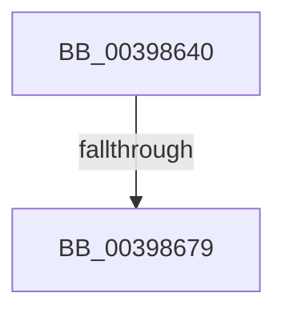

# KiDeferredReadyThread

- RVA: `0x00398640`–`0x0039867C` (길이 `60` bytes)
- VA: `0x0000000140398640`
- 실행 섹션: `.text`
- PDB 이름 있음: `예`; PDB Function 태그: `아니요`
- unwind 정보 RVA: `0x000814DC`
- 디코드: `14`개 명령, `60/60` bytes 표시
- 미해석 바이트: `0` (있으면 어셈블리에 `.byte`로 보존)

> 이 문서는 커널 이미지의 기계어와 PDB 기호를 분석해 생성했습니다. 4번과 5번은 함수 원형과 자료형을 바이너리 사용 방식에서 추정한 C 해석이며 원본 소스 복구 결과는 아닙니다.

## 1. Dependencies

- 직접 호출 지점: **1**; 고유 호출 대상: **1**
- 직접 호출자로 확인된 함수: **6**
- RIP 상대 이미지 참조: **0**

### Outgoing calls
- `0x00398663` → [KiDeferredReadySingleThread](../25/KiDeferredReadySingleThread_function_00252FE0.md) (function, `0x00252FE0`)

### Direct callers
- [KiNormalPriorityReadyScan](../21/KiNormalPriorityReadyScan_function_0021B400.md) at `0x0021B65A`
- [sub_0021C69D](../21/Unknown_function_0021C69D.md) at `0x0021C6E1`
- [sub_0021D7F8](../21/Unknown_function_0021D7F8.md) at `0x0021E413`
- [KiFastReadyThread](KiFastReadyThread_function_00398548.md) at `0x003985E1`
- [KiSetThreadSchedulingGroup](../46/KiSetThreadSchedulingGroup_function_0046E458.md) at `0x0046E550`
- [KiScanSharedReadyThreads](../46/KiScanSharedReadyThreads_function_0046F120.md) at `0x0046F4A3`

### Static image references
- 디코드된 RIP-relative 메모리 참조가 없습니다.

## 2. Other-region calls and transfers

- 다른 실행 섹션으로 향하는 call: **0**
- call이 아닌 외부 분기/꼬리 이동: **1**
  - `0x00398677` → [sub_003986CE](Unknown_function_003986CE.md) (`tail-transfer`)

## 3. Assembly (complete function range)

```asm
00398640  48 89 5C 24 18                  mov qword ptr [rsp + 0x18], rbx
00398645  48 89 6C 24 20                  mov qword ptr [rsp + 0x20], rbp
0039864A  56                              push rsi
0039864B  48 83 EC 20                     sub rsp, 0x20
0039864F  4D 8B C8                        mov r9, r8
00398652  48 C7 44 24 30 00 00 00 00      mov qword ptr [rsp + 0x30], 0
0039865B  4C 8D 44 24 30                  lea r8, [rsp + 0x30]
00398660  48 8B E9                        mov rbp, rcx
00398663  E8 78 A9 EB FF                  call 0x140252fe0
00398668  48 8B 5C 24 30                  mov rbx, qword ptr [rsp + 0x30]
0039866D  48 8D B5 D8 35 00 00            lea rsi, [rbp + 0x35d8]
00398674  48 85 DB                        test rbx, rbx
00398677  74 55                           je 0x1403986ce
00398679  48 8B 03                        mov rax, qword ptr [rbx]
```

## 4. C-style interpretation (structured pseudocode)

```c
__int64 __fastcall KiDeferredReadyThread(__int64 a1, __int64 a2, __int64 a3)
{
    __int64 result;
    __int64 v_rsp;
    unsigned __int64 v_stack_p18;
    unsigned __int64 v_stack_p20;
    unsigned __int64 v_stack_p8;

    v_stack_p18 = v_rbx;
    v_stack_p20 = v_rbp;
    v_rsp = (v_rsp) - (32);
    v_stack_p8 = 0;
    result = KiDeferredReadySingleThread(a1, a2, v_stack_p8, a3);
    return *(unsigned __int64 *)(v_stack_p8);
}
```

## 5. (Beta) C Style

```c
int64_t KiDeferredReadyThread(void *Arg1, int64_t Arg2, int64_t Arg3)
{
    uint8_t *arg1 = (uint8_t *)Arg1;

    int64_t result;
    int64_t local_rsp;
    uint64_t v_stack_p18;
    uint64_t v_stack_p20;
    uint64_t v_stack_p8;

    v_stack_p18 = local_rbx;
    v_stack_p20 = local_rbp;
    local_rsp = (local_rsp) - (32);
    v_stack_p8 = 0;
    result = KiDeferredReadySingleThread(Arg1, Arg2, v_stack_p8, Arg3);
    return *(uint64_t *)(v_stack_p8);
}
```

### 관측된 메모리 오프셋

구조체 형식이 확인되지 않은 접근은 인자 기준의 오프셋으로만 기록했습니다.

| 기준 인자 | 오프셋 표현 | 폭 (bit) | 접근 |
|---|---:|---:|---|
| `Arg1` | `+ 0x35D8` | `64` | `R` |

## 6. Execution-region graph

[열기: 2D/3D 그래프와 함수 탐색 컨트롤 패널](../../../control-panel.html?section=text&rva=0x00398640&view=graph)

- 2D 그래프는 위에서 아래로 흐르고, 3D 그래프는 빈 공간을 드래그해 회전합니다. Shift+드래그는 이동, 휠은 확대·축소, 함수 노드 선택은 대상 보고서 이동입니다.

### Static fallback


