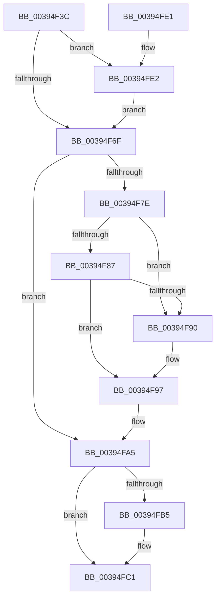

# KiDeregisterObjectWaitBlock

- RVA: `0x00394F3C`–`0x00394FEC` (길이 `176` bytes)
- VA: `0x0000000140394F3C`
- 실행 섹션: `.text`
- PDB 이름 있음: `예`; PDB Function 태그: `아니요`
- unwind 정보 RVA: `0x00073808`
- 디코드: `49`개 명령, `176/176` bytes 표시
- 미해석 바이트: `0` (있으면 어셈블리에 `.byte`로 보존)

> 이 문서는 커널 이미지의 기계어와 PDB 기호를 분석해 생성했습니다. 4번과 5번은 함수 원형과 자료형을 바이너리 사용 방식에서 추정한 C 해석이며 원본 소스 복구 결과는 아닙니다.

## 1. Dependencies

- 직접 호출 지점: **3**; 고유 호출 대상: **3**
- 직접 호출자로 확인된 함수: **4**
- RIP 상대 이미지 참조: **1**

### Outgoing calls
- `0x00394F72` → [KiAcquireKobjectLockSafe](../25/KiAcquireKobjectLockSafe_function_00251C90.md) (function, `0x00251C90`)
- `0x00394FBC` → [KiLowerIrqlProcessIrqlFlags](../4F/KiLowerIrqlProcessIrqlFlags_function_004F5698.md) (function, `0x004F5698`)
- `0x00394FE5` → [KiRaiseIrqlProcessIrqlFlags](../4F/KiRaiseIrqlProcessIrqlFlags_function_004F56FC.md) (function, `0x004F56FC`)

### Direct callers
- [ExpShutdownWorkerFactory](../2A/ExpShutdownWorkerFactory_function_002A4F70.md) at `0x002A5003`
- [NtWaitForWorkViaWorkerFactory](NtWaitForWorkViaWorkerFactory_function_00394270.md) at `0x0039451B`
- [IopCancelWaitCompletionPacket](../42/IopCancelWaitCompletionPacket_function_0042F614.md) at `0x0042F649`
- [ExCancelDpcEventWait](../65/ExCancelDpcEventWait_function_00659500.md) at `0x0065950B`

### Static image references
- `0x00394F66` → RVA `0x00FC6D20` (`ALMOSTRO`; read)

## 2. Other-region calls and transfers

- 다른 실행 섹션으로 향하는 call: **0**
- 별도 외부 분기/꼬리 이동을 확인하지 못했습니다.

## 3. Assembly (complete function range)

```asm
00394F3C  48 89 5C 24 08                  mov qword ptr [rsp + 8], rbx
00394F41  48 89 6C 24 10                  mov qword ptr [rsp + 0x10], rbp
00394F46  48 89 74 24 18                  mov qword ptr [rsp + 0x18], rsi
00394F4B  57                              push rdi
00394F4C  48 83 EC 20                     sub rsp, 0x20
00394F50  48 8B DA                        mov rbx, rdx
00394F53  48 8B F1                        mov rsi, rcx
00394F56  40 32 ED                        xor bpl, bpl
00394F59  44 0F 20 C7                     mov rdi, cr8
00394F5D  BA 02 00 00 00                  mov edx, 2
00394F62  44 0F 22 C2                     mov cr8, rdx
00394F66  83 3D B3 1D C3 00 00            cmp dword ptr [rip + 0xc31db3], 0
00394F6D  75 73                           jne 0x140394fe2
00394F6F  48 8B CE                        mov rcx, rsi
00394F72  E8 19 CD EB FF                  call 0x140251c90
00394F77  8A 43 11                        mov al, byte ptr [rbx + 0x11]
00394F7A  3C 04                           cmp al, 4
00394F7C  75 27                           jne 0x140394fa5
00394F7E  48 8B 0B                        mov rcx, qword ptr [rbx]
00394F81  48 39 59 08                     cmp qword ptr [rcx + 8], rbx
00394F85  75 09                           jne 0x140394f90
00394F87  48 8B 43 08                     mov rax, qword ptr [rbx + 8]
00394F8B  48 39 18                        cmp qword ptr [rax], rbx
00394F8E  74 07                           je 0x140394f97
00394F90  B9 03 00 00 00                  mov ecx, 3
00394F95  CD 29                           int 0x29
00394F97  48 89 08                        mov qword ptr [rax], rcx
00394F9A  40 B5 01                        mov bpl, 1
00394F9D  48 89 41 08                     mov qword ptr [rcx + 8], rax
00394FA1  C6 43 11 05                     mov byte ptr [rbx + 0x11], 5
00394FA5  F0 81 26 7F FF FF FF            lock and dword ptr [rsi], 0xffffff7f
00394FAC  83 3D 6D 1D C3 00 00            cmp dword ptr [rip + 0xc31d6d], 0
00394FB3  74 0C                           je 0x140394fc1
00394FB5  44 0F 20 C1                     mov rcx, cr8
00394FB9  40 8A D7                        mov dl, dil
00394FBC  E8 D7 06 16 00                  call 0x1404f5698
00394FC1  40 0F B6 CF                     movzx ecx, dil
00394FC5  44 0F 22 C1                     mov cr8, rcx
00394FC9  48 8B 5C 24 30                  mov rbx, qword ptr [rsp + 0x30]
00394FCE  40 8A C5                        mov al, bpl
00394FD1  48 8B 6C 24 38                  mov rbp, qword ptr [rsp + 0x38]
00394FD6  48 8B 74 24 40                  mov rsi, qword ptr [rsp + 0x40]
00394FDB  48 83 C4 20                     add rsp, 0x20
00394FDF  5F                              pop rdi
00394FE0  C3                              ret
00394FE1  CC                              int3
00394FE2  40 8A CF                        mov cl, dil
00394FE5  E8 12 07 16 00                  call 0x1404f56fc
00394FEA  EB 83                           jmp 0x140394f6f
```

## 4. C-style interpretation (structured pseudocode)

```c
__int64 __fastcall KiDeregisterObjectWaitBlock(__int64 a1, __int64 a2)
{
    __int64 result;
    __int64 v_rbp;
    __int64 v_rsp;
    unsigned __int64 v_stack_p10;
    unsigned __int64 v_stack_p18;
    unsigned __int64 v_stack_p8;

    v_stack_p8 = v_rbx;
    v_stack_p10 = v_rbp;
    v_stack_p18 = v_rsi;
    v_rsp = (v_rsp) - (32);
    v_rbp = 0;
    if ((*(unsigned int *)(v_rip + 12787123)) != 0) goto loc_00394FE2;
loc_00394F6F:
    result = KiAcquireKobjectLockSafe(a1, 2, a3, a4);
    if (((unsigned __int8)(*(unsigned __int8 *)(a2 + 17))) != 4) goto loc_00394FA5;
    if ((*(unsigned __int64 *)(*(unsigned __int64 *)(a2) + 8)) != a2) goto loc_00394F90;
    if ((*(unsigned __int64 *)(*(unsigned __int64 *)(a2 + 8))) != a2) {
        a1 = 3;
    }
    *(unsigned __int64 *)(*(unsigned __int64 *)(a2 + 8)) = a1;
    *(unsigned __int64 *)(a1 + 8) = *(unsigned __int64 *)(a2 + 8);
    *(unsigned __int8 *)(a2 + 17) = 5;
loc_00394FA5:
    result = *(unsigned __int64 *)(a2 + 8);
    if ((*(unsigned int *)(v_rip + 12787053)) != 0) {
        a1 = 2;
        a2 = (unsigned __int8)(v_cr8);
        result = KiLowerIrqlProcessIrqlFlags(a1, a2, a3, a4);
    }
    v_rsp = (v_rsp) + (32);
    return 1;
loc_00394FE2:
    result = KiRaiseIrqlProcessIrqlFlags((unsigned __int8)(v_cr8), a2, a3, a4);
    goto loc_00394F6F;
}
```

## 5. (Beta) C Style

```c
int64_t KiDeregisterObjectWaitBlock(void *Arg1, void *Arg2)
{
    uint8_t *arg1 = (uint8_t *)Arg1;
    uint8_t *arg2 = (uint8_t *)Arg2;

    int64_t result;
    int64_t local_rbp;
    int64_t local_rsp;
    uint64_t v_stack_p10;
    uint64_t v_stack_p18;
    uint64_t v_stack_p8;

    v_stack_p8 = local_rbx;
    v_stack_p10 = local_rbp;
    v_stack_p18 = local_rsi;
    local_rsp = (local_rsp) - (32);
    local_rbp = 0;
    if ((*(uint32_t *)(v_rip + 0xC31DB3)) != 0) goto loc_00394FE2;
loc_00394F6F:
    result = KiAcquireKobjectLockSafe(Arg1, 2, a3, a4);
    if (((uint8_t)(*(uint8_t *)(arg2 + 0x11))) != 4) goto loc_00394FA5;
    if ((*(uint64_t *)(*(uint64_t *)(arg2) + 0x8)) != Arg2) goto loc_00394F90;
    if ((*(uint64_t *)(*(uint64_t *)(arg2 + 0x8))) != Arg2) {
        Arg1 = 3;
    }
    *(void **)(*(uint64_t *)(arg2 + 0x8)) = Arg1;
    *(uint64_t *)(arg1 + 0x8) = *(uint64_t *)(arg2 + 0x8);
    *(uint8_t *)(arg2 + 0x11) = 5;
loc_00394FA5:
    result = *(uint64_t *)(arg2 + 0x8);
    if ((*(uint32_t *)(v_rip + 0xC31D6D)) != 0) {
        Arg1 = 2;
        Arg2 = (uint8_t)(v_cr8);
        result = KiLowerIrqlProcessIrqlFlags(Arg1, Arg2, a3, a4);
    }
    local_rsp = (local_rsp) + (32);
    return 1;
loc_00394FE2:
    result = KiRaiseIrqlProcessIrqlFlags((uint8_t)(v_cr8), Arg2, a3, a4);
    goto loc_00394F6F;
}
```

### 관측된 메모리 오프셋

구조체 형식이 확인되지 않은 접근은 인자 기준의 오프셋으로만 기록했습니다.

| 기준 인자 | 오프셋 표현 | 폭 (bit) | 접근 |
|---|---:|---:|---|
| `Arg1` | `+ 0x0` | `32` | `R/W` |
| `Arg2` | `+ 0x0` | `64` | `R` |
| `Arg2` | `+ 0x8` | `64` | `R` |
| `Arg2` | `+ 0x11` | `8` | `R` |
| `Arg2` | `+ 0x11` | `8` | `W` |

## 6. Execution-region graph

[열기: 2D/3D 그래프와 함수 탐색 컨트롤 패널](../../../control-panel.html?section=text&rva=0x00394F3C&view=graph)

- 2D 그래프는 위에서 아래로 흐르고, 3D 그래프는 빈 공간을 드래그해 회전합니다. Shift+드래그는 이동, 휠은 확대·축소, 함수 노드 선택은 대상 보고서 이동입니다.

### Static fallback


