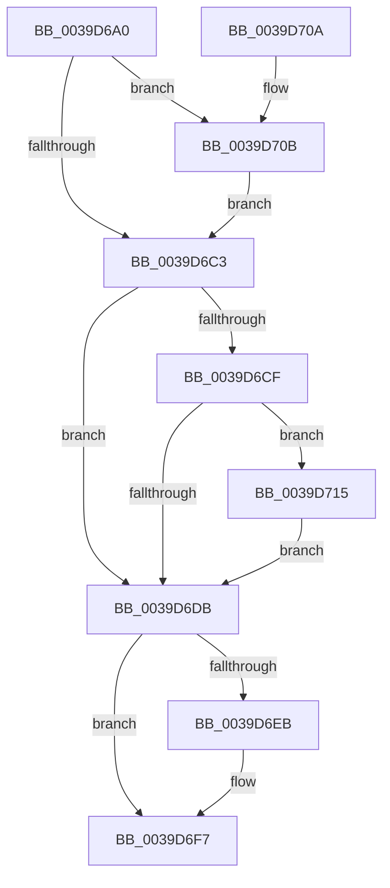

# KiDpcWatchdogCounterReset

- RVA: `0x0039D6A0`–`0x0039D723` (길이 `131` bytes)
- VA: `0x000000014039D6A0`
- 실행 섹션: `.text`
- PDB 이름 있음: `예`; PDB Function 태그: `아니요`
- unwind 정보 RVA: `0x0007EC14`
- 디코드: `35`개 명령, `131/131` bytes 표시
- 미해석 바이트: `0` (있으면 어셈블리에 `.byte`로 보존)

> 이 문서는 커널 이미지의 기계어와 PDB 기호를 분석해 생성했습니다. 4번과 5번은 함수 원형과 자료형을 바이너리 사용 방식에서 추정한 C 해석이며 원본 소스 복구 결과는 아닙니다.

## 1. Dependencies

- 직접 호출 지점: **3**; 고유 호출 대상: **3**
- 직접 호출자로 확인된 함수: **2**
- RIP 상대 이미지 참조: **1**

### Outgoing calls
- `0x0039D6F2` → [KiLowerIrqlProcessIrqlFlags](../4F/KiLowerIrqlProcessIrqlFlags_function_004F5698.md) (function, `0x004F5698`)
- `0x0039D70E` → [KiRaiseIrqlProcessIrqlFlags](../4F/KiRaiseIrqlProcessIrqlFlags_function_004F56FC.md) (function, `0x004F56FC`)
- `0x0039D71C` → [EtwTraceCumulativeDpcSoftTimeout](../64/EtwTraceCumulativeDpcSoftTimeout_function_0064F940.md) (function, `0x0064F940`)

### Direct callers
- [KeAccumulateTicks](KeAccumulateTicks_function_0039C140.md) at `0x0039C370`
- [KeAccumulateTicks](KeAccumulateTicks_function_0039C140.md) at `0x0039C3DE`
- [KeAccumulateTicks](KeAccumulateTicks_function_0039C140.md) at `0x0039C7BB`
- [KiDpcWatchdog](../5C/KiDpcWatchdog_function_005C8490.md) at `0x005C849E`

### Static image references
- `0x0039D6BA` → RVA `0x00FC6D20` (`ALMOSTRO`; read)

## 2. Other-region calls and transfers

- 다른 실행 섹션으로 향하는 call: **0**
- 별도 외부 분기/꼬리 이동을 확인하지 못했습니다.

## 3. Assembly (complete function range)

```asm
0039D6A0  48 89 5C 24 08                  mov qword ptr [rsp + 8], rbx
0039D6A5  57                              push rdi
0039D6A6  48 83 EC 20                     sub rsp, 0x20
0039D6AA  48 8B D9                        mov rbx, rcx
0039D6AD  44 0F 20 C7                     mov rdi, cr8
0039D6B1  BA 0D 00 00 00                  mov edx, 0xd
0039D6B6  44 0F 22 C2                     mov cr8, rdx
0039D6BA  83 3D 5F 96 C2 00 00            cmp dword ptr [rip + 0xc2965f], 0
0039D6C1  75 48                           jne 0x14039d70b
0039D6C3  44 8B 8B D8 38 00 00            mov r9d, dword ptr [rbx + 0x38d8]
0039D6CA  45 85 C9                        test r9d, r9d
0039D6CD  74 0C                           je 0x14039d6db
0039D6CF  44 8B 83 AC 83 00 00            mov r8d, dword ptr [rbx + 0x83ac]
0039D6D6  45 3B C1                        cmp r8d, r9d
0039D6D9  7D 3A                           jge 0x14039d715
0039D6DB  83 A3 AC 83 00 00 00            and dword ptr [rbx + 0x83ac], 0
0039D6E2  83 3D 37 96 C2 00 00            cmp dword ptr [rip + 0xc29637], 0
0039D6E9  74 0C                           je 0x14039d6f7
0039D6EB  44 0F 20 C1                     mov rcx, cr8
0039D6EF  40 8A D7                        mov dl, dil
0039D6F2  E8 A1 7F 15 00                  call 0x1404f5698
0039D6F7  40 0F B6 C7                     movzx eax, dil
0039D6FB  44 0F 22 C0                     mov cr8, rax
0039D6FF  48 8B 5C 24 30                  mov rbx, qword ptr [rsp + 0x30]
0039D704  48 83 C4 20                     add rsp, 0x20
0039D708  5F                              pop rdi
0039D709  C3                              ret
0039D70A  CC                              int3
0039D70B  40 8A CF                        mov cl, dil
0039D70E  E8 E9 7F 15 00                  call 0x1404f56fc
0039D713  EB AE                           jmp 0x14039d6c3
0039D715  48 8B 4B 08                     mov rcx, qword ptr [rbx + 8]
0039D719  48 8B D3                        mov rdx, rbx
0039D71C  E8 1F 22 2B 00                  call 0x14064f940
0039D721  EB B8                           jmp 0x14039d6db
```

## 4. C-style interpretation (structured pseudocode)

```c
__int64 __fastcall KiDpcWatchdogCounterReset(__int64 a1)
{
    __int64 result;
    __int64 v_rsp;
    unsigned __int64 v_stack_p8;

    v_stack_p8 = v_rbx;
    v_rsp = (v_rsp) - (32);
    if ((*(unsigned int *)(v_rip + 12752479)) != 0) goto loc_0039D70B;
loc_0039D6C3:
    if ((unsigned int)((unsigned int)(*(unsigned int *)(a1 + 14552))) == 0) goto loc_0039D6DB;
    if (((unsigned int)((unsigned int)(*(unsigned int *)(a1 + 33708)))) >= ((unsigned int)((unsigned int)(*(unsigned int *)(a1 + 14552))))) goto loc_0039D715;
loc_0039D6DB:
    if ((*(unsigned int *)(v_rip + 12752439)) != 0) {
        a1 = 13;
        a2 = (unsigned __int8)(v_cr8);
        result = KiLowerIrqlProcessIrqlFlags(a1, a2, (unsigned int)(*(unsigned int *)(a1 + 33708)), (unsigned int)(*(unsigned int *)(a1 + 14552)));
    }
    v_rsp = (v_rsp) + (32);
    return (unsigned __int8)(v_cr8);
loc_0039D70B:
    result = KiRaiseIrqlProcessIrqlFlags((unsigned __int8)(v_cr8), a2, (unsigned int)(*(unsigned int *)(a1 + 33708)), (unsigned int)(*(unsigned int *)(a1 + 14552)));
    goto loc_0039D6C3;
loc_0039D715:
    result = EtwTraceCumulativeDpcSoftTimeout(*(unsigned __int64 *)(v_stack_p8 + 8), v_stack_p8, (unsigned int)(*(unsigned int *)(a1 + 33708)), (unsigned int)(*(unsigned int *)(a1 + 14552)));
    goto loc_0039D6DB;
}
```

## 5. (Beta) C Style

```c
int64_t KiDpcWatchdogCounterReset(void *Arg1)
{
    uint8_t *arg1 = (uint8_t *)Arg1;

    int64_t result;
    int64_t local_rsp;
    uint64_t v_stack_p8;

    v_stack_p8 = local_rbx;
    local_rsp = (local_rsp) - (32);
    if ((*(uint32_t *)(v_rip + 0xC2965F)) != 0) goto loc_0039D70B;
loc_0039D6C3:
    if ((uint32_t)((uint32_t)(*(uint32_t *)(arg1 + 0x38D8))) == 0) goto loc_0039D6DB;
    if (((uint32_t)((uint32_t)(*(uint32_t *)(arg1 + 0x83AC)))) >= ((uint32_t)((uint32_t)(*(uint32_t *)(arg1 + 0x38D8))))) goto loc_0039D715;
loc_0039D6DB:
    if ((*(uint32_t *)(v_rip + 0xC29637)) != 0) {
        Arg1 = 13;
        a2 = (uint8_t)(v_cr8);
        result = KiLowerIrqlProcessIrqlFlags(Arg1, a2, (uint32_t)(*(uint32_t *)(arg1 + 0x83AC)), (uint32_t)(*(uint32_t *)(arg1 + 0x38D8)));
    }
    local_rsp = (local_rsp) + (32);
    return (uint8_t)(v_cr8);
loc_0039D70B:
    result = KiRaiseIrqlProcessIrqlFlags((uint8_t)(v_cr8), a2, (uint32_t)(*(uint32_t *)(arg1 + 0x83AC)), (uint32_t)(*(uint32_t *)(arg1 + 0x38D8)));
    goto loc_0039D6C3;
loc_0039D715:
    result = EtwTraceCumulativeDpcSoftTimeout(*(uint64_t *)(v_stack_p8 + 0x8), v_stack_p8, (uint32_t)(*(uint32_t *)(arg1 + 0x83AC)), (uint32_t)(*(uint32_t *)(arg1 + 0x38D8)));
    goto loc_0039D6DB;
}
```

### 관측된 메모리 오프셋

구조체 형식이 확인되지 않은 접근은 인자 기준의 오프셋으로만 기록했습니다.

| 기준 인자 | 오프셋 표현 | 폭 (bit) | 접근 |
|---|---:|---:|---|
| `Arg1` | `+ 0x8` | `64` | `R` |
| `Arg1` | `+ 0x38D8` | `32` | `R` |
| `Arg1` | `+ 0x83AC` | `32` | `R` |
| `Arg1` | `+ 0x83AC` | `32` | `R/W` |

## 6. Execution-region graph

[열기: 2D/3D 그래프와 함수 탐색 컨트롤 패널](../../../control-panel.html?section=text&rva=0x0039D6A0&view=graph)

- 2D 그래프는 위에서 아래로 흐르고, 3D 그래프는 빈 공간을 드래그해 회전합니다. Shift+드래그는 이동, 휠은 확대·축소, 함수 노드 선택은 대상 보고서 이동입니다.

### Static fallback


