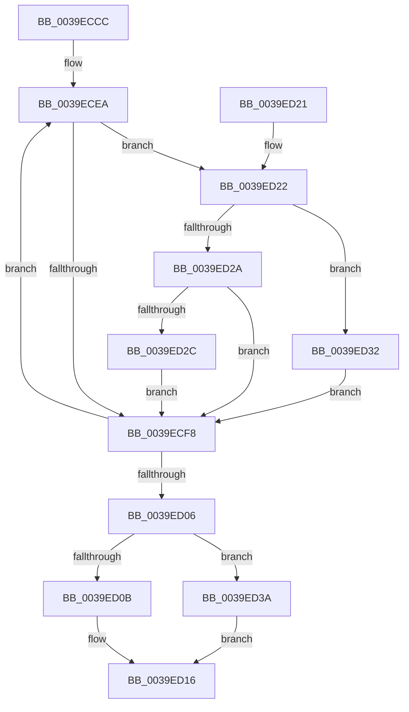

# KiEliminateLowVoteSoftParkCandidates

- RVA: `0x0039ECCC`–`0x0039ED41` (길이 `117` bytes)
- VA: `0x000000014039ECCC`
- 실행 섹션: `.text`
- PDB 이름 있음: `예`; PDB Function 태그: `아니요`
- unwind 정보 RVA: `0x00081BFC`
- 디코드: `40`개 명령, `117/117` bytes 표시
- 미해석 바이트: `0` (있으면 어셈블리에 `.byte`로 보존)

> 이 문서는 커널 이미지의 기계어와 PDB 기호를 분석해 생성했습니다. 4번과 5번은 함수 원형과 자료형을 바이너리 사용 방식에서 추정한 C 해석이며 원본 소스 복구 결과는 아닙니다.

## 1. Dependencies

- 직접 호출 지점: **0**; 고유 호출 대상: **0**
- 직접 호출자로 확인된 함수: **1**
- RIP 상대 이미지 참조: **0**

### Outgoing calls
- 직접 디코드된 call 명령이 없습니다.

### Direct callers
- [KiPerformHeteroSoftParkElection](KiPerformHeteroSoftParkElection_function_0039E490.md) at `0x0039E569`

### Static image references
- 디코드된 RIP-relative 메모리 참조가 없습니다.

## 2. Other-region calls and transfers

- 다른 실행 섹션으로 향하는 call: **0**
- 별도 외부 분기/꼬리 이동을 확인하지 못했습니다.

## 3. Assembly (complete function range)

```asm
0039ECCC  48 89 5C 24 08                  mov qword ptr [rsp + 8], rbx
0039ECD1  48 89 7C 24 10                  mov qword ptr [rsp + 0x10], rdi
0039ECD6  48 83 CB FF                     or rbx, 0xffffffffffffffff
0039ECDA  4C 8B C9                        mov r9, rcx
0039ECDD  33 C0                           xor eax, eax
0039ECDF  49 8B F8                        mov rdi, r8
0039ECE2  8B C8                           mov ecx, eax
0039ECE4  44 8B D8                        mov r11d, eax
0039ECE7  4C 8B D2                        mov r10, rdx
0039ECEA  41 B8 01 00 00 00               mov r8d, 1
0039ECF0  49 D3 E0                        shl r8, cl
0039ECF3  4D 85 C1                        test r9, r8
0039ECF6  75 2A                           jne 0x14039ed22
0039ECF8  FF C1                           inc ecx
0039ECFA  49 FF C3                        inc r11
0039ECFD  49 83 C2 08                     add r10, 8
0039ED01  83 F9 40                        cmp ecx, 0x40
0039ED04  72 E4                           jb 0x14039ecea
0039ED06  49 3B C1                        cmp rax, r9
0039ED09  74 2F                           je 0x14039ed3a
0039ED0B  48 F7 D0                        not rax
0039ED0E  49 23 C1                        and rax, r9
0039ED11  48 89 07                        mov qword ptr [rdi], rax
0039ED14  B0 01                           mov al, 1
0039ED16  48 8B 5C 24 08                  mov rbx, qword ptr [rsp + 8]
0039ED1B  48 8B 7C 24 10                  mov rdi, qword ptr [rsp + 0x10]
0039ED20  C3                              ret
0039ED21  CC                              int3
0039ED22  49 8B 12                        mov rdx, qword ptr [r10]
0039ED25  48 3B DA                        cmp rbx, rdx
0039ED28  77 08                           ja 0x14039ed32
0039ED2A  75 CC                           jne 0x14039ecf8
0039ED2C  4C 0F AB D8                     bts rax, r11
0039ED30  EB C6                           jmp 0x14039ecf8
0039ED32  48 8B DA                        mov rbx, rdx
0039ED35  49 8B C0                        mov rax, r8
0039ED38  EB BE                           jmp 0x14039ecf8
0039ED3A  4C 89 0F                        mov qword ptr [rdi], r9
0039ED3D  32 C0                           xor al, al
0039ED3F  EB D5                           jmp 0x14039ed16
```

## 4. C-style interpretation (structured pseudocode)

```c
__int64 __fastcall KiEliminateLowVoteSoftParkCandidates(__int64 a1, __int64 a2, __int64 a3)
{
    __int64 result;
    __int64 v_r10;
    __int64 v_r11;
    __int64 v_rbx;
    unsigned __int64 v_stack_p10;
    unsigned __int64 v_stack_p8;

    v_stack_p8 = v_rbx;
    v_stack_p10 = v_rdi;
    v_rbx = (v_rbx) | (-1);
    result = 0;
loc_0039ECEA:
    a3 = (1) << (0);
    if (((a1) & (a3)) != 0) goto loc_0039ED22;
loc_0039ECF8:
    a1 = (unsigned int)((0) + 1);
    v_r11 = (0) + 1;
    v_r10 = (a2) + (8);
    if (((unsigned int)(a1)) < 64) goto loc_0039ECEA;
    if (0 == a1) goto loc_0039ED3A;
    result = ~(result);
    result = (result) & (a1);
    *(unsigned __int64 *)(a3) = result;
loc_0039ED16:
    return 1;
loc_0039ED22:
    if (v_stack_p8 > (*(unsigned __int64 *)(v_r10))) goto loc_0039ED32;
    if (v_stack_p8 != (*(unsigned __int64 *)(v_r10))) goto loc_0039ECF8;
    goto loc_0039ECF8;
loc_0039ED32:
    goto loc_0039ECF8;
loc_0039ED3A:
    *(unsigned __int64 *)(v_stack_p10) = a1;
    result = 0;
    goto loc_0039ED16;
}
```

## 5. (Beta) C Style

```c
int64_t KiEliminateLowVoteSoftParkCandidates(int64_t Arg1, void *Arg2, void *Arg3)
{
    uint8_t *arg2 = (uint8_t *)Arg2;
    uint8_t *arg3 = (uint8_t *)Arg3;

    int64_t result;
    int64_t local_r10;
    int64_t local_r11;
    int64_t local_rbx;
    uint64_t v_stack_p10;
    uint64_t v_stack_p8;

    v_stack_p8 = local_rbx;
    v_stack_p10 = local_rdi;
    local_rbx = (local_rbx) | (-1);
    result = 0;
loc_0039ECEA:
    Arg3 = (1) << (0);
    if (((Arg1) & (Arg3)) != 0) goto loc_0039ED22;
loc_0039ECF8:
    Arg1 = (uint32_t)((0) + 1);
    local_r11 = (0) + 1;
    local_r10 = (Arg2) + (8);
    if (((uint32_t)(Arg1)) < 64) goto loc_0039ECEA;
    if (0 == Arg1) goto loc_0039ED3A;
    result = ~(result);
    result = (result) & (Arg1);
    *(uint64_t *)(arg3) = result;
loc_0039ED16:
    return 1;
loc_0039ED22:
    if (v_stack_p8 > (*(uint64_t *)(local_r10))) goto loc_0039ED32;
    if (v_stack_p8 != (*(uint64_t *)(local_r10))) goto loc_0039ECF8;
    goto loc_0039ECF8;
loc_0039ED32:
    goto loc_0039ECF8;
loc_0039ED3A:
    *(uint64_t *)(v_stack_p10) = Arg1;
    result = 0;
    goto loc_0039ED16;
}
```

### 관측된 메모리 오프셋

구조체 형식이 확인되지 않은 접근은 인자 기준의 오프셋으로만 기록했습니다.

| 기준 인자 | 오프셋 표현 | 폭 (bit) | 접근 |
|---|---:|---:|---|
| `Arg2` | `+ 0x0` | `64` | `R` |
| `Arg3` | `+ 0x0` | `64` | `W` |

## 6. Execution-region graph

[열기: 2D/3D 그래프와 함수 탐색 컨트롤 패널](../../../control-panel.html?section=text&rva=0x0039ECCC&view=graph)

- 2D 그래프는 위에서 아래로 흐르고, 3D 그래프는 빈 공간을 드래그해 회전합니다. Shift+드래그는 이동, 휠은 확대·축소, 함수 노드 선택은 대상 보고서 이동입니다.

### Static fallback


