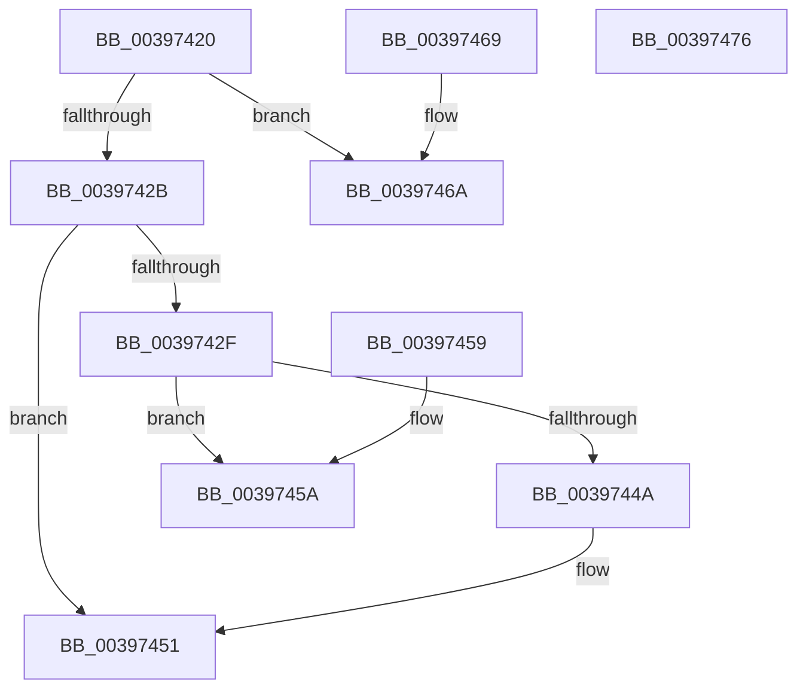

# KiEnterDeferredReadyState

- RVA: `0x00397420`–`0x00397477` (길이 `87` bytes)
- VA: `0x0000000140397420`
- 실행 섹션: `.text`
- PDB 이름 있음: `예`; PDB Function 태그: `아니요`
- unwind 정보 RVA: `0x000DB714`
- 디코드: `22`개 명령, `87/87` bytes 표시
- 미해석 바이트: `0` (있으면 어셈블리에 `.byte`로 보존)

> 이 문서는 커널 이미지의 기계어와 PDB 기호를 분석해 생성했습니다. 4번과 5번은 함수 원형과 자료형을 바이너리 사용 방식에서 추정한 C 해석이며 원본 소스 복구 결과는 아닙니다.

## 1. Dependencies

- 직접 호출 지점: **0**; 고유 호출 대상: **0**
- 직접 호출자로 확인된 함수: **12**
- RIP 상대 이미지 참조: **0**

### Outgoing calls
- 직접 디코드된 call 명령이 없습니다.

### Direct callers
- [KiQueueReadyThread](../21/KiQueueReadyThread_function_0021C7B0.md) at `0x0021C91A`
- [KiAttemptToScheduleThreadToBusyIsolationUnit](../25/KiAttemptToScheduleThreadToBusyIsolationUnit_function_00259B00.md) at `0x0025AD1D`
- [sub_0033F467](../33/Unknown_function_0033F467.md) at `0x0033F5DA`
- [KeReleaseSemaphoreEx](../34/KeReleaseSemaphoreEx_function_003468C0.md) at `0x003469B8`
- [AlpcpSignal](AlpcpSignal_function_003955E0.md) at `0x00395D8F`
- [AlpcpSignal](AlpcpSignal_function_003955E0.md) at `0x00395E89`
- [KeReleaseMutantEx](KeReleaseMutantEx_function_00396850.md) at `0x00396B2F`
- [KiReadyOutSwappedThreads](KiReadyOutSwappedThreads_function_00396E30.md) at `0x00396E8D`
- [sub_003970FA](Unknown_function_003970FA.md) at `0x00397189`
- [KiAlertSingleThreadByThreadId](KiAlertSingleThreadByThreadId_function_00397D8C.md) at `0x00397E3E`
- [KiPrepareReadyThreadForRescheduling](KiPrepareReadyThreadForRescheduling_function_00397F2C.md) at `0x00397F8A`
- [KiFastReadyThread](KiFastReadyThread_function_00398548.md) at `0x003985CB`
- [KiSetThreadSchedulingGroup](../46/KiSetThreadSchedulingGroup_function_0046E458.md) at `0x0046E5B2`

### Static image references
- 디코드된 RIP-relative 메모리 참조가 없습니다.

## 2. Other-region calls and transfers

- 다른 실행 섹션으로 향하는 call: **0**
- 별도 외부 분기/꼬리 이동을 확인하지 못했습니다.

## 3. Assembly (complete function range)

```asm
00397420  0F B6 81 84 01 00 00            movzx eax, byte ptr [rcx + 0x184]
00397427  3C 01                           cmp al, 1
00397429  74 3F                           je 0x14039746a
0039742B  3C 05                           cmp al, 5
0039742D  75 22                           jne 0x140397451
0039742F  48 B8 20 03 00 00 80 F7 FF FF   movabs rax, 0xfffff78000000320
00397439  8B 10                           mov edx, dword ptr [rax]
0039743B  2B 91 B4 01 00 00               sub edx, dword ptr [rcx + 0x1b4]
00397441  80 B9 87 01 00 00 00            cmp byte ptr [rcx + 0x187], 0
00397448  74 10                           je 0x14039745a
0039744A  48 01 91 E8 03 00 00            add qword ptr [rcx + 0x3e8], rdx
00397451  C6 81 84 01 00 00 07            mov byte ptr [rcx + 0x184], 7
00397458  C3                              ret
00397459  CC                              int3
0039745A  48 01 91 E0 03 00 00            add qword ptr [rcx + 0x3e0], rdx
00397461  C6 81 84 01 00 00 07            mov byte ptr [rcx + 0x184], 7
00397468  C3                              ret
00397469  CC                              int3
0039746A  83 49 74 02                     or dword ptr [rcx + 0x74], 2
0039746E  C6 81 84 01 00 00 07            mov byte ptr [rcx + 0x184], 7
00397475  C3                              ret
00397476  CC                              int3
```

## 4. C-style interpretation (structured pseudocode)

```c
__int64 __fastcall KiEnterDeferredReadyState(__int64 a1)
{
    if (((unsigned __int8)(*(unsigned __int8 *)(a1 + 388))) == 1) goto loc_0039746A;
    if (((unsigned __int8)(*(unsigned __int8 *)(a1 + 388))) != 5) goto loc_00397451;
    a2 = (unsigned int)(((unsigned int)(*(unsigned int *)(*(unsigned __int8 *)(a1 + 388)))) - (*(unsigned int *)(a1 + 436)));
    if ((*(unsigned __int8 *)(a1 + 391)) == 0) goto loc_0039745A;
loc_00397451:
    *(unsigned __int8 *)(a1 + 388) = 7;
    return *(unsigned __int8 *)(a1 + 388);
loc_0039745A:
    *(unsigned __int8 *)(a1 + 388) = 7;
    return *(unsigned __int8 *)(a1 + 388);
loc_0039746A:
    *(unsigned __int8 *)(a1 + 388) = 7;
    return *(unsigned __int8 *)(a1 + 388);
}
```

## 5. (Beta) C Style

```c
int64_t KiEnterDeferredReadyState(void *Arg1)
{
    uint8_t *arg1 = (uint8_t *)Arg1;

    if (((uint8_t)(*(uint8_t *)(arg1 + 0x184))) == 1) goto loc_0039746A;
    if (((uint8_t)(*(uint8_t *)(arg1 + 0x184))) != 5) goto loc_00397451;
    a2 = (uint32_t)(((uint32_t)(*(uint32_t *)(*(uint8_t *)(arg1 + 0x184)))) - (*(uint32_t *)(arg1 + 0x1B4)));
    if ((*(uint8_t *)(arg1 + 0x187)) == 0) goto loc_0039745A;
loc_00397451:
    *(uint8_t *)(arg1 + 0x184) = 7;
    return *(uint8_t *)(arg1 + 0x184);
loc_0039745A:
    *(uint8_t *)(arg1 + 0x184) = 7;
    return *(uint8_t *)(arg1 + 0x184);
loc_0039746A:
    *(uint8_t *)(arg1 + 0x184) = 7;
    return *(uint8_t *)(arg1 + 0x184);
}
```

### 관측된 메모리 오프셋

구조체 형식이 확인되지 않은 접근은 인자 기준의 오프셋으로만 기록했습니다.

| 기준 인자 | 오프셋 표현 | 폭 (bit) | 접근 |
|---|---:|---:|---|
| `Arg1` | `+ 0x74` | `32` | `R/W` |
| `Arg1` | `+ 0x184` | `8` | `R` |
| `Arg1` | `+ 0x184` | `8` | `W` |
| `Arg1` | `+ 0x187` | `8` | `R` |
| `Arg1` | `+ 0x1B4` | `32` | `R` |
| `Arg1` | `+ 0x3E0` | `64` | `R/W` |
| `Arg1` | `+ 0x3E8` | `64` | `R/W` |

## 6. Execution-region graph

[열기: 2D/3D 그래프와 함수 탐색 컨트롤 패널](../../../control-panel.html?section=text&rva=0x00397420&view=graph)

- 2D 그래프는 위에서 아래로 흐르고, 3D 그래프는 빈 공간을 드래그해 회전합니다. Shift+드래그는 이동, 휠은 확대·축소, 함수 노드 선택은 대상 보고서 이동입니다.

### Static fallback


