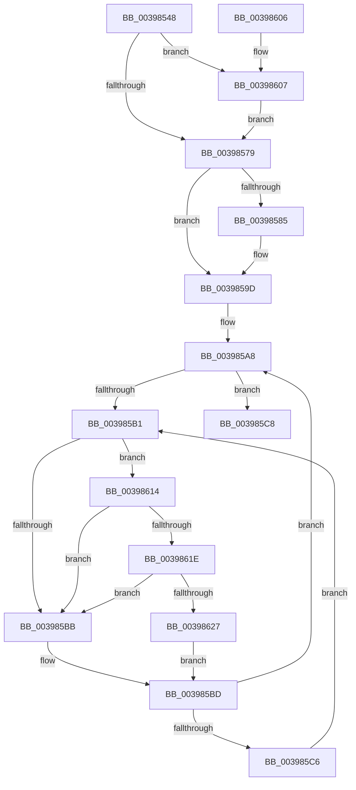

# KiFastReadyThread

- RVA: `0x00398548`–`0x00398630` (길이 `232` bytes)
- VA: `0x0000000140398548`
- 실행 섹션: `.text`
- PDB 이름 있음: `예`; PDB Function 태그: `아니요`
- unwind 정보 RVA: `0x000814C4`
- 디코드: `59`개 명령, `232/232` bytes 표시
- 미해석 바이트: `0` (있으면 어셈블리에 `.byte`로 보존)

> 이 문서는 커널 이미지의 기계어와 PDB 기호를 분석해 생성했습니다. 4번과 5번은 함수 원형과 자료형을 바이너리 사용 방식에서 추정한 C 해석이며 원본 소스 복구 결과는 아닙니다.

## 1. Dependencies

- 직접 호출 지점: **7**; 고유 호출 대상: **7**
- 직접 호출자로 확인된 함수: **2**
- RIP 상대 이미지 참조: **4**

### Outgoing calls
- `0x00398598` → [EtwTraceReadyThread](../25/EtwTraceReadyThread_function_00251F70.md) (function, `0x00251F70`)
- `0x003985CB` → [KiEnterDeferredReadyState](KiEnterDeferredReadyState_function_00397420.md) (function, `0x00397420`)
- `0x003985E1` → [KiDeferredReadyThread](KiDeferredReadyThread_function_00398640.md) (function, `0x00398640`)
- `0x003985EC` → [KiCheckForThreadDispatch](../25/KiCheckForThreadDispatch_function_00250648.md) (function, `0x00250648`)
- `0x0039860A` → [KiRaiseIrqlProcessIrqlFlags](../4F/KiRaiseIrqlProcessIrqlFlags_function_004F56FC.md) (function, `0x004F56FC`)
- `0x0039861E` → [KiCheckVpBackingLongSpinWaitHypercall](../30/KiCheckVpBackingLongSpinWaitHypercall_function_0030F490.md) (function, `0x0030F490`)
- `0x00398629` → [HvlNotifyLongSpinWait](../30/HvlNotifyLongSpinWait_function_0030F460.md) (function, `0x0030F460`)

### Direct callers
- [KeReadyThread](KeReadyThread_function_00398AB4.md) at `0x00398ADA`
- [KeSwapProcessOrStack](../5C/KeSwapProcessOrStack_function_005C5E00.md) at `0x005C5EE2`

### Static image references
- `0x0039856C` → RVA `0x00FC6D20` (`ALMOSTRO`; read)
- `0x00398579` → RVA `0x00FC6B04` (`ALMOSTRO`; read)
- `0x003985B3` → RVA `0x00FC52AC` (`ALMOSTRO`; reference)
- `0x00398614` → RVA `0x00FC6AB8` (`ALMOSTRO`; read)

## 2. Other-region calls and transfers

- 다른 실행 섹션으로 향하는 call: **0**
- 별도 외부 분기/꼬리 이동을 확인하지 못했습니다.

## 3. Assembly (complete function range)

```asm
00398548  48 89 5C 24 08                  mov qword ptr [rsp + 8], rbx
0039854D  48 89 6C 24 10                  mov qword ptr [rsp + 0x10], rbp
00398552  48 89 74 24 18                  mov qword ptr [rsp + 0x18], rsi
00398557  57                              push rdi
00398558  48 83 EC 20                     sub rsp, 0x20
0039855C  48 8B D9                        mov rbx, rcx
0039855F  44 0F 20 C6                     mov rsi, cr8
00398563  BA 02 00 00 00                  mov edx, 2
00398568  44 0F 22 C2                     mov cr8, rdx
0039856C  83 3D AD E7 C2 00 00            cmp dword ptr [rip + 0xc2e7ad], 0
00398573  0F 85 8E 00 00 00               jne 0x140398607
00398579  F7 05 81 E5 C2 00 00 02 00 00   test dword ptr [rip + 0xc2e581], 0x200
00398583  74 18                           je 0x14039859d
00398585  44 8A 83 37 02 00 00            mov r8b, byte ptr [rbx + 0x237]
0039858C  45 33 C9                        xor r9d, r9d
0039858F  8A 93 36 02 00 00               mov dl, byte ptr [rbx + 0x236]
00398595  48 8B CB                        mov rcx, rbx
00398598  E8 D3 99 EB FF                  call 0x140251f70
0039859D  65 48 8B 2C 25 20 00 00 00      mov rbp, qword ptr gs:[0x20]
003985A6  33 FF                           xor edi, edi
003985A8  F0 48 0F BA 6B 40 00            lock bts qword ptr [rbx + 0x40], 0
003985AF  73 17                           jae 0x1403985c8
003985B1  FF C7                           inc edi
003985B3  85 3D F3 CC C2 00               test dword ptr [rip + 0xc2ccf3], edi
003985B9  74 59                           je 0x140398614
003985BB  F3 90                           pause
003985BD  48 8B 43 40                     mov rax, qword ptr [rbx + 0x40]
003985C1  48 85 C0                        test rax, rax
003985C4  74 E2                           je 0x1403985a8
003985C6  EB E9                           jmp 0x1403985b1
003985C8  48 8B CB                        mov rcx, rbx
003985CB  E8 50 EE FF FF                  call 0x140397420
003985D0  48 8B D3                        mov rdx, rbx
003985D3  48 C7 43 40 00 00 00 00         mov qword ptr [rbx + 0x40], 0
003985DB  45 33 C0                        xor r8d, r8d
003985DE  48 8B CD                        mov rcx, rbp
003985E1  E8 5A 00 00 00                  call 0x140398640
003985E6  40 8A D6                        mov dl, sil
003985E9  48 8B CD                        mov rcx, rbp
003985EC  E8 57 80 EB FF                  call 0x140250648
003985F1  48 8B 5C 24 30                  mov rbx, qword ptr [rsp + 0x30]
003985F6  48 8B 6C 24 38                  mov rbp, qword ptr [rsp + 0x38]
003985FB  48 8B 74 24 40                  mov rsi, qword ptr [rsp + 0x40]
00398600  48 83 C4 20                     add rsp, 0x20
00398604  5F                              pop rdi
00398605  C3                              ret
00398606  CC                              int3
00398607  40 8A CE                        mov cl, sil
0039860A  E8 ED D0 15 00                  call 0x1404f56fc
0039860F  E9 65 FF FF FF                  jmp 0x140398579
00398614  8B 05 9E E4 C2 00               mov eax, dword ptr [rip + 0xc2e49e]
0039861A  A8 40                           test al, 0x40
0039861C  74 9D                           je 0x1403985bb
0039861E  E8 6D 6E F7 FF                  call 0x14030f490
00398623  84 C0                           test al, al
00398625  74 94                           je 0x1403985bb
00398627  8B CF                           mov ecx, edi
00398629  E8 32 6E F7 FF                  call 0x14030f460
0039862E  EB 8D                           jmp 0x1403985bd
```

## 4. C-style interpretation (structured pseudocode)

```c
__int64 __fastcall KiFastReadyThread(__int64 a1, __int64 a2, __int64 a3, int a4)
{
    __int64 result;
    __int64 v_rdi;
    __int64 v_rsp;
    unsigned __int64 v_stack_p10;
    unsigned __int64 v_stack_p18;
    unsigned __int64 v_stack_p8;

    v_stack_p8 = v_rbx;
    v_stack_p10 = v_rbp;
    v_stack_p18 = v_rsi;
    v_rsp = (v_rsp) - (32);
    if ((*(unsigned int *)(v_rip + 12773293)) != 0) goto loc_00398607;
loc_00398579:
    if (((*(unsigned int *)(v_rip + 12772737)) & (512)) != 0) {
        a3 = *(unsigned __int8 *)(a1 + 567);
        a4 = 0;
        a2 = *(unsigned __int8 *)(a1 + 566);
        a1 = a1;
        result = EtwTraceReadyThread(a1, a2, a3, a4);
    }
    v_rdi = 0;
loc_003985A8:
    if (condition_is_above_or_equal) goto loc_003985C8;
loc_003985B1:
    v_rdi = (unsigned int)((v_rdi) + 1);
    if (((*(unsigned int *)(v_rip + 12766451)) & ((unsigned int)(v_rdi))) == 0) goto loc_00398614;
loc_003985BB:
loc_003985BD:
    if (*(unsigned __int64 *)(a1 + 64) == 0) goto loc_003985A8;
    goto loc_003985B1;
loc_003985C8:
    result = KiEnterDeferredReadyState(a1, a2, a3, a4);
    *(unsigned __int64 *)(a1 + 64) = 0;
    a3 = 0;
    result = KiDeferredReadyThread(*(unsigned __int64 *)(gs_base + (0 + 32)), a1, a3, a4);
    result = KiCheckForThreadDispatch(*(unsigned __int64 *)(gs_base + (0 + 32)), (unsigned __int8)(v_cr8), a3, a4);
    v_rsp = (v_rsp) + (32);
    return result;
loc_00398607:
    result = KiRaiseIrqlProcessIrqlFlags((unsigned __int8)(v_stack_p18), (unsigned __int8)(v_cr8), a3, a4);
    goto loc_00398579;
loc_00398614:
    if ((((unsigned __int8)((unsigned int)(*(unsigned int *)(v_rip + 12772510)))) & (64)) == 0) goto loc_003985BB;
    result = KiCheckVpBackingLongSpinWaitHypercall((unsigned __int8)(v_stack_p18), (unsigned __int8)(v_cr8), a3, a4);
    if ((unsigned __int8)(result) == 0) goto loc_003985BB;
    result = HvlNotifyLongSpinWait((unsigned int)((unsigned int)(v_rdi)), (unsigned __int8)(v_cr8), a3, a4);
    goto loc_003985BD;
}
```

## 5. (Beta) C Style

```c
int64_t KiFastReadyThread(void *Arg1, int64_t Arg2, int64_t Arg3, int32_t Arg4)
{
    uint8_t *arg1 = (uint8_t *)Arg1;

    int64_t result;
    int64_t local_rdi;
    int64_t local_rsp;
    uint64_t v_stack_p10;
    uint64_t v_stack_p18;
    uint64_t v_stack_p8;

    v_stack_p8 = local_rbx;
    v_stack_p10 = local_rbp;
    v_stack_p18 = local_rsi;
    local_rsp = (local_rsp) - (32);
    if ((*(uint32_t *)(v_rip + 0xC2E7AD)) != 0) goto loc_00398607;
loc_00398579:
    if (((*(uint32_t *)(v_rip + 0xC2E581)) & (512)) != 0) {
        Arg3 = *(uint8_t *)(arg1 + 0x237);
        Arg4 = 0;
        Arg2 = *(uint8_t *)(arg1 + 0x236);
        Arg1 = Arg1;
        result = EtwTraceReadyThread(Arg1, Arg2, Arg3, Arg4);
    }
    local_rdi = 0;
loc_003985A8:
    if (condition_is_above_or_equal) goto loc_003985C8;
loc_003985B1:
    local_rdi = (uint32_t)((local_rdi) + 1);
    if (((*(uint32_t *)(v_rip + 0xC2CCF3)) & ((uint32_t)(local_rdi))) == 0) goto loc_00398614;
loc_003985BB:
loc_003985BD:
    if (*(uint64_t *)(arg1 + 0x40) == 0) goto loc_003985A8;
    goto loc_003985B1;
loc_003985C8:
    result = KiEnterDeferredReadyState(Arg1, Arg2, Arg3, Arg4);
    *(uint64_t *)(arg1 + 0x40) = 0;
    Arg3 = 0;
    result = KiDeferredReadyThread(*(uint64_t *)(gs_base + (0 + 0x20)), Arg1, Arg3, Arg4);
    result = KiCheckForThreadDispatch(*(uint64_t *)(gs_base + (0 + 0x20)), (uint8_t)(v_cr8), Arg3, Arg4);
    local_rsp = (local_rsp) + (32);
    return result;
loc_00398607:
    result = KiRaiseIrqlProcessIrqlFlags((uint8_t)(v_stack_p18), (uint8_t)(v_cr8), Arg3, Arg4);
    goto loc_00398579;
loc_00398614:
    if ((((uint8_t)((uint32_t)(*(uint32_t *)(v_rip + 0xC2E49E)))) & (64)) == 0) goto loc_003985BB;
    result = KiCheckVpBackingLongSpinWaitHypercall((uint8_t)(v_stack_p18), (uint8_t)(v_cr8), Arg3, Arg4);
    if ((uint8_t)(result) == 0) goto loc_003985BB;
    result = HvlNotifyLongSpinWait((uint32_t)((uint32_t)(local_rdi)), (uint8_t)(v_cr8), Arg3, Arg4);
    goto loc_003985BD;
}
```

### 관측된 메모리 오프셋

구조체 형식이 확인되지 않은 접근은 인자 기준의 오프셋으로만 기록했습니다.

| 기준 인자 | 오프셋 표현 | 폭 (bit) | 접근 |
|---|---:|---:|---|
| `Arg1` | `+ 0x40` | `64` | `R` |
| `Arg1` | `+ 0x40` | `64` | `R/W` |
| `Arg1` | `+ 0x40` | `64` | `W` |
| `Arg1` | `+ 0x236` | `8` | `R` |
| `Arg1` | `+ 0x237` | `8` | `R` |

## 6. Execution-region graph

[열기: 2D/3D 그래프와 함수 탐색 컨트롤 패널](../../../control-panel.html?section=text&rva=0x00398548&view=graph)

- 2D 그래프는 위에서 아래로 흐르고, 3D 그래프는 빈 공간을 드래그해 회전합니다. Shift+드래그는 이동, 휠은 확대·축소, 함수 노드 선택은 대상 보고서 이동입니다.

### Static fallback


