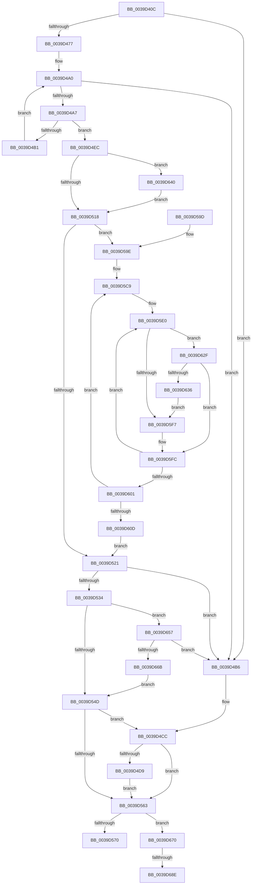

# KiForwardTick

- RVA: `0x0039D40C`–`0x0039D69A` (길이 `654` bytes)
- VA: `0x000000014039D40C`
- 실행 섹션: `.text`
- PDB 이름 있음: `예`; PDB Function 태그: `예`
- unwind 정보 RVA: `0x00081A78`
- 디코드: `159`개 명령, `654/654` bytes 표시
- 미해석 바이트: `0` (있으면 어셈블리에 `.byte`로 보존)

> 이 문서는 커널 이미지의 기계어와 PDB 기호를 분석해 생성했습니다. 4번과 5번은 함수 원형과 자료형을 바이너리 사용 방식에서 추정한 C 해석이며 원본 소스 복구 결과는 아닙니다.

## 1. Dependencies

- 직접 호출 지점: **15**; 고유 호출 대상: **13**
- 직접 호출자로 확인된 함수: **1**
- RIP 상대 이미지 참조: **15**

### Outgoing calls
- `0x0039D461` → [memset](../6C/memset_function_006C6C40.md) (function, `0x006C6C40`)
- `0x0039D48D` → [memset](../6C/memset_function_006C6C40.md) (function, `0x006C6C40`)
- `0x0039D497` → [PoCopyDeepIdleMask](../3C/PoCopyDeepIdleMask_function_003C04C8.md) (function, `0x003C04C8`)
- `0x0039D4C7` → [KiCopyAffinityEx](../2C/KiCopyAffinityEx_function_002CE860.md) (function, `0x002CE860`)
- `0x0039D4DE` → [HalRequestClockInterrupt](../2D/HalRequestClockInterrupt_function_002D14C0.md) (function, `0x002D14C0`)
- `0x0039D4F8` → [KiComplementAffinityEx](../3C/KiComplementAffinityEx_function_003C05E0.md) (function, `0x003C05E0`)
- `0x0039D50A` → [KeAndAffinityEx2](../3C/KeAndAffinityEx2_function_003C0740.md) (function, `0x003C0740`)
- `0x0039D52B` → [KeIsEqualAffinityEx](../30/KeIsEqualAffinityEx_function_00305230.md) (function, `0x00305230`)
- `0x0039D53B` → [KeRemoveProcessorAffinityEx](../30/KeRemoveProcessorAffinityEx_function_00304E10.md) (function, `0x00304E10`)
- `0x0039D556` → [KeIsEmptyAffinityEx](../2D/KeIsEmptyAffinityEx_function_002D1580.md) (function, `0x002D1580`)
- `0x0039D577` → [_security_check_cookie](../6A/_security_check_cookie_function_006AC640.md) (function, `0x006AC640`)
- `0x0039D5C4` → [memset](../6C/memset_function_006C6C40.md) (function, `0x006C6C40`)
- `0x0039D61D` → [KiOrAffinityEx](KiOrAffinityEx_function_0039A84C.md) (function, `0x0039A84C`)
- `0x0039D64D` → [KeOrAffinityEx2](../2C/KeOrAffinityEx2_function_002CF930.md) (function, `0x002CF930`)
- `0x0039D65A` → [KeCountSetBitsAffinityEx](../2C/KeCountSetBitsAffinityEx_function_002CE6E0.md) (function, `0x002CE6E0`)

### Direct callers
- [KiUpdateTime](KiUpdateTime_function_0039B530.md) at `0x0039B99A`

### Static image references
- `0x0039D42F` → RVA `0x00E0A740` (`.data`; read)
- `0x0039D46E` → RVA `0x00FC50DC` (`ALMOSTRO`; read)
- `0x0039D4BA` → RVA `0x00FC7120` (`ALMOSTRO`; read)
- `0x0039D4CC` → RVA `0x00FC6A85` (`ALMOSTRO`; read)
- `0x0039D4E3` → RVA `0x00E668B8` (`.data`; write)
- `0x0039D518` → RVA `0x00FC5030` (`ALMOSTRO`; read)
- `0x0039D563` → RVA `0x00F475F8` (`.data`; read)
- `0x0039D59E` → RVA `0x00E668B8` (`.data`; read)
- `0x0039D5CC` → RVA `0x00FC8528` (`ALMOSTRO`; read)
- `0x0039D604` → RVA `0x00FC5018` (`ALMOSTRO`; read)
- `0x0039D643` → RVA `0x00E0AFD0` (`.data`; read)
- `0x0039D65F` → RVA `0x00FC5320` (`ALMOSTRO`; read)
- `0x0039D670` → RVA `0x00E66810` (`.data`; read)
- `0x0039D676` → RVA `0x00E66808` (`.data`; write)
- `0x0039D67F` → RVA `0x00E66810` (`.data`; write)

## 2. Other-region calls and transfers

- 다른 실행 섹션으로 향하는 call: **0**
- call이 아닌 외부 분기/꼬리 이동: **2**
  - `0x0039D688` → [sub_006E5F76](../6E/Unknown_function_006E5F76.md) (`tail-transfer`)
  - `0x0039D695` → [sub_006E5F76](../6E/Unknown_function_006E5F76.md) (`tail-transfer`)

## 3. Assembly (complete function range)

```asm
0039D40C  48 8B C4                        mov rax, rsp
0039D40F  48 89 58 10                     mov qword ptr [rax + 0x10], rbx
0039D413  48 89 70 18                     mov qword ptr [rax + 0x18], rsi
0039D417  48 89 78 20                     mov qword ptr [rax + 0x20], rdi
0039D41B  55                              push rbp
0039D41C  41 54                           push r12
0039D41E  41 55                           push r13
0039D420  41 56                           push r14
0039D422  41 57                           push r15
0039D424  48 8D 68 88                     lea rbp, [rax - 0x78]
0039D428  48 81 EC 50 01 00 00            sub rsp, 0x150
0039D42F  48 8B 05 0A D3 A6 00            mov rax, qword ptr [rip + 0xa6d30a]
0039D436  48 33 C4                        xor rax, rsp
0039D439  48 89 45 40                     mov qword ptr [rbp + 0x40], rax
0039D43D  48 8B 9D A0 00 00 00            mov rbx, qword ptr [rbp + 0xa0]
0039D444  4D 8B E0                        mov r12, r8
0039D447  44 8B F2                        mov r14d, edx
0039D44A  89 54 24 20                     mov dword ptr [rsp + 0x20], edx
0039D44E  4C 8B E9                        mov r13, rcx
0039D451  33 D2                           xor edx, edx
0039D453  41 B8 00 01 00 00               mov r8d, 0x100
0039D459  48 8D 4C 24 38                  lea rcx, [rsp + 0x38]
0039D45E  41 8A F9                        mov dil, r9b
0039D461  E8 DA 97 32 00                  call 0x1406c6c40
0039D466  45 33 FF                        xor r15d, r15d
0039D469  BE 01 00 00 00                  mov esi, 1
0039D46E  83 3D 67 7C C2 00 02            cmp dword ptr [rip + 0xc27c67], 2
0039D475  74 3F                           je 0x14039d4b6
0039D477  33 D2                           xor edx, edx
0039D479  48 C7 44 24 30 01 00 20 00      mov qword ptr [rsp + 0x30], 0x200001
0039D482  41 B8 00 01 00 00               mov r8d, 0x100
0039D488  48 8D 4C 24 38                  lea rcx, [rsp + 0x38]
0039D48D  E8 AE 97 32 00                  call 0x1406c6c40
0039D492  48 8D 4C 24 30                  lea rcx, [rsp + 0x30]
0039D497  E8 2C 30 02 00                  call 0x1403c04c8
0039D49C  41 0F B7 CF                     movzx ecx, r15w
0039D4A0  66 3B 4C 24 30                  cmp cx, word ptr [rsp + 0x30]
0039D4A5  73 0F                           jae 0x14039d4b6
0039D4A7  0F B7 C1                        movzx eax, cx
0039D4AA  4C 39 7C C4 38                  cmp qword ptr [rsp + rax*8 + 0x38], r15
0039D4AF  75 3B                           jne 0x14039d4ec
0039D4B1  66 03 CE                        add cx, si
0039D4B4  EB EA                           jmp 0x14039d4a0
0039D4B6  0F B7 53 02                     movzx edx, word ptr [rbx + 2]
0039D4BA  4C 8D 05 5F 9C C2 00            lea r8, [rip + 0xc29c5f]
0039D4C1  48 8B CB                        mov rcx, rbx
0039D4C4  49 8B FF                        mov rdi, r15
0039D4C7  E8 94 13 F3 FF                  call 0x1402ce860
0039D4CC  44 38 3D B2 95 C2 00            cmp byte ptr [rip + 0xc295b2], r15b
0039D4D3  0F 85 8A 00 00 00               jne 0x14039d563
0039D4D9  48 8B D7                        mov rdx, rdi
0039D4DC  8B CE                           mov ecx, esi
0039D4DE  E8 DD 3F F3 FF                  call 0x1402d14c0
0039D4E3  44 89 25 CE 93 AC 00            mov dword ptr [rip + 0xac93ce], r12d
0039D4EA  EB 77                           jmp 0x14039d563
0039D4EC  0F B7 53 02                     movzx edx, word ptr [rbx + 2]
0039D4F0  4C 8D 44 24 30                  lea r8, [rsp + 0x30]
0039D4F5  48 8B CB                        mov rcx, rbx
0039D4F8  E8 E3 30 02 00                  call 0x1403c05e0
0039D4FD  4C 8B C3                        mov r8, rbx
0039D500  48 8D 15 19 9C C2 00            lea rdx, [rip + 0xc29c19]
0039D507  48 8B CB                        mov rcx, rbx
0039D50A  E8 31 32 02 00                  call 0x1403c0740
0039D50F  40 84 FF                        test dil, dil
0039D512  0F 85 28 01 00 00               jne 0x14039d640
0039D518  44 39 3D 11 7B C2 00            cmp dword ptr [rip + 0xc27b11], r15d
0039D51F  74 7D                           je 0x14039d59e
0039D521  48 8D 15 F8 9B C2 00            lea rdx, [rip + 0xc29bf8]
0039D528  48 8B CB                        mov rcx, rbx
0039D52B  E8 00 7D F6 FF                  call 0x140305230
0039D530  85 C0                           test eax, eax
0039D532  75 82                           jne 0x14039d4b6
0039D534  41 8B 55 24                     mov edx, dword ptr [r13 + 0x24]
0039D538  48 8B CB                        mov rcx, rbx
0039D53B  E8 D0 78 F6 FF                  call 0x140304e10
0039D540  44 39 3D 95 7B C2 00            cmp dword ptr [rip + 0xc27b95], r15d
0039D547  0F 85 0A 01 00 00               jne 0x14039d657
0039D54D  48 8B CB                        mov rcx, rbx
0039D550  41 8B F7                        mov esi, r15d
0039D553  48 8B FB                        mov rdi, rbx
0039D556  E8 25 40 F3 FF                  call 0x1402d1580
0039D55B  85 C0                           test eax, eax
0039D55D  0F 84 69 FF FF FF               je 0x14039d4cc
0039D563  44 38 3D 8E A0 BA 00            cmp byte ptr [rip + 0xbaa08e], r15b
0039D56A  0F 85 00 01 00 00               jne 0x14039d670
0039D570  48 8B 4D 40                     mov rcx, qword ptr [rbp + 0x40]
0039D574  48 33 CC                        xor rcx, rsp
0039D577  E8 C4 F0 30 00                  call 0x1406ac640
0039D57C  4C 8D 9C 24 50 01 00 00         lea r11, [rsp + 0x150]
0039D584  49 8B 5B 38                     mov rbx, qword ptr [r11 + 0x38]
0039D588  49 8B 73 40                     mov rsi, qword ptr [r11 + 0x40]
0039D58C  49 8B 7B 48                     mov rdi, qword ptr [r11 + 0x48]
0039D590  49 8B E3                        mov rsp, r11
0039D593  41 5F                           pop r15
0039D595  41 5E                           pop r14
0039D597  41 5D                           pop r13
0039D599  41 5C                           pop r12
0039D59B  5D                              pop rbp
0039D59C  C3                              ret
0039D59D  CC                              int3
0039D59E  44 8B 3D 13 93 AC 00            mov r15d, dword ptr [rip + 0xac9313]
0039D5A5  48 8D 4C 24 38                  lea rcx, [rsp + 0x38]
0039D5AA  33 C0                           xor eax, eax
0039D5AC  45 0F B6 F4                     movzx r14d, r12b
0039D5B0  33 D2                           xor edx, edx
0039D5B2  48 C7 44 24 30 01 00 20 00      mov qword ptr [rsp + 0x30], 0x200001
0039D5BB  41 B8 00 01 00 00               mov r8d, 0x100
0039D5C1  0F B7 F8                        movzx edi, ax
0039D5C4  E8 77 96 32 00                  call 0x1406c6c40
0039D5C9  0F B7 D7                        movzx edx, di
0039D5CC  4C 8D 0D 55 AF C2 00            lea r9, [rip + 0xc2af55]
0039D5D3  8B C2                           mov eax, edx
0039D5D5  41 8D 4F FF                     lea ecx, [r15 - 1]
0039D5D9  48 03 C0                        add rax, rax
0039D5DC  4D 8B 0C C1                     mov r9, qword ptr [r9 + rax*8]
0039D5E0  8D 41 01                        lea eax, [rcx + 1]
0039D5E3  0F B6 C8                        movzx ecx, al
0039D5E6  8B C1                           mov eax, ecx
0039D5E8  48 C1 E0 06                     shl rax, 6
0039D5EC  4E 8B 04 08                     mov r8, qword ptr [rax + r9]
0039D5F0  66 39 7C 24 30                  cmp word ptr [rsp + 0x30], di
0039D5F5  76 38                           jbe 0x14039d62f
0039D5F7  4C 09 44 D4 38                  or qword ptr [rsp + rdx*8 + 0x38], r8
0039D5FC  41 3B CE                        cmp ecx, r14d
0039D5FF  75 DF                           jne 0x14039d5e0
0039D601  66 03 FE                        add di, si
0039D604  66 3B 3D 0D 7A C2 00            cmp di, word ptr [rip + 0xc27a0d]
0039D60B  72 BC                           jb 0x14039d5c9
0039D60D  44 0F B7 4B 02                  movzx r9d, word ptr [rbx + 2]
0039D612  48 8D 54 24 30                  lea rdx, [rsp + 0x30]
0039D617  4C 8B C3                        mov r8, rbx
0039D61A  48 8B CB                        mov rcx, rbx
0039D61D  E8 2A D2 FF FF                  call 0x14039a84c
0039D622  44 8B 74 24 20                  mov r14d, dword ptr [rsp + 0x20]
0039D627  45 33 FF                        xor r15d, r15d
0039D62A  E9 F2 FE FF FF                  jmp 0x14039d521
0039D62F  66 39 7C 24 32                  cmp word ptr [rsp + 0x32], di
0039D634  76 C6                           jbe 0x14039d5fc
0039D636  8D 04 3E                        lea eax, [rsi + rdi]
0039D639  66 89 44 24 30                  mov word ptr [rsp + 0x30], ax
0039D63E  EB B7                           jmp 0x14039d5f7
0039D640  4C 8B C3                        mov r8, rbx
0039D643  48 8D 15 86 D9 A6 00            lea rdx, [rip + 0xa6d986]
0039D64A  48 8B CB                        mov rcx, rbx
0039D64D  E8 DE 22 F3 FF                  call 0x1402cf930
0039D652  E9 C1 FE FF FF                  jmp 0x14039d518
0039D657  48 8B CB                        mov rcx, rbx
0039D65A  E8 81 10 F3 FF                  call 0x1402ce6e0
0039D65F  3B 05 BB 7C C2 00               cmp eax, dword ptr [rip + 0xc27cbb]
0039D665  0F 87 4B FE FF FF               ja 0x14039d4b6
0039D66B  E9 DD FE FF FF                  jmp 0x14039d54d
0039D670  8B 15 9A 91 AC 00               mov edx, dword ptr [rip + 0xac919a]
0039D676  89 15 8C 91 AC 00               mov dword ptr [rip + 0xac918c], edx
0039D67C  8D 42 01                        lea eax, [rdx + 1]
0039D67F  89 05 8B 91 AC 00               mov dword ptr [rip + 0xac918b], eax
0039D685  41 3B C6                        cmp eax, r14d
0039D688  0F 82 E8 88 34 00               jb 0x1406e5f76
0039D68E  44 89 3D 7B 91 AC 00            mov dword ptr [rip + 0xac917b], r15d
0039D695  E9 DC 88 34 00                  jmp 0x1406e5f76
```

## 4. C-style interpretation (structured pseudocode)

```c
__int64 __fastcall KiForwardTick(__int64 a1, int a2, __int64 a3, unsigned __int8 a4)
{
    __int64 result;
    __int64 v_r15;
    __int64 v_rdi;
    __int64 v_rsp;
    unsigned __int64 v_stack_m118;
    unsigned __int16 v_stack_m11E;
    unsigned __int64 v_stack_m120;
    unsigned int v_stack_m130;
    unsigned __int64 v_stack_m140;
    unsigned __int64 v_stack_m148;
    unsigned int v_stack_m158;
    unsigned __int64 v_stack_m28;

    *(unsigned __int64 *)(v_rsp + 16) = v_rbx;
    *(unsigned __int64 *)(v_rsp + 24) = v_rsi;
    *(unsigned __int64 *)(v_rsp + 32) = v_rdi;
    v_rsp = (v_rsp) - (336);
    result = (*(unsigned __int64 *)(v_rip + 10933002)) ^ (v_rsp);
    *(unsigned __int64 *)(v_rsp - 120 + 64) = result;
    v_stack_m158 = a2;
    a2 = 0;
    result = memset(v_stack_m140, a2, 256, a4);
    v_r15 = 0;
    if ((*(unsigned int *)(v_rip + 12745831)) == 2) goto loc_0039D4B6;
    a2 = 0;
    v_stack_m148 = 0x200001ULL;
    result = memset(v_stack_m140, a2, 256, a4);
    result = PoCopyDeepIdleMask(v_stack_m148, a2, 256, a4);
loc_0039D4A0:
    if (0 >= v_stack_m148) goto loc_0039D4B6;
    if ((*(unsigned __int64 *)(v_rsp + 0 * 8 + 56)) != 0) goto loc_0039D4EC;
    a1 = (unsigned __int16)((0) + (1));
    goto loc_0039D4A0;
loc_0039D4B6:
    result = KiCopyAffinityEx(*(unsigned __int64 *)(v_rsp - 120 + 160), *(unsigned __int16 *)(*(unsigned __int64 *)(v_rsp - 120 + 160) + 2), v_rip + 12754015, a4);
loc_0039D4CC:
    if ((*(unsigned __int8 *)(v_rip + 12752306)) != 0) goto loc_0039D563;
    result = HalRequestClockInterrupt(1, 0, v_rip + 12754015, a4);
    *(unsigned int *)(v_rip + 11310030) = (unsigned int)(a3);
    goto loc_0039D563;
loc_0039D4EC:
    result = KiComplementAffinityEx(*(unsigned __int64 *)(v_rsp - 120 + 160), *(unsigned __int16 *)(*(unsigned __int64 *)(v_rsp - 120 + 160) + 2), v_stack_m148, a4);
    result = KeAndAffinityEx2(*(unsigned __int64 *)(v_rsp - 120 + 160), v_rip + 12753945, *(unsigned __int64 *)(v_rsp - 120 + 160), a4);
    if (0 != 0) goto loc_0039D640;
loc_0039D518:
    if ((*(unsigned int *)(v_rip + 12745489)) == 0) goto loc_0039D59E;
loc_0039D521:
    result = KeIsEqualAffinityEx(*(unsigned __int64 *)(v_rsp - 120 + 160), v_rip + 12753912, *(unsigned __int64 *)(v_rsp - 120 + 160), a4);
    if ((unsigned int)(result) != 0) goto loc_0039D4B6;
    result = KeRemoveProcessorAffinityEx(*(unsigned __int64 *)(v_rsp - 120 + 160), (unsigned int)(*(unsigned int *)(a1 + 36)), *(unsigned __int64 *)(v_rsp - 120 + 160), a4);
    if ((*(unsigned int *)(v_rip + 12745621)) != 0) goto loc_0039D657;
loc_0039D54D:
    result = KeIsEmptyAffinityEx(*(unsigned __int64 *)(v_rsp - 120 + 160), (unsigned int)(*(unsigned int *)(a1 + 36)), *(unsigned __int64 *)(v_rsp - 120 + 160), a4);
    if ((unsigned int)(result) == 0) goto loc_0039D4CC;
loc_0039D563:
    if ((*(unsigned __int8 *)(v_rip + 12230798)) != 0) goto loc_0039D670;
    a1 = (*(unsigned __int64 *)(v_rsp - 120 + 64)) ^ (v_rsp);
    result = _security_check_cookie(a1, (unsigned int)(*(unsigned int *)(a1 + 36)), *(unsigned __int64 *)(v_rsp - 120 + 160), a4);
    return result;
loc_0039D59E:
    result = 0;
    a2 = 0;
    v_stack_m120 = 0x200001ULL;
    result = memset(v_stack_m118, a2, 256, a4);
loc_0039D5C9:
    result = (0) + (0);
loc_0039D5E0:
    result = ((unsigned int)((unsigned int)((unsigned __int8)((unsigned int)(*(unsigned int *)(v_rip + 11309843)) - 1 + 1)))) << (6);
    if (v_stack_m120 <= 0) goto loc_0039D62F;
loc_0039D5F7:
loc_0039D5FC:
    if (((unsigned int)((unsigned __int8)((unsigned int)(*(unsigned int *)(v_rip + 11309843)) - 1 + 1))) != ((unsigned int)((unsigned __int8)(a3)))) goto loc_0039D5E0;
    v_rdi = (unsigned __int16)((0) + ((unsigned __int16)(*(unsigned __int64 *)(v_stack_m28 + 64))));
    if (((unsigned __int16)(v_rdi)) < (*(unsigned __int16 *)(v_rip + 12745229))) goto loc_0039D5C9;
    result = KiOrAffinityEx(*(unsigned __int64 *)(v_stack_m28 + 56), v_stack_m120, *(unsigned __int64 *)(v_stack_m28 + 56), *(unsigned __int16 *)(*(unsigned __int64 *)(v_stack_m28 + 56) + 2));
    v_r15 = 0;
    goto loc_0039D521;
loc_0039D62F:
    if (v_stack_m11E <= ((unsigned __int16)(v_rdi))) goto loc_0039D5FC;
    v_stack_m120 = (unsigned __int16)(*(unsigned __int64 *)(v_stack_m28 + 64) + v_rdi * 1);
    goto loc_0039D5F7;
loc_0039D640:
    result = KeOrAffinityEx2(*(unsigned __int64 *)(v_stack_m28 + 56), v_rip + 10934662, *(unsigned __int64 *)(v_stack_m28 + 56), *(unsigned __int16 *)(*(unsigned __int64 *)(v_stack_m28 + 56) + 2));
    goto loc_0039D518;
loc_0039D657:
    result = KeCountSetBitsAffinityEx(*(unsigned __int64 *)(v_stack_m28 + 56), v_rip + 10934662, *(unsigned __int64 *)(v_stack_m28 + 56), *(unsigned __int16 *)(*(unsigned __int64 *)(v_stack_m28 + 56) + 2));
    if (((unsigned int)(result)) > (*(unsigned int *)(v_rip + 12745915))) goto loc_0039D4B6;
    goto loc_0039D54D;
loc_0039D670:
    *(unsigned int *)(v_rip + 11309452) = (unsigned int)((unsigned int)(*(unsigned int *)(v_rip + 11309466)));
    *(unsigned int *)(v_rip + 11309451) = (unsigned int)((unsigned int)(*(unsigned int *)(v_rip + 11309466)) + 1);
    *(unsigned int *)(v_rip + 11309435) = 0;
}
```

## 5. (Beta) C Style

```c
int64_t KiForwardTick(void *Arg1, int32_t Arg2, int64_t Arg3, uint8_t Arg4)
{
    uint8_t *arg1 = (uint8_t *)Arg1;

    int64_t result;
    int64_t local_r15;
    int64_t local_rdi;
    int64_t local_rsp;
    uint64_t v_stack_m118;
    uint16_t v_stack_m11E;
    uint64_t v_stack_m120;
    uint32_t v_stack_m130;
    uint64_t v_stack_m140;
    uint64_t v_stack_m148;
    uint32_t v_stack_m158;
    uint64_t v_stack_m28;

    *(uint64_t *)(local_rsp + 0x10) = local_rbx;
    *(uint64_t *)(local_rsp + 0x18) = local_rsi;
    *(uint64_t *)(local_rsp + 0x20) = local_rdi;
    local_rsp = (local_rsp) - (336);
    result = (*(uint64_t *)(v_rip + 0xA6D30A)) ^ (local_rsp);
    *(uint64_t *)(local_rsp - 0x78 + 0x40) = result;
    v_stack_m158 = Arg2;
    Arg2 = 0;
    result = memset(v_stack_m140, Arg2, 256, Arg4);
    local_r15 = 0;
    if ((*(uint32_t *)(v_rip + 0xC27C67)) == 2) goto loc_0039D4B6;
    Arg2 = 0;
    v_stack_m148 = 0x200001ULL;
    result = memset(v_stack_m140, Arg2, 256, Arg4);
    result = PoCopyDeepIdleMask(v_stack_m148, Arg2, 256, Arg4);
loc_0039D4A0:
    if (0 >= v_stack_m148) goto loc_0039D4B6;
    if ((*(uint64_t *)(local_rsp + 0x0 * 8 + 0x38)) != 0) goto loc_0039D4EC;
    Arg1 = (uint16_t)((0) + (1));
    goto loc_0039D4A0;
loc_0039D4B6:
    result = KiCopyAffinityEx(*(uint64_t *)(local_rsp - 0x78 + 0xA0), *(uint16_t *)(*(uint64_t *)(local_rsp - 0x78 + 0xA0) + 0x2), v_rip + 12754015, Arg4);
loc_0039D4CC:
    if ((*(uint8_t *)(v_rip + 0xC295B2)) != 0) goto loc_0039D563;
    result = HalRequestClockInterrupt(1, 0, v_rip + 12754015, Arg4);
    *(uint32_t *)(v_rip + 0xAC93CE) = (uint32_t)(Arg3);
    goto loc_0039D563;
loc_0039D4EC:
    result = KiComplementAffinityEx(*(uint64_t *)(local_rsp - 0x78 + 0xA0), *(uint16_t *)(*(uint64_t *)(local_rsp - 0x78 + 0xA0) + 0x2), v_stack_m148, Arg4);
    result = KeAndAffinityEx2(*(uint64_t *)(local_rsp - 0x78 + 0xA0), v_rip + 12753945, *(uint64_t *)(local_rsp - 0x78 + 0xA0), Arg4);
    if (0 != 0) goto loc_0039D640;
loc_0039D518:
    if ((*(uint32_t *)(v_rip + 0xC27B11)) == 0) goto loc_0039D59E;
loc_0039D521:
    result = KeIsEqualAffinityEx(*(uint64_t *)(local_rsp - 0x78 + 0xA0), v_rip + 12753912, *(uint64_t *)(local_rsp - 0x78 + 0xA0), Arg4);
    if ((uint32_t)(result) != 0) goto loc_0039D4B6;
    result = KeRemoveProcessorAffinityEx(*(uint64_t *)(local_rsp - 0x78 + 0xA0), (uint32_t)(*(uint32_t *)(arg1 + 0x24)), *(uint64_t *)(local_rsp - 0x78 + 0xA0), Arg4);
    if ((*(uint32_t *)(v_rip + 0xC27B95)) != 0) goto loc_0039D657;
loc_0039D54D:
    result = KeIsEmptyAffinityEx(*(uint64_t *)(local_rsp - 0x78 + 0xA0), (uint32_t)(*(uint32_t *)(arg1 + 0x24)), *(uint64_t *)(local_rsp - 0x78 + 0xA0), Arg4);
    if ((uint32_t)(result) == 0) goto loc_0039D4CC;
loc_0039D563:
    if ((*(uint8_t *)(v_rip + 0xBAA08E)) != 0) goto loc_0039D670;
    Arg1 = (*(uint64_t *)(local_rsp - 0x78 + 0x40)) ^ (local_rsp);
    result = _security_check_cookie(Arg1, (uint32_t)(*(uint32_t *)(arg1 + 0x24)), *(uint64_t *)(local_rsp - 0x78 + 0xA0), Arg4);
    return result;
loc_0039D59E:
    result = 0;
    Arg2 = 0;
    v_stack_m120 = 0x200001ULL;
    result = memset(v_stack_m118, Arg2, 256, Arg4);
loc_0039D5C9:
    result = (0) + (0);
loc_0039D5E0:
    result = ((uint32_t)((uint32_t)((uint8_t)((uint32_t)(*(uint32_t *)(v_rip + 0xAC9313)) - 1 + 1)))) << (6);
    if (v_stack_m120 <= 0) goto loc_0039D62F;
loc_0039D5F7:
loc_0039D5FC:
    if (((uint32_t)((uint8_t)((uint32_t)(*(uint32_t *)(v_rip + 0xAC9313)) - 1 + 1))) != ((uint32_t)((uint8_t)(Arg3)))) goto loc_0039D5E0;
    local_rdi = (uint16_t)((0) + ((uint16_t)(*(uint64_t *)(v_stack_m28 + 0x40))));
    if (((uint16_t)(local_rdi)) < (*(uint16_t *)(v_rip + 0xC27A0D))) goto loc_0039D5C9;
    result = KiOrAffinityEx(*(uint64_t *)(v_stack_m28 + 0x38), v_stack_m120, *(uint64_t *)(v_stack_m28 + 0x38), *(uint16_t *)(*(uint64_t *)(v_stack_m28 + 0x38) + 0x2));
    local_r15 = 0;
    goto loc_0039D521;
loc_0039D62F:
    if (v_stack_m11E <= ((uint16_t)(local_rdi))) goto loc_0039D5FC;
    v_stack_m120 = (uint16_t)(*(uint64_t *)(v_stack_m28 + 0x40) + local_rdi * 1);
    goto loc_0039D5F7;
loc_0039D640:
    result = KeOrAffinityEx2(*(uint64_t *)(v_stack_m28 + 0x38), v_rip + 10934662, *(uint64_t *)(v_stack_m28 + 0x38), *(uint16_t *)(*(uint64_t *)(v_stack_m28 + 0x38) + 0x2));
    goto loc_0039D518;
loc_0039D657:
    result = KeCountSetBitsAffinityEx(*(uint64_t *)(v_stack_m28 + 0x38), v_rip + 10934662, *(uint64_t *)(v_stack_m28 + 0x38), *(uint16_t *)(*(uint64_t *)(v_stack_m28 + 0x38) + 0x2));
    if (((uint32_t)(result)) > (*(uint32_t *)(v_rip + 0xC27CBB))) goto loc_0039D4B6;
    goto loc_0039D54D;
loc_0039D670:
    *(uint32_t *)(v_rip + 0xAC918C) = (uint32_t)((uint32_t)(*(uint32_t *)(v_rip + 0xAC919A)));
    *(uint32_t *)(v_rip + 0xAC918B) = (uint32_t)((uint32_t)(*(uint32_t *)(v_rip + 0xAC919A)) + 1);
    *(uint32_t *)(v_rip + 0xAC917B) = 0;
}
```

### 관측된 메모리 오프셋

구조체 형식이 확인되지 않은 접근은 인자 기준의 오프셋으로만 기록했습니다.

| 기준 인자 | 오프셋 표현 | 폭 (bit) | 접근 |
|---|---:|---:|---|
| `Arg1` | `+ 0x24` | `32` | `R` |

## 6. Execution-region graph

[열기: 2D/3D 그래프와 함수 탐색 컨트롤 패널](../../../control-panel.html?section=text&rva=0x0039D40C&view=graph)

- 2D 그래프는 위에서 아래로 흐르고, 3D 그래프는 빈 공간을 드래그해 회전합니다. Shift+드래그는 이동, 휠은 확대·축소, 함수 노드 선택은 대상 보고서 이동입니다.

### Static fallback


