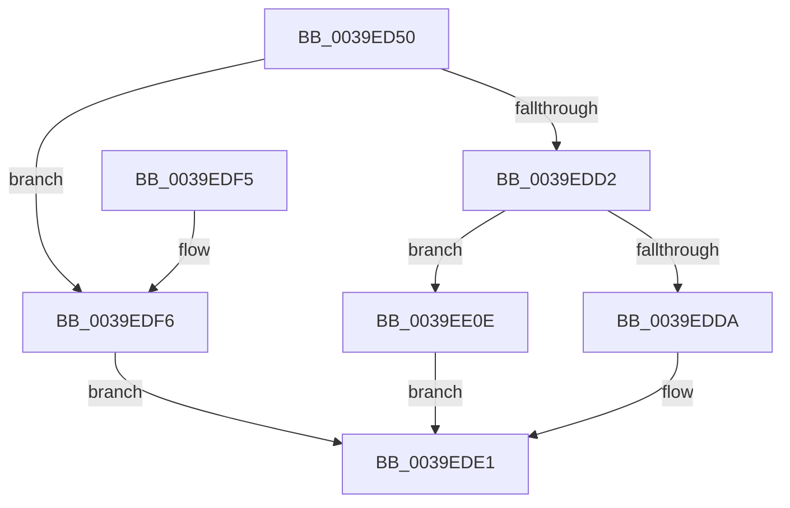

# KiGenerateHeteroSets

- RVA: `0x0039ED50`–`0x0039EE16` (길이 `198` bytes)
- VA: `0x000000014039ED50`
- 실행 섹션: `.text`
- PDB 이름 있음: `예`; PDB Function 태그: `아니요`
- unwind 정보 RVA: `0x00069370`
- 디코드: `55`개 명령, `198/198` bytes 표시
- 미해석 바이트: `0` (있으면 어셈블리에 `.byte`로 보존)

> 이 문서는 커널 이미지의 기계어와 PDB 기호를 분석해 생성했습니다. 4번과 5번은 함수 원형과 자료형을 바이너리 사용 방식에서 추정한 C 해석이며 원본 소스 복구 결과는 아닙니다.

## 1. Dependencies

- 직접 호출 지점: **0**; 고유 호출 대상: **0**
- 직접 호출자로 확인된 함수: **5**
- RIP 상대 이미지 참조: **0**

### Outgoing calls
- 직접 디코드된 call 명령이 없습니다.

### Direct callers
- [KiHeteroSelectIdleProcessorFromSubNode](../25/KiHeteroSelectIdleProcessorFromSubNode_function_00255504.md) at `0x00255578`
- [KiCheckPreferredHeteroProcessor](KiCheckPreferredHeteroProcessor_function_0039D72C.md) at `0x0039D7FB`
- [KiTallyHeteroSoftParkElectionVotes](KiTallyHeteroSoftParkElectionVotes_function_0039E5B8.md) at `0x0039E728`
- [KiHeteroAttemptPreemptionSwapOnSubNode](../3C/KiHeteroAttemptPreemptionSwapOnSubNode_function_003C1144.md) at `0x003C11CE`
- [KiEvaluatePreemptionSwapTarget](../3C/KiEvaluatePreemptionSwapTarget_function_003C1624.md) at `0x003C1745`

### Static image references
- 디코드된 RIP-relative 메모리 참조가 없습니다.

## 2. Other-region calls and transfers

- 다른 실행 섹션으로 향하는 call: **0**
- 별도 외부 분기/꼬리 이동을 확인하지 못했습니다.

## 3. Assembly (complete function range)

```asm
0039ED50  40 53                           push rbx
0039ED52  48 83 EC 20                     sub rsp, 0x20
0039ED56  8B 44 24 50                     mov eax, dword ptr [rsp + 0x50]
0039ED5A  48 8B D9                        mov rbx, rcx
0039ED5D  4C 8B DA                        mov r11, rdx
0039ED60  46 8D 14 48                     lea r10d, [rax + r9*2]
0039ED64  0F B6 81 B9 00 00 00            movzx eax, byte ptr [rcx + 0xb9]
0039ED6B  44 0F AF D0                     imul r10d, eax
0039ED6F  41 0F B6 C0                     movzx eax, r8b
0039ED73  44 03 D0                        add r10d, eax
0039ED76  48 8B 81 C0 00 00 00            mov rax, qword ptr [rcx + 0xc0]
0039ED7D  4F 8D 04 52                     lea r8, [r10 + r10*2]
0039ED81  4E 8D 0C C0                     lea r9, [rax + r8*8]
0039ED85  4A 8B 44 C0 10                  mov rax, qword ptr [rax + r8*8 + 0x10]
0039ED8A  49 8B 49 08                     mov rcx, qword ptr [r9 + 8]
0039ED8E  48 23 C8                        and rcx, rax
0039ED91  48 89 44 24 10                  mov qword ptr [rsp + 0x10], rax
0039ED96  49 8B 01                        mov rax, qword ptr [r9]
0039ED99  F2 0F 10 4C 24 10               movsd xmm1, qword ptr [rsp + 0x10]
0039ED9F  48 23 C1                        and rax, rcx
0039EDA2  48 89 04 24                     mov qword ptr [rsp], rax
0039EDA6  48 89 4C 24 08                  mov qword ptr [rsp + 8], rcx
0039EDAB  48 8B 4C 24 58                  mov rcx, qword ptr [rsp + 0x58]
0039EDB0  0F 10 04 24                     movups xmm0, xmmword ptr [rsp]
0039EDB4  0F 11 01                        movups xmmword ptr [rcx], xmm0
0039EDB7  F2 0F 11 49 10                  movsd qword ptr [rcx + 0x10], xmm1
0039EDBC  48 8B 01                        mov rax, qword ptr [rcx]
0039EDBF  4C 8B 49 10                     mov r9, qword ptr [rcx + 0x10]
0039EDC3  48 23 C2                        and rax, rdx
0039EDC6  48 8B 51 08                     mov rdx, qword ptr [rcx + 8]
0039EDCA  49 23 D3                        and rdx, r11
0039EDCD  4D 23 CB                        and r9, r11
0039EDD0  74 24                           je 0x14039edf6
0039EDD2  45 33 C0                        xor r8d, r8d
0039EDD5  48 85 D2                        test rdx, rdx
0039EDD8  74 34                           je 0x14039ee0e
0039EDDA  48 85 C0                        test rax, rax
0039EDDD  48 0F 44 C2                     cmove rax, rdx
0039EDE1  48 89 01                        mov qword ptr [rcx], rax
0039EDE4  41 8B C0                        mov eax, r8d
0039EDE7  48 89 51 08                     mov qword ptr [rcx + 8], rdx
0039EDEB  4C 89 49 10                     mov qword ptr [rcx + 0x10], r9
0039EDEF  48 83 C4 20                     add rsp, 0x20
0039EDF3  5B                              pop rbx
0039EDF4  C3                              ret
0039EDF5  CC                              int3
0039EDF6  4C 8B 8B 80 00 00 00            mov r9, qword ptr [rbx + 0x80]
0039EDFD  41 B8 01 00 00 00               mov r8d, 1
0039EE03  4D 23 CB                        and r9, r11
0039EE06  49 8B D1                        mov rdx, r9
0039EE09  49 8B C1                        mov rax, r9
0039EE0C  EB D3                           jmp 0x14039ede1
0039EE0E  49 8B D1                        mov rdx, r9
0039EE11  49 8B C1                        mov rax, r9
0039EE14  EB CB                           jmp 0x14039ede1
```

## 4. C-style interpretation (structured pseudocode)

```c
__int64 __fastcall KiGenerateHeteroSets(__int64 a1, __int64 a2, unsigned __int8 a3, __int64 a4, unsigned int a5, __int64 a6)
{
    __int64 result;
    __int64 v_r10;
    __int64 v_rsp;
    unsigned __int64 v_stack_m18;
    unsigned __int64 v_stack_m20;
    unsigned __int64 v_stack_m28;

    v_rsp = (v_rsp) - (32);
    v_r10 = (unsigned int)(((unsigned int)(a5) + a4 * 2) * ((unsigned int)(*(unsigned __int8 *)(a1 + 185))));
    v_r10 = (unsigned int)((v_r10) + (a3));
    a1 = (*(unsigned __int64 *)(*(unsigned __int64 *)(a1 + 192) + v_r10 + v_r10 * 2 * 8 + 8)) & (*(unsigned __int64 *)(*(unsigned __int64 *)(a1 + 192) + v_r10 + v_r10 * 2 * 8 + 16));
    v_stack_m18 = *(unsigned __int64 *)(*(unsigned __int64 *)(a1 + 192) + v_r10 + v_r10 * 2 * 8 + 16);
    result = (*(unsigned __int64 *)(*(unsigned __int64 *)(a1 + 192) + v_r10 + v_r10 * 2 * 8)) & (a1);
    v_stack_m28 = result;
    v_stack_m20 = a1;
    *(unsigned __int64 *)(a6) = v_xmm0;
    *(unsigned __int64 *)(a6 + 16) = v_xmm1;
    result = (*(unsigned __int64 *)(a6)) & (a2);
    a2 = (*(unsigned __int64 *)(a6 + 8)) & (a2);
    a4 = (*(unsigned __int64 *)(a6 + 16)) & (a2);
    if (condition_is_equal) goto loc_0039EDF6;
    a3 = 0;
    if (a2 == 0) goto loc_0039EE0E;
    if (result == 0) { result = a2; }
loc_0039EDE1:
    *(unsigned __int64 *)(a6) = result;
    *(unsigned __int64 *)(a6 + 8) = a2;
    *(unsigned __int64 *)(a6 + 16) = a4;
    v_rsp = (v_rsp) + (32);
    return 0;
loc_0039EDF6:
    a4 = (*(unsigned __int64 *)(a1 + 128)) & (a2);
    goto loc_0039EDE1;
loc_0039EE0E:
    goto loc_0039EDE1;
}
```

## 5. (Beta) C Style

```c
int64_t KiGenerateHeteroSets(void *Arg1, int64_t Arg2, uint8_t Arg3, int64_t Arg4, void *Arg5, void *Arg6)
{
    uint8_t *arg1 = (uint8_t *)Arg1;
    uint8_t *arg5 = (uint8_t *)Arg5;
    uint8_t *arg6 = (uint8_t *)Arg6;

    int64_t result;
    int64_t local_r10;
    int64_t local_rsp;
    uint64_t v_stack_m18;
    uint64_t v_stack_m20;
    uint64_t v_stack_m28;

    local_rsp = (local_rsp) - (32);
    local_r10 = (uint32_t)(((uint32_t)(Arg5) + Arg4 * 2) * ((uint32_t)(*(uint8_t *)(arg1 + 0xB9))));
    local_r10 = (uint32_t)((local_r10) + (Arg3));
    Arg1 = (*(uint64_t *)(*(uint64_t *)(arg1 + 0xC0) + local_r10 + local_r10 * 2 * 8 + 0x8)) & (*(uint64_t *)(*(uint64_t *)(arg1 + 0xC0) + local_r10 + local_r10 * 2 * 8 + 0x10));
    v_stack_m18 = *(uint64_t *)(*(uint64_t *)(arg1 + 0xC0) + local_r10 + local_r10 * 2 * 8 + 0x10);
    result = (*(uint64_t *)(*(uint64_t *)(arg1 + 0xC0) + local_r10 + local_r10 * 2 * 8)) & (Arg1);
    v_stack_m28 = result;
    v_stack_m20 = Arg1;
    *(uint64_t *)(arg6) = v_xmm0;
    *(uint64_t *)(arg6 + 0x10) = v_xmm1;
    result = (*(uint64_t *)(arg6)) & (Arg2);
    Arg2 = (*(uint64_t *)(arg6 + 0x8)) & (Arg2);
    Arg4 = (*(uint64_t *)(arg6 + 0x10)) & (Arg2);
    if (condition_is_equal) goto loc_0039EDF6;
    Arg3 = 0;
    if (Arg2 == 0) goto loc_0039EE0E;
    if (result == 0) { result = Arg2; }
loc_0039EDE1:
    *(uint64_t *)(arg6) = result;
    *(uint64_t *)(arg6 + 0x8) = Arg2;
    *(uint64_t *)(arg6 + 0x10) = Arg4;
    local_rsp = (local_rsp) + (32);
    return 0;
loc_0039EDF6:
    Arg4 = (*(uint64_t *)(arg1 + 0x80)) & (Arg2);
    goto loc_0039EDE1;
loc_0039EE0E:
    goto loc_0039EDE1;
}
```

### 관측된 메모리 오프셋

구조체 형식이 확인되지 않은 접근은 인자 기준의 오프셋으로만 기록했습니다.

| 기준 인자 | 오프셋 표현 | 폭 (bit) | 접근 |
|---|---:|---:|---|
| `Arg1` | `+ 0x80` | `64` | `R` |
| `Arg1` | `+ 0xB9` | `8` | `R` |
| `Arg1` | `+ 0xC0` | `64` | `R` |
| `Arg5` | `+ 0x0 + r10*2` | `64` | `R` |
| `Arg5` | `+ 0x0 + r9*2` | `32` | `R` |
| `Arg6` | `+ 0x0` | `64` | `R` |
| `Arg6` | `+ 0x0` | `64` | `W` |
| `Arg6` | `+ 0x0` | `128` | `R` |
| `Arg6` | `+ 0x8` | `64` | `R` |
| `Arg6` | `+ 0x8` | `64` | `W` |
| `Arg6` | `+ 0x10` | `64` | `R` |
| `Arg6` | `+ 0x10` | `64` | `W` |

## 6. Execution-region graph

[열기: 2D/3D 그래프와 함수 탐색 컨트롤 패널](../../../control-panel.html?section=text&rva=0x0039ED50&view=graph)

- 2D 그래프는 위에서 아래로 흐르고, 3D 그래프는 빈 공간을 드래그해 회전합니다. Shift+드래그는 이동, 휠은 확대·축소, 함수 노드 선택은 대상 보고서 이동입니다.

### Static fallback


