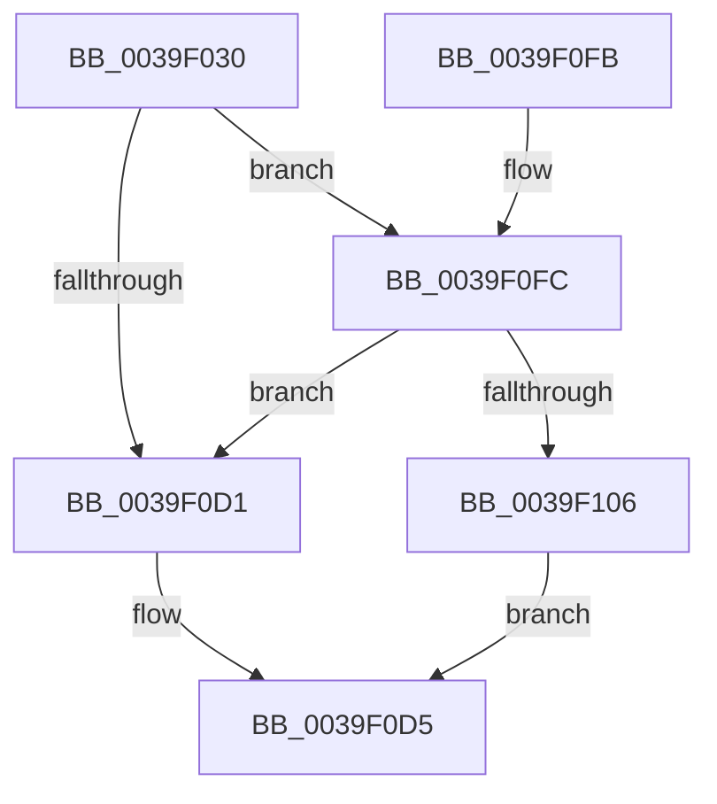

# KiHeteroComputeThreadWorkloadProperties

- RVA: `0x0039F030`–`0x0039F112` (길이 `226` bytes)
- VA: `0x000000014039F030`
- 실행 섹션: `.text`
- PDB 이름 있음: `예`; PDB Function 태그: `아니요`
- unwind 정보 RVA: `0x00081C5C`
- 디코드: `57`개 명령, `226/226` bytes 표시
- 미해석 바이트: `0` (있으면 어셈블리에 `.byte`로 보존)

> 이 문서는 커널 이미지의 기계어와 PDB 기호를 분석해 생성했습니다. 4번과 5번은 함수 원형과 자료형을 바이너리 사용 방식에서 추정한 C 해석이며 원본 소스 복구 결과는 아닙니다.

## 1. Dependencies

- 직접 호출 지점: **1**; 고유 호출 대상: **1**
- 직접 호출자로 확인된 함수: **1**
- RIP 상대 이미지 참조: **5**

### Outgoing calls
- `0x0039F0F0` → [_security_check_cookie](../6A/_security_check_cookie_function_006AC640.md) (function, `0x006AC640`)

### Direct callers
- [KiCheckPreferredHeteroProcessor](KiCheckPreferredHeteroProcessor_function_0039D72C.md) at `0x0039D7AB`

### Static image references
- `0x0039F036` → RVA `0x00E0A740` (`.data`; read)
- `0x0039F081` → RVA `0x00FC537C` (`ALMOSTRO`; read)
- `0x0039F088` → RVA `0x00FC5460` (`ALMOSTRO`; read)
- `0x0039F0C7` → RVA `0x00FC6D14` (`ALMOSTRO`; read)
- `0x0039F0FC` → RVA `0x00FC6D10` (`ALMOSTRO`; read)

## 2. Other-region calls and transfers

- 다른 실행 섹션으로 향하는 call: **0**
- 별도 외부 분기/꼬리 이동을 확인하지 못했습니다.

## 3. Assembly (complete function range)

```asm
0039F030  40 53                           push rbx
0039F032  48 83 EC 20                     sub rsp, 0x20
0039F036  48 8B 05 03 B7 A6 00            mov rax, qword ptr [rip + 0xa6b703]
0039F03D  48 33 C4                        xor rax, rsp
0039F040  48 89 44 24 10                  mov qword ptr [rsp + 0x10], rax
0039F045  33 C0                           xor eax, eax
0039F047  48 8B D9                        mov rbx, rcx
0039F04A  0F 57 C0                        xorps xmm0, xmm0
0039F04D  0F 11 02                        movups xmmword ptr [rdx], xmm0
0039F050  48 89 42 10                     mov qword ptr [rdx + 0x10], rax
0039F054  44 0F B6 91 04 02 00 00         movzx r10d, byte ptr [rcx + 0x204]
0039F05C  44 8B 41 50                     mov r8d, dword ptr [rcx + 0x50]
0039F060  8B 41 54                        mov eax, dword ptr [rcx + 0x54]
0039F063  44 3B C0                        cmp r8d, eax
0039F066  C7 44 24 04 05 04 03 02         mov dword ptr [rsp + 4], 0x2030405
0039F06E  44 0F 46 C0                     cmovbe r8d, eax
0039F072  66 C7 44 24 08 06 00            mov word ptr [rsp + 8], 6
0039F079  45 33 C9                        xor r9d, r9d
0039F07C  C6 44 24 0A 01                  mov byte ptr [rsp + 0xa], 1
0039F081  44 3B 05 F4 62 C2 00            cmp r8d, dword ptr [rip + 0xc262f4]
0039F088  4C 8D 05 D1 63 C2 00            lea r8, [rip + 0xc263d1]
0039F08F  41 0F 93 C1                     setae r9b
0039F093  41 8B C1                        mov eax, r9d
0039F096  4A 8D 0C 50                     lea rcx, [rax + r10*2]
0039F09A  0F B6 83 C3 00 00 00            movzx eax, byte ptr [rbx + 0xc3]
0039F0A1  45 8B 04 88                     mov r8d, dword ptr [r8 + rcx*4]
0039F0A5  88 02                           mov byte ptr [rdx], al
0039F0A7  44 89 52 04                     mov dword ptr [rdx + 4], r10d
0039F0AB  44 89 4A 08                     mov dword ptr [rdx + 8], r9d
0039F0AF  44 89 42 0C                     mov dword ptr [rdx + 0xc], r8d
0039F0B3  0F B6 83 05 02 00 00            movzx eax, byte ptr [rbx + 0x205]
0039F0BA  88 42 10                        mov byte ptr [rdx + 0x10], al
0039F0BD  42 0F B6 44 14 04               movzx eax, byte ptr [rsp + r10 + 4]
0039F0C3  88 44 24 01                     mov byte ptr [rsp + 1], al
0039F0C7  8B 05 47 7C C2 00               mov eax, dword ptr [rip + 0xc27c47]
0039F0CD  A8 08                           test al, 8
0039F0CF  75 2B                           jne 0x14039f0fc
0039F0D1  C6 04 24 00                     mov byte ptr [rsp], 0
0039F0D5  0F B7 04 24                     movzx eax, word ptr [rsp]
0039F0D9  66 89 42 12                     mov word ptr [rdx + 0x12], ax
0039F0DD  8B 43 78                        mov eax, dword ptr [rbx + 0x78]
0039F0E0  D1 E8                           shr eax, 1
0039F0E2  83 E0 01                        and eax, 1
0039F0E5  89 42 14                        mov dword ptr [rdx + 0x14], eax
0039F0E8  48 8B 4C 24 10                  mov rcx, qword ptr [rsp + 0x10]
0039F0ED  48 33 CC                        xor rcx, rsp
0039F0F0  E8 4B D5 30 00                  call 0x1406ac640
0039F0F5  48 83 C4 20                     add rsp, 0x20
0039F0F9  5B                              pop rbx
0039F0FA  C3                              ret
0039F0FB  CC                              int3
0039F0FC  8B 05 0E 7C C2 00               mov eax, dword ptr [rip + 0xc27c0e]
0039F102  A8 08                           test al, 8
0039F104  74 CB                           je 0x14039f0d1
0039F106  0F B6 83 C3 00 00 00            movzx eax, byte ptr [rbx + 0xc3]
0039F10D  88 04 24                        mov byte ptr [rsp], al
0039F110  EB C3                           jmp 0x14039f0d5
```

## 4. C-style interpretation (structured pseudocode)

```c
__int64 __fastcall KiHeteroComputeThreadWorkloadProperties(__int64 a1, __int64 a2, __int64 a3, int a4)
{
    __int64 result;
    __int64 v_rsp;
    unsigned __int64 v_stack_m18;
    unsigned __int8 v_stack_m1E;
    unsigned __int16 v_stack_m20;
    unsigned int v_stack_m24;
    unsigned __int8 v_stack_m27;
    unsigned __int8 v_stack_m28;
    unsigned __int8 v_stack_p0;

    v_rsp = (v_rsp) - (32);
    result = (*(unsigned __int64 *)(v_rip + 10925827)) ^ (v_rsp);
    v_stack_m18 = result;
    result = 0;
    *(unsigned __int64 *)(a2) = v_xmm0;
    *(unsigned __int64 *)(a2 + 16) = 0;
    v_stack_m24 = 0x2030405ULL;
    a3 = (unsigned int)(*(unsigned int *)(a1 + 80));
    if (((unsigned int)((unsigned int)(*(unsigned int *)(a1 + 80)))) <= ((unsigned int)((unsigned int)(*(unsigned int *)(a1 + 84))))) { a3 = (unsigned int)((unsigned int)(*(unsigned int *)(a1 + 84))); }
    v_stack_m20 = 6;
    a4 = 0;
    v_stack_m1E = 1;
    a4 = (((unsigned int)(a3)) >= (*(unsigned int *)(v_rip + 12739316))) ? 1 : 0;
    *(unsigned __int8 *)(a2) = (unsigned __int8)(*(unsigned __int8 *)(a1 + 195));
    *(unsigned int *)(a2 + 4) = (unsigned int)(*(unsigned __int8 *)(a1 + 516));
    *(unsigned int *)(a2 + 8) = a4;
    *(unsigned int *)(a2 + 12) = (unsigned int)((unsigned int)(*(unsigned int *)(v_rip + 12739537 + (unsigned int)(a4) + *(unsigned __int8 *)(a1 + 516) * 2 * 4)));
    *(unsigned __int8 *)(a2 + 16) = (unsigned __int8)(*(unsigned __int8 *)(a1 + 517));
    v_stack_m27 = (unsigned __int8)(*(unsigned __int8 *)(v_rsp + *(unsigned __int8 *)(a1 + 516) * 1 + 4));
    if ((((unsigned __int8)((unsigned int)(*(unsigned int *)(v_rip + 12745799)))) & (8)) != 0) goto loc_0039F0FC;
loc_0039F0D1:
    v_stack_m28 = 0;
loc_0039F0D5:
    *(unsigned __int16 *)(a2 + 18) = (unsigned __int16)(v_stack_m28);
    result = (unsigned int)(((unsigned int)(*(unsigned int *)(a1 + 120))) >> (1));
    result = (unsigned int)((result) & (1));
    *(unsigned int *)(a2 + 20) = (unsigned int)(result);
    a1 = (v_stack_m18) ^ (v_rsp);
    result = _security_check_cookie(a1, a2, (unsigned int)(*(unsigned int *)(v_rip + 12739537 + (unsigned int)(a4) + *(unsigned __int8 *)(a1 + 516) * 2 * 4)), a4);
    v_rsp = (v_rsp) + (32);
    return result;
loc_0039F0FC:
    if ((((unsigned __int8)((unsigned int)(*(unsigned int *)(v_rip + 12745742)))) & (8)) == 0) goto loc_0039F0D1;
    v_stack_p0 = (unsigned __int8)(*(unsigned __int8 *)(a1 + 195));
    goto loc_0039F0D5;
}
```

## 5. (Beta) C Style

```c
int64_t KiHeteroComputeThreadWorkloadProperties(void *Arg1, void *Arg2, int64_t Arg3, int32_t Arg4)
{
    uint8_t *arg1 = (uint8_t *)Arg1;
    uint8_t *arg2 = (uint8_t *)Arg2;

    int64_t result;
    int64_t local_rsp;
    uint64_t v_stack_m18;
    uint8_t v_stack_m1E;
    uint16_t v_stack_m20;
    uint32_t v_stack_m24;
    uint8_t v_stack_m27;
    uint8_t v_stack_m28;
    uint8_t v_stack_p0;

    local_rsp = (local_rsp) - (32);
    result = (*(uint64_t *)(v_rip + 0xA6B703)) ^ (local_rsp);
    v_stack_m18 = result;
    result = 0;
    *(uint64_t *)(arg2) = v_xmm0;
    *(uint64_t *)(arg2 + 0x10) = 0;
    v_stack_m24 = 0x2030405ULL;
    Arg3 = (uint32_t)(*(uint32_t *)(arg1 + 0x50));
    if (((uint32_t)((uint32_t)(*(uint32_t *)(arg1 + 0x50)))) <= ((uint32_t)((uint32_t)(*(uint32_t *)(arg1 + 0x54))))) { Arg3 = (uint32_t)((uint32_t)(*(uint32_t *)(arg1 + 0x54))); }
    v_stack_m20 = 6;
    Arg4 = 0;
    v_stack_m1E = 1;
    Arg4 = (((uint32_t)(Arg3)) >= (*(uint32_t *)(v_rip + 0xC262F4))) ? 1 : 0;
    *(uint8_t *)(arg2) = (uint8_t)(*(uint8_t *)(arg1 + 0xC3));
    *(uint32_t *)(arg2 + 0x4) = (uint32_t)(*(uint8_t *)(arg1 + 0x204));
    *(uint32_t *)(arg2 + 0x8) = Arg4;
    *(uint32_t *)(arg2 + 0xC) = (uint32_t)((uint32_t)(*(uint32_t *)(v_rip + 0xC263D1 + (uint32_t)(Arg4) + *(uint8_t *)(arg1 + 0x204) * 2 * 4)));
    *(uint8_t *)(arg2 + 0x10) = (uint8_t)(*(uint8_t *)(arg1 + 0x205));
    v_stack_m27 = (uint8_t)(*(uint8_t *)(local_rsp + *(uint8_t *)(arg1 + 0x204) * 1 + 0x4));
    if ((((uint8_t)((uint32_t)(*(uint32_t *)(v_rip + 0xC27C47)))) & (8)) != 0) goto loc_0039F0FC;
loc_0039F0D1:
    v_stack_m28 = 0;
loc_0039F0D5:
    *(uint16_t *)(arg2 + 0x12) = (uint16_t)(v_stack_m28);
    result = (uint32_t)(((uint32_t)(*(uint32_t *)(arg1 + 0x78))) >> (1));
    result = (uint32_t)((result) & (1));
    *(uint32_t *)(arg2 + 0x14) = (uint32_t)(result);
    Arg1 = (v_stack_m18) ^ (local_rsp);
    result = _security_check_cookie(Arg1, Arg2, (uint32_t)(*(uint32_t *)(v_rip + 0xC263D1 + (uint32_t)(Arg4) + *(uint8_t *)(arg1 + 0x204) * 2 * 4)), Arg4);
    local_rsp = (local_rsp) + (32);
    return result;
loc_0039F0FC:
    if ((((uint8_t)((uint32_t)(*(uint32_t *)(v_rip + 0xC27C0E)))) & (8)) == 0) goto loc_0039F0D1;
    v_stack_p0 = (uint8_t)(*(uint8_t *)(arg1 + 0xC3));
    goto loc_0039F0D5;
}
```

### 관측된 메모리 오프셋

구조체 형식이 확인되지 않은 접근은 인자 기준의 오프셋으로만 기록했습니다.

| 기준 인자 | 오프셋 표현 | 폭 (bit) | 접근 |
|---|---:|---:|---|
| `Arg1` | `+ 0x50` | `32` | `R` |
| `Arg1` | `+ 0x54` | `32` | `R` |
| `Arg1` | `+ 0x78` | `32` | `R` |
| `Arg1` | `+ 0xC3` | `8` | `R` |
| `Arg1` | `+ 0x204` | `8` | `R` |
| `Arg1` | `+ 0x205` | `8` | `R` |
| `Arg2` | `+ 0x0` | `8` | `W` |
| `Arg2` | `+ 0x0` | `128` | `R` |
| `Arg2` | `+ 0x4` | `32` | `W` |
| `Arg2` | `+ 0x8` | `32` | `W` |
| `Arg2` | `+ 0xC` | `32` | `W` |
| `Arg2` | `+ 0x10` | `8` | `W` |
| `Arg2` | `+ 0x10` | `64` | `W` |
| `Arg2` | `+ 0x12` | `16` | `W` |
| `Arg2` | `+ 0x14` | `32` | `W` |

## 6. Execution-region graph

[열기: 2D/3D 그래프와 함수 탐색 컨트롤 패널](../../../control-panel.html?section=text&rva=0x0039F030&view=graph)

- 2D 그래프는 위에서 아래로 흐르고, 3D 그래프는 빈 공간을 드래그해 회전합니다. Shift+드래그는 이동, 휠은 확대·축소, 함수 노드 선택은 대상 보고서 이동입니다.

### Static fallback


