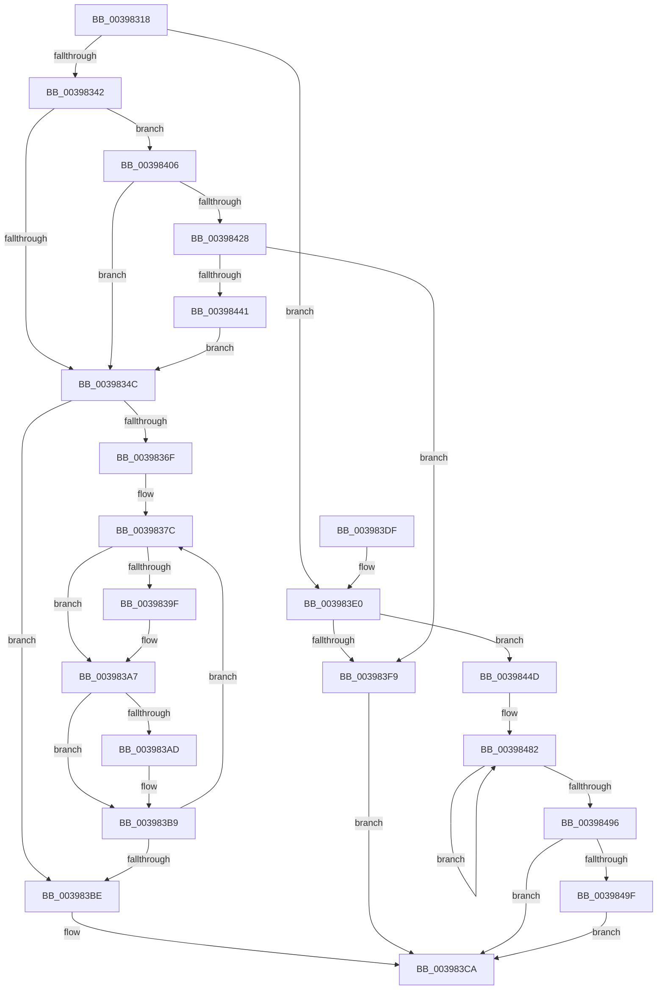

# KiInswapAndReadyThread

- RVA: `0x00398318`–`0x003984B6` (길이 `414` bytes)
- VA: `0x0000000140398318`
- 실행 섹션: `.text`
- PDB 이름 있음: `예`; PDB Function 태그: `아니요`
- unwind 정보 RVA: `0x000814AC`
- 디코드: `95`개 명령, `414/414` bytes 표시
- 미해석 바이트: `0` (있으면 어셈블리에 `.byte`로 보존)

> 이 문서는 커널 이미지의 기계어와 PDB 기호를 분석해 생성했습니다. 4번과 5번은 함수 원형과 자료형을 바이너리 사용 방식에서 추정한 C 해석이며 원본 소스 복구 결과는 아닙니다.

## 1. Dependencies

- 직접 호출 지점: **8**; 고유 호출 대상: **5**
- 직접 호출자로 확인된 함수: **2**
- RIP 상대 이미지 참조: **2**

### Outgoing calls
- `0x00398360` → [KiDeferredReadySingleThread](../25/KiDeferredReadySingleThread_function_00252FE0.md) (function, `0x00252FE0`)
- `0x0039838E` → [KiDeferredReadySingleThread](../25/KiDeferredReadySingleThread_function_00252FE0.md) (function, `0x00252FE0`)
- `0x003983B4` → [KiFlushSoftwareInterruptBatch](../25/KiFlushSoftwareInterruptBatch_function_00252200.md) (function, `0x00252200`)
- `0x003983C5` → [KiFlushSoftwareInterruptBatch](../25/KiFlushSoftwareInterruptBatch_function_00252200.md) (function, `0x00252200`)
- `0x003983EA` → [KiAcquireKobjectLockSafe](../25/KiAcquireKobjectLockSafe_function_00251C90.md) (function, `0x00251C90`)
- `0x003983FF` → [KiRequestProcessInSwap](KiRequestProcessInSwap_function_003981D4.md) (function, `0x003981D4`)
- `0x00398432` → [KiAcquireKobjectLockSafe](../25/KiAcquireKobjectLockSafe_function_00251C90.md) (function, `0x00251C90`)
- `0x003984AC` → [KeSetEvent](../33/KeSetEvent_function_0033F310.md) (function, `0x0033F310`)

### Direct callers
- [sub_0021D7F8](../21/Unknown_function_0021D7F8.md) at `0x0021E91E`
- [KiProcessThreadWaitList](../25/KiProcessThreadWaitList_function_00252CC0.md) at `0x00252FC3`

### Static image references
- `0x00398474` → RVA `0x00F22D48` (`.data`; read)
- `0x003984A5` → RVA `0x00F22D80` (`.data`; read)

## 2. Other-region calls and transfers

- 다른 실행 섹션으로 향하는 call: **0**
- 별도 외부 분기/꼬리 이동을 확인하지 못했습니다.

## 3. Assembly (complete function range)

```asm
00398318  48 89 5C 24 08                  mov qword ptr [rsp + 8], rbx
0039831D  48 89 6C 24 18                  mov qword ptr [rsp + 0x18], rbp
00398322  48 89 74 24 20                  mov qword ptr [rsp + 0x20], rsi
00398327  57                              push rdi
00398328  48 83 EC 20                     sub rsp, 0x20
0039832C  8B 42 78                        mov eax, dword ptr [rdx + 0x78]
0039832F  49 8B E8                        mov rbp, r8
00398332  48 8B DA                        mov rbx, rdx
00398335  48 8B F1                        mov rsi, rcx
00398338  0F BA E0 11                     bt eax, 0x11
0039833C  0F 83 9E 00 00 00               jae 0x1403983e0
00398342  0F BA E0 14                     bt eax, 0x14
00398346  0F 82 BA 00 00 00               jb 0x140398406
0039834C  48 83 64 24 38 00               and qword ptr [rsp + 0x38], 0
00398352  4C 8D 44 24 38                  lea r8, [rsp + 0x38]
00398357  4C 8B CD                        mov r9, rbp
0039835A  48 8B D3                        mov rdx, rbx
0039835D  48 8B CE                        mov rcx, rsi
00398360  E8 7B AC EB FF                  call 0x140252fe0
00398365  48 8B 5C 24 38                  mov rbx, qword ptr [rsp + 0x38]
0039836A  48 85 DB                        test rbx, rbx
0039836D  74 4F                           je 0x1403983be
0039836F  48 8B 03                        mov rax, qword ptr [rbx]
00398372  BF 01 00 00 00                  mov edi, 1
00398377  48 89 44 24 38                  mov qword ptr [rsp + 0x38], rax
0039837C  48 8D 93 28 FF FF FF            lea rdx, [rbx - 0xd8]
00398383  45 33 C9                        xor r9d, r9d
00398386  4C 8D 44 24 38                  lea r8, [rsp + 0x38]
0039838B  48 8B CE                        mov rcx, rsi
0039838E  E8 4D AC EB FF                  call 0x140252fe0
00398393  48 8B 5C 24 38                  mov rbx, qword ptr [rsp + 0x38]
00398398  FF C7                           inc edi
0039839A  48 85 DB                        test rbx, rbx
0039839D  74 08                           je 0x1403983a7
0039839F  48 8B 03                        mov rax, qword ptr [rbx]
003983A2  48 89 44 24 38                  mov qword ptr [rsp + 0x38], rax
003983A7  40 F6 C7 0F                     test dil, 0xf
003983AB  75 0C                           jne 0x1403983b9
003983AD  48 8D 8E D8 35 00 00            lea rcx, [rsi + 0x35d8]
003983B4  E8 47 9E EB FF                  call 0x140252200
003983B9  48 85 DB                        test rbx, rbx
003983BC  75 BE                           jne 0x14039837c
003983BE  48 8D 8E D8 35 00 00            lea rcx, [rsi + 0x35d8]
003983C5  E8 36 9E EB FF                  call 0x140252200
003983CA  48 8B 5C 24 30                  mov rbx, qword ptr [rsp + 0x30]
003983CF  48 8B 6C 24 40                  mov rbp, qword ptr [rsp + 0x40]
003983D4  48 8B 74 24 48                  mov rsi, qword ptr [rsp + 0x48]
003983D9  48 83 C4 20                     add rsp, 0x20
003983DD  5F                              pop rdi
003983DE  C3                              ret
003983DF  CC                              int3
003983E0  48 8B BA B8 00 00 00            mov rdi, qword ptr [rdx + 0xb8]
003983E7  48 8B CF                        mov rcx, rdi
003983EA  E8 A1 98 EB FF                  call 0x140251c90
003983EF  8B 87 08 01 00 00               mov eax, dword ptr [rdi + 0x108]
003983F5  A8 07                           test al, 7
003983F7  74 54                           je 0x14039844d
003983F9  48 8B D7                        mov rdx, rdi
003983FC  48 8B CB                        mov rcx, rbx
003983FF  E8 D0 FD FF FF                  call 0x1403981d4
00398404  EB C4                           jmp 0x1403983ca
00398406  F0 0F BA 72 78 14               lock btr dword ptr [rdx + 0x78], 0x14
0039840C  48 8B 8A B8 00 00 00            mov rcx, qword ptr [rdx + 0xb8]
00398413  B8 08 00 00 00                  mov eax, 8
00398418  F0 0F C1 81 08 01 00 00         lock xadd dword ptr [rcx + 0x108], eax
00398420  A8 07                           test al, 7
00398422  0F 84 24 FF FF FF               je 0x14039834c
00398428  48 8B BA B8 00 00 00            mov rdi, qword ptr [rdx + 0xb8]
0039842F  48 8B CF                        mov rcx, rdi
00398432  E8 59 98 EB FF                  call 0x140251c90
00398437  8B 87 08 01 00 00               mov eax, dword ptr [rdi + 0x108]
0039843D  A8 07                           test al, 7
0039843F  75 B8                           jne 0x1403983f9
00398441  F0 81 27 7F FF FF FF            lock and dword ptr [rdi], 0xffffff7f
00398448  E9 FF FE FF FF                  jmp 0x14039834c
0039844D  B8 08 00 00 00                  mov eax, 8
00398452  F0 01 87 08 01 00 00            lock add dword ptr [rdi + 0x108], eax
00398459  F0 81 27 7F FF FF FF            lock and dword ptr [rdi], 0xffffff7f
00398460  F0 0F BA 73 78 14               lock btr dword ptr [rbx + 0x78], 0x14
00398466  C6 83 84 01 00 00 06            mov byte ptr [rbx + 0x184], 6
0039846D  48 81 C3 D8 00 00 00            add rbx, 0xd8
00398474  0F 0D 0D CD A8 B8 00            prefetchw byte ptr [rip + 0xb8a8cd]
0039847B  48 8B 05 C6 A8 B8 00            mov rax, qword ptr [rip + 0xb8a8c6]
00398482  48 89 03                        mov qword ptr [rbx], rax
00398485  48 8B C8                        mov rcx, rax
00398488  F0 48 0F B1 1D B7 A8 B8 00      lock cmpxchg qword ptr [rip + 0xb8a8b7], rbx
00398491  48 3B C1                        cmp rax, rcx
00398494  75 EC                           jne 0x140398482
00398496  48 85 C0                        test rax, rax
00398499  0F 85 2B FF FF FF               jne 0x1403983ca
0039849F  45 33 C0                        xor r8d, r8d
003984A2  8D 50 0A                        lea edx, [rax + 0xa]
003984A5  48 8D 0D D4 A8 B8 00            lea rcx, [rip + 0xb8a8d4]
003984AC  E8 5F 6E FA FF                  call 0x14033f310
003984B1  E9 14 FF FF FF                  jmp 0x1403983ca
```

## 4. C-style interpretation (structured pseudocode)

```c
__int64 __fastcall KiInswapAndReadyThread(__int64 a1, __int64 a2, __int64 a3)
{
    __int64 result;
    __int64 v_rbx;
    __int64 v_rdi;
    __int64 v_rsp;
    unsigned __int64 v_stack_p10;
    unsigned __int64 v_stack_p18;
    unsigned __int64 v_stack_p20;
    unsigned __int64 v_stack_p8;

    v_stack_p8 = v_rbx;
    v_stack_p18 = v_rbp;
    v_stack_p20 = v_rsi;
    v_rsp = (v_rsp) - (32);
    if (condition_is_above_or_equal) goto loc_003983E0;
    if (condition_is_below) goto loc_00398406;
loc_0039834C:
    result = KiDeferredReadySingleThread(a1, a2, v_stack_p10, a3);
    if (v_stack_p10 == 0) goto loc_003983BE;
    v_stack_p10 = *(unsigned __int64 *)(v_stack_p10);
loc_0039837C:
    a4 = 0;
    result = KiDeferredReadySingleThread(a1, v_stack_p10 - 216, v_stack_p10, a4);
    v_rdi = (unsigned int)((1) + 1);
    if (v_stack_p10 != 0) {
        result = *(unsigned __int64 *)(v_stack_p10);
        v_stack_p10 = result;
    }
    if ((((unsigned __int8)(v_rdi)) & (15)) == 0) {
        a1 = a1 + 13784;
        result = KiFlushSoftwareInterruptBatch(a1, v_stack_p10 - 216, v_stack_p10, a4);
    }
    if (v_stack_p10 != 0) goto loc_0039837C;
loc_003983BE:
    result = KiFlushSoftwareInterruptBatch(a1 + 13784, v_stack_p10 - 216, v_stack_p10, a4);
loc_003983CA:
    v_rsp = (v_rsp) + (32);
    return result;
loc_003983E0:
    result = KiAcquireKobjectLockSafe(*(unsigned __int64 *)(v_stack_p10 - 216 + 184), v_stack_p10 - 216, v_stack_p10, a4);
    if ((((unsigned __int8)((unsigned int)(*(unsigned int *)(*(unsigned __int64 *)(v_stack_p10 - 216 + 184) + 264)))) & (7)) == 0) goto loc_0039844D;
loc_003983F9:
    result = KiRequestProcessInSwap(v_stack_p8, *(unsigned __int64 *)(v_stack_p10 - 216 + 184), v_stack_p10, a4);
    goto loc_003983CA;
loc_00398406:
    if (((8) & (7)) == 0) goto loc_0039834C;
    result = KiAcquireKobjectLockSafe(*(unsigned __int64 *)(*(unsigned __int64 *)(v_stack_p10 - 216 + 184) + 184), *(unsigned __int64 *)(v_stack_p10 - 216 + 184), v_stack_p10, a4);
    if ((((unsigned __int8)((unsigned int)(*(unsigned int *)(*(unsigned __int64 *)(*(unsigned __int64 *)(v_stack_p10 - 216 + 184) + 184) + 264)))) & (7)) != 0) goto loc_003983F9;
    goto loc_0039834C;
loc_0039844D:
    *(unsigned __int8 *)(v_stack_p8 + 388) = 6;
    v_rbx = (v_stack_p8) + (216);
loc_00398482:
    *(unsigned __int64 *)(v_rbx) = *(unsigned __int64 *)(v_rip + 12101830);
    if ((*(unsigned __int64 *)(v_rip + 12101830)) != (*(unsigned __int64 *)(v_rip + 12101830))) goto loc_00398482;
    if (*(unsigned __int64 *)(v_rip + 12101830) != 0) goto loc_003983CA;
    a3 = 0;
    result = KeSetEvent(v_rip + 12101844, *(unsigned __int64 *)(v_rip + 12101830) + 10, a3, a4);
    goto loc_003983CA;
}
```

## 5. (Beta) C Style

```c
int64_t KiInswapAndReadyThread(void *Arg1, void *Arg2, int64_t Arg3)
{
    uint8_t *arg1 = (uint8_t *)Arg1;
    uint8_t *arg2 = (uint8_t *)Arg2;

    int64_t result;
    int64_t local_rbx;
    int64_t local_rdi;
    int64_t local_rsp;
    uint64_t v_stack_p10;
    uint64_t v_stack_p18;
    uint64_t v_stack_p20;
    uint64_t v_stack_p8;

    v_stack_p8 = local_rbx;
    v_stack_p18 = local_rbp;
    v_stack_p20 = local_rsi;
    local_rsp = (local_rsp) - (32);
    if (condition_is_above_or_equal) goto loc_003983E0;
    if (condition_is_below) goto loc_00398406;
loc_0039834C:
    result = KiDeferredReadySingleThread(Arg1, Arg2, v_stack_p10, Arg3);
    if (v_stack_p10 == 0) goto loc_003983BE;
    v_stack_p10 = *(uint64_t *)(v_stack_p10);
loc_0039837C:
    a4 = 0;
    result = KiDeferredReadySingleThread(Arg1, v_stack_p10 - 216, v_stack_p10, a4);
    local_rdi = (uint32_t)((1) + 1);
    if (v_stack_p10 != 0) {
        result = *(uint64_t *)(v_stack_p10);
        v_stack_p10 = result;
    }
    if ((((uint8_t)(local_rdi)) & (15)) == 0) {
        Arg1 = Arg1 + 13784;
        result = KiFlushSoftwareInterruptBatch(Arg1, v_stack_p10 - 216, v_stack_p10, a4);
    }
    if (v_stack_p10 != 0) goto loc_0039837C;
loc_003983BE:
    result = KiFlushSoftwareInterruptBatch(Arg1 + 13784, v_stack_p10 - 216, v_stack_p10, a4);
loc_003983CA:
    local_rsp = (local_rsp) + (32);
    return result;
loc_003983E0:
    result = KiAcquireKobjectLockSafe(*(uint64_t *)(v_stack_p10 - 0xD8 + 0xB8), v_stack_p10 - 216, v_stack_p10, a4);
    if ((((uint8_t)((uint32_t)(*(uint32_t *)(*(uint64_t *)(v_stack_p10 - 0xD8 + 0xB8) + 0x108)))) & (7)) == 0) goto loc_0039844D;
loc_003983F9:
    result = KiRequestProcessInSwap(v_stack_p8, *(uint64_t *)(v_stack_p10 - 0xD8 + 0xB8), v_stack_p10, a4);
    goto loc_003983CA;
loc_00398406:
    if (((8) & (7)) == 0) goto loc_0039834C;
    result = KiAcquireKobjectLockSafe(*(uint64_t *)(*(uint64_t *)(v_stack_p10 - 0xD8 + 0xB8) + 0xB8), *(uint64_t *)(v_stack_p10 - 0xD8 + 0xB8), v_stack_p10, a4);
    if ((((uint8_t)((uint32_t)(*(uint32_t *)(*(uint64_t *)(*(uint64_t *)(v_stack_p10 - 0xD8 + 0xB8) + 0xB8) + 0x108)))) & (7)) != 0) goto loc_003983F9;
    goto loc_0039834C;
loc_0039844D:
    *(uint8_t *)(v_stack_p8 + 0x184) = 6;
    local_rbx = (v_stack_p8) + (216);
loc_00398482:
    *(uint64_t *)(local_rbx) = *(uint64_t *)(v_rip + 0xB8A8C6);
    if ((*(uint64_t *)(v_rip + 0xB8A8C6)) != (*(uint64_t *)(v_rip + 0xB8A8C6))) goto loc_00398482;
    if (*(uint64_t *)(v_rip + 0xB8A8C6) != 0) goto loc_003983CA;
    Arg3 = 0;
    result = KeSetEvent(v_rip + 12101844, *(uint64_t *)(v_rip + 0xB8A8C6) + 10, Arg3, a4);
    goto loc_003983CA;
}
```

### 관측된 메모리 오프셋

구조체 형식이 확인되지 않은 접근은 인자 기준의 오프셋으로만 기록했습니다.

| 기준 인자 | 오프셋 표현 | 폭 (bit) | 접근 |
|---|---:|---:|---|
| `Arg1` | `+ 0x35D8` | `64` | `R` |
| `Arg2` | `+ 0x0` | `64` | `W` |
| `Arg2` | `+ 0x78` | `32` | `R` |
| `Arg2` | `+ 0x78` | `32` | `R/W` |
| `Arg2` | `+ 0xB8` | `64` | `R` |
| `Arg2` | `+ 0x184` | `8` | `W` |

## 6. Execution-region graph

[열기: 2D/3D 그래프와 함수 탐색 컨트롤 패널](../../../control-panel.html?section=text&rva=0x00398318&view=graph)

- 2D 그래프는 위에서 아래로 흐르고, 3D 그래프는 빈 공간을 드래그해 회전합니다. Shift+드래그는 이동, 휠은 확대·축소, 함수 노드 선택은 대상 보고서 이동입니다.

### Static fallback


