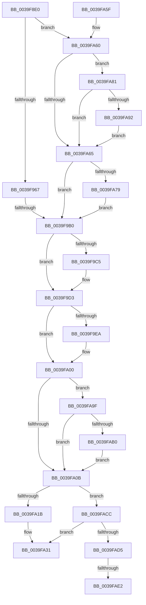

# KiInvokeInterruptServiceRoutine

- RVA: `0x0039F8E0`–`0x0039FAF4` (길이 `532` bytes)
- VA: `0x000000014039F8E0`
- 실행 섹션: `.text`
- PDB 이름 있음: `예`; PDB Function 태그: `예`
- unwind 정보 RVA: `0x00081D10`
- 디코드: `135`개 명령, `532/532` bytes 표시
- 미해석 바이트: `0` (있으면 어셈블리에 `.byte`로 보존)

> 이 문서는 커널 이미지의 기계어와 PDB 기호를 분석해 생성했습니다. 4번과 5번은 함수 원형과 자료형을 바이너리 사용 방식에서 추정한 C 해석이며 원본 소스 복구 결과는 아닙니다.

## 1. Dependencies

- 직접 호출 지점: **12**; 고유 호출 대상: **11**
- 직접 호출자로 확인된 함수: **1**
- RIP 상대 이미지 참조: **4**

### Outgoing calls
- `0x0039F94A` → [memset](../6C/memset_function_006C6C40.md) (function, `0x006C6C40`)
- `0x0039F98C` → [KeWaitForSingleObject](../20/KeWaitForSingleObject_function_0020E6B0.md) (function, `0x0020E6B0`)
- `0x0039F9CE` → [EtwGetKernelTraceTimestamp](EtwGetKernelTraceTimestamp_function_0039FC50.md) (function, `0x0039FC50`)
- `0x0039F9D9` → [KiCallInterruptServiceRoutine](../20/KiCallInterruptServiceRoutine_function_00208970.md) (function, `0x00208970`)
- `0x0039F9FB` → [PerfInfoLogInterrupt](PerfInfoLogInterrupt_function_0039FB00.md) (function, `0x0039FB00`)
- `0x0039FA27` → [KeSetEvent](../33/KeSetEvent_function_0033F310.md) (function, `0x0033F310`)
- `0x0039FA2C` → [KeLeaveCriticalRegion](../25/KeLeaveCriticalRegion_function_0025D8B0.md) (function, `0x0025D8B0`)
- `0x0039FA3F` → [_security_check_cookie](../6A/_security_check_cookie_function_006AC640.md) (function, `0x006AC640`)
- `0x0039FA98` → [KiRaiseIrqlProcessIrqlFlags](../4F/KiRaiseIrqlProcessIrqlFlags_function_004F56FC.md) (function, `0x004F56FC`)
- `0x0039FAA3` → [KeCancelTimer](../23/KeCancelTimer_function_002327E0.md) (function, `0x002327E0`)
- `0x0039FAC2` → [KeWaitForSingleObject](../20/KeWaitForSingleObject_function_0020E6B0.md) (function, `0x0020E6B0`)
- `0x0039FAE9` → [KiLowerIrqlProcessIrqlFlags](../4F/KiLowerIrqlProcessIrqlFlags_function_004F5698.md) (function, `0x004F5698`)

### Direct callers
- [KiInterruptDispatchCommon](KiInterruptDispatchCommon_function_0039F3D0.md) at `0x0039F5CA`

### Static image references
- `0x0039F8FC` → RVA `0x00E0A740` (`.data`; read)
- `0x0039F991` → RVA `0x00FC6B04` (`ALMOSTRO`; read)
- `0x0039F9A1` → RVA `0x00F475F8` (`.data`; read)
- `0x0039FA89` → RVA `0x00FC6D20` (`ALMOSTRO`; read)

## 2. Other-region calls and transfers

- 다른 실행 섹션으로 향하는 call: **0**
- call이 아닌 외부 분기/꼬리 이동: **3**
  - `0x0039F9AA` → [sub_006E6264](../6E/Unknown_function_006E6264.md) (`tail-transfer`)
  - `0x0039FADC` → [sub_006E6264 + 0xAA](../6E/Unknown_function_006E6264.md) (`tail-transfer`)
  - `0x0039FAEF` → [sub_006E6264 + 0xAA](../6E/Unknown_function_006E6264.md) (`tail-transfer`)

## 3. Assembly (complete function range)

```asm
0039F8E0  48 89 5C 24 20                  mov qword ptr [rsp + 0x20], rbx
0039F8E5  55                              push rbp
0039F8E6  56                              push rsi
0039F8E7  57                              push rdi
0039F8E8  41 54                           push r12
0039F8EA  41 55                           push r13
0039F8EC  41 56                           push r14
0039F8EE  41 57                           push r15
0039F8F0  48 8D 6C 24 F0                  lea rbp, [rsp - 0x10]
0039F8F5  48 81 EC 10 01 00 00            sub rsp, 0x110
0039F8FC  48 8B 05 3D AE A6 00            mov rax, qword ptr [rip + 0xa6ae3d]
0039F903  48 33 C4                        xor rax, rsp
0039F906  48 89 45 00                     mov qword ptr [rbp], rax
0039F90A  45 33 F6                        xor r14d, r14d
0039F90D  0F 57 C0                        xorps xmm0, xmm0
0039F910  0F 57 C9                        xorps xmm1, xmm1
0039F913  4C 89 74 24 64                  mov qword ptr [rsp + 0x64], r14
0039F918  45 8B E0                        mov r12d, r8d
0039F91B  44 89 74 24 6C                  mov dword ptr [rsp + 0x6c], r14d
0039F920  40 8A FA                        mov dil, dl
0039F923  4C 89 75 88                     mov qword ptr [rbp - 0x78], r14
0039F927  48 8B D9                        mov rbx, rcx
0039F92A  4C 89 75 90                     mov qword ptr [rbp - 0x70], r14
0039F92E  45 8D 46 40                     lea r8d, [r14 + 0x40]
0039F932  33 D2                           xor edx, edx
0039F934  48 8D 4D A0                     lea rcx, [rbp - 0x60]
0039F938  0F 11 45 E0                     movups xmmword ptr [rbp - 0x20], xmm0
0039F93C  0F 11 45 F0                     movups xmmword ptr [rbp - 0x10], xmm0
0039F940  0F 11 4C 24 38                  movups xmmword ptr [rsp + 0x38], xmm1
0039F945  0F 11 4C 24 48                  movups xmmword ptr [rsp + 0x48], xmm1
0039F94A  E8 F1 72 32 00                  call 0x1406c6c40
0039F94F  0F B6 73 5D                     movzx esi, byte ptr [rbx + 0x5d]
0039F953  41 B5 01                        mov r13b, 1
0039F956  44 88 74 24 30                  mov byte ptr [rsp + 0x30], r14b
0039F95B  45 8A FE                        mov r15b, r14b
0039F95E  40 84 F6                        test sil, sil
0039F961  0F 85 F9 00 00 00               jne 0x14039fa60
0039F967  65 48 8B 04 25 88 01 00 00      mov rax, qword ptr gs:[0x188]
0039F970  45 33 C9                        xor r9d, r9d
0039F973  45 33 C0                        xor r8d, r8d
0039F976  4C 89 74 24 20                  mov qword ptr [rsp + 0x20], r14
0039F97B  33 D2                           xor edx, edx
0039F97D  66 FF 88 E4 01 00 00            dec word ptr [rax + 0x1e4]
0039F984  90                              nop
0039F985  48 8B 8B 80 00 00 00            mov rcx, qword ptr [rbx + 0x80]
0039F98C  E8 1F ED E6 FF                  call 0x14020e6b0
0039F991  44 8B 35 6C 71 C2 00            mov r14d, dword ptr [rip + 0xc2716c]
0039F998  33 D2                           xor edx, edx
0039F99A  41 C1 EE 0E                     shr r14d, 0xe
0039F99E  45 22 F5                        and r14b, r13b
0039F9A1  38 15 51 7C BA 00               cmp byte ptr [rip + 0xba7c51], dl
0039F9A7  45 8A FE                        mov r15b, r14b
0039F9AA  0F 85 B4 68 34 00               jne 0x1406e6264
0039F9B0  65 48 8B 04 25 88 01 00 00      mov rax, qword ptr gs:[0x188]
0039F9B9  48 89 83 98 00 00 00            mov qword ptr [rbx + 0x98], rax
0039F9C0  45 84 FF                        test r15b, r15b
0039F9C3  74 0E                           je 0x14039f9d3
0039F9C5  BA 00 40 00 20                  mov edx, 0x20004000
0039F9CA  48 8D 4D E0                     lea rcx, [rbp - 0x20]
0039F9CE  E8 7D 02 00 00                  call 0x14039fc50
0039F9D3  41 8A D5                        mov dl, r13b
0039F9D6  48 8B CB                        mov rcx, rbx
0039F9D9  E8 92 8F E6 FF                  call 0x140208970
0039F9DE  45 33 ED                        xor r13d, r13d
0039F9E1  44 0F B6 F0                     movzx r14d, al
0039F9E5  45 84 FF                        test r15b, r15b
0039F9E8  74 16                           je 0x14039fa00
0039F9EA  41 C1 E4 08                     shl r12d, 8
0039F9EE  4C 8D 45 E0                     lea r8, [rbp - 0x20]
0039F9F2  41 8B D6                        mov edx, r14d
0039F9F5  48 8B CB                        mov rcx, rbx
0039F9F8  41 0B D4                        or edx, r12d
0039F9FB  E8 00 01 00 00                  call 0x14039fb00
0039FA00  44 38 6C 24 30                  cmp byte ptr [rsp + 0x30], r13b
0039FA05  0F 85 94 00 00 00               jne 0x14039fa9f
0039FA0B  4C 89 AB 98 00 00 00            mov qword ptr [rbx + 0x98], r13
0039FA12  40 84 F6                        test sil, sil
0039FA15  0F 85 B1 00 00 00               jne 0x14039facc
0039FA1B  48 8B 8B 80 00 00 00            mov rcx, qword ptr [rbx + 0x80]
0039FA22  45 33 C0                        xor r8d, r8d
0039FA25  33 D2                           xor edx, edx
0039FA27  E8 E4 F8 F9 FF                  call 0x14033f310
0039FA2C  E8 7F DE EB FF                  call 0x14025d8b0
0039FA31  41 80 FE 01                     cmp r14b, 1
0039FA35  0F 94 C0                        sete al
0039FA38  48 8B 4D 00                     mov rcx, qword ptr [rbp]
0039FA3C  48 33 CC                        xor rcx, rsp
0039FA3F  E8 FC CB 30 00                  call 0x1406ac640
0039FA44  48 8B 9C 24 68 01 00 00         mov rbx, qword ptr [rsp + 0x168]
0039FA4C  48 81 C4 10 01 00 00            add rsp, 0x110
0039FA53  41 5F                           pop r15
0039FA55  41 5E                           pop r14
0039FA57  41 5D                           pop r13
0039FA59  41 5C                           pop r12
0039FA5B  5F                              pop rdi
0039FA5C  5E                              pop rsi
0039FA5D  5D                              pop rbp
0039FA5E  C3                              ret
0039FA5F  CC                              int3
0039FA60  40 3A FE                        cmp dil, sil
0039FA63  75 1C                           jne 0x14039fa81
0039FA65  48 8B 43 48                     mov rax, qword ptr [rbx + 0x48]
0039FA69  48 83 C0 03                     add rax, 3
0039FA6D  48 A9 FD FF FF FF               test rax, -3
0039FA73  0F 85 37 FF FF FF               jne 0x14039f9b0
0039FA79  45 8A EE                        mov r13b, r14b
0039FA7C  E9 2F FF FF FF                  jmp 0x14039f9b0
0039FA81  44 0F 20 C7                     mov rdi, cr8
0039FA85  44 0F 22 C6                     mov cr8, rsi
0039FA89  44 39 35 90 72 C2 00            cmp dword ptr [rip + 0xc27290], r14d
0039FA90  74 D3                           je 0x14039fa65
0039FA92  40 8A D6                        mov dl, sil
0039FA95  40 8A CF                        mov cl, dil
0039FA98  E8 5F 5C 15 00                  call 0x1404f56fc
0039FA9D  EB C6                           jmp 0x14039fa65
0039FA9F  48 8D 4D A0                     lea rcx, [rbp - 0x60]
0039FAA3  E8 38 2D E9 FF                  call 0x1402327e0
0039FAA8  84 C0                           test al, al
0039FAAA  0F 85 5B FF FF FF               jne 0x14039fa0b
0039FAB0  45 33 C9                        xor r9d, r9d
0039FAB3  4C 89 6C 24 20                  mov qword ptr [rsp + 0x20], r13
0039FAB8  45 33 C0                        xor r8d, r8d
0039FABB  48 8D 4C 24 38                  lea rcx, [rsp + 0x38]
0039FAC0  33 D2                           xor edx, edx
0039FAC2  E8 E9 EB E6 FF                  call 0x14020e6b0
0039FAC7  E9 3F FF FF FF                  jmp 0x14039fa0b
0039FACC  40 3A FE                        cmp dil, sil
0039FACF  0F 84 5C FF FF FF               je 0x14039fa31
0039FAD5  44 39 2D 44 72 C2 00            cmp dword ptr [rip + 0xc27244], r13d
0039FADC  0F 84 2C 68 34 00               je 0x1406e630e
0039FAE2  44 0F 20 C1                     mov rcx, cr8
0039FAE6  40 8A D7                        mov dl, dil
0039FAE9  E8 AA 5B 15 00                  call 0x1404f5698
0039FAEE  90                              nop
0039FAEF  E9 1A 68 34 00                  jmp 0x1406e630e
```

## 4. C-style interpretation (structured pseudocode)

```c
__int64 __fastcall KiInvokeInterruptServiceRoutine(__int64 a1, int a2, int a3, int a4)
{
    __int64 result;
    __int64 v_r12;
    __int64 v_r13;
    __int64 v_r14;
    __int64 v_rsp;
    unsigned __int64 v_stack_m100;
    unsigned __int64 v_stack_m110;
    unsigned __int8 v_stack_m118;
    unsigned __int64 v_stack_m128;
    unsigned __int64 v_stack_m48;
    unsigned __int64 v_stack_m58;
    unsigned __int64 v_stack_m68;
    unsigned __int64 v_stack_mA8;
    unsigned __int64 v_stack_mB8;
    unsigned __int64 v_stack_mC0;
    unsigned int v_stack_mDC;
    unsigned __int64 v_stack_mE4;
    unsigned __int64 v_stack_p20;
    unsigned __int64 v_stack_p38;

    v_stack_p20 = v_rbx;
    v_rsp = (v_rsp) - (272);
    result = (*(unsigned __int64 *)(v_rip + 10923581)) ^ (v_rsp);
    v_stack_m48 = result;
    v_r14 = 0;
    v_stack_mE4 = 0;
    v_stack_mDC = 0;
    v_stack_mC0 = 0;
    v_stack_mB8 = 0;
    a2 = 0;
    v_stack_m68 = v_xmm0;
    v_stack_m58 = v_xmm0;
    v_stack_m110 = v_xmm1;
    v_stack_m100 = v_xmm1;
    result = memset(v_stack_mA8, a2, v_r14 + 64, a4);
    v_stack_m118 = 0;
    if ((unsigned __int8)(*(unsigned __int8 *)(a1 + 93)) != 0) goto loc_0039FA60;
    a4 = 0;
    a3 = 0;
    v_stack_m128 = 0;
    a2 = 0;
    result = KeWaitForSingleObject(*(unsigned __int64 *)(a1 + 128), a2, a3, a4);
    a2 = 0;
    v_r14 = (unsigned int)(((unsigned int)(*(unsigned int *)(v_rip + 12743020))) >> (14));
    v_r14 = (unsigned __int8)((v_r14) & (1));
loc_0039F9B0:
    *(unsigned __int64 *)(a1 + 152) = *(unsigned __int64 *)(gs_base + (0 + 392));
    result = *(unsigned __int64 *)(gs_base + (0 + 392));
    if ((unsigned __int8)((unsigned __int8)(v_r14)) != 0) {
        a2 = 0x20004000ULL;
        a1 = v_stack_m68;
        result = EtwGetKernelTraceTimestamp(a1, a2, a3, a4);
    }
    result = KiCallInterruptServiceRoutine(a1, 1, a3, a4);
    v_r13 = 0;
    v_r12 = (unsigned int)(a3);
    if ((unsigned __int8)((unsigned __int8)(v_r14)) != 0) {
        v_r12 = (unsigned int)(((unsigned int)(a3)) << (8));
        a3 = v_stack_m68;
        a2 = (unsigned int)((unsigned __int8)(result));
        a1 = a1;
        a2 = (unsigned int)((a2) | ((unsigned int)(v_r12)));
        result = PerfInfoLogInterrupt(a1, a2, a3, a4);
    }
    if (v_stack_m118 != 0) goto loc_0039FA9F;
loc_0039FA0B:
    *(unsigned __int64 *)(a1 + 152) = 0;
    if ((unsigned __int8)(*(unsigned __int8 *)(a1 + 93)) != 0) goto loc_0039FACC;
    a3 = 0;
    a2 = 0;
    result = KeSetEvent(*(unsigned __int64 *)(a1 + 128), a2, a3, a4);
    result = KeLeaveCriticalRegion(*(unsigned __int64 *)(a1 + 128), a2, a3, a4);
loc_0039FA31:
    result = (((unsigned __int8)((unsigned __int8)(result))) == 1) ? 1 : 0;
    a1 = (v_stack_m48) ^ (v_rsp);
    result = _security_check_cookie(a1, a2, a3, a4);
    v_rsp = (v_rsp) + (272);
    return result;
loc_0039FA60:
    if (((unsigned __int8)((unsigned __int8)(a2))) != ((unsigned __int8)(*(unsigned __int8 *)(a1 + 93)))) goto loc_0039FA81;
loc_0039FA65:
    result = (*(unsigned __int64 *)(v_stack_p20 + 72)) + (3);
    if (((result) & (-3)) != 0) goto loc_0039F9B0;
    goto loc_0039F9B0;
loc_0039FA81:
    if ((*(unsigned int *)(v_rip + 12743312)) == ((unsigned int)((unsigned __int8)(result)))) goto loc_0039FA65;
    result = KiRaiseIrqlProcessIrqlFlags((unsigned __int8)(v_cr8), (unsigned __int8)(*(unsigned __int8 *)(a1 + 93)), a3, a4);
    goto loc_0039FA65;
loc_0039FA9F:
    result = KeCancelTimer(v_stack_mA8, (unsigned __int8)(*(unsigned __int8 *)(a1 + 93)), a3, a4);
    if ((unsigned __int8)(result) != 0) goto loc_0039FA0B;
    a4 = 0;
    v_stack_p20 = (unsigned __int8)((unsigned __int8)(result));
    a3 = 0;
    a2 = 0;
    result = KeWaitForSingleObject(v_stack_p38, a2, a3, a4);
    goto loc_0039FA0B;
loc_0039FACC:
    if (((unsigned __int8)(v_cr8)) == ((unsigned __int8)(*(unsigned __int8 *)(a1 + 93)))) goto loc_0039FA31;
    result = KiLowerIrqlProcessIrqlFlags(*(unsigned __int8 *)(a1 + 93), (unsigned __int8)(v_cr8), a3, a4);
}
```

## 5. (Beta) C Style

```c
int64_t KiInvokeInterruptServiceRoutine(void *Arg1, int32_t Arg2, int32_t Arg3, int32_t Arg4)
{
    uint8_t *arg1 = (uint8_t *)Arg1;

    int64_t result;
    int64_t local_r12;
    int64_t local_r13;
    int64_t local_r14;
    int64_t local_rsp;
    uint64_t v_stack_m100;
    uint64_t v_stack_m110;
    uint8_t v_stack_m118;
    uint64_t v_stack_m128;
    uint64_t v_stack_m48;
    uint64_t v_stack_m58;
    uint64_t v_stack_m68;
    uint64_t v_stack_mA8;
    uint64_t v_stack_mB8;
    uint64_t v_stack_mC0;
    uint32_t v_stack_mDC;
    uint64_t v_stack_mE4;
    uint64_t v_stack_p20;
    uint64_t v_stack_p38;

    v_stack_p20 = local_rbx;
    local_rsp = (local_rsp) - (272);
    result = (*(uint64_t *)(v_rip + 0xA6AE3D)) ^ (local_rsp);
    v_stack_m48 = result;
    local_r14 = 0;
    v_stack_mE4 = 0;
    v_stack_mDC = 0;
    v_stack_mC0 = 0;
    v_stack_mB8 = 0;
    Arg2 = 0;
    v_stack_m68 = v_xmm0;
    v_stack_m58 = v_xmm0;
    v_stack_m110 = v_xmm1;
    v_stack_m100 = v_xmm1;
    result = memset(v_stack_mA8, Arg2, local_r14 + 64, Arg4);
    v_stack_m118 = 0;
    if ((uint8_t)(*(uint8_t *)(arg1 + 0x5D)) != 0) goto loc_0039FA60;
    Arg4 = 0;
    Arg3 = 0;
    v_stack_m128 = 0;
    Arg2 = 0;
    result = KeWaitForSingleObject(*(uint64_t *)(arg1 + 0x80), Arg2, Arg3, Arg4);
    Arg2 = 0;
    local_r14 = (uint32_t)(((uint32_t)(*(uint32_t *)(v_rip + 0xC2716C))) >> (14));
    local_r14 = (uint8_t)((local_r14) & (1));
loc_0039F9B0:
    *(uint64_t *)(arg1 + 0x98) = *(uint64_t *)(gs_base + (0 + 0x188));
    result = *(uint64_t *)(gs_base + (0 + 0x188));
    if ((uint8_t)((uint8_t)(local_r14)) != 0) {
        Arg2 = 0x20004000ULL;
        Arg1 = v_stack_m68;
        result = EtwGetKernelTraceTimestamp(Arg1, Arg2, Arg3, Arg4);
    }
    result = KiCallInterruptServiceRoutine(Arg1, 1, Arg3, Arg4);
    local_r13 = 0;
    local_r12 = (uint32_t)(Arg3);
    if ((uint8_t)((uint8_t)(local_r14)) != 0) {
        local_r12 = (uint32_t)(((uint32_t)(Arg3)) << (8));
        Arg3 = v_stack_m68;
        Arg2 = (uint32_t)((uint8_t)(result));
        Arg1 = Arg1;
        Arg2 = (uint32_t)((Arg2) | ((uint32_t)(local_r12)));
        result = PerfInfoLogInterrupt(Arg1, Arg2, Arg3, Arg4);
    }
    if (v_stack_m118 != 0) goto loc_0039FA9F;
loc_0039FA0B:
    *(uint64_t *)(arg1 + 0x98) = 0;
    if ((uint8_t)(*(uint8_t *)(arg1 + 0x5D)) != 0) goto loc_0039FACC;
    Arg3 = 0;
    Arg2 = 0;
    result = KeSetEvent(*(uint64_t *)(arg1 + 0x80), Arg2, Arg3, Arg4);
    result = KeLeaveCriticalRegion(*(uint64_t *)(arg1 + 0x80), Arg2, Arg3, Arg4);
loc_0039FA31:
    result = (((uint8_t)((uint8_t)(result))) == 1) ? 1 : 0;
    Arg1 = (v_stack_m48) ^ (local_rsp);
    result = _security_check_cookie(Arg1, Arg2, Arg3, Arg4);
    local_rsp = (local_rsp) + (272);
    return result;
loc_0039FA60:
    if (((uint8_t)((uint8_t)(Arg2))) != ((uint8_t)(*(uint8_t *)(arg1 + 0x5D)))) goto loc_0039FA81;
loc_0039FA65:
    result = (*(uint64_t *)(v_stack_p20 + 0x48)) + (3);
    if (((result) & (-3)) != 0) goto loc_0039F9B0;
    goto loc_0039F9B0;
loc_0039FA81:
    if ((*(uint32_t *)(v_rip + 0xC27290)) == ((uint32_t)((uint8_t)(result)))) goto loc_0039FA65;
    result = KiRaiseIrqlProcessIrqlFlags((uint8_t)(v_cr8), (uint8_t)(*(uint8_t *)(arg1 + 0x5D)), Arg3, Arg4);
    goto loc_0039FA65;
loc_0039FA9F:
    result = KeCancelTimer(v_stack_mA8, (uint8_t)(*(uint8_t *)(arg1 + 0x5D)), Arg3, Arg4);
    if ((uint8_t)(result) != 0) goto loc_0039FA0B;
    Arg4 = 0;
    v_stack_p20 = (uint8_t)((uint8_t)(result));
    Arg3 = 0;
    Arg2 = 0;
    result = KeWaitForSingleObject(v_stack_p38, Arg2, Arg3, Arg4);
    goto loc_0039FA0B;
loc_0039FACC:
    if (((uint8_t)(v_cr8)) == ((uint8_t)(*(uint8_t *)(arg1 + 0x5D)))) goto loc_0039FA31;
    result = KiLowerIrqlProcessIrqlFlags(*(uint8_t *)(arg1 + 0x5D), (uint8_t)(v_cr8), Arg3, Arg4);
}
```

### 관측된 메모리 오프셋

구조체 형식이 확인되지 않은 접근은 인자 기준의 오프셋으로만 기록했습니다.

| 기준 인자 | 오프셋 표현 | 폭 (bit) | 접근 |
|---|---:|---:|---|
| `Arg1` | `+ 0x48` | `64` | `R` |
| `Arg1` | `+ 0x5D` | `8` | `R` |
| `Arg1` | `+ 0x80` | `64` | `R` |
| `Arg1` | `+ 0x98` | `64` | `W` |

## 6. Execution-region graph

[열기: 2D/3D 그래프와 함수 탐색 컨트롤 패널](../../../control-panel.html?section=text&rva=0x0039F8E0&view=graph)

- 2D 그래프는 위에서 아래로 흐르고, 3D 그래프는 빈 공간을 드래그해 회전합니다. Shift+드래그는 이동, 휠은 확대·축소, 함수 노드 선택은 대상 보고서 이동입니다.

### Static fallback


