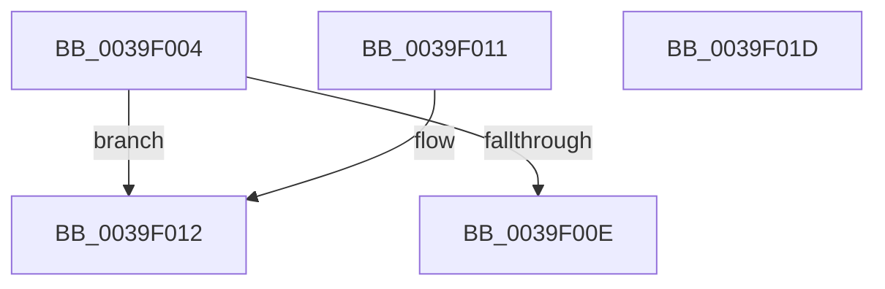

# KiIsQosGroupingActive

- RVA: `0x0039F004`–`0x0039F01E` (길이 `26` bytes)
- VA: `0x000000014039F004`
- 실행 섹션: `.text`
- PDB 이름 있음: `예`; PDB Function 태그: `아니요`
- unwind 정보 RVA: `0x000DB714`
- 디코드: `11`개 명령, `26/26` bytes 표시
- 미해석 바이트: `0` (있으면 어셈블리에 `.byte`로 보존)

> 이 문서는 커널 이미지의 기계어와 PDB 기호를 분석해 생성했습니다. 4번과 5번은 함수 원형과 자료형을 바이너리 사용 방식에서 추정한 C 해석이며 원본 소스 복구 결과는 아닙니다.

## 1. Dependencies

- 직접 호출 지점: **0**; 고유 호출 대상: **0**
- 직접 호출자로 확인된 함수: **1**
- RIP 상대 이미지 참조: **2**

### Outgoing calls
- 직접 디코드된 call 명령이 없습니다.

### Direct callers
- [KiCheckPreferredHeteroProcessor](KiCheckPreferredHeteroProcessor_function_0039D72C.md) at `0x0039D82B`

### Static image references
- `0x0039F004` → RVA `0x00FC6D14` (`ALMOSTRO`; read)
- `0x0039F012` → RVA `0x00FC6D10` (`ALMOSTRO`; read)

## 2. Other-region calls and transfers

- 다른 실행 섹션으로 향하는 call: **0**
- 별도 외부 분기/꼬리 이동을 확인하지 못했습니다.

## 3. Assembly (complete function range)

```asm
0039F004  8B 05 0A 7D C2 00               mov eax, dword ptr [rip + 0xc27d0a]
0039F00A  A8 02                           test al, 2
0039F00C  75 04                           jne 0x14039f012
0039F00E  B0 01                           mov al, 1
0039F010  C3                              ret
0039F011  CC                              int3
0039F012  8B 05 F8 7C C2 00               mov eax, dword ptr [rip + 0xc27cf8]
0039F018  D1 E8                           shr eax, 1
0039F01A  24 01                           and al, 1
0039F01C  C3                              ret
0039F01D  CC                              int3
```

## 4. C-style interpretation (structured pseudocode)

```c
__int64 __fastcall KiIsQosGroupingActive(void)
{
    __int64 result;

    if ((((unsigned __int8)((unsigned int)(*(unsigned int *)(v_rip + 12745994)))) & (2)) != 0) goto loc_0039F012;
    return 1;
loc_0039F012:
    result = (unsigned int)(((unsigned int)(*(unsigned int *)(v_rip + 12745976))) >> (1));
    result = (unsigned __int8)((result) & (1));
    return result;
}
```

## 5. (Beta) C Style

```c
void KiIsQosGroupingActive(void)
{
    int64_t result;

    if ((((uint8_t)((uint32_t)(*(uint32_t *)(v_rip + 0xC27D0A)))) & (2)) != 0) goto loc_0039F012;
    return 1;
loc_0039F012:
    result = (uint32_t)(((uint32_t)(*(uint32_t *)(v_rip + 0xC27CF8))) >> (1));
    result = (uint8_t)((result) & (1));
    return result;
}
```

## 6. Execution-region graph

[열기: 2D/3D 그래프와 함수 탐색 컨트롤 패널](../../../control-panel.html?section=text&rva=0x0039F004&view=graph)

- 2D 그래프는 위에서 아래로 흐르고, 3D 그래프는 빈 공간을 드래그해 회전합니다. Shift+드래그는 이동, 휠은 확대·축소, 함수 노드 선택은 대상 보고서 이동입니다.

### Static fallback


