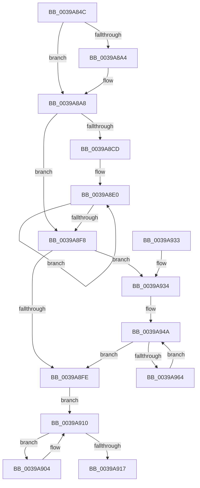

# KiOrAffinityEx

- RVA: `0x0039A84C`–`0x0039A966` (길이 `282` bytes)
- VA: `0x000000014039A84C`
- 실행 섹션: `.text`
- PDB 이름 있음: `예`; PDB Function 태그: `아니요`
- unwind 정보 RVA: `0x00081874`
- 디코드: `80`개 명령, `282/282` bytes 표시
- 미해석 바이트: `0` (있으면 어셈블리에 `.byte`로 보존)

> 이 문서는 커널 이미지의 기계어와 PDB 기호를 분석해 생성했습니다. 4번과 5번은 함수 원형과 자료형을 바이너리 사용 방식에서 추정한 C 해석이며 원본 소스 복구 결과는 아닙니다.

## 1. Dependencies

- 직접 호출 지점: **0**; 고유 호출 대상: **0**
- 직접 호출자로 확인된 함수: **18**
- RIP 상대 이미지 참조: **0**

### Outgoing calls
- 직접 디코드된 call 명령이 없습니다.

### Direct callers
- [KeOrAffinityEx2](../2C/KeOrAffinityEx2_function_002CF930.md) at `0x002CF93E`
- [sub_002D6584](../2D/Unknown_function_002D6584.md) at `0x002D6A0A`
- [PpmPerfApplyProcessorStates](../2D/PpmPerfApplyProcessorStates_function_002D8EF0.md) at `0x002D8FB7`
- [KiComputeCpuSetAffinity](KiComputeCpuSetAffinity_function_0039A1C0.md) at `0x0039A3B1`
- [KiComputeCpuSetAffinity](KiComputeCpuSetAffinity_function_0039A1C0.md) at `0x0039A483`
- [KiUpdateTime](KiUpdateTime_function_0039B530.md) at `0x0039B9B9`
- [KiForwardTick](KiForwardTick_function_0039D40C.md) at `0x0039D61D`
- [PpmHeteroUpdateHgsConfiguration](../3B/PpmHeteroUpdateHgsConfiguration_function_003BF344.md) at `0x003BFC0B`
- [KiForceIdleUpdateSchedulerParkState](../48/KiForceIdleUpdateSchedulerParkState_function_0048D874.md) at `0x0048DA03`
- [PpmParkComputeDiff](../4A/PpmParkComputeDiff_function_004ADCAC.md) at `0x004ADDD7`
- [PpmParkComputeDiff](../4A/PpmParkComputeDiff_function_004ADCAC.md) at `0x004ADDF9`
- [PpmParkApplyPolicyEx](../4F/PpmParkApplyPolicyEx_function_004F3090.md) at `0x004F33E2`
- [PpmParkApplyPolicyEx](../4F/PpmParkApplyPolicyEx_function_004F3090.md) at `0x004F34E2`
- [KeUpdateProcessorRestrictionsEx](../5B/KeUpdateProcessorRestrictionsEx_function_005B64E8.md) at `0x005B67F5`
- [KeOrAffinityEx](../5B/KeOrAffinityEx_function_005B9600.md) at `0x005B9616`
- [PpmHeteroComputeMultiClassUnparkCountEx](../5D/PpmHeteroComputeMultiClassUnparkCountEx_function_005DF584.md) at `0x005DF688`
- [PpmParkComputeUnparkMaskEx](../5E/PpmParkComputeUnparkMaskEx_function_005E05E0.md) at `0x005E0ADC`
- [PpmRegisterPerfStates](../../page/75/PpmRegisterPerfStates_function_0075B084.md) at `0x0075BB22`
- [PpmEventTraceParkNodeRundownEx](../../page/77/PpmEventTraceParkNodeRundownEx_function_00772E5C.md) at `0x00772F3F`
- [PpmUpdateProcessorPolicy](../../page/A5/PpmUpdateProcessorPolicy_function_00A53324.md) at `0x00A5349F`
- [PpmCheckInitProcessors](../../page/A8/PpmCheckInitProcessors_function_00A84AE8.md) at `0x00A84BBF`

### Static image references
- 디코드된 RIP-relative 메모리 참조가 없습니다.

## 2. Other-region calls and transfers

- 다른 실행 섹션으로 향하는 call: **0**
- 별도 외부 분기/꼬리 이동을 확인하지 못했습니다.

## 3. Assembly (complete function range)

```asm
0039A84C  48 8B C4                        mov rax, rsp
0039A84F  48 89 58 08                     mov qword ptr [rax + 8], rbx
0039A853  48 89 68 10                     mov qword ptr [rax + 0x10], rbp
0039A857  48 89 70 18                     mov qword ptr [rax + 0x18], rsi
0039A85B  48 89 78 20                     mov qword ptr [rax + 0x20], rdi
0039A85F  41 56                           push r14
0039A861  41 57                           push r15
0039A863  44 0F B7 11                     movzx r10d, word ptr [rcx]
0039A867  48 8B FA                        mov rdi, rdx
0039A86A  0F B7 02                        movzx eax, word ptr [rdx]
0039A86D  48 8B F1                        mov rsi, rcx
0039A870  66 44 3B D0                     cmp r10w, ax
0039A874  45 0F B7 D9                     movzx r11d, r9w
0039A878  0F B7 C8                        movzx ecx, ax
0039A87B  66 45 89 58 02                  mov word ptr [r8 + 2], r11w
0039A880  66 41 0F 43 CA                  cmovae cx, r10w
0039A885  41 0F B7 D2                     movzx edx, r10w
0039A889  66 0F 43 D0                     cmovae dx, ax
0039A88D  66 41 89 08                     mov word ptr [r8], cx
0039A891  48 8B EF                        mov rbp, rdi
0039A894  48 0F 43 EE                     cmovae rbp, rsi
0039A898  45 33 FF                        xor r15d, r15d
0039A89B  45 8B CF                        mov r9d, r15d
0039A89E  66 41 3B CB                     cmp cx, r11w
0039A8A2  76 04                           jbe 0x14039a8a8
0039A8A4  66 45 89 18                     mov word ptr [r8], r11w
0039A8A8  66 41 3B D3                     cmp dx, r11w
0039A8AC  41 0F B7 C3                     movzx eax, r11w
0039A8B0  41 BE 01 00 00 00               mov r14d, 1
0039A8B6  66 0F 46 C2                     cmovbe ax, dx
0039A8BA  66 41 3B CB                     cmp cx, r11w
0039A8BE  41 0F B7 D7                     movzx edx, r15w
0039A8C2  66 44 0F 46 D9                  cmovbe r11w, cx
0039A8C7  66 44 3B F8                     cmp r15w, ax
0039A8CB  73 2B                           jae 0x14039a8f8
0039A8CD  48 2B F7                        sub rsi, rdi
0039A8D0  4C 8D 57 08                     lea r10, [rdi + 8]
0039A8D4  49 8B D8                        mov rbx, r8
0039A8D7  0F B7 D0                        movzx edx, ax
0039A8DA  48 2B DF                        sub rbx, rdi
0039A8DD  0F B7 F8                        movzx edi, ax
0039A8E0  4A 8B 0C 16                     mov rcx, qword ptr [rsi + r10]
0039A8E4  49 0B 0A                        or rcx, qword ptr [r10]
0039A8E7  4A 89 0C 13                     mov qword ptr [rbx + r10], rcx
0039A8EB  4D 8D 52 08                     lea r10, [r10 + 8]
0039A8EF  45 0F 45 CE                     cmovne r9d, r14d
0039A8F3  49 2B FE                        sub rdi, r14
0039A8F6  75 E8                           jne 0x14039a8e0
0039A8F8  66 41 3B D3                     cmp dx, r11w
0039A8FC  72 36                           jb 0x14039a934
0039A8FE  45 89 78 04                     mov dword ptr [r8 + 4], r15d
0039A902  EB 0C                           jmp 0x14039a910
0039A904  0F B7 CA                        movzx ecx, dx
0039A907  66 41 03 D6                     add dx, r14w
0039A90B  4D 89 7C C8 08                  mov qword ptr [r8 + rcx*8 + 8], r15
0039A910  66 41 3B 50 02                  cmp dx, word ptr [r8 + 2]
0039A915  72 ED                           jb 0x14039a904
0039A917  48 8B 5C 24 18                  mov rbx, qword ptr [rsp + 0x18]
0039A91C  41 8B C1                        mov eax, r9d
0039A91F  48 8B 6C 24 20                  mov rbp, qword ptr [rsp + 0x20]
0039A924  48 8B 74 24 28                  mov rsi, qword ptr [rsp + 0x28]
0039A929  48 8B 7C 24 30                  mov rdi, qword ptr [rsp + 0x30]
0039A92E  41 5F                           pop r15
0039A930  41 5E                           pop r14
0039A932  C3                              ret
0039A933  CC                              int3
0039A934  0F B7 CA                        movzx ecx, dx
0039A937  41 0F B7 C3                     movzx eax, r11w
0039A93B  48 C1 E1 03                     shl rcx, 3
0039A93F  66 2B C2                        sub ax, dx
0039A942  41 0F B7 D3                     movzx edx, r11w
0039A946  44 0F B7 D0                     movzx r10d, ax
0039A94A  48 8B 44 29 08                  mov rax, qword ptr [rcx + rbp + 8]
0039A94F  49 89 44 08 08                  mov qword ptr [r8 + rcx + 8], rax
0039A954  48 8D 49 08                     lea rcx, [rcx + 8]
0039A958  48 85 C0                        test rax, rax
0039A95B  45 0F 45 CE                     cmovne r9d, r14d
0039A95F  4D 2B D6                        sub r10, r14
0039A962  74 9A                           je 0x14039a8fe
0039A964  EB E4                           jmp 0x14039a94a
```

## 4. C-style interpretation (structured pseudocode)

```c
__int64 __fastcall KiOrAffinityEx(__int64 a1, __int64 a2, __int64 a3, unsigned __int16 a4)
{
    __int64 result;
    __int64 v_r10;
    __int64 v_r15;
    __int64 v_rbx;
    __int64 v_rdi;
    __int64 v_rsi;
    unsigned __int64 v_stack_p10;
    unsigned __int64 v_stack_p18;
    unsigned __int64 v_stack_p20;
    unsigned __int64 v_stack_p8;

    *(unsigned __int64 *)(v_rsp + 8) = v_rbx;
    *(unsigned __int64 *)(v_rsp + 16) = v_rbp;
    *(unsigned __int64 *)(v_rsp + 24) = v_rsi;
    *(unsigned __int64 *)(v_rsp + 32) = v_rdi;
    *(unsigned __int16 *)(a3 + 2) = a4;
    a1 = (unsigned __int16)(*(unsigned __int16 *)(a2));
    if (((unsigned __int16)(*(unsigned __int16 *)(a1))) >= ((unsigned __int16)(*(unsigned __int16 *)(a2)))) { a1 = (unsigned __int16)(*(unsigned __int16 *)(a1)); }
    a2 = (unsigned __int16)(*(unsigned __int16 *)(a1));
    if (((unsigned __int16)(*(unsigned __int16 *)(a1))) >= ((unsigned __int16)(*(unsigned __int16 *)(a2)))) { a2 = (unsigned __int16)(*(unsigned __int16 *)(a2)); }
    *(unsigned __int16 *)(a3) = (unsigned __int16)(a1);
    if (((unsigned __int16)(*(unsigned __int16 *)(a1))) >= ((unsigned __int16)(*(unsigned __int16 *)(a2)))) { a2 = a1; }
    v_r15 = 0;
    if (((unsigned __int16)(a1)) >= = a4) {
        *(unsigned __int16 *)(a3) = a4;
    }
    if (((unsigned __int16)(a2)) <= a4) { a4 = (unsigned __int16)(a2); }
    if (((unsigned __int16)(a1)) <= a4) { a4 = (unsigned __int16)(a1); }
    if (0 >= a4) goto loc_0039A8F8;
    v_rsi = (a1) - (a2);
    v_rbx = (a3) - (a2);
loc_0039A8E0:
    a1 = (*(unsigned __int64 *)(v_rsi + a2 + 8 * 1)) | (*(unsigned __int64 *)(a2 + 8));
    *(unsigned __int64 *)(v_rbx + a2 + 8 * 1) = a1;
    a4 = 0;
    if (condition_is_not_equal) { a4 = 1; }
    v_rdi = (a4) - (1);
    if (condition_is_not_equal) goto loc_0039A8E0;
loc_0039A8F8:
    if (a4 < a4) goto loc_0039A934;
loc_0039A8FE:
    *(unsigned int *)(a3 + 4) = 0;
    goto loc_0039A910;
loc_0039A904:
    a2 = (unsigned __int16)((a4) + (1));
    *(unsigned __int64 *)(a3 + a4 * 8 + 8) = 0;
loc_0039A910:
    if (((unsigned __int16)(a2)) < (*(unsigned __int16 *)(a3 + 2))) goto loc_0039A904;
    return (unsigned int)(a4);
loc_0039A934:
    a1 = ((unsigned __int16)(a2)) << (3);
    result = (unsigned __int16)((a4) - ((unsigned __int16)(a2)));
loc_0039A94A:
    *(unsigned __int64 *)(a3 + a1 * 1 + 8) = *(unsigned __int64 *)(a1 + v_stack_p10 * 1 + 8);
    if (*(unsigned __int64 *)(a1 + v_stack_p10 * 1 + 8) != 0) { a4 = 1; }
    v_r10 = ((unsigned __int16)(result)) - (1);
    if (condition_is_equal) goto loc_0039A8FE;
    goto loc_0039A94A;
}
```

## 5. (Beta) C Style

```c
int64_t KiOrAffinityEx(void *Arg1, void *Arg2, void *Arg3, uint16_t Arg4)
{
    uint8_t *arg1 = (uint8_t *)Arg1;
    uint8_t *arg2 = (uint8_t *)Arg2;
    uint8_t *arg3 = (uint8_t *)Arg3;

    int64_t result;
    int64_t local_r10;
    int64_t local_r15;
    int64_t local_rbx;
    int64_t local_rdi;
    int64_t local_rsi;
    uint64_t v_stack_p10;
    uint64_t v_stack_p18;
    uint64_t v_stack_p20;
    uint64_t v_stack_p8;

    *(uint64_t *)(local_rsp + 0x8) = local_rbx;
    *(uint64_t *)(local_rsp + 0x10) = local_rbp;
    *(uint64_t *)(local_rsp + 0x18) = local_rsi;
    *(uint64_t *)(local_rsp + 0x20) = local_rdi;
    *(uint16_t *)(arg3 + 0x2) = Arg4;
    Arg1 = (uint16_t)(*(uint16_t *)(arg2));
    if (((uint16_t)(*(uint16_t *)(arg1))) >= ((uint16_t)(*(uint16_t *)(arg2)))) { Arg1 = (uint16_t)(*(uint16_t *)(arg1)); }
    Arg2 = (uint16_t)(*(uint16_t *)(arg1));
    if (((uint16_t)(*(uint16_t *)(arg1))) >= ((uint16_t)(*(uint16_t *)(arg2)))) { Arg2 = (uint16_t)(*(uint16_t *)(arg2)); }
    *(uint16_t *)(arg3) = (uint16_t)(Arg1);
    if (((uint16_t)(*(uint16_t *)(arg1))) >= ((uint16_t)(*(uint16_t *)(arg2)))) { Arg2 = Arg1; }
    local_r15 = 0;
    if (((uint16_t)(Arg1)) >= = Arg4) {
        *(uint16_t *)(arg3) = Arg4;
    }
    if (((uint16_t)(Arg2)) <= Arg4) { Arg4 = (uint16_t)(Arg2); }
    if (((uint16_t)(Arg1)) <= Arg4) { Arg4 = (uint16_t)(Arg1); }
    if (0 >= Arg4) goto loc_0039A8F8;
    local_rsi = (Arg1) - (Arg2);
    local_rbx = (Arg3) - (Arg2);
loc_0039A8E0:
    Arg1 = (*(uint64_t *)(local_rsi + arg2 + 0x8 * 1)) | (*(uint64_t *)(arg2 + 0x8));
    *(void **)(local_rbx + arg2 + 0x8 * 1) = Arg1;
    Arg4 = 0;
    if (condition_is_not_equal) { Arg4 = 1; }
    local_rdi = (Arg4) - (1);
    if (condition_is_not_equal) goto loc_0039A8E0;
loc_0039A8F8:
    if (Arg4 < Arg4) goto loc_0039A934;
loc_0039A8FE:
    *(uint32_t *)(arg3 + 0x4) = 0;
    goto loc_0039A910;
loc_0039A904:
    Arg2 = (uint16_t)((Arg4) + (1));
    *(uint64_t *)(arg3 + Arg4 * 8 + 0x8) = 0;
loc_0039A910:
    if (((uint16_t)(Arg2)) < (*(uint16_t *)(arg3 + 0x2))) goto loc_0039A904;
    return (uint32_t)(Arg4);
loc_0039A934:
    Arg1 = ((uint16_t)(Arg2)) << (3);
    result = (uint16_t)((Arg4) - ((uint16_t)(Arg2)));
loc_0039A94A:
    *(uint64_t *)(arg3 + arg1 * 1 + 0x8) = *(uint64_t *)(arg1 + v_stack_p10 * 1 + 0x8);
    if (*(uint64_t *)(arg1 + v_stack_p10 * 1 + 0x8) != 0) { Arg4 = 1; }
    local_r10 = ((uint16_t)(result)) - (1);
    if (condition_is_equal) goto loc_0039A8FE;
    goto loc_0039A94A;
}
```

### 관측된 메모리 오프셋

구조체 형식이 확인되지 않은 접근은 인자 기준의 오프셋으로만 기록했습니다.

| 기준 인자 | 오프셋 표현 | 폭 (bit) | 접근 |
|---|---:|---:|---|
| `Arg1` | `+ 0x0` | `16` | `R` |
| `Arg1` | `+ 0x0 + r10*1` | `64` | `R` |
| `Arg2` | `+ 0x0` | `16` | `R` |
| `Arg2` | `+ 0x0` | `64` | `R` |
| `Arg2` | `+ 0x8` | `64` | `R` |
| `Arg3` | `+ 0x0` | `16` | `W` |
| `Arg3` | `+ 0x0 + r10*1` | `64` | `W` |
| `Arg3` | `+ 0x2` | `16` | `R` |
| `Arg3` | `+ 0x2` | `16` | `W` |
| `Arg3` | `+ 0x4` | `32` | `W` |
| `Arg3` | `+ 0x8 + rcx*1` | `64` | `W` |
| `Arg3` | `+ 0x8 + rcx*8` | `64` | `W` |

## 6. Execution-region graph

[열기: 2D/3D 그래프와 함수 탐색 컨트롤 패널](../../../control-panel.html?section=text&rva=0x0039A84C&view=graph)

- 2D 그래프는 위에서 아래로 흐르고, 3D 그래프는 빈 공간을 드래그해 회전합니다. Shift+드래그는 이동, 휠은 확대·축소, 함수 노드 선택은 대상 보고서 이동입니다.

### Static fallback


