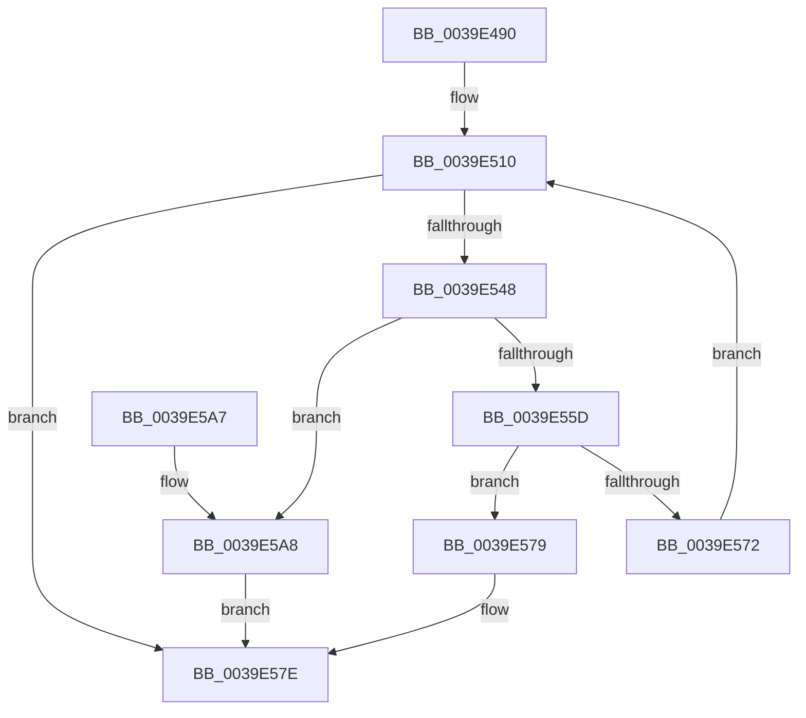

# KiPerformHeteroSoftParkElection

- RVA: `0x0039E490`–`0x0039E5AF` (길이 `287` bytes)
- VA: `0x000000014039E490`
- 실행 섹션: `.text`
- PDB 이름 있음: `예`; PDB Function 태그: `아니요`
- unwind 정보 RVA: `0x00081BA8`
- 디코드: `73`개 명령, `287/287` bytes 표시
- 미해석 바이트: `0` (있으면 어셈블리에 `.byte`로 보존)

> 이 문서는 커널 이미지의 기계어와 PDB 기호를 분석해 생성했습니다. 4번과 5번은 함수 원형과 자료형을 바이너리 사용 방식에서 추정한 C 해석이며 원본 소스 복구 결과는 아닙니다.

## 1. Dependencies

- 직접 호출 지점: **6**; 고유 호출 대상: **6**
- 직접 호출자로 확인된 함수: **1**
- RIP 상대 이미지 참조: **1**

### Outgoing calls
- `0x0039E4DA` → [memset](../6C/memset_function_006C6C40.md) (function, `0x006C6C40`)
- `0x0039E50B` → [KiBuildShareCountListForSubNodeByAffinity](KiBuildShareCountListForSubNodeByAffinity_function_0039EE1C.md) (function, `0x0039EE1C`)
- `0x0039E539` → [KiTallyHeteroSoftParkElectionVotes](KiTallyHeteroSoftParkElectionVotes_function_0039E5B8.md) (function, `0x0039E5B8`)
- `0x0039E554` → [KiDoesHeteroSoftParkElectionHaveWinner](KiDoesHeteroSoftParkElectionHaveWinner_function_0039E7A0.md) (function, `0x0039E7A0`)
- `0x0039E569` → [KiEliminateLowVoteSoftParkCandidates](KiEliminateLowVoteSoftParkCandidates_function_0039ECCC.md) (function, `0x0039ECCC`)
- `0x0039E58B` → [_security_check_cookie](../6A/_security_check_cookie_function_006AC640.md) (function, `0x006AC640`)

### Direct callers
- [KiPerformSoftParkElectionRound](../45/KiPerformSoftParkElectionRound_function_00450BC0.md) at `0x00450BF3`

### Static image references
- `0x0039E4AB` → RVA `0x00E0A740` (`.data`; read)

## 2. Other-region calls and transfers

- 다른 실행 섹션으로 향하는 call: **0**
- 별도 외부 분기/꼬리 이동을 확인하지 못했습니다.

## 3. Assembly (complete function range)

```asm
0039E490  48 89 5C 24 10                  mov qword ptr [rsp + 0x10], rbx
0039E495  55                              push rbp
0039E496  56                              push rsi
0039E497  57                              push rdi
0039E498  41 56                           push r14
0039E49A  41 57                           push r15
0039E49C  48 8D AC 24 50 FE FF FF         lea rbp, [rsp - 0x1b0]
0039E4A4  48 81 EC B0 02 00 00            sub rsp, 0x2b0
0039E4AB  48 8B 05 8E C2 A6 00            mov rax, qword ptr [rip + 0xa6c28e]
0039E4B2  48 33 C4                        xor rax, rsp
0039E4B5  48 89 85 A0 01 00 00            mov qword ptr [rbp + 0x1a0], rax
0039E4BC  33 DB                           xor ebx, ebx
0039E4BE  49 8B F8                        mov rdi, r8
0039E4C1  4C 8B FA                        mov r15, rdx
0039E4C4  48 89 5C 24 48                  mov qword ptr [rsp + 0x48], rbx
0039E4C9  48 8B F1                        mov rsi, rcx
0039E4CC  33 D2                           xor edx, edx
0039E4CE  48 8D 4C 24 60                  lea rcx, [rsp + 0x60]
0039E4D3  4D 8B F1                        mov r14, r9
0039E4D6  44 8D 43 40                     lea r8d, [rbx + 0x40]
0039E4DA  E8 61 87 32 00                  call 0x1406c6c40
0039E4DF  4C 8B 8D 00 02 00 00            mov r9, qword ptr [rbp + 0x200]
0039E4E6  48 8D 4C 24 60                  lea rcx, [rsp + 0x60]
0039E4EB  4C 8B 86 80 00 00 00            mov r8, qword ptr [rsi + 0x80]
0039E4F2  0F B7 96 88 00 00 00            movzx edx, word ptr [rsi + 0x88]
0039E4F9  48 89 7C 24 40                  mov qword ptr [rsp + 0x40], rdi
0039E4FE  48 89 5C 24 50                  mov qword ptr [rsp + 0x50], rbx
0039E503  C7 44 24 20 01 00 00 00         mov dword ptr [rsp + 0x20], 1
0039E50B  E8 0C 09 00 00                  call 0x14039ee1c
0039E510  48 8D 44 24 48                  lea rax, [rsp + 0x48]
0039E515  4D 8B CE                        mov r9, r14
0039E518  48 89 44 24 30                  mov qword ptr [rsp + 0x30], rax
0039E51D  4C 8B C7                        mov r8, rdi
0039E520  48 8D 45 A0                     lea rax, [rbp - 0x60]
0039E524  49 8B D7                        mov rdx, r15
0039E527  48 89 44 24 28                  mov qword ptr [rsp + 0x28], rax
0039E52C  48 8B CE                        mov rcx, rsi
0039E52F  48 8D 44 24 60                  lea rax, [rsp + 0x60]
0039E534  48 89 44 24 20                  mov qword ptr [rsp + 0x20], rax
0039E539  E8 7A 00 00 00                  call 0x14039e5b8
0039E53E  48 8B 4C 24 48                  mov rcx, qword ptr [rsp + 0x48]
0039E543  48 85 C9                        test rcx, rcx
0039E546  74 36                           je 0x14039e57e
0039E548  4C 8D 4C 24 50                  lea r9, [rsp + 0x50]
0039E54D  48 8B D7                        mov rdx, rdi
0039E550  4C 8D 45 A0                     lea r8, [rbp - 0x60]
0039E554  E8 47 02 00 00                  call 0x14039e7a0
0039E559  84 C0                           test al, al
0039E55B  75 4B                           jne 0x14039e5a8
0039E55D  4C 8D 44 24 40                  lea r8, [rsp + 0x40]
0039E562  48 8B CF                        mov rcx, rdi
0039E565  48 8D 55 A0                     lea rdx, [rbp - 0x60]
0039E569  E8 5E 07 00 00                  call 0x14039eccc
0039E56E  84 C0                           test al, al
0039E570  74 07                           je 0x14039e579
0039E572  48 8B 7C 24 40                  mov rdi, qword ptr [rsp + 0x40]
0039E577  EB 97                           jmp 0x14039e510
0039E579  48 8B 5C 24 40                  mov rbx, qword ptr [rsp + 0x40]
0039E57E  48 8B C3                        mov rax, rbx
0039E581  48 8B 8D A0 01 00 00            mov rcx, qword ptr [rbp + 0x1a0]
0039E588  48 33 CC                        xor rcx, rsp
0039E58B  E8 B0 E0 30 00                  call 0x1406ac640
0039E590  48 8B 9C 24 E8 02 00 00         mov rbx, qword ptr [rsp + 0x2e8]
0039E598  48 81 C4 B0 02 00 00            add rsp, 0x2b0
0039E59F  41 5F                           pop r15
0039E5A1  41 5E                           pop r14
0039E5A3  5F                              pop rdi
0039E5A4  5E                              pop rsi
0039E5A5  5D                              pop rbp
0039E5A6  C3                              ret
0039E5A7  CC                              int3
0039E5A8  48 8B 5C 24 50                  mov rbx, qword ptr [rsp + 0x50]
0039E5AD  EB CF                           jmp 0x14039e57e
```

## 4. C-style interpretation (structured pseudocode)

```c
__int64 __fastcall KiPerformHeteroSoftParkElection(__int64 a1, __int64 a2, __int64 a3, __int64 a4, __int64 a5)
{
    __int64 result;
    __int64 v_rbx;
    __int64 v_rsp;
    unsigned __int64 v_stack_m1D8;
    unsigned __int64 v_stack_m238;
    unsigned __int64 v_stack_m278;
    unsigned __int64 v_stack_m288;
    unsigned __int64 v_stack_m290;
    unsigned __int64 v_stack_m298;
    unsigned __int64 v_stack_m2A8;
    unsigned __int64 v_stack_m2B0;
    unsigned int v_stack_m2B8;
    unsigned __int64 v_stack_m38;
    unsigned __int64 v_stack_p10;
    unsigned __int64 v_stack_p50;

    v_stack_p10 = v_rbx;
    v_rsp = (v_rsp) - (688);
    result = (*(unsigned __int64 *)(v_rip + 10928782)) ^ (v_rsp);
    v_stack_m38 = result;
    v_rbx = 0;
    v_stack_m290 = 0;
    a2 = 0;
    result = memset(v_stack_m278, a2, v_rbx + 64, a4);
    v_stack_m298 = a3;
    v_stack_m288 = 0;
    v_stack_m2B8 = 1;
    result = KiBuildShareCountListForSubNodeByAffinity(v_stack_m278, *(unsigned __int16 *)(a1 + 136), *(unsigned __int64 *)(a1 + 128), a5);
loc_0039E510:
    v_stack_m2A8 = v_stack_m290;
    v_stack_m2B0 = v_stack_m238;
    v_stack_m2B8 = v_stack_m278;
    result = KiTallyHeteroSoftParkElectionVotes(a1, 0, a3, a4);
    if (v_stack_m290 == 0) goto loc_0039E57E;
    result = KiDoesHeteroSoftParkElectionHaveWinner(v_stack_m290, a3, v_stack_m238, v_stack_m288);
    if ((unsigned __int8)(result) != 0) goto loc_0039E5A8;
    result = KiEliminateLowVoteSoftParkCandidates(a3, v_stack_m238, v_stack_m298, v_stack_m288);
    if ((unsigned __int8)(result) == 0) goto loc_0039E579;
    goto loc_0039E510;
loc_0039E579:
loc_0039E57E:
    a1 = (v_stack_m38) ^ (v_rsp);
    result = _security_check_cookie(a1, v_stack_m238, v_stack_m298, v_stack_m288);
    v_rsp = (v_rsp) + (688);
    return result;
loc_0039E5A8:
    goto loc_0039E57E;
}
```

## 5. (Beta) C Style

```c
int64_t KiPerformHeteroSoftParkElection(void *Arg1, int64_t Arg2, int64_t Arg3, int64_t Arg4, int64_t Arg5)
{
    uint8_t *arg1 = (uint8_t *)Arg1;

    int64_t result;
    int64_t local_rbx;
    int64_t local_rsp;
    uint64_t v_stack_m1D8;
    uint64_t v_stack_m238;
    uint64_t v_stack_m278;
    uint64_t v_stack_m288;
    uint64_t v_stack_m290;
    uint64_t v_stack_m298;
    uint64_t v_stack_m2A8;
    uint64_t v_stack_m2B0;
    uint32_t v_stack_m2B8;
    uint64_t v_stack_m38;
    uint64_t v_stack_p10;
    uint64_t v_stack_p50;

    v_stack_p10 = local_rbx;
    local_rsp = (local_rsp) - (688);
    result = (*(uint64_t *)(v_rip + 0xA6C28E)) ^ (local_rsp);
    v_stack_m38 = result;
    local_rbx = 0;
    v_stack_m290 = 0;
    Arg2 = 0;
    result = memset(v_stack_m278, Arg2, local_rbx + 64, Arg4);
    v_stack_m298 = Arg3;
    v_stack_m288 = 0;
    v_stack_m2B8 = 1;
    result = KiBuildShareCountListForSubNodeByAffinity(v_stack_m278, *(uint16_t *)(arg1 + 0x88), *(uint64_t *)(arg1 + 0x80), Arg5);
loc_0039E510:
    v_stack_m2A8 = v_stack_m290;
    v_stack_m2B0 = v_stack_m238;
    v_stack_m2B8 = v_stack_m278;
    result = KiTallyHeteroSoftParkElectionVotes(Arg1, 0, Arg3, Arg4);
    if (v_stack_m290 == 0) goto loc_0039E57E;
    result = KiDoesHeteroSoftParkElectionHaveWinner(v_stack_m290, Arg3, v_stack_m238, v_stack_m288);
    if ((uint8_t)(result) != 0) goto loc_0039E5A8;
    result = KiEliminateLowVoteSoftParkCandidates(Arg3, v_stack_m238, v_stack_m298, v_stack_m288);
    if ((uint8_t)(result) == 0) goto loc_0039E579;
    goto loc_0039E510;
loc_0039E579:
loc_0039E57E:
    Arg1 = (v_stack_m38) ^ (local_rsp);
    result = _security_check_cookie(Arg1, v_stack_m238, v_stack_m298, v_stack_m288);
    local_rsp = (local_rsp) + (688);
    return result;
loc_0039E5A8:
    goto loc_0039E57E;
}
```

### 관측된 메모리 오프셋

구조체 형식이 확인되지 않은 접근은 인자 기준의 오프셋으로만 기록했습니다.

| 기준 인자 | 오프셋 표현 | 폭 (bit) | 접근 |
|---|---:|---:|---|
| `Arg1` | `+ 0x80` | `64` | `R` |
| `Arg1` | `+ 0x88` | `16` | `R` |

## 6. Execution-region graph

[열기: 2D/3D 그래프와 함수 탐색 컨트롤 패널](../../../control-panel.html?section=text&rva=0x0039E490&view=graph)

- 2D 그래프는 위에서 아래로 흐르고, 3D 그래프는 빈 공간을 드래그해 회전합니다. Shift+드래그는 이동, 휠은 확대·축소, 함수 노드 선택은 대상 보고서 이동입니다.

### Static fallback


