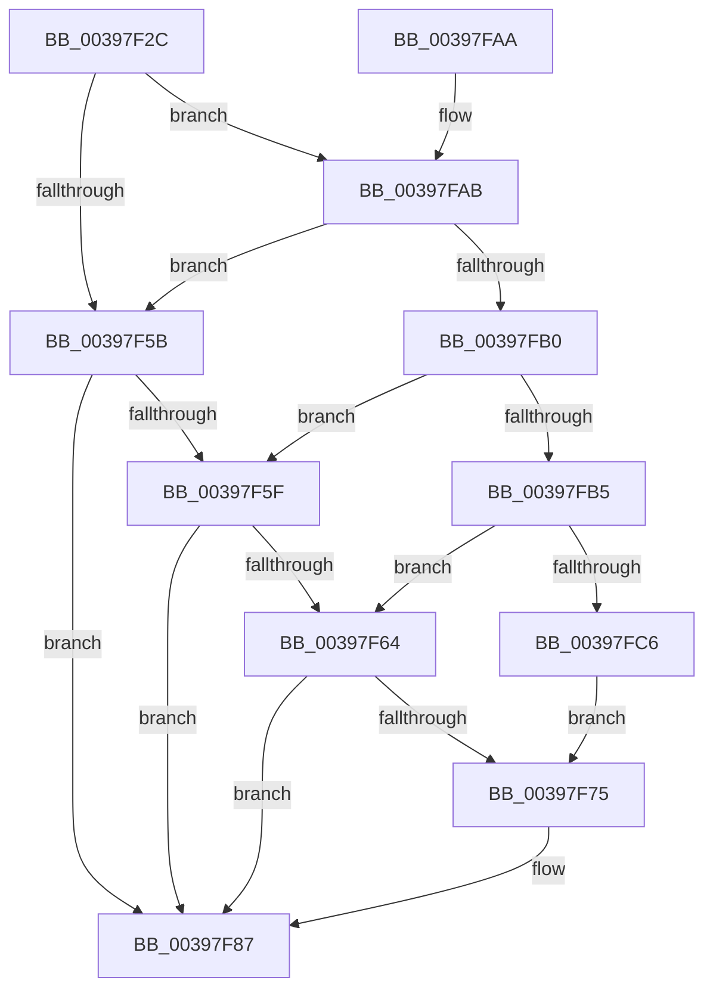

# KiPrepareReadyThreadForRescheduling

- RVA: `0x00397F2C`–`0x00397FDB` (길이 `175` bytes)
- VA: `0x0000000140397F2C`
- 실행 섹션: `.text`
- PDB 이름 있음: `예`; PDB Function 태그: `아니요`
- unwind 정보 RVA: `0x00081468`
- 디코드: `46`개 명령, `175/175` bytes 표시
- 미해석 바이트: `0` (있으면 어셈블리에 `.byte`로 보존)

> 이 문서는 커널 이미지의 기계어와 PDB 기호를 분석해 생성했습니다. 4번과 5번은 함수 원형과 자료형을 바이너리 사용 방식에서 추정한 C 해석이며 원본 소스 복구 결과는 아닙니다.

## 1. Dependencies

- 직접 호출 지점: **2**; 고유 호출 대상: **2**
- 직접 호출자로 확인된 함수: **3**
- RIP 상대 이미지 참조: **5**

### Outgoing calls
- `0x00397F82` → [KiSetPriorityBoost](KiSetPriorityBoost_function_00398A40.md) (function, `0x00398A40`)
- `0x00397F8A` → [KiEnterDeferredReadyState](KiEnterDeferredReadyState_function_00397420.md) (function, `0x00397420`)

### Direct callers
- [KiSetPriorityThread](../22/KiSetPriorityThread_function_00220E78.md) at `0x00221018`
- [KiRescheduleThreadAfterAffinityChange](../30/KiRescheduleThreadAfterAffinityChange_function_0030C9E8.md) at `0x0030CE8A`
- [KiApplyForegroundBoostThread](../4F/KiApplyForegroundBoostThread_function_004F7DC0.md) at `0x004F7F2A`

### Static image references
- `0x00397F36` → RVA `0x00FC50A0` (`ALMOSTRO`; read)
- `0x00397F49` → RVA `0x00FC6C4C` (`ALMOSTRO`; read)
- `0x00397F67` → RVA `0x00FC51C0` (`ALMOSTRO`; read)
- `0x00397FB8` → RVA `0x00FC50CC` (`ALMOSTRO`; read)
- `0x00397FC6` → RVA `0x00FC509C` (`ALMOSTRO`; read)

## 2. Other-region calls and transfers

- 다른 실행 섹션으로 향하는 call: **0**
- 별도 외부 분기/꼬리 이동을 확인하지 못했습니다.

## 3. Assembly (complete function range)

```asm
00397F2C  48 89 5C 24 08                  mov qword ptr [rsp + 8], rbx
00397F31  57                              push rdi
00397F32  48 83 EC 30                     sub rsp, 0x30
00397F36  83 3D 63 D1 C2 00 00            cmp dword ptr [rip + 0xc2d163], 0
00397F3D  49 8B F8                        mov rdi, r8
00397F40  48 8B D9                        mov rbx, rcx
00397F43  41 B8 0F 00 00 00               mov r8d, 0xf
00397F49  8B 0D FD EC C2 00               mov ecx, dword ptr [rip + 0xc2ecfd]
00397F4F  49 B9 20 03 00 00 80 F7 FF FF   movabs r9, 0xfffff78000000320
00397F59  74 50                           je 0x140397fab
00397F5B  85 D2                           test edx, edx
00397F5D  7E 28                           jle 0x140397f87
00397F5F  41 3B D0                        cmp edx, r8d
00397F62  7D 23                           jge 0x140397f87
00397F64  41 8B 01                        mov eax, dword ptr [r9]
00397F67  2B 05 53 D2 C2 00               sub eax, dword ptr [rip + 0xc2d253]
00397F6D  3B 83 B4 01 00 00               cmp eax, dword ptr [rbx + 0x1b4]
00397F73  72 12                           jb 0x140397f87
00397F75  4C 8B 4B 48                     mov r9, qword ptr [rbx + 0x48]
00397F79  48 8B D3                        mov rdx, rbx
00397F7C  89 4C 24 20                     mov dword ptr [rsp + 0x20], ecx
00397F80  33 C9                           xor ecx, ecx
00397F82  E8 B9 0A 00 00                  call 0x140398a40
00397F87  48 8B CB                        mov rcx, rbx
00397F8A  E8 91 F4 FF FF                  call 0x140397420
00397F8F  48 8B 07                        mov rax, qword ptr [rdi]
00397F92  48 8D 8B D8 00 00 00            lea rcx, [rbx + 0xd8]
00397F99  48 8B 5C 24 40                  mov rbx, qword ptr [rsp + 0x40]
00397F9E  48 89 01                        mov qword ptr [rcx], rax
00397FA1  48 89 0F                        mov qword ptr [rdi], rcx
00397FA4  48 83 C4 30                     add rsp, 0x30
00397FA8  5F                              pop rdi
00397FA9  C3                              ret
00397FAA  CC                              int3
00397FAB  83 FA 08                        cmp edx, 8
00397FAE  7C AB                           jl 0x140397f5b
00397FB0  83 FA 09                        cmp edx, 9
00397FB3  7F AA                           jg 0x140397f5f
00397FB5  41 8B 01                        mov eax, dword ptr [r9]
00397FB8  2B 05 0E D1 C2 00               sub eax, dword ptr [rip + 0xc2d10e]
00397FBE  3B 83 B4 01 00 00               cmp eax, dword ptr [rbx + 0x1b4]
00397FC4  72 9E                           jb 0x140397f64
00397FC6  8B 0D D0 D0 C2 00               mov ecx, dword ptr [rip + 0xc2d0d0]
00397FCC  41 B8 0B 00 00 00               mov r8d, 0xb
00397FD2  0F AF 0D 73 EC C2 00            imul ecx, dword ptr [rip + 0xc2ec73]
00397FD9  EB 9A                           jmp 0x140397f75
```

## 4. C-style interpretation (structured pseudocode)

```c
__int64 __fastcall KiPrepareReadyThreadForRescheduling(__int64 a1, int a2, __int64 a3)
{
    __int64 result;
    __int64 v_rsp;
    unsigned int v_stack_m18;
    unsigned __int64 v_stack_p8;

    v_stack_p8 = v_rbx;
    v_rsp = (v_rsp) - (48);
    if ((*(unsigned int *)(v_rip + 12767587)) == 0) goto loc_00397FAB;
loc_00397F5B:
    if (condition_is_less_or_equal) goto loc_00397F87;
loc_00397F5F:
    if (a2 >= 15) goto loc_00397F87;
loc_00397F64:
    result = (unsigned int)(((unsigned int)(*(unsigned int *)(a4))) - (*(unsigned int *)(v_rip + 12767827)));
    if (((unsigned int)(result)) >= (*(unsigned int *)(a1 + 436))) {
        a4 = *(unsigned __int64 *)(a1 + 72);
        a2 = a1;
        v_stack_m18 = (unsigned int)((unsigned int)(*(unsigned int *)(v_rip + 12774653)));
        a1 = 0;
        result = KiSetPriorityBoost(a1, a2, 15, a4);
    }
    result = KiEnterDeferredReadyState(0, a2, 15, a4);
    *(unsigned __int64 *)(a1 + 216) = *(unsigned __int64 *)(a3);
    *(unsigned __int64 *)(a3) = a1 + 216;
    v_rsp = (v_rsp) + (48);
    return *(unsigned __int64 *)(a3);
loc_00397FAB:
    if (a2 < 8) goto loc_00397F5B;
    if (a2 > 9) goto loc_00397F5F;
    result = (unsigned int)(((unsigned int)(*(unsigned int *)(a4))) - (*(unsigned int *)(v_rip + 12767502)));
    if (((unsigned int)(result)) < (*(unsigned int *)(v_stack_p8 + 436))) goto loc_00397F64;
    a1 = (unsigned int)(((unsigned int)(*(unsigned int *)(v_rip + 12767440))) * (*(unsigned int *)(v_rip + 12774515)));
    goto loc_00397F75;
}
```

## 5. (Beta) C Style

```c
int64_t KiPrepareReadyThreadForRescheduling(void *Arg1, int32_t Arg2, void *Arg3)
{
    uint8_t *arg1 = (uint8_t *)Arg1;
    uint8_t *arg3 = (uint8_t *)Arg3;

    int64_t result;
    int64_t local_rsp;
    uint32_t v_stack_m18;
    uint64_t v_stack_p8;

    v_stack_p8 = local_rbx;
    local_rsp = (local_rsp) - (48);
    if ((*(uint32_t *)(v_rip + 0xC2D163)) == 0) goto loc_00397FAB;
loc_00397F5B:
    if (condition_is_less_or_equal) goto loc_00397F87;
loc_00397F5F:
    if (Arg2 >= 15) goto loc_00397F87;
loc_00397F64:
    result = (uint32_t)(((uint32_t)(*(uint32_t *)(a4))) - (*(uint32_t *)(v_rip + 0xC2D253)));
    if (((uint32_t)(result)) >= (*(uint32_t *)(arg1 + 0x1B4))) {
        a4 = *(uint64_t *)(arg1 + 0x48);
        Arg2 = Arg1;
        v_stack_m18 = (uint32_t)((uint32_t)(*(uint32_t *)(v_rip + 0xC2ECFD)));
        Arg1 = 0;
        result = KiSetPriorityBoost(Arg1, Arg2, 15, a4);
    }
    result = KiEnterDeferredReadyState(0, Arg2, 15, a4);
    *(uint64_t *)(arg1 + 0xD8) = *(uint64_t *)(arg3);
    *(void **)(arg3) = Arg1 + 216;
    local_rsp = (local_rsp) + (48);
    return *(uint64_t *)(arg3);
loc_00397FAB:
    if (Arg2 < 8) goto loc_00397F5B;
    if (Arg2 > 9) goto loc_00397F5F;
    result = (uint32_t)(((uint32_t)(*(uint32_t *)(a4))) - (*(uint32_t *)(v_rip + 0xC2D10E)));
    if (((uint32_t)(result)) < (*(uint32_t *)(v_stack_p8 + 0x1B4))) goto loc_00397F64;
    Arg1 = (uint32_t)(((uint32_t)(*(uint32_t *)(v_rip + 0xC2D0D0))) * (*(uint32_t *)(v_rip + 0xC2EC73)));
    goto loc_00397F75;
}
```

### 관측된 메모리 오프셋

구조체 형식이 확인되지 않은 접근은 인자 기준의 오프셋으로만 기록했습니다.

| 기준 인자 | 오프셋 표현 | 폭 (bit) | 접근 |
|---|---:|---:|---|
| `Arg1` | `+ 0x0` | `64` | `W` |
| `Arg1` | `+ 0x48` | `64` | `R` |
| `Arg1` | `+ 0xD8` | `64` | `R` |
| `Arg1` | `+ 0x1B4` | `32` | `R` |
| `Arg3` | `+ 0x0` | `64` | `R` |
| `Arg3` | `+ 0x0` | `64` | `W` |

## 6. Execution-region graph

[열기: 2D/3D 그래프와 함수 탐색 컨트롤 패널](../../../control-panel.html?section=text&rva=0x00397F2C&view=graph)

- 2D 그래프는 위에서 아래로 흐르고, 3D 그래프는 빈 공간을 드래그해 회전합니다. Shift+드래그는 이동, 휠은 확대·축소, 함수 노드 선택은 대상 보고서 이동입니다.

### Static fallback


