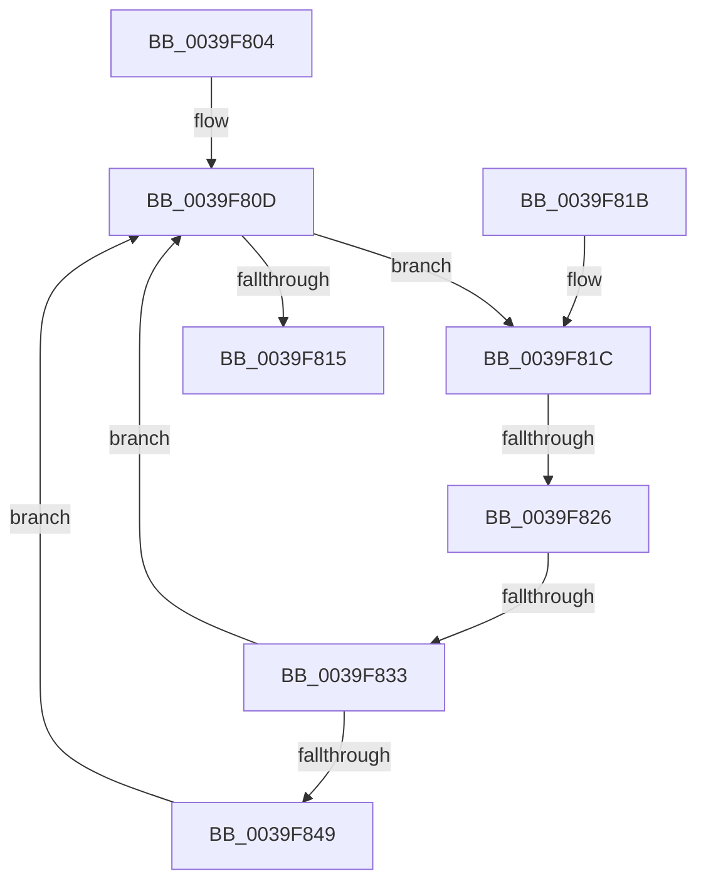

# KiProcessDisconnectList

- RVA: `0x0039F804`–`0x0039F855` (길이 `81` bytes)
- VA: `0x000000014039F804`
- 실행 섹션: `.text`
- PDB 이름 있음: `예`; PDB Function 태그: `예`
- unwind 정보 RVA: `0x0005E698`
- 디코드: `25`개 명령, `81/81` bytes 표시
- 미해석 바이트: `0` (있으면 어셈블리에 `.byte`로 보존)

> 이 문서는 커널 이미지의 기계어와 PDB 기호를 분석해 생성했습니다. 4번과 5번은 함수 원형과 자료형을 바이너리 사용 방식에서 추정한 C 해석이며 원본 소스 복구 결과는 아닙니다.

## 1. Dependencies

- 직접 호출 지점: **1**; 고유 호출 대상: **1**
- 직접 호출자로 확인된 함수: **2**
- RIP 상대 이미지 참조: **0**

### Outgoing calls
- `0x0039F84E` → [KeSetEvent](../33/KeSetEvent_function_0033F310.md) (function, `0x0033F310`)

### Direct callers
- [KiInterruptDispatchCommon](KiInterruptDispatchCommon_function_0039F3D0.md) at `0x0039F6AB`
- [KiProcessSecondarySignalList](../5B/KiProcessSecondarySignalList_function_005BDA10.md) at `0x005BDACC`

### Static image references
- 디코드된 RIP-relative 메모리 참조가 없습니다.

## 2. Other-region calls and transfers

- 다른 실행 섹션으로 향하는 call: **0**
- call이 아닌 외부 분기/꼬리 이동: **2**
  - `0x0039F820` → [sub_006E625C](../6E/Unknown_function_006E625C.md) (`tail-transfer`)
  - `0x0039F82D` → [sub_006E625C](../6E/Unknown_function_006E625C.md) (`tail-transfer`)

## 3. Assembly (complete function range)

```asm
0039F804  40 53                           push rbx
0039F806  48 83 EC 20                     sub rsp, 0x20
0039F80A  48 8B D9                        mov rbx, rcx
0039F80D  48 8B 03                        mov rax, qword ptr [rbx]
0039F810  48 3B C3                        cmp rax, rbx
0039F813  75 07                           jne 0x14039f81c
0039F815  48 83 C4 20                     add rsp, 0x20
0039F819  5B                              pop rbx
0039F81A  C3                              ret
0039F81B  CC                              int3
0039F81C  48 39 58 08                     cmp qword ptr [rax + 8], rbx
0039F820  0F 85 36 6A 34 00               jne 0x1406e625c
0039F826  48 8B 08                        mov rcx, qword ptr [rax]
0039F829  48 39 41 08                     cmp qword ptr [rcx + 8], rax
0039F82D  0F 85 29 6A 34 00               jne 0x1406e625c
0039F833  48 89 0B                        mov qword ptr [rbx], rcx
0039F836  48 89 59 08                     mov qword ptr [rcx + 8], rbx
0039F83A  48 8B 80 88 00 00 00            mov rax, qword ptr [rax + 0x88]
0039F841  48 8B 08                        mov rcx, qword ptr [rax]
0039F844  48 85 C9                        test rcx, rcx
0039F847  74 C4                           je 0x14039f80d
0039F849  45 33 C0                        xor r8d, r8d
0039F84C  33 D2                           xor edx, edx
0039F84E  E8 BD FA F9 FF                  call 0x14033f310
0039F853  EB B8                           jmp 0x14039f80d
```

## 4. C-style interpretation (structured pseudocode)

```c
__int64 __fastcall KiProcessDisconnectList(__int64 a1, int a2, int a3)
{
    __int64 result;
    __int64 v_rsp;

    v_rsp = (v_rsp) - (32);
loc_0039F80D:
    if ((*(unsigned __int64 *)(a1)) != a1) goto loc_0039F81C;
    v_rsp = (v_rsp) + (32);
    return *(unsigned __int64 *)(a1);
loc_0039F81C:
    *(unsigned __int64 *)(a1) = *(unsigned __int64 *)(*(unsigned __int64 *)(a1));
    *(unsigned __int64 *)(*(unsigned __int64 *)(*(unsigned __int64 *)(a1)) + 8) = a1;
    if (*(unsigned __int64 *)(*(unsigned __int64 *)(*(unsigned __int64 *)(a1) + 136)) == 0) goto loc_0039F80D;
    a3 = 0;
    a2 = 0;
    result = KeSetEvent(*(unsigned __int64 *)(*(unsigned __int64 *)(*(unsigned __int64 *)(a1) + 136)), a2, a3, a4);
    goto loc_0039F80D;
}
```

## 5. (Beta) C Style

```c
int64_t KiProcessDisconnectList(void *Arg1, int32_t Arg2, int32_t Arg3)
{
    uint8_t *arg1 = (uint8_t *)Arg1;

    int64_t result;
    int64_t local_rsp;

    local_rsp = (local_rsp) - (32);
loc_0039F80D:
    if ((*(uint64_t *)(arg1)) != Arg1) goto loc_0039F81C;
    local_rsp = (local_rsp) + (32);
    return *(uint64_t *)(arg1);
loc_0039F81C:
    *(uint64_t *)(arg1) = *(uint64_t *)(*(uint64_t *)(arg1));
    *(void **)(*(uint64_t *)(*(uint64_t *)(arg1)) + 0x8) = Arg1;
    if (*(uint64_t *)(*(uint64_t *)(*(uint64_t *)(arg1) + 0x88)) == 0) goto loc_0039F80D;
    Arg3 = 0;
    Arg2 = 0;
    result = KeSetEvent(*(uint64_t *)(*(uint64_t *)(*(uint64_t *)(arg1) + 0x88)), Arg2, Arg3, a4);
    goto loc_0039F80D;
}
```

### 관측된 메모리 오프셋

구조체 형식이 확인되지 않은 접근은 인자 기준의 오프셋으로만 기록했습니다.

| 기준 인자 | 오프셋 표현 | 폭 (bit) | 접근 |
|---|---:|---:|---|
| `Arg1` | `+ 0x0` | `64` | `R` |
| `Arg1` | `+ 0x0` | `64` | `W` |

## 6. Execution-region graph

[열기: 2D/3D 그래프와 함수 탐색 컨트롤 패널](../../../control-panel.html?section=text&rva=0x0039F804&view=graph)

- 2D 그래프는 위에서 아래로 흐르고, 3D 그래프는 빈 공간을 드래그해 회전합니다. Shift+드래그는 이동, 휠은 확대·축소, 함수 노드 선택은 대상 보고서 이동입니다.

### Static fallback


