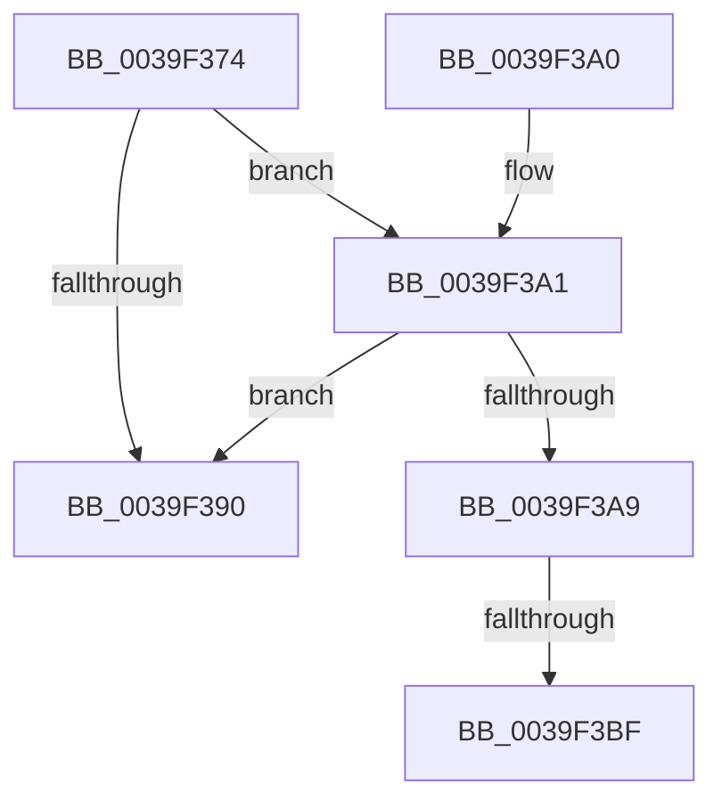

# KiProcessPendingDisconnect

- RVA: `0x0039F374`–`0x0039F3CA` (길이 `86` bytes)
- VA: `0x000000014039F374`
- 실행 섹션: `.text`
- PDB 이름 있음: `예`; PDB Function 태그: `예`
- unwind 정보 RVA: `0x000704BC`
- 디코드: `26`개 명령, `86/86` bytes 표시
- 미해석 바이트: `0` (있으면 어셈블리에 `.byte`로 보존)

> 이 문서는 커널 이미지의 기계어와 PDB 기호를 분석해 생성했습니다. 4번과 5번은 함수 원형과 자료형을 바이너리 사용 방식에서 추정한 C 해석이며 원본 소스 복구 결과는 아닙니다.

## 1. Dependencies

- 직접 호출 지점: **1**; 고유 호출 대상: **1**
- 직접 호출자로 확인된 함수: **1**
- RIP 상대 이미지 참조: **0**

### Outgoing calls
- `0x0039F3BF` → [KiDisconnectInterruptInternal](../2D/KiDisconnectInterruptInternal_function_002D38C0.md) (function, `0x002D38C0`)

### Direct callers
- [KiInterruptDispatchCommon](KiInterruptDispatchCommon_function_0039F3D0.md) at `0x0039F61B`

### Static image references
- 디코드된 RIP-relative 메모리 참조가 없습니다.

## 2. Other-region calls and transfers

- 다른 실행 섹션으로 향하는 call: **0**
- call이 아닌 외부 분기/꼬리 이동: **2**
  - `0x0039F3B9` → [sub_006E61FC](../6E/Unknown_function_006E61FC.md) (`tail-transfer`)
  - `0x0039F3C5` → [sub_006E61FC + 0x5](../6E/Unknown_function_006E61FC.md) (`tail-transfer`)

## 3. Assembly (complete function range)

```asm
0039F374  48 89 5C 24 08                  mov qword ptr [rsp + 8], rbx
0039F379  48 89 74 24 10                  mov qword ptr [rsp + 0x10], rsi
0039F37E  57                              push rdi
0039F37F  48 83 EC 20                     sub rsp, 0x20
0039F383  8B 42 68                        mov eax, dword ptr [rdx + 0x68]
0039F386  49 8B F8                        mov rdi, r8
0039F389  48 8B DA                        mov rbx, rdx
0039F38C  A8 02                           test al, 2
0039F38E  75 11                           jne 0x14039f3a1
0039F390  48 8B 5C 24 30                  mov rbx, qword ptr [rsp + 0x30]
0039F395  48 8B 74 24 38                  mov rsi, qword ptr [rsp + 0x38]
0039F39A  48 83 C4 20                     add rsp, 0x20
0039F39E  5F                              pop rdi
0039F39F  C3                              ret
0039F3A0  CC                              int3
0039F3A1  33 C0                           xor eax, eax
0039F3A3  66 39 42 66                     cmp word ptr [rdx + 0x66], ax
0039F3A7  75 E7                           jne 0x14039f390
0039F3A9  48 8B B2 90 00 00 00            mov rsi, qword ptr [rdx + 0x90]
0039F3B0  85 C9                           test ecx, ecx
0039F3B2  48 8B CB                        mov rcx, rbx
0039F3B5  48 8B 56 08                     mov rdx, qword ptr [rsi + 8]
0039F3B9  0F 85 3D 6E 34 00               jne 0x1406e61fc
0039F3BF  E8 FC 44 F3 FF                  call 0x1402d38c0
0039F3C4  90                              nop
0039F3C5  E9 37 6E 34 00                  jmp 0x1406e6201
```

## 4. C-style interpretation (structured pseudocode)

```c
__int64 __fastcall KiProcessPendingDisconnect(int a1, __int64 a2, __int64 a3)
{
    __int64 result;
    __int64 v_rsp;
    unsigned __int64 v_stack_p10;
    unsigned __int64 v_stack_p8;

    v_stack_p8 = v_rbx;
    v_stack_p10 = v_rsi;
    v_rsp = (v_rsp) - (32);
    if ((((unsigned __int8)((unsigned int)(*(unsigned int *)(a2 + 104)))) & (2)) != 0) goto loc_0039F3A1;
loc_0039F390:
    v_rsp = (v_rsp) + (32);
    return (unsigned int)(*(unsigned int *)(a2 + 104));
loc_0039F3A1:
    result = 0;
    if ((*(unsigned __int16 *)(a2 + 102)) != 0) goto loc_0039F390;
    result = KiDisconnectInterruptInternal(v_stack_p8, *(unsigned __int64 *)(*(unsigned __int64 *)(a2 + 144) + 8), a3, a4);
}
```

## 5. (Beta) C Style

```c
int64_t KiProcessPendingDisconnect(int32_t Arg1, void *Arg2, int64_t Arg3)
{
    uint8_t *arg2 = (uint8_t *)Arg2;

    int64_t result;
    int64_t local_rsp;
    uint64_t v_stack_p10;
    uint64_t v_stack_p8;

    v_stack_p8 = local_rbx;
    v_stack_p10 = local_rsi;
    local_rsp = (local_rsp) - (32);
    if ((((uint8_t)((uint32_t)(*(uint32_t *)(arg2 + 0x68)))) & (2)) != 0) goto loc_0039F3A1;
loc_0039F390:
    local_rsp = (local_rsp) + (32);
    return (uint32_t)(*(uint32_t *)(arg2 + 0x68));
loc_0039F3A1:
    result = 0;
    if ((*(uint16_t *)(arg2 + 0x66)) != 0) goto loc_0039F390;
    result = KiDisconnectInterruptInternal(v_stack_p8, *(uint64_t *)(*(uint64_t *)(arg2 + 0x90) + 0x8), Arg3, a4);
}
```

### 관측된 메모리 오프셋

구조체 형식이 확인되지 않은 접근은 인자 기준의 오프셋으로만 기록했습니다.

| 기준 인자 | 오프셋 표현 | 폭 (bit) | 접근 |
|---|---:|---:|---|
| `Arg2` | `+ 0x66` | `16` | `R` |
| `Arg2` | `+ 0x68` | `32` | `R` |
| `Arg2` | `+ 0x90` | `64` | `R` |

## 6. Execution-region graph

[열기: 2D/3D 그래프와 함수 탐색 컨트롤 패널](../../../control-panel.html?section=text&rva=0x0039F374&view=graph)

- 2D 그래프는 위에서 아래로 흐르고, 3D 그래프는 빈 공간을 드래그해 회전합니다. Shift+드래그는 이동, 휠은 확대·축소, 함수 노드 선택은 대상 보고서 이동입니다.

### Static fallback


