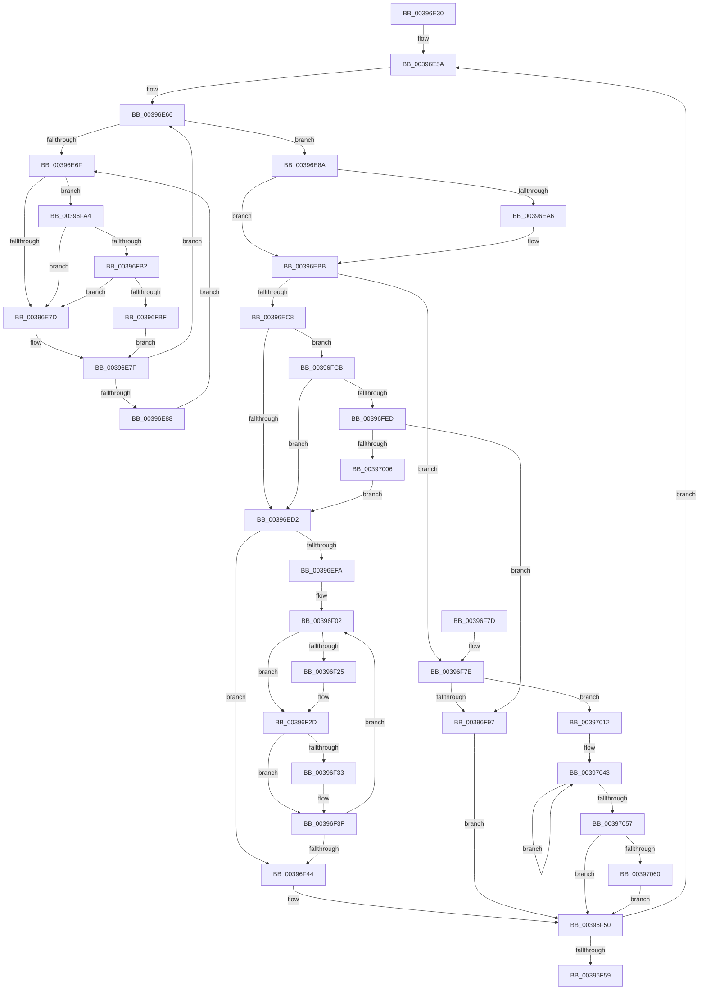

# KiReadyOutSwappedThreads

- RVA: `0x00396E30`–`0x00397077` (길이 `583` bytes)
- VA: `0x0000000140396E30`
- 실행 섹션: `.text`
- PDB 이름 있음: `예`; PDB Function 태그: `아니요`
- unwind 정보 RVA: `0x00081298`
- 디코드: `135`개 명령, `583/583` bytes 표시
- 미해석 바이트: `0` (있으면 어셈블리에 `.byte`로 보존)

> 이 문서는 커널 이미지의 기계어와 PDB 기호를 분석해 생성했습니다. 4번과 5번은 함수 원형과 자료형을 바이너리 사용 방식에서 추정한 C 해석이며 원본 소스 복구 결과는 아닙니다.

## 1. Dependencies

- 직접 호출 지점: **13**; 고유 호출 대상: **10**
- 직접 호출자로 확인된 함수: **2**
- RIP 상대 이미지 참조: **5**

### Outgoing calls
- `0x00396E8D` → [KiEnterDeferredReadyState](KiEnterDeferredReadyState_function_00397420.md) (function, `0x00397420`)
- `0x00396EB6` → [EtwTraceReadyThread](../25/EtwTraceReadyThread_function_00251F70.md) (function, `0x00251F70`)
- `0x00396EE6` → [KiDeferredReadySingleThread](../25/KiDeferredReadySingleThread_function_00252FE0.md) (function, `0x00252FE0`)
- `0x00396F14` → [KiDeferredReadySingleThread](../25/KiDeferredReadySingleThread_function_00252FE0.md) (function, `0x00252FE0`)
- `0x00396F3A` → [KiFlushSoftwareInterruptBatch](../25/KiFlushSoftwareInterruptBatch_function_00252200.md) (function, `0x00252200`)
- `0x00396F4B` → [KiFlushSoftwareInterruptBatch](../25/KiFlushSoftwareInterruptBatch_function_00252200.md) (function, `0x00252200`)
- `0x00396F5F` → [KiCheckForThreadDispatch](../25/KiCheckForThreadDispatch_function_00250648.md) (function, `0x00250648`)
- `0x00396F88` → [KiAcquireKobjectLockSafe](../25/KiAcquireKobjectLockSafe_function_00251C90.md) (function, `0x00251C90`)
- `0x00396F9D` → [KiRequestProcessInSwap](KiRequestProcessInSwap_function_003981D4.md) (function, `0x003981D4`)
- `0x00396FB2` → [KiCheckVpBackingLongSpinWaitHypercall](../30/KiCheckVpBackingLongSpinWaitHypercall_function_0030F490.md) (function, `0x0030F490`)
- `0x00396FC1` → [HvlNotifyLongSpinWait](../30/HvlNotifyLongSpinWait_function_0030F460.md) (function, `0x0030F460`)
- `0x00396FF7` → [KiAcquireKobjectLockSafe](../25/KiAcquireKobjectLockSafe_function_00251C90.md) (function, `0x00251C90`)
- `0x0039706D` → [KeSetEvent](../33/KeSetEvent_function_0033F310.md) (function, `0x0033F310`)

### Direct callers
- [KiOutSwapProcesses](../3C/KiOutSwapProcesses_function_003C8038.md) at `0x003C81C1`
- [KiInSwapProcesses](../46/KiInSwapProcesses_function_00463218.md) at `0x004632AB`

### Static image references
- `0x00396E71` → RVA `0x00FC52AC` (`ALMOSTRO`; reference)
- `0x00396E9A` → RVA `0x00FC6B04` (`ALMOSTRO`; read)
- `0x00396FA4` → RVA `0x00FC6AB8` (`ALMOSTRO`; read)
- `0x00397035` → RVA `0x00F22D48` (`.data`; read)
- `0x00397066` → RVA `0x00F22D80` (`.data`; read)

## 2. Other-region calls and transfers

- 다른 실행 섹션으로 향하는 call: **0**
- 별도 외부 분기/꼬리 이동을 확인하지 못했습니다.

## 3. Assembly (complete function range)

```asm
00396E30  48 89 5C 24 10                  mov qword ptr [rsp + 0x10], rbx
00396E35  48 89 6C 24 18                  mov qword ptr [rsp + 0x18], rbp
00396E3A  48 89 74 24 20                  mov qword ptr [rsp + 0x20], rsi
00396E3F  57                              push rdi
00396E40  41 56                           push r14
00396E42  41 57                           push r15
00396E44  48 83 EC 20                     sub rsp, 0x20
00396E48  65 48 8B 34 25 20 00 00 00      mov rsi, qword ptr gs:[0x20]
00396E51  44 8A FA                        mov r15b, dl
00396E54  48 8B E9                        mov rbp, rcx
00396E57  4C 8B F1                        mov r14, rcx
00396E5A  49 8D 9E 28 FF FF FF            lea rbx, [r14 - 0xd8]
00396E61  33 FF                           xor edi, edi
00396E63  4D 8B 36                        mov r14, qword ptr [r14]
00396E66  F0 48 0F BA 6B 40 00            lock bts qword ptr [rbx + 0x40], 0
00396E6D  73 1B                           jae 0x140396e8a
00396E6F  FF C7                           inc edi
00396E71  85 3D 35 E4 C2 00               test dword ptr [rip + 0xc2e435], edi
00396E77  0F 84 27 01 00 00               je 0x140396fa4
00396E7D  F3 90                           pause
00396E7F  48 8B 43 40                     mov rax, qword ptr [rbx + 0x40]
00396E83  48 85 C0                        test rax, rax
00396E86  74 DE                           je 0x140396e66
00396E88  EB E5                           jmp 0x140396e6f
00396E8A  48 8B CB                        mov rcx, rbx
00396E8D  E8 8E 05 00 00                  call 0x140397420
00396E92  48 C7 43 40 00 00 00 00         mov qword ptr [rbx + 0x40], 0
00396E9A  F7 05 60 FC C2 00 00 02 00 00   test dword ptr [rip + 0xc2fc60], 0x200
00396EA4  74 15                           je 0x140396ebb
00396EA6  44 8A 83 37 02 00 00            mov r8b, byte ptr [rbx + 0x237]
00396EAD  45 33 C9                        xor r9d, r9d
00396EB0  8A 93 36 02 00 00               mov dl, byte ptr [rbx + 0x236]
00396EB6  E8 B5 B0 EB FF                  call 0x140251f70
00396EBB  8B 43 78                        mov eax, dword ptr [rbx + 0x78]
00396EBE  0F BA E0 11                     bt eax, 0x11
00396EC2  0F 83 B6 00 00 00               jae 0x140396f7e
00396EC8  0F BA E0 14                     bt eax, 0x14
00396ECC  0F 82 F9 00 00 00               jb 0x140396fcb
00396ED2  48 83 64 24 40 00               and qword ptr [rsp + 0x40], 0
00396ED8  4C 8D 44 24 40                  lea r8, [rsp + 0x40]
00396EDD  45 33 C9                        xor r9d, r9d
00396EE0  48 8B D3                        mov rdx, rbx
00396EE3  48 8B CE                        mov rcx, rsi
00396EE6  E8 F5 C0 EB FF                  call 0x140252fe0
00396EEB  48 8B 5C 24 40                  mov rbx, qword ptr [rsp + 0x40]
00396EF0  BF 01 00 00 00                  mov edi, 1
00396EF5  48 85 DB                        test rbx, rbx
00396EF8  74 4A                           je 0x140396f44
00396EFA  48 8B 03                        mov rax, qword ptr [rbx]
00396EFD  48 89 44 24 40                  mov qword ptr [rsp + 0x40], rax
00396F02  48 8D 93 28 FF FF FF            lea rdx, [rbx - 0xd8]
00396F09  45 33 C9                        xor r9d, r9d
00396F0C  4C 8D 44 24 40                  lea r8, [rsp + 0x40]
00396F11  48 8B CE                        mov rcx, rsi
00396F14  E8 C7 C0 EB FF                  call 0x140252fe0
00396F19  48 8B 5C 24 40                  mov rbx, qword ptr [rsp + 0x40]
00396F1E  FF C7                           inc edi
00396F20  48 85 DB                        test rbx, rbx
00396F23  74 08                           je 0x140396f2d
00396F25  48 8B 03                        mov rax, qword ptr [rbx]
00396F28  48 89 44 24 40                  mov qword ptr [rsp + 0x40], rax
00396F2D  40 F6 C7 0F                     test dil, 0xf
00396F31  75 0C                           jne 0x140396f3f
00396F33  48 8D 8E D8 35 00 00            lea rcx, [rsi + 0x35d8]
00396F3A  E8 C1 B2 EB FF                  call 0x140252200
00396F3F  48 85 DB                        test rbx, rbx
00396F42  75 BE                           jne 0x140396f02
00396F44  48 8D 8E D8 35 00 00            lea rcx, [rsi + 0x35d8]
00396F4B  E8 B0 B2 EB FF                  call 0x140252200
00396F50  4C 3B F5                        cmp r14, rbp
00396F53  0F 85 01 FF FF FF               jne 0x140396e5a
00396F59  41 8A D7                        mov dl, r15b
00396F5C  48 8B CE                        mov rcx, rsi
00396F5F  E8 E4 96 EB FF                  call 0x140250648
00396F64  48 8B 5C 24 48                  mov rbx, qword ptr [rsp + 0x48]
00396F69  48 8B 6C 24 50                  mov rbp, qword ptr [rsp + 0x50]
00396F6E  48 8B 74 24 58                  mov rsi, qword ptr [rsp + 0x58]
00396F73  48 83 C4 20                     add rsp, 0x20
00396F77  41 5F                           pop r15
00396F79  41 5E                           pop r14
00396F7B  5F                              pop rdi
00396F7C  C3                              ret
00396F7D  CC                              int3
00396F7E  48 8B BB B8 00 00 00            mov rdi, qword ptr [rbx + 0xb8]
00396F85  48 8B CF                        mov rcx, rdi
00396F88  E8 03 AD EB FF                  call 0x140251c90
00396F8D  8B 87 08 01 00 00               mov eax, dword ptr [rdi + 0x108]
00396F93  A8 07                           test al, 7
00396F95  74 7B                           je 0x140397012
00396F97  48 8B D7                        mov rdx, rdi
00396F9A  48 8B CB                        mov rcx, rbx
00396F9D  E8 32 12 00 00                  call 0x1403981d4
00396FA2  EB AC                           jmp 0x140396f50
00396FA4  8B 05 0E FB C2 00               mov eax, dword ptr [rip + 0xc2fb0e]
00396FAA  A8 40                           test al, 0x40
00396FAC  0F 84 CB FE FF FF               je 0x140396e7d
00396FB2  E8 D9 84 F7 FF                  call 0x14030f490
00396FB7  84 C0                           test al, al
00396FB9  0F 84 BE FE FF FF               je 0x140396e7d
00396FBF  8B CF                           mov ecx, edi
00396FC1  E8 9A 84 F7 FF                  call 0x14030f460
00396FC6  E9 B4 FE FF FF                  jmp 0x140396e7f
00396FCB  F0 0F BA 73 78 14               lock btr dword ptr [rbx + 0x78], 0x14
00396FD1  48 8B 8B B8 00 00 00            mov rcx, qword ptr [rbx + 0xb8]
00396FD8  B8 08 00 00 00                  mov eax, 8
00396FDD  F0 0F C1 81 08 01 00 00         lock xadd dword ptr [rcx + 0x108], eax
00396FE5  A8 07                           test al, 7
00396FE7  0F 84 E5 FE FF FF               je 0x140396ed2
00396FED  48 8B BB B8 00 00 00            mov rdi, qword ptr [rbx + 0xb8]
00396FF4  48 8B CF                        mov rcx, rdi
00396FF7  E8 94 AC EB FF                  call 0x140251c90
00396FFC  8B 87 08 01 00 00               mov eax, dword ptr [rdi + 0x108]
00397002  A8 07                           test al, 7
00397004  75 91                           jne 0x140396f97
00397006  F0 81 27 7F FF FF FF            lock and dword ptr [rdi], 0xffffff7f
0039700D  E9 C0 FE FF FF                  jmp 0x140396ed2
00397012  F0 83 87 08 01 00 00 08         lock add dword ptr [rdi + 0x108], 8
0039701A  F0 81 27 7F FF FF FF            lock and dword ptr [rdi], 0xffffff7f
00397021  F0 0F BA 73 78 14               lock btr dword ptr [rbx + 0x78], 0x14
00397027  C6 83 84 01 00 00 06            mov byte ptr [rbx + 0x184], 6
0039702E  48 81 C3 D8 00 00 00            add rbx, 0xd8
00397035  0F 0D 0D 0C BD B8 00            prefetchw byte ptr [rip + 0xb8bd0c]
0039703C  48 8B 05 05 BD B8 00            mov rax, qword ptr [rip + 0xb8bd05]
00397043  48 89 03                        mov qword ptr [rbx], rax
00397046  48 8B C8                        mov rcx, rax
00397049  F0 48 0F B1 1D F6 BC B8 00      lock cmpxchg qword ptr [rip + 0xb8bcf6], rbx
00397052  48 3B C1                        cmp rax, rcx
00397055  75 EC                           jne 0x140397043
00397057  48 85 C0                        test rax, rax
0039705A  0F 85 F0 FE FF FF               jne 0x140396f50
00397060  45 33 C0                        xor r8d, r8d
00397063  8D 50 0A                        lea edx, [rax + 0xa]
00397066  48 8D 0D 13 BD B8 00            lea rcx, [rip + 0xb8bd13]
0039706D  E8 9E 82 FA FF                  call 0x14033f310
00397072  E9 D9 FE FF FF                  jmp 0x140396f50
```

## 4. C-style interpretation (structured pseudocode)

```c
__int64 __fastcall KiReadyOutSwappedThreads(__int64 a1, unsigned __int8 a2, __int64 a3, int a4)
{
    __int64 result;
    __int64 v_rbx;
    __int64 v_rdi;
    __int64 v_rsp;
    unsigned __int64 v_stack_p10;
    unsigned __int64 v_stack_p18;
    unsigned __int64 v_stack_p20;
    unsigned __int64 v_stack_p8;

    v_stack_p10 = v_rbx;
    v_stack_p18 = v_rbp;
    v_stack_p20 = v_rsi;
    v_rsp = (v_rsp) - (32);
loc_00396E5A:
    v_rdi = 0;
loc_00396E66:
    if (condition_is_above_or_equal) goto loc_00396E8A;
loc_00396E6F:
    v_rdi = (unsigned int)((v_rdi) + 1);
    if (((*(unsigned int *)(v_rip + 12772405)) & ((unsigned int)(v_rdi))) == 0) goto loc_00396FA4;
loc_00396E7D:
loc_00396E7F:
    if (*(unsigned __int64 *)(a1 - 216 + 64) == 0) goto loc_00396E66;
    goto loc_00396E6F;
loc_00396E8A:
    result = KiEnterDeferredReadyState(a1 - 216, a2, a3, a4);
    *(unsigned __int64 *)(a1 - 216 + 64) = 0;
    if (((*(unsigned int *)(v_rip + 12778592)) & (512)) != 0) {
        a3 = *(unsigned __int8 *)(a1 - 216 + 567);
        a4 = 0;
        a2 = *(unsigned __int8 *)(a1 - 216 + 566);
        result = EtwTraceReadyThread(a1 - 216, a2, a3, a4);
    }
    if (condition_is_above_or_equal) goto loc_00396F7E;
    if (condition_is_below) goto loc_00396FCB;
loc_00396ED2:
    a4 = 0;
    result = KiDeferredReadySingleThread(*(unsigned __int64 *)(gs_base + (0 + 32)), a1 - 216, v_stack_p8, a4);
    if (v_stack_p8 == 0) goto loc_00396F44;
    v_stack_p8 = *(unsigned __int64 *)(v_stack_p8);
loc_00396F02:
    a4 = 0;
    result = KiDeferredReadySingleThread(*(unsigned __int64 *)(gs_base + (0 + 32)), v_stack_p8 - 216, v_stack_p8, a4);
    v_rdi = (unsigned int)((1) + 1);
    if (v_stack_p8 != 0) {
        result = *(unsigned __int64 *)(v_stack_p8);
        v_stack_p8 = result;
    }
    if ((((unsigned __int8)(v_rdi)) & (15)) == 0) {
        a1 = *(unsigned __int64 *)(gs_base + (0 + 32)) + 13784;
        result = KiFlushSoftwareInterruptBatch(a1, v_stack_p8 - 216, v_stack_p8, a4);
    }
    if (v_stack_p8 != 0) goto loc_00396F02;
loc_00396F44:
    result = KiFlushSoftwareInterruptBatch(*(unsigned __int64 *)(gs_base + (0 + 32)) + 13784, v_stack_p8 - 216, v_stack_p8, a4);
loc_00396F50:
    if ((*(unsigned __int64 *)(a1)) != a1) goto loc_00396E5A;
    result = KiCheckForThreadDispatch(*(unsigned __int64 *)(gs_base + (0 + 32)), a2, v_stack_p8, a4);
    v_rsp = (v_rsp) + (32);
    return result;
loc_00396F7E:
    result = KiAcquireKobjectLockSafe(*(unsigned __int64 *)(v_stack_p10 + 184), a2, v_stack_p8, a4);
    if ((((unsigned __int8)((unsigned int)(*(unsigned int *)(*(unsigned __int64 *)(v_stack_p10 + 184) + 264)))) & (7)) == 0) goto loc_00397012;
loc_00396F97:
    result = KiRequestProcessInSwap(v_stack_p10, *(unsigned __int64 *)(v_stack_p10 + 184), v_stack_p8, a4);
    goto loc_00396F50;
loc_00396FA4:
    if ((((unsigned __int8)((unsigned int)(*(unsigned int *)(v_rip + 12778254)))) & (64)) == 0) goto loc_00396E7D;
    result = KiCheckVpBackingLongSpinWaitHypercall(v_stack_p10, *(unsigned __int64 *)(v_stack_p10 + 184), v_stack_p8, a4);
    if ((unsigned __int8)(result) == 0) goto loc_00396E7D;
    result = HvlNotifyLongSpinWait((unsigned int)((unsigned int)(*(unsigned __int64 *)(v_stack_p10 + 184))), *(unsigned __int64 *)(v_stack_p10 + 184), v_stack_p8, a4);
    goto loc_00396E7F;
loc_00396FCB:
    if (((8) & (7)) == 0) goto loc_00396ED2;
    result = KiAcquireKobjectLockSafe(*(unsigned __int64 *)(v_stack_p10 + 184), *(unsigned __int64 *)(v_stack_p10 + 184), v_stack_p8, a4);
    if ((((unsigned __int8)((unsigned int)(*(unsigned int *)(*(unsigned __int64 *)(v_stack_p10 + 184) + 264)))) & (7)) != 0) goto loc_00396F97;
    goto loc_00396ED2;
loc_00397012:
    *(unsigned __int8 *)(v_stack_p10 + 388) = 6;
    v_rbx = (v_stack_p10) + (216);
loc_00397043:
    *(unsigned __int64 *)(v_rbx) = *(unsigned __int64 *)(v_rip + 12107013);
    if ((*(unsigned __int64 *)(v_rip + 12107013)) != (*(unsigned __int64 *)(v_rip + 12107013))) goto loc_00397043;
    if (*(unsigned __int64 *)(v_rip + 12107013) != 0) goto loc_00396F50;
    a3 = 0;
    result = KeSetEvent(v_rip + 12107027, *(unsigned __int64 *)(v_rip + 12107013) + 10, a3, a4);
    goto loc_00396F50;
}
```

## 5. (Beta) C Style

```c
int64_t KiReadyOutSwappedThreads(int64_t Arg1, uint8_t Arg2, int64_t Arg3, int32_t Arg4)
{
    int64_t result;
    int64_t local_rbx;
    int64_t local_rdi;
    int64_t local_rsp;
    uint64_t v_stack_p10;
    uint64_t v_stack_p18;
    uint64_t v_stack_p20;
    uint64_t v_stack_p8;

    v_stack_p10 = local_rbx;
    v_stack_p18 = local_rbp;
    v_stack_p20 = local_rsi;
    local_rsp = (local_rsp) - (32);
loc_00396E5A:
    local_rdi = 0;
loc_00396E66:
    if (condition_is_above_or_equal) goto loc_00396E8A;
loc_00396E6F:
    local_rdi = (uint32_t)((local_rdi) + 1);
    if (((*(uint32_t *)(v_rip + 0xC2E435)) & ((uint32_t)(local_rdi))) == 0) goto loc_00396FA4;
loc_00396E7D:
loc_00396E7F:
    if (*(uint64_t *)(Arg1 - 0xD8 + 0x40) == 0) goto loc_00396E66;
    goto loc_00396E6F;
loc_00396E8A:
    result = KiEnterDeferredReadyState(Arg1 - 216, Arg2, Arg3, Arg4);
    *(uint64_t *)(Arg1 - 0xD8 + 0x40) = 0;
    if (((*(uint32_t *)(v_rip + 0xC2FC60)) & (512)) != 0) {
        Arg3 = *(uint8_t *)(Arg1 - 0xD8 + 0x237);
        Arg4 = 0;
        Arg2 = *(uint8_t *)(Arg1 - 0xD8 + 0x236);
        result = EtwTraceReadyThread(Arg1 - 216, Arg2, Arg3, Arg4);
    }
    if (condition_is_above_or_equal) goto loc_00396F7E;
    if (condition_is_below) goto loc_00396FCB;
loc_00396ED2:
    Arg4 = 0;
    result = KiDeferredReadySingleThread(*(uint64_t *)(gs_base + (0 + 0x20)), Arg1 - 216, v_stack_p8, Arg4);
    if (v_stack_p8 == 0) goto loc_00396F44;
    v_stack_p8 = *(uint64_t *)(v_stack_p8);
loc_00396F02:
    Arg4 = 0;
    result = KiDeferredReadySingleThread(*(uint64_t *)(gs_base + (0 + 0x20)), v_stack_p8 - 216, v_stack_p8, Arg4);
    local_rdi = (uint32_t)((1) + 1);
    if (v_stack_p8 != 0) {
        result = *(uint64_t *)(v_stack_p8);
        v_stack_p8 = result;
    }
    if ((((uint8_t)(local_rdi)) & (15)) == 0) {
        Arg1 = *(uint64_t *)(gs_base + (0 + 0x20)) + 13784;
        result = KiFlushSoftwareInterruptBatch(Arg1, v_stack_p8 - 216, v_stack_p8, Arg4);
    }
    if (v_stack_p8 != 0) goto loc_00396F02;
loc_00396F44:
    result = KiFlushSoftwareInterruptBatch(*(uint64_t *)(gs_base + (0 + 0x20)) + 13784, v_stack_p8 - 216, v_stack_p8, Arg4);
loc_00396F50:
    if ((*(uint64_t *)(Arg1)) != Arg1) goto loc_00396E5A;
    result = KiCheckForThreadDispatch(*(uint64_t *)(gs_base + (0 + 0x20)), Arg2, v_stack_p8, Arg4);
    local_rsp = (local_rsp) + (32);
    return result;
loc_00396F7E:
    result = KiAcquireKobjectLockSafe(*(uint64_t *)(v_stack_p10 + 0xB8), Arg2, v_stack_p8, Arg4);
    if ((((uint8_t)((uint32_t)(*(uint32_t *)(*(uint64_t *)(v_stack_p10 + 0xB8) + 0x108)))) & (7)) == 0) goto loc_00397012;
loc_00396F97:
    result = KiRequestProcessInSwap(v_stack_p10, *(uint64_t *)(v_stack_p10 + 0xB8), v_stack_p8, Arg4);
    goto loc_00396F50;
loc_00396FA4:
    if ((((uint8_t)((uint32_t)(*(uint32_t *)(v_rip + 0xC2FB0E)))) & (64)) == 0) goto loc_00396E7D;
    result = KiCheckVpBackingLongSpinWaitHypercall(v_stack_p10, *(uint64_t *)(v_stack_p10 + 0xB8), v_stack_p8, Arg4);
    if ((uint8_t)(result) == 0) goto loc_00396E7D;
    result = HvlNotifyLongSpinWait((uint32_t)((uint32_t)(*(uint64_t *)(v_stack_p10 + 0xB8))), *(uint64_t *)(v_stack_p10 + 0xB8), v_stack_p8, Arg4);
    goto loc_00396E7F;
loc_00396FCB:
    if (((8) & (7)) == 0) goto loc_00396ED2;
    result = KiAcquireKobjectLockSafe(*(uint64_t *)(v_stack_p10 + 0xB8), *(uint64_t *)(v_stack_p10 + 0xB8), v_stack_p8, Arg4);
    if ((((uint8_t)((uint32_t)(*(uint32_t *)(*(uint64_t *)(v_stack_p10 + 0xB8) + 0x108)))) & (7)) != 0) goto loc_00396F97;
    goto loc_00396ED2;
loc_00397012:
    *(uint8_t *)(v_stack_p10 + 0x184) = 6;
    local_rbx = (v_stack_p10) + (216);
loc_00397043:
    *(uint64_t *)(local_rbx) = *(uint64_t *)(v_rip + 0xB8BD05);
    if ((*(uint64_t *)(v_rip + 0xB8BD05)) != (*(uint64_t *)(v_rip + 0xB8BD05))) goto loc_00397043;
    if (*(uint64_t *)(v_rip + 0xB8BD05) != 0) goto loc_00396F50;
    Arg3 = 0;
    result = KeSetEvent(v_rip + 12107027, *(uint64_t *)(v_rip + 0xB8BD05) + 10, Arg3, Arg4);
    goto loc_00396F50;
}
```

## 6. Execution-region graph

[열기: 2D/3D 그래프와 함수 탐색 컨트롤 패널](../../../control-panel.html?section=text&rva=0x00396E30&view=graph)

- 2D 그래프는 위에서 아래로 흐르고, 3D 그래프는 빈 공간을 드래그해 회전합니다. Shift+드래그는 이동, 휠은 확대·축소, 함수 노드 선택은 대상 보고서 이동입니다.

### Static fallback


