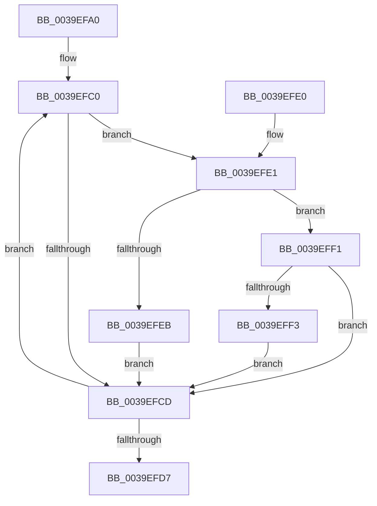

# KiReduceAffinityToRankListMinimums

- RVA: `0x0039EFA0`–`0x0039EFFC` (길이 `92` bytes)
- VA: `0x000000014039EFA0`
- 실행 섹션: `.text`
- PDB 이름 있음: `예`; PDB Function 태그: `아니요`
- unwind 정보 RVA: `0x00081C50`
- 디코드: `29`개 명령, `92/92` bytes 표시
- 미해석 바이트: `0` (있으면 어셈블리에 `.byte`로 보존)

> 이 문서는 커널 이미지의 기계어와 PDB 기호를 분석해 생성했습니다. 4번과 5번은 함수 원형과 자료형을 바이너리 사용 방식에서 추정한 C 해석이며 원본 소스 복구 결과는 아닙니다.

## 1. Dependencies

- 직접 호출 지점: **0**; 고유 호출 대상: **0**
- 직접 호출자로 확인된 함수: **4**
- RIP 상대 이미지 참조: **0**

### Outgoing calls
- 직접 디코드된 call 명령이 없습니다.

### Direct callers
- [KiChooseTargetProcessor](../25/KiChooseTargetProcessor_function_002556D8.md) at `0x00255984`
- [KiChooseTargetProcessor](../25/KiChooseTargetProcessor_function_002556D8.md) at `0x00255ECD`
- [KiTallyHeteroSoftParkElectionVotes](KiTallyHeteroSoftParkElectionVotes_function_0039E5B8.md) at `0x0039E759`
- [KiPerformSoftParkElectionRound](../45/KiPerformSoftParkElectionRound_function_00450BC0.md) at `0x00450C07`
- [sub_006D831E](../6D/Unknown_function_006D831E.md) at `0x006D850D`
- [sub_006D831E](../6D/Unknown_function_006D831E.md) at `0x006D8922`

### Static image references
- 디코드된 RIP-relative 메모리 참조가 없습니다.

## 2. Other-region calls and transfers

- 다른 실행 섹션으로 향하는 call: **0**
- 별도 외부 분기/꼬리 이동을 확인하지 못했습니다.

## 3. Assembly (complete function range)

```asm
0039EFA0  48 89 5C 24 08                  mov qword ptr [rsp + 8], rbx
0039EFA5  45 33 D2                        xor r10d, r10d
0039EFA8  4C 8B C9                        mov r9, rcx
0039EFAB  32 C9                           xor cl, cl
0039EFAD  45 8B C2                        mov r8d, r10d
0039EFB0  48 8B DA                        mov rbx, rdx
0039EFB3  41 B3 FF                        mov r11b, 0xff
0039EFB6  66 66 0F 1F 84 00 00 00 00 00   nop word ptr [rax + rax]
0039EFC0  B8 01 00 00 00                  mov eax, 1
0039EFC5  48 D3 E0                        shl rax, cl
0039EFC8  49 85 C1                        test r9, rax
0039EFCB  75 14                           jne 0x14039efe1
0039EFCD  FE C1                           inc cl
0039EFCF  49 FF C0                        inc r8
0039EFD2  80 F9 40                        cmp cl, 0x40
0039EFD5  72 E9                           jb 0x14039efc0
0039EFD7  48 8B 5C 24 08                  mov rbx, qword ptr [rsp + 8]
0039EFDC  49 8B C2                        mov rax, r10
0039EFDF  C3                              ret
0039EFE0  CC                              int3
0039EFE1  41 0F B6 14 18                  movzx edx, byte ptr [r8 + rbx]
0039EFE6  41 3A D3                        cmp dl, r11b
0039EFE9  75 06                           jne 0x14039eff1
0039EFEB  4D 0F AB C2                     bts r10, r8
0039EFEF  EB DC                           jmp 0x14039efcd
0039EFF1  73 DA                           jae 0x14039efcd
0039EFF3  44 0F B6 DA                     movzx r11d, dl
0039EFF7  4C 8B D0                        mov r10, rax
0039EFFA  EB D1                           jmp 0x14039efcd
```

## 4. C-style interpretation (structured pseudocode)

```c
__int64 __fastcall KiReduceAffinityToRankListMinimums(__int64 a1, __int64 a2)
{
    __int64 result;
    __int64 v_r10;
    unsigned __int64 v_stack_p8;

    v_stack_p8 = v_rbx;
    v_r10 = 0;
    a1 = 0;
loc_0039EFC0:
    result = (1) << (0);
    if (((0) & (result)) != 0) goto loc_0039EFE1;
loc_0039EFCD:
    a1 = (unsigned __int8)((a1) + 1);
    a3 = (0) + 1;
    if (((unsigned __int8)(a1)) < 64) goto loc_0039EFC0;
    return 0;
loc_0039EFE1:
    if (((unsigned __int8)(*(unsigned __int8 *)(a3 + v_stack_p8 * 1))) != 255) goto loc_0039EFF1;
    goto loc_0039EFCD;
loc_0039EFF1:
    if (((unsigned __int8)(*(unsigned __int8 *)(a3 + v_stack_p8 * 1))) >= 255) goto loc_0039EFCD;
    goto loc_0039EFCD;
}
```

## 5. (Beta) C Style

```c
int64_t KiReduceAffinityToRankListMinimums(int64_t Arg1, int64_t Arg2)
{
    int64_t result;
    int64_t local_r10;
    uint64_t v_stack_p8;

    v_stack_p8 = local_rbx;
    local_r10 = 0;
    Arg1 = 0;
loc_0039EFC0:
    result = (1) << (0);
    if (((0) & (result)) != 0) goto loc_0039EFE1;
loc_0039EFCD:
    Arg1 = (uint8_t)((Arg1) + 1);
    a3 = (0) + 1;
    if (((uint8_t)(Arg1)) < 64) goto loc_0039EFC0;
    return 0;
loc_0039EFE1:
    if (((uint8_t)(*(uint8_t *)(a3 + v_stack_p8 * 1))) != 255) goto loc_0039EFF1;
    goto loc_0039EFCD;
loc_0039EFF1:
    if (((uint8_t)(*(uint8_t *)(a3 + v_stack_p8 * 1))) >= 255) goto loc_0039EFCD;
    goto loc_0039EFCD;
}
```

## 6. Execution-region graph

[열기: 2D/3D 그래프와 함수 탐색 컨트롤 패널](../../../control-panel.html?section=text&rva=0x0039EFA0&view=graph)

- 2D 그래프는 위에서 아래로 흐르고, 3D 그래프는 빈 공간을 드래그해 회전합니다. Shift+드래그는 이동, 휠은 확대·축소, 함수 노드 선택은 대상 보고서 이동입니다.

### Static fallback


