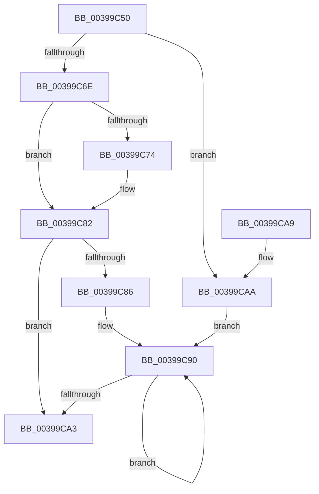

# KiReleasePrcbLocksForIsolationUnit

- RVA: `0x00399C50`–`0x00399CB6` (길이 `102` bytes)
- VA: `0x0000000140399C50`
- 실행 섹션: `.text`
- PDB 이름 있음: `예`; PDB Function 태그: `아니요`
- unwind 정보 RVA: `0x000DB714`
- 디코드: `30`개 명령, `102/102` bytes 표시
- 미해석 바이트: `0` (있으면 어셈블리에 `.byte`로 보존)

> 이 문서는 커널 이미지의 기계어와 PDB 기호를 분석해 생성했습니다. 4번과 5번은 함수 원형과 자료형을 바이너리 사용 방식에서 추정한 C 해석이며 원본 소스 복구 결과는 아닙니다.

## 1. Dependencies

- 직접 호출 지점: **0**; 고유 호출 대상: **0**
- 직접 호출자로 확인된 함수: **42**
- RIP 상대 이미지 참조: **0**

### Outgoing calls
- 직접 디코드된 call 명령이 없습니다.

### Direct callers
- [KiDeferGroupSchedulingPreemption](../20/KiDeferGroupSchedulingPreemption_function_0020076C.md) at `0x00200BF5`
- [KiHandleDeferredPreemption](../20/KiHandleDeferredPreemption_function_00202ECC.md) at `0x00202F9F`
- [KiHandleDeferredPreemption](../20/KiHandleDeferredPreemption_function_00202ECC.md) at `0x002031AC`
- [KeYieldExecution](../20/KeYieldExecution_function_00209FA0.md) at `0x0020A2DA`
- [KeYieldExecution](../20/KeYieldExecution_function_00209FA0.md) at `0x0020A324`
- [KiNormalPriorityReadyScan](../21/KiNormalPriorityReadyScan_function_0021B400.md) at `0x0021B5B8`
- [KiNormalPriorityReadyScan](../21/KiNormalPriorityReadyScan_function_0021B400.md) at `0x0021B5DB`
- [sub_0021C284](../21/Unknown_function_0021C284.md) at `0x0021C405`
- [sub_0021C4AD](../21/Unknown_function_0021C4AD.md) at `0x0021C4B2`
- [KiSetPriorityThread](../22/KiSetPriorityThread_function_00220E78.md) at `0x0022121D`
- [sub_002546EC](../25/Unknown_function_002546EC.md) at `0x00254918`
- [KiChooseTargetProcessor](../25/KiChooseTargetProcessor_function_002556D8.md) at `0x00255C84`
- [KiChooseTargetProcessor](../25/KiChooseTargetProcessor_function_002556D8.md) at `0x00255CAD`
- [KiChooseTargetProcessor](../25/KiChooseTargetProcessor_function_002556D8.md) at `0x00256083`
- [KiUpdateGlobalCpuSetConfiguration](../30/KiUpdateGlobalCpuSetConfiguration_function_00305AB8.md) at `0x00305BE7`
- [KiUpdateGlobalCpuSetConfiguration](../30/KiUpdateGlobalCpuSetConfiguration_function_00305AB8.md) at `0x00305C53`
- [KiUpdateGlobalCpuSetConfiguration](../30/KiUpdateGlobalCpuSetConfiguration_function_00305AB8.md) at `0x00305CAC`
- [KiGroupSchedulingGenerationEnd](../30/KiGroupSchedulingGenerationEnd_function_0030A9B4.md) at `0x0030ACDA`
- [KiGroupSchedulingQuantumEnd](../30/KiGroupSchedulingQuantumEnd_function_0030B220.md) at `0x0030B3F6`
- [sub_0030E8E0](../30/Unknown_function_0030E8E0.md) at `0x0030EB66`
- [sub_0030F26B](../30/Unknown_function_0030F26B.md) at `0x0030F436`
- [KiSearchForNewThreadsOnTarget](../30/KiSearchForNewThreadsOnTarget_function_0030F500.md) at `0x00310A61`
- [KiSearchForNewThreadsOnTarget](../30/KiSearchForNewThreadsOnTarget_function_0030F500.md) at `0x00310C0A`
- [KiSearchForNewThreadsOnTarget](../30/KiSearchForNewThreadsOnTarget_function_0030F500.md) at `0x00311193`
- [KiSearchForNewThreadsOnTarget](../30/KiSearchForNewThreadsOnTarget_function_0030F500.md) at `0x0031129A`
- [KiUnparkCurrentProcessor](../35/KiUnparkCurrentProcessor_function_00352214.md) at `0x003522B9`
- [KeTransitionProcessorParkState](../35/KeTransitionProcessorParkState_function_003527EC.md) at `0x00352902`
- [KiExitThreadWaitReschedule](../35/KiExitThreadWaitReschedule_function_00352EC8.md) at `0x00352F9F`
- [KiParkCurrentProcessor](../35/KiParkCurrentProcessor_function_003533A4.md) at `0x003534CA`
- [KiSearchForNewThreadsWithinSearchContext](../35/KiSearchForNewThreadsWithinSearchContext_function_00353B30.md) at `0x00353C79`
- [KiSendHeteroRescheduleIntRequestHelper](../35/KiSendHeteroRescheduleIntRequestHelper_function_0035420C.md) at `0x00354474`
- [KiSendHeteroRescheduleIntRequestHelper](../35/KiSendHeteroRescheduleIntRequestHelper_function_0035420C.md) at `0x003544D0`
- [KiIdleSchedule](../35/KiIdleSchedule_function_00355000.md) at `0x00355105`
- [KiSwapThread](../35/KiSwapThread_function_00355640.md) at `0x00355984`
- [KiSwapThread](../35/KiSwapThread_function_00355640.md) at `0x00355BBA`
- [KiSearchForNewThread](../35/KiSearchForNewThread_function_00355C98.md) at `0x00355D6C`
- [KiSearchForNewThread](../35/KiSearchForNewThread_function_00355C98.md) at `0x00355EB1`
- [KiSearchForNewThread](../35/KiSearchForNewThread_function_00355C98.md) at `0x00355F32`
- [KeQueryTotalCycleTimeThread](../37/KeQueryTotalCycleTimeThread_function_0037EF20.md) at `0x0037FA24`
- [KiSetSystemAffinityThread](KiSetSystemAffinityThread_function_003993E0.md) at `0x0039958E`
- [KiHeteroAttemptPreemptionSwapOnSubNode](../3C/KiHeteroAttemptPreemptionSwapOnSubNode_function_003C1144.md) at `0x003C1323`
- [KeQueryEffectivePriorityThread](../3C/KeQueryEffectivePriorityThread_function_003C7CA0.md) at `0x003C7E57`
- [KiAcquirePrcbLocksForPreemptionAttemptSlowPath](../43/KiAcquirePrcbLocksForPreemptionAttemptSlowPath_function_00434910.md) at `0x00434966`
- [KiUpdateCpuTargetByRate](../46/KiUpdateCpuTargetByRate_function_0046D7E4.md) at `0x0046D99E`
- [KiUpdateCpuTargetByRate](../46/KiUpdateCpuTargetByRate_function_0046D7E4.md) at `0x0046DA3B`
- [KeSetSchedulingGroupRankBias](../46/KeSetSchedulingGroupRankBias_function_0046DB74.md) at `0x0046DC5A`
- [KiUpdateCpuTargetByWeight](../46/KiUpdateCpuTargetByWeight_function_0046E0E0.md) at `0x0046E220`
- [KiUpdateCpuTargetByWeight](../46/KiUpdateCpuTargetByWeight_function_0046E0E0.md) at `0x0046E2BF`
- [KeTryToFreezeThreadStack](../4B/KeTryToFreezeThreadStack_function_004B5038.md) at `0x004B520B`
- [KiFinalizeCoreControlBlockAssignment](../5B/KiFinalizeCoreControlBlockAssignment_function_005B7D0C.md) at `0x005B7E1B`
- [KiAdjustUserIsolationDomainThread](../5C/KiAdjustUserIsolationDomainThread_function_005C3B54.md) at `0x005C3E76`
- [KeAbCrossThreadDelete](../5C/KeAbCrossThreadDelete_function_005C517C.md) at `0x005C5483`
- [KeTraceParkingRundown](../5C/KeTraceParkingRundown_function_005C95F4.md) at `0x005C9678`
- [KiForceParkDutyCycleDpcCallback](../5C/KiForceParkDutyCycleDpcCallback_function_005C97D0.md) at `0x005C9842`
- [KiForceParkDutyCycleDpcCallback](../5C/KiForceParkDutyCycleDpcCallback_function_005C97D0.md) at `0x005C98DD`
- [KiForceParkDutyCycleDpcCallback](../5C/KiForceParkDutyCycleDpcCallback_function_005C97D0.md) at `0x005C994C`
- [KiForceParkDutyCycleDpcCallback](../5C/KiForceParkDutyCycleDpcCallback_function_005C97D0.md) at `0x005C9979`
- [KiStartForceParkSingleDutyCycleTimerCallback](../5C/KiStartForceParkSingleDutyCycleTimerCallback_function_005C99F0.md) at `0x005C9A3E`
- [KiStopForceParkSingleDutyCycleTimerCallback](../5C/KiStopForceParkSingleDutyCycleTimerCallback_function_005C9A70.md) at `0x005C9ABF`
- [sub_006E2870](../6E/Unknown_function_006E2870.md) at `0x006E2895`
- [KiCompleteKernelInit](../../pagelk/B6/KiCompleteKernelInit_function_00B66090.md) at `0x00B663A4`

### Static image references
- 디코드된 RIP-relative 메모리 참조가 없습니다.

## 2. Other-region calls and transfers

- 다른 실행 섹션으로 향하는 call: **0**
- 별도 외부 분기/꼬리 이동을 확인하지 못했습니다.

## 3. Assembly (complete function range)

```asm
00399C50  4C 8B 09                        mov r9, qword ptr [rcx]
00399C53  45 33 C0                        xor r8d, r8d
00399C56  4D 8B D1                        mov r10, r9
00399C59  4C 8B D9                        mov r11, rcx
00399C5C  49 83 E2 FE                     and r10, 0xfffffffffffffffe
00399C60  41 8B C0                        mov eax, r8d
00399C63  4C 89 54 24 08                  mov qword ptr [rsp + 8], r10
00399C68  41 83 E1 01                     and r9d, 1
00399C6C  74 3C                           je 0x140399caa
00399C6E  41 83 F9 01                     cmp r9d, 1
00399C72  75 0E                           jne 0x140399c82
00399C74  49 8B 82 58 8E 00 00            mov rax, qword ptr [r10 + 0x8e58]
00399C7B  4C 8D 40 08                     lea r8, [rax + 8]
00399C7F  0F B6 00                        movzx eax, byte ptr [rax]
00399C82  85 C0                           test eax, eax
00399C84  74 1D                           je 0x140399ca3
00399C86  66 66 0F 1F 84 00 00 00 00 00   nop word ptr [rax + rax]
00399C90  8D 48 FF                        lea ecx, [rax - 1]
00399C93  49 8B 14 C8                     mov rdx, qword ptr [r8 + rcx*8]
00399C97  8B C1                           mov eax, ecx
00399C99  F0 48 83 62 30 00               lock and qword ptr [rdx + 0x30], 0
00399C9F  85 C9                           test ecx, ecx
00399CA1  75 ED                           jne 0x140399c90
00399CA3  33 C0                           xor eax, eax
00399CA5  49 89 03                        mov qword ptr [r11], rax
00399CA8  C3                              ret
00399CA9  CC                              int3
00399CAA  4C 8D 44 24 08                  lea r8, [rsp + 8]
00399CAF  B8 01 00 00 00                  mov eax, 1
00399CB4  EB DA                           jmp 0x140399c90
```

## 4. C-style interpretation (structured pseudocode)

```c
__int64 __fastcall KiReleasePrcbLocksForIsolationUnit(__int64 a1, __int64 a2, int a3)
{
    __int64 result;
    __int64 v_r10;
    unsigned __int64 v_stack_p8;

    a3 = 0;
    v_r10 = (*(unsigned __int64 *)(a1)) & (-2);
    v_stack_p8 = v_r10;
    a4 = (unsigned int)((*(unsigned __int64 *)(a1)) & (1));
    if (condition_is_equal) goto loc_00399CAA;
    result = 0;
    if (((unsigned int)(a4)) == 1) {
        result = *(unsigned __int64 *)(v_r10 + 36440);
        a3 = result + 8;
        result = *(unsigned __int8 *)(result);
    }
    if ((unsigned int)(result) == 0) goto loc_00399CA3;
loc_00399C90:
    if ((unsigned int)(result - 1) != 0) goto loc_00399C90;
loc_00399CA3:
    result = 0;
    *(unsigned __int64 *)(a1) = 0;
    return result;
loc_00399CAA:
    goto loc_00399C90;
}
```

## 5. (Beta) C Style

```c
int64_t KiReleasePrcbLocksForIsolationUnit(void *Arg1, int64_t Arg2, int32_t Arg3)
{
    uint8_t *arg1 = (uint8_t *)Arg1;

    int64_t result;
    int64_t local_r10;
    uint64_t v_stack_p8;

    Arg3 = 0;
    local_r10 = (*(uint64_t *)(arg1)) & (-2);
    v_stack_p8 = local_r10;
    a4 = (uint32_t)((*(uint64_t *)(arg1)) & (1));
    if (condition_is_equal) goto loc_00399CAA;
    result = 0;
    if (((uint32_t)(a4)) == 1) {
        result = *(uint64_t *)(local_r10 + 0x8E58);
        Arg3 = result + 8;
        result = *(uint8_t *)(result);
    }
    if ((uint32_t)(result) == 0) goto loc_00399CA3;
loc_00399C90:
    if ((uint32_t)(result - 1) != 0) goto loc_00399C90;
loc_00399CA3:
    result = 0;
    *(uint64_t *)(arg1) = 0;
    return result;
loc_00399CAA:
    goto loc_00399C90;
}
```

### 관측된 메모리 오프셋

구조체 형식이 확인되지 않은 접근은 인자 기준의 오프셋으로만 기록했습니다.

| 기준 인자 | 오프셋 표현 | 폭 (bit) | 접근 |
|---|---:|---:|---|
| `Arg1` | `+ 0x0` | `64` | `R` |
| `Arg1` | `+ 0x0` | `64` | `W` |

## 6. Execution-region graph

[열기: 2D/3D 그래프와 함수 탐색 컨트롤 패널](../../../control-panel.html?section=text&rva=0x00399C50&view=graph)

- 2D 그래프는 위에서 아래로 흐르고, 3D 그래프는 빈 공간을 드래그해 회전합니다. Shift+드래그는 이동, 휠은 확대·축소, 함수 노드 선택은 대상 보고서 이동입니다.

### Static fallback


