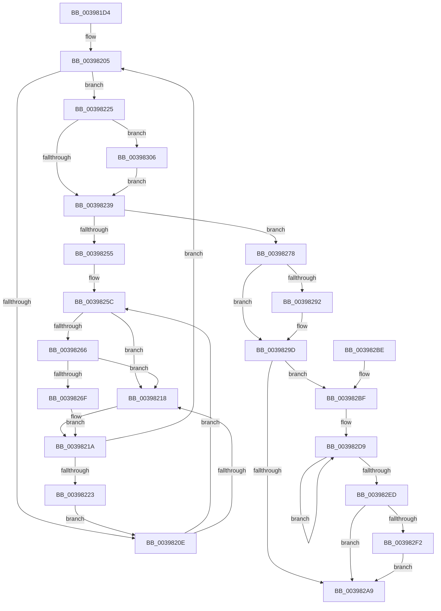

# KiRequestProcessInSwap

- RVA: `0x003981D4`–`0x00398311` (길이 `317` bytes)
- VA: `0x00000001403981D4`
- 실행 섹션: `.text`
- PDB 이름 있음: `예`; PDB Function 태그: `아니요`
- unwind 정보 RVA: `0x00081494`
- 디코드: `81`개 명령, `317/317` bytes 표시
- 미해석 바이트: `0` (있으면 어셈블리에 `.byte`로 보존)

> 이 문서는 커널 이미지의 기계어와 PDB 기호를 분석해 생성했습니다. 4번과 5번은 함수 원형과 자료형을 바이너리 사용 방식에서 추정한 C 해석이며 원본 소스 복구 결과는 아닙니다.

## 1. Dependencies

- 직접 호출 지점: **4**; 고유 호출 대상: **4**
- 직접 호출자로 확인된 함수: **2**
- RIP 상대 이미지 참조: **4**

### Outgoing calls
- `0x00398266` → [KiCheckVpBackingLongSpinWaitHypercall](../30/KiCheckVpBackingLongSpinWaitHypercall_function_0030F490.md) (function, `0x0030F490`)
- `0x00398271` → [HvlNotifyLongSpinWait](../30/HvlNotifyLongSpinWait_function_0030F460.md) (function, `0x0030F460`)
- `0x003982C2` → [MmNotifyProcessInSwapTrigger](../35/MmNotifyProcessInSwapTrigger_function_00354FAC.md) (function, `0x00354FAC`)
- `0x003982FF` → [KeSetEvent](../33/KeSetEvent_function_0033F310.md) (function, `0x0033F310`)

### Direct callers
- [KiReadyOutSwappedThreads](KiReadyOutSwappedThreads_function_00396E30.md) at `0x00396F9D`
- [KiInswapAndReadyThread](KiInswapAndReadyThread_function_00398318.md) at `0x003983FF`

### Static image references
- `0x00398210` → RVA `0x00FC52AC` (`ALMOSTRO`; reference)
- `0x0039825C` → RVA `0x00FC6AB8` (`ALMOSTRO`; read)
- `0x003982CB` → RVA `0x00F22D98` (`.data`; read)
- `0x003982F8` → RVA `0x00F22D80` (`.data`; read)

## 2. Other-region calls and transfers

- 다른 실행 섹션으로 향하는 call: **0**
- 별도 외부 분기/꼬리 이동을 확인하지 못했습니다.

## 3. Assembly (complete function range)

```asm
003981D4  48 89 5C 24 08                  mov qword ptr [rsp + 8], rbx
003981D9  48 89 6C 24 10                  mov qword ptr [rsp + 0x10], rbp
003981DE  48 89 74 24 18                  mov qword ptr [rsp + 0x18], rsi
003981E3  57                              push rdi
003981E4  48 83 EC 20                     sub rsp, 0x20
003981E8  48 B8 20 03 00 00 80 F7 FF FF   movabs rax, 0xfffff78000000320
003981F2  40 32 ED                        xor bpl, bpl
003981F5  48 8B FA                        mov rdi, rdx
003981F8  48 8B D9                        mov rbx, rcx
003981FB  33 F6                           xor esi, esi
003981FD  8B 00                           mov eax, dword ptr [rax]
003981FF  89 81 B4 01 00 00               mov dword ptr [rcx + 0x1b4], eax
00398205  F0 48 0F BA 6B 40 00            lock bts qword ptr [rbx + 0x40], 0
0039820C  73 17                           jae 0x140398225
0039820E  FF C6                           inc esi
00398210  85 35 96 D0 C2 00               test dword ptr [rip + 0xc2d096], esi
00398216  74 44                           je 0x14039825c
00398218  F3 90                           pause
0039821A  48 8B 43 40                     mov rax, qword ptr [rbx + 0x40]
0039821E  48 85 C0                        test rax, rax
00398221  74 E2                           je 0x140398205
00398223  EB E9                           jmp 0x14039820e
00398225  C6 83 84 01 00 00 09            mov byte ptr [rbx + 0x184], 9
0039822C  F7 43 78 00 10 00 00            test dword ptr [rbx + 0x78], 0x1000
00398233  0F 85 CD 00 00 00               jne 0x140398306
00398239  48 C7 43 40 00 00 00 00         mov qword ptr [rbx + 0x40], 0
00398241  48 8D 47 68                     lea rax, [rdi + 0x68]
00398245  48 8B 48 08                     mov rcx, qword ptr [rax + 8]
00398249  48 81 C3 D8 00 00 00            add rbx, 0xd8
00398250  48 39 01                        cmp qword ptr [rcx], rax
00398253  74 23                           je 0x140398278
00398255  B9 03 00 00 00                  mov ecx, 3
0039825A  CD 29                           int 0x29
0039825C  8B 05 56 E8 C2 00               mov eax, dword ptr [rip + 0xc2e856]
00398262  A8 40                           test al, 0x40
00398264  74 B2                           je 0x140398218
00398266  E8 25 72 F7 FF                  call 0x14030f490
0039826B  84 C0                           test al, al
0039826D  74 A9                           je 0x140398218
0039826F  8B CE                           mov ecx, esi
00398271  E8 EA 71 F7 FF                  call 0x14030f460
00398276  EB A2                           jmp 0x14039821a
00398278  48 89 03                        mov qword ptr [rbx], rax
0039827B  48 89 4B 08                     mov qword ptr [rbx + 8], rcx
0039827F  48 89 19                        mov qword ptr [rcx], rbx
00398282  48 89 58 08                     mov qword ptr [rax + 8], rbx
00398286  8B 87 08 01 00 00               mov eax, dword ptr [rdi + 0x108]
0039828C  24 07                           and al, 7
0039828E  3C 01                           cmp al, 1
00398290  75 0B                           jne 0x14039829d
00398292  F0 83 B7 08 01 00 00 03         lock xor dword ptr [rdi + 0x108], 3
0039829A  40 8A E8                        mov bpl, al
0039829D  F0 81 27 7F FF FF FF            lock and dword ptr [rdi], 0xffffff7f
003982A4  40 84 ED                        test bpl, bpl
003982A7  75 16                           jne 0x1403982bf
003982A9  48 8B 5C 24 30                  mov rbx, qword ptr [rsp + 0x30]
003982AE  48 8B 6C 24 38                  mov rbp, qword ptr [rsp + 0x38]
003982B3  48 8B 74 24 40                  mov rsi, qword ptr [rsp + 0x40]
003982B8  48 83 C4 20                     add rsp, 0x20
003982BC  5F                              pop rdi
003982BD  C3                              ret
003982BE  CC                              int3
003982BF  48 8B CF                        mov rcx, rdi
003982C2  E8 E5 CC FB FF                  call 0x140354fac
003982C7  48 83 C7 78                     add rdi, 0x78
003982CB  0F 0D 0D C6 AA B8 00            prefetchw byte ptr [rip + 0xb8aac6]
003982D2  48 8B 05 BF AA B8 00            mov rax, qword ptr [rip + 0xb8aabf]
003982D9  48 89 07                        mov qword ptr [rdi], rax
003982DC  48 8B C8                        mov rcx, rax
003982DF  F0 48 0F B1 3D B0 AA B8 00      lock cmpxchg qword ptr [rip + 0xb8aab0], rdi
003982E8  48 3B C1                        cmp rax, rcx
003982EB  75 EC                           jne 0x1403982d9
003982ED  48 85 C0                        test rax, rax
003982F0  75 B7                           jne 0x1403982a9
003982F2  45 33 C0                        xor r8d, r8d
003982F5  8D 50 0A                        lea edx, [rax + 0xa]
003982F8  48 8D 0D 81 AA B8 00            lea rcx, [rip + 0xb8aa81]
003982FF  E8 0C 70 FA FF                  call 0x14033f310
00398304  EB A3                           jmp 0x1403982a9
00398306  F0 0F BA 73 78 0C               lock btr dword ptr [rbx + 0x78], 0xc
0039830C  E9 28 FF FF FF                  jmp 0x140398239
```

## 4. C-style interpretation (structured pseudocode)

```c
__int64 __fastcall KiRequestProcessInSwap(__int64 a1, __int64 a2, int a3)
{
    __int64 result;
    __int64 v_rbp;
    __int64 v_rbx;
    __int64 v_rdi;
    __int64 v_rsi;
    __int64 v_rsp;
    unsigned __int64 v_stack_p10;
    unsigned __int64 v_stack_p18;
    unsigned __int64 v_stack_p8;

    v_stack_p8 = v_rbx;
    v_stack_p10 = v_rbp;
    v_stack_p18 = v_rsi;
    v_rsp = (v_rsp) - (32);
    v_rbp = 0;
    v_rsi = 0;
    *(unsigned int *)(a1 + 436) = (unsigned int)((unsigned int)(*(unsigned int *)(result)));
loc_00398205:
    if (condition_is_above_or_equal) goto loc_00398225;
loc_0039820E:
    v_rsi = (unsigned int)((v_rsi) + 1);
    if (((*(unsigned int *)(v_rip + 12767382)) & ((unsigned int)(v_rsi))) == 0) goto loc_0039825C;
loc_00398218:
loc_0039821A:
    if (*(unsigned __int64 *)(a1 + 64) == 0) goto loc_00398205;
    goto loc_0039820E;
loc_00398225:
    *(unsigned __int8 *)(a1 + 388) = 9;
    if (((*(unsigned int *)(a1 + 120)) & (0x1000ULL)) != 0) goto loc_00398306;
loc_00398239:
    *(unsigned __int64 *)(a1 + 64) = 0;
    v_rbx = (a1) + (216);
    if ((*(unsigned __int64 *)(*(unsigned __int64 *)(a2 + 104 + 8))) == (a2 + 104)) goto loc_00398278;
loc_0039825C:
    if ((((unsigned __int8)((unsigned int)(*(unsigned int *)(v_rip + 12773462)))) & (64)) == 0) goto loc_00398218;
    result = KiCheckVpBackingLongSpinWaitHypercall(3, a2, a3, a4);
    if ((unsigned __int8)(result) == 0) goto loc_00398218;
    result = HvlNotifyLongSpinWait((unsigned int)((unsigned int)(v_rsi)), a2, a3, a4);
    goto loc_0039821A;
loc_00398278:
    *(unsigned __int64 *)(v_rbx) = result;
    *(unsigned __int64 *)(v_rbx + 8) = (unsigned int)((unsigned int)(v_rsi));
    *(unsigned __int64 *)((unsigned int)((unsigned int)(v_rsi))) = v_rbx;
    *(unsigned __int64 *)(result + 8) = v_rbx;
    result = (unsigned __int8)(((unsigned int)(*(unsigned int *)(a2 + 264))) & (7));
    if (((unsigned __int8)(result)) == 1) {
        v_rbp = (unsigned __int8)(result);
    }
    if ((unsigned __int8)(v_rbp) != 0) goto loc_003982BF;
loc_003982A9:
    v_rsp = (v_rsp) + (32);
    return result;
loc_003982BF:
    result = MmNotifyProcessInSwapTrigger(a2, a2, a3, a4);
    v_rdi = (a2) + (120);
loc_003982D9:
    *(unsigned __int64 *)(v_rdi) = *(unsigned __int64 *)(v_rip + 12102335);
    if ((*(unsigned __int64 *)(v_rip + 12102335)) != (*(unsigned __int64 *)(v_rip + 12102335))) goto loc_003982D9;
    if (*(unsigned __int64 *)(v_rip + 12102335) != 0) goto loc_003982A9;
    a3 = 0;
    result = KeSetEvent(v_rip + 12102273, *(unsigned __int64 *)(v_rip + 12102335) + 10, a3, a4);
    goto loc_003982A9;
loc_00398306:
    goto loc_00398239;
}
```

## 5. (Beta) C Style

```c
int64_t KiRequestProcessInSwap(void *Arg1, void *Arg2, int32_t Arg3)
{
    uint8_t *arg1 = (uint8_t *)Arg1;
    uint8_t *arg2 = (uint8_t *)Arg2;

    int64_t result;
    int64_t local_rbp;
    int64_t local_rbx;
    int64_t local_rdi;
    int64_t local_rsi;
    int64_t local_rsp;
    uint64_t v_stack_p10;
    uint64_t v_stack_p18;
    uint64_t v_stack_p8;

    v_stack_p8 = local_rbx;
    v_stack_p10 = local_rbp;
    v_stack_p18 = local_rsi;
    local_rsp = (local_rsp) - (32);
    local_rbp = 0;
    local_rsi = 0;
    *(uint32_t *)(arg1 + 0x1B4) = (uint32_t)((uint32_t)(*(uint32_t *)(result)));
loc_00398205:
    if (condition_is_above_or_equal) goto loc_00398225;
loc_0039820E:
    local_rsi = (uint32_t)((local_rsi) + 1);
    if (((*(uint32_t *)(v_rip + 0xC2D096)) & ((uint32_t)(local_rsi))) == 0) goto loc_0039825C;
loc_00398218:
loc_0039821A:
    if (*(uint64_t *)(arg1 + 0x40) == 0) goto loc_00398205;
    goto loc_0039820E;
loc_00398225:
    *(uint8_t *)(arg1 + 0x184) = 9;
    if (((*(uint32_t *)(arg1 + 0x78)) & (0x1000ULL)) != 0) goto loc_00398306;
loc_00398239:
    *(uint64_t *)(arg1 + 0x40) = 0;
    local_rbx = (Arg1) + (216);
    if ((*(uint64_t *)(*(uint64_t *)(arg2 + 0x68 + 0x8))) == (Arg2 + 104)) goto loc_00398278;
loc_0039825C:
    if ((((uint8_t)((uint32_t)(*(uint32_t *)(v_rip + 0xC2E856)))) & (64)) == 0) goto loc_00398218;
    result = KiCheckVpBackingLongSpinWaitHypercall(3, Arg2, Arg3, a4);
    if ((uint8_t)(result) == 0) goto loc_00398218;
    result = HvlNotifyLongSpinWait((uint32_t)((uint32_t)(local_rsi)), Arg2, Arg3, a4);
    goto loc_0039821A;
loc_00398278:
    *(uint64_t *)(local_rbx) = result;
    *(uint64_t *)(local_rbx + 0x8) = (uint32_t)((uint32_t)(local_rsi));
    *(uint64_t *)((uint32_t)((uint32_t)(local_rsi))) = local_rbx;
    *(uint64_t *)(result + 0x8) = local_rbx;
    result = (uint8_t)(((uint32_t)(*(uint32_t *)(arg2 + 0x108))) & (7));
    if (((uint8_t)(result)) == 1) {
        local_rbp = (uint8_t)(result);
    }
    if ((uint8_t)(local_rbp) != 0) goto loc_003982BF;
loc_003982A9:
    local_rsp = (local_rsp) + (32);
    return result;
loc_003982BF:
    result = MmNotifyProcessInSwapTrigger(Arg2, Arg2, Arg3, a4);
    local_rdi = (Arg2) + (120);
loc_003982D9:
    *(uint64_t *)(local_rdi) = *(uint64_t *)(v_rip + 0xB8AABF);
    if ((*(uint64_t *)(v_rip + 0xB8AABF)) != (*(uint64_t *)(v_rip + 0xB8AABF))) goto loc_003982D9;
    if (*(uint64_t *)(v_rip + 0xB8AABF) != 0) goto loc_003982A9;
    Arg3 = 0;
    result = KeSetEvent(v_rip + 12102273, *(uint64_t *)(v_rip + 0xB8AABF) + 10, Arg3, a4);
    goto loc_003982A9;
loc_00398306:
    goto loc_00398239;
}
```

### 관측된 메모리 오프셋

구조체 형식이 확인되지 않은 접근은 인자 기준의 오프셋으로만 기록했습니다.

| 기준 인자 | 오프셋 표현 | 폭 (bit) | 접근 |
|---|---:|---:|---|
| `Arg1` | `+ 0x0` | `64` | `W` |
| `Arg1` | `+ 0x8` | `64` | `W` |
| `Arg1` | `+ 0x40` | `64` | `R` |
| `Arg1` | `+ 0x40` | `64` | `R/W` |
| `Arg1` | `+ 0x40` | `64` | `W` |
| `Arg1` | `+ 0x78` | `32` | `R` |
| `Arg1` | `+ 0x78` | `32` | `R/W` |
| `Arg1` | `+ 0x184` | `8` | `W` |
| `Arg1` | `+ 0x1B4` | `32` | `W` |
| `Arg2` | `+ 0x0` | `32` | `R/W` |
| `Arg2` | `+ 0x0` | `64` | `W` |
| `Arg2` | `+ 0x8` | `64` | `R` |
| `Arg2` | `+ 0x8` | `64` | `W` |
| `Arg2` | `+ 0x68` | `64` | `R` |
| `Arg2` | `+ 0x108` | `32` | `R` |
| `Arg2` | `+ 0x108` | `32` | `R/W` |

## 6. Execution-region graph

[열기: 2D/3D 그래프와 함수 탐색 컨트롤 패널](../../../control-panel.html?section=text&rva=0x003981D4&view=graph)

- 2D 그래프는 위에서 아래로 흐르고, 3D 그래프는 빈 공간을 드래그해 회전합니다. Shift+드래그는 이동, 휠은 확대·축소, 함수 노드 선택은 대상 보고서 이동입니다.

### Static fallback


