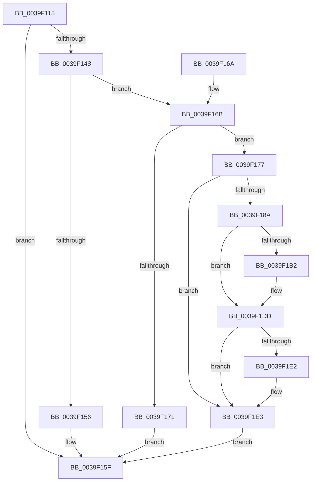

# KiRequestTimer2Expiration

- RVA: `0x0039F118`–`0x0039F1FF` (길이 `231` bytes)
- VA: `0x000000014039F118`
- 실행 섹션: `.text`
- PDB 이름 있음: `예`; PDB Function 태그: `아니요`
- unwind 정보 RVA: `0x00081C70`
- 디코드: `59`개 명령, `231/231` bytes 표시
- 미해석 바이트: `0` (있으면 어셈블리에 `.byte`로 보존)

> 이 문서는 커널 이미지의 기계어와 PDB 기호를 분석해 생성했습니다. 4번과 5번은 함수 원형과 자료형을 바이너리 사용 방식에서 추정한 C 해석이며 원본 소스 복구 결과는 아닙니다.

## 1. Dependencies

- 직접 호출 지점: **4**; 고유 호출 대상: **4**
- 직접 호출자로 확인된 함수: **2**
- RIP 상대 이미지 참조: **3**

### Outgoing calls
- `0x0039F13F` → [KiSetDpcRequestFlag](KiSetDpcRequestFlag_function_0039DC50.md) (function, `0x0039DC50`)
- `0x0039F15A` → [KiSendSoftwareInterrupt](../25/KiSendSoftwareInterrupt_function_00250A30.md) (function, `0x00250A30`)
- `0x0039F193` → [HalpDisableInterrupts](../25/HalpDisableInterrupts_function_002521A0.md) (function, `0x002521A0`)
- `0x0039F1F5` → [HalpInterruptSendIpi](../25/HalpInterruptSendIpi_function_00252310.md) (function, `0x00252310`)

### Direct callers
- [KeSetTimer2](../3A/KeSetTimer2_function_003A08E0.md) at `0x003A0F9D`
- [KiAdjustTimer2DueTimes](../3A/KiAdjustTimer2DueTimes_function_003A3550.md) at `0x003A3771`

### Static image references
- `0x0039F122` → RVA `0x00F21FB0` (`.data`; read)
- `0x0039F128` → RVA `0x00FC8C40` (`ALMOSTRO`; read)
- `0x0039F17C` → RVA `0x00FC6BC5` (`ALMOSTRO`; read)

## 2. Other-region calls and transfers

- 다른 실행 섹션으로 향하는 call: **0**
- 별도 외부 분기/꼬리 이동을 확인하지 못했습니다.

## 3. Assembly (complete function range)

```asm
0039F118  48 89 5C 24 08                  mov qword ptr [rsp + 8], rbx
0039F11D  57                              push rdi
0039F11E  48 83 EC 40                     sub rsp, 0x40
0039F122  8B 3D 88 2E B8 00               mov edi, dword ptr [rip + 0xb82e88]
0039F128  48 8D 1D 11 9B C2 00            lea rbx, [rip + 0xc29b11]
0039F12F  BA 08 00 00 00                  mov edx, 8
0039F134  48 8B 1C FB                     mov rbx, qword ptr [rbx + rdi*8]
0039F138  48 8D 8B BC 38 00 00            lea rcx, [rbx + 0x38bc]
0039F13F  E8 0C EB FF FF                  call 0x14039dc50
0039F144  A8 A9                           test al, 0xa9
0039F146  75 17                           jne 0x14039f15f
0039F148  65 48 8B 04 25 20 00 00 00      mov rax, qword ptr gs:[0x20]
0039F151  48 3B C3                        cmp rax, rbx
0039F154  74 15                           je 0x14039f16b
0039F156  B2 02                           mov dl, 2
0039F158  8B CF                           mov ecx, edi
0039F15A  E8 D1 18 EB FF                  call 0x140250a30
0039F15F  48 8B 5C 24 50                  mov rbx, qword ptr [rsp + 0x50]
0039F164  48 83 C4 40                     add rsp, 0x40
0039F168  5F                              pop rdi
0039F169  C3                              ret
0039F16A  CC                              int3
0039F16B  80 7B 20 00                     cmp byte ptr [rbx + 0x20], 0
0039F16F  74 06                           je 0x14039f177
0039F171  C6 43 06 01                     mov byte ptr [rbx + 6], 1
0039F175  EB E8                           jmp 0x14039f15f
0039F177  33 C0                           xor eax, eax
0039F179  0F 57 C0                        xorps xmm0, xmm0
0039F17C  38 05 43 7A C2 00               cmp byte ptr [rip + 0xc27a43], al
0039F182  F3 0F 7F 44 24 24               movdqu xmmword ptr [rsp + 0x24], xmm0
0039F188  74 59                           je 0x14039f1e3
0039F18A  65 4C 8B 04 25 20 00 00 00      mov r8, qword ptr gs:[0x20]
0039F193  E8 08 30 EB FF                  call 0x1402521a0
0039F198  41 8B 90 A8 00 00 00            mov edx, dword ptr [r8 + 0xa8]
0039F19F  44 8A C8                        mov r9b, al
0039F1A2  8B CA                           mov ecx, edx
0039F1A4  83 C9 04                        or ecx, 4
0039F1A7  41 89 88 A8 00 00 00            mov dword ptr [r8 + 0xa8], ecx
0039F1AE  85 D2                           test edx, edx
0039F1B0  75 2B                           jne 0x14039f1dd
0039F1B2  41 B8 15 00 01 C0               mov r8d, 0xc0010015
0039F1B8  41 8B C8                        mov ecx, r8d
0039F1BB  0F 32                           rdmsr
0039F1BD  48 C1 E2 20                     shl rdx, 0x20
0039F1C1  48 B9 00 00 00 00 01 00 00 00   movabs rcx, 0x100000000
0039F1CB  48 0B C2                        or rax, rdx
0039F1CE  48 0B C1                        or rax, rcx
0039F1D1  41 8B C8                        mov ecx, r8d
0039F1D4  48 8B D0                        mov rdx, rax
0039F1D7  48 C1 EA 20                     shr rdx, 0x20
0039F1DB  0F 30                           wrmsr
0039F1DD  45 84 C9                        test r9b, r9b
0039F1E0  74 01                           je 0x14039f1e3
0039F1E2  FB                              sti
0039F1E3  BA 2F 00 00 00                  mov edx, 0x2f
0039F1E8  C7 44 24 20 05 00 00 00         mov dword ptr [rsp + 0x20], 5
0039F1F0  48 8D 4C 24 20                  lea rcx, [rsp + 0x20]
0039F1F5  E8 16 31 EB FF                  call 0x140252310
0039F1FA  E9 60 FF FF FF                  jmp 0x14039f15f
```

## 4. C-style interpretation (structured pseudocode)

```c
__int64 __fastcall KiRequestTimer2Expiration(void)
{
    __int64 result;
    __int64 v_rsp;
    unsigned int v_stack_p20;
    unsigned __int64 v_stack_p24;
    unsigned __int64 v_stack_p8;

    v_stack_p8 = v_rbx;
    v_rsp = (v_rsp) - (64);
    result = KiSetDpcRequestFlag(*(unsigned __int64 *)(v_rip + 12753681 + (unsigned int)(*(unsigned int *)(v_rip + 12070536)) * 8) + 14524, 8, a3, a4);
    if ((((unsigned __int8)(result)) & (169)) != 0) goto loc_0039F15F;
    if ((*(unsigned __int64 *)(gs_base + (0 + 32))) == (*(unsigned __int64 *)(v_rip + 12753681 + (unsigned int)(*(unsigned int *)(v_rip + 12070536)) * 8))) goto loc_0039F16B;
    result = KiSendSoftwareInterrupt((unsigned int)((unsigned int)((unsigned int)(*(unsigned int *)(v_rip + 12070536)))), 2, a3, a4);
loc_0039F15F:
    v_rsp = (v_rsp) + (64);
    return result;
loc_0039F16B:
    if ((*(unsigned __int8 *)(v_stack_p8 + 32)) == 0) goto loc_0039F177;
    *(unsigned __int8 *)(v_stack_p8 + 6) = 1;
    goto loc_0039F15F;
loc_0039F177:
    result = 0;
    v_stack_p24 = v_xmm0;
    if ((*(unsigned __int8 *)(v_rip + 12745283)) == 0) goto loc_0039F1E3;
    result = HalpDisableInterrupts((unsigned int)((unsigned int)((unsigned int)(*(unsigned int *)(v_rip + 12070536)))), 2, *(unsigned __int64 *)(gs_base + (0 + 32)), a4);
    a1 = (unsigned int)(((unsigned int)((unsigned int)((unsigned int)(*(unsigned int *)(*(unsigned __int64 *)(gs_base + (0 + 32)) + 168))))) | (4));
    *(unsigned int *)(*(unsigned __int64 *)(gs_base + (0 + 32)) + 168) = (unsigned int)(a1);
    if ((unsigned int)((unsigned int)(*(unsigned int *)(*(unsigned __int64 *)(gs_base + (0 + 32)) + 168))) == 0) {
        a3 = 0xC0010015ULL;
        a1 = (unsigned int)(a3);
        a2 = ((unsigned int)(*(unsigned int *)(*(unsigned __int64 *)(gs_base + (0 + 32)) + 168))) << (32);
        result = (result) | (a2);
        result = (result) | (a1);
        a1 = (unsigned int)(a3);
        a2 = result;
        a2 = (a2) >> (32);
    }
    if ((unsigned __int8)((unsigned __int8)(result)) != 0) {
    }
    v_stack_p20 = 5;
    result = HalpInterruptSendIpi(v_stack_p20, 47, a3, (unsigned __int8)(result));
    goto loc_0039F15F;
}
```

## 5. (Beta) C Style

```c
void KiRequestTimer2Expiration(void)
{
    int64_t result;
    int64_t local_rsp;
    uint32_t v_stack_p20;
    uint64_t v_stack_p24;
    uint64_t v_stack_p8;

    v_stack_p8 = local_rbx;
    local_rsp = (local_rsp) - (64);
    result = KiSetDpcRequestFlag(*(uint64_t *)(v_rip + 0xC29B11 + (uint32_t)(*(uint32_t *)(v_rip + 0xB82E88)) * 8) + 14524, 8, a3, a4);
    if ((((uint8_t)(result)) & (169)) != 0) goto loc_0039F15F;
    if ((*(uint64_t *)(gs_base + (0 + 0x20))) == (*(uint64_t *)(v_rip + 0xC29B11 + (uint32_t)(*(uint32_t *)(v_rip + 0xB82E88)) * 8))) goto loc_0039F16B;
    result = KiSendSoftwareInterrupt((uint32_t)((uint32_t)((uint32_t)(*(uint32_t *)(v_rip + 0xB82E88)))), 2, a3, a4);
loc_0039F15F:
    local_rsp = (local_rsp) + (64);
    return result;
loc_0039F16B:
    if ((*(uint8_t *)(v_stack_p8 + 0x20)) == 0) goto loc_0039F177;
    *(uint8_t *)(v_stack_p8 + 0x6) = 1;
    goto loc_0039F15F;
loc_0039F177:
    result = 0;
    v_stack_p24 = v_xmm0;
    if ((*(uint8_t *)(v_rip + 0xC27A43)) == 0) goto loc_0039F1E3;
    result = HalpDisableInterrupts((uint32_t)((uint32_t)((uint32_t)(*(uint32_t *)(v_rip + 0xB82E88)))), 2, *(uint64_t *)(gs_base + (0 + 0x20)), a4);
    a1 = (uint32_t)(((uint32_t)((uint32_t)((uint32_t)(*(uint32_t *)(*(uint64_t *)(gs_base + (0 + 0x20)) + 0xA8))))) | (4));
    *(uint32_t *)(*(uint64_t *)(gs_base + (0 + 0x20)) + 0xA8) = (uint32_t)(a1);
    if ((uint32_t)((uint32_t)(*(uint32_t *)(*(uint64_t *)(gs_base + (0 + 0x20)) + 0xA8))) == 0) {
        a3 = 0xC0010015ULL;
        a1 = (uint32_t)(a3);
        a2 = ((uint32_t)(*(uint32_t *)(*(uint64_t *)(gs_base + (0 + 0x20)) + 0xA8))) << (32);
        result = (result) | (a2);
        result = (result) | (a1);
        a1 = (uint32_t)(a3);
        a2 = result;
        a2 = (a2) >> (32);
    }
    if ((uint8_t)((uint8_t)(result)) != 0) {
    }
    v_stack_p20 = 5;
    result = HalpInterruptSendIpi(v_stack_p20, 47, a3, (uint8_t)(result));
    goto loc_0039F15F;
}
```

## 6. Execution-region graph

[열기: 2D/3D 그래프와 함수 탐색 컨트롤 패널](../../../control-panel.html?section=text&rva=0x0039F118&view=graph)

- 2D 그래프는 위에서 아래로 흐르고, 3D 그래프는 빈 공간을 드래그해 회전합니다. Shift+드래그는 이동, 휠은 확대·축소, 함수 노드 선택은 대상 보고서 이동입니다.

### Static fallback


