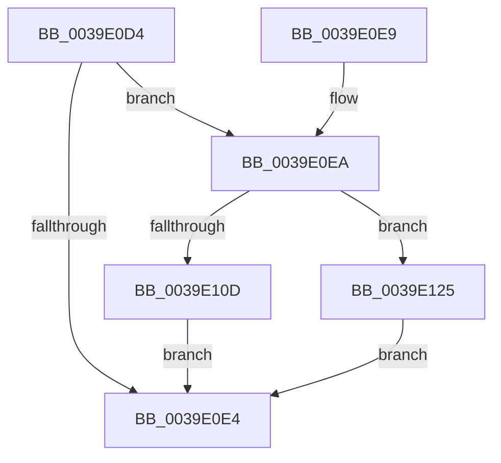

# KiResetClockIntervalOneShot

- RVA: `0x0039E0D4`–`0x0039E12C` (길이 `88` bytes)
- VA: `0x000000014039E0D4`
- 실행 섹션: `.text`
- PDB 이름 있음: `예`; PDB Function 태그: `아니요`
- unwind 정보 RVA: `0x00067BB4`
- 디코드: `21`개 명령, `88/88` bytes 표시
- 미해석 바이트: `0` (있으면 어셈블리에 `.byte`로 보존)

> 이 문서는 커널 이미지의 기계어와 PDB 기호를 분석해 생성했습니다. 4번과 5번은 함수 원형과 자료형을 바이너리 사용 방식에서 추정한 C 해석이며 원본 소스 복구 결과는 아닙니다.

## 1. Dependencies

- 직접 호출 지점: **3**; 고유 호출 대상: **3**
- 직접 호출자로 확인된 함수: **1**
- RIP 상대 이미지 참조: **3**

### Outgoing calls
- `0x0039E0F4` → [PoTraceSystemTimerResolutionKernel](../2F/PoTraceSystemTimerResolutionKernel_function_002FD154.md) (function, `0x002FD154`)
- `0x0039E11E` → [KiCancelClockTimer](../47/KiCancelClockTimer_function_004743CC.md) (function, `0x004743CC`)
- `0x0039E125` → [KiSetClockIntervalToMinimumRequested](KiSetClockIntervalToMinimumRequested_function_0039DF1C.md) (function, `0x0039DF1C`)

### Direct callers
- [sub_0039CA0B](Unknown_function_0039CA0B.md) at `0x0039CC62`

### Static image references
- `0x0039E0D8` → RVA `0x00F21F90` (`.data`; read)
- `0x0039E0F9` → RVA `0x00FC6A85` (`ALMOSTRO`; read)
- `0x0039E100` → RVA `0x00F21F90` (`.data`; write)

## 2. Other-region calls and transfers

- 다른 실행 섹션으로 향하는 call: **0**
- 별도 외부 분기/꼬리 이동을 확인하지 못했습니다.

## 3. Assembly (complete function range)

```asm
0039E0D4  48 83 EC 28                     sub rsp, 0x28
0039E0D8  48 8B 05 B1 3E B8 00            mov rax, qword ptr [rip + 0xb83eb1]
0039E0DF  48 85 C0                        test rax, rax
0039E0E2  75 06                           jne 0x14039e0ea
0039E0E4  48 83 C4 28                     add rsp, 0x28
0039E0E8  C3                              ret
0039E0E9  CC                              int3
0039E0EA  41 B0 01                        mov r8b, 1
0039E0ED  BA 48 52 4F 53                  mov edx, 0x534f5248
0039E0F2  33 C9                           xor ecx, ecx
0039E0F4  E8 5B F0 F5 FF                  call 0x1402fd154
0039E0F9  80 3D 85 89 C2 00 00            cmp byte ptr [rip + 0xc28985], 0
0039E100  48 C7 05 85 3E B8 00 00 00 00 00  mov qword ptr [rip + 0xb83e85], 0
0039E10B  74 18                           je 0x14039e125
0039E10D  65 48 8B 0C 25 20 00 00 00      mov rcx, qword ptr gs:[0x20]
0039E116  41 B0 01                        mov r8b, 1
0039E119  BA 02 00 00 00                  mov edx, 2
0039E11E  E8 A9 62 0D 00                  call 0x1404743cc
0039E123  EB BF                           jmp 0x14039e0e4
0039E125  E8 F2 FD FF FF                  call 0x14039df1c
0039E12A  EB B8                           jmp 0x14039e0e4
```

## 4. C-style interpretation (structured pseudocode)

```c
__int64 __fastcall KiResetClockIntervalOneShot(int a1)
{
    __int64 result;
    __int64 v_rsp;

    v_rsp = (v_rsp) - (40);
    if (*(unsigned __int64 *)(v_rip + 12074673) != 0) goto loc_0039E0EA;
loc_0039E0E4:
    v_rsp = (v_rsp) + (40);
    return *(unsigned __int64 *)(v_rip + 12074673);
loc_0039E0EA:
    a1 = 0;
    result = PoTraceSystemTimerResolutionKernel(a1, (unsigned int)(0x534F5248ULL), 1, a4);
    *(unsigned __int64 *)(v_rip + 12074629) = 0;
    if ((*(unsigned __int8 *)(v_rip + 12749189)) == 0) goto loc_0039E125;
    result = KiCancelClockTimer(*(unsigned __int64 *)(gs_base + (0 + 32)), 2, 1, a4);
    goto loc_0039E0E4;
loc_0039E125:
    result = KiSetClockIntervalToMinimumRequested(*(unsigned __int64 *)(gs_base + (0 + 32)), 2, 1, a4);
    goto loc_0039E0E4;
}
```

## 5. (Beta) C Style

```c
int64_t KiResetClockIntervalOneShot(int32_t Arg1)
{
    int64_t result;
    int64_t local_rsp;

    local_rsp = (local_rsp) - (40);
    if (*(uint64_t *)(v_rip + 0xB83EB1) != 0) goto loc_0039E0EA;
loc_0039E0E4:
    local_rsp = (local_rsp) + (40);
    return *(uint64_t *)(v_rip + 0xB83EB1);
loc_0039E0EA:
    Arg1 = 0;
    result = PoTraceSystemTimerResolutionKernel(Arg1, (uint32_t)(0x534F5248ULL), 1, a4);
    *(uint64_t *)(v_rip + 0xB83E85) = 0;
    if ((*(uint8_t *)(v_rip + 0xC28985)) == 0) goto loc_0039E125;
    result = KiCancelClockTimer(*(uint64_t *)(gs_base + (0 + 0x20)), 2, 1, a4);
    goto loc_0039E0E4;
loc_0039E125:
    result = KiSetClockIntervalToMinimumRequested(*(uint64_t *)(gs_base + (0 + 0x20)), 2, 1, a4);
    goto loc_0039E0E4;
}
```

## 6. Execution-region graph

[열기: 2D/3D 그래프와 함수 탐색 컨트롤 패널](../../../control-panel.html?section=text&rva=0x0039E0D4&view=graph)

- 2D 그래프는 위에서 아래로 흐르고, 3D 그래프는 빈 공간을 드래그해 회전합니다. Shift+드래그는 이동, 휠은 확대·축소, 함수 노드 선택은 대상 보고서 이동입니다.

### Static fallback


