# KiSetClockIntervalToMinimumRequested

- RVA: `0x0039DF1C`–`0x0039E0CE` (길이 `434` bytes)
- VA: `0x000000014039DF1C`
- 실행 섹션: `.text`
- PDB 이름 있음: `예`; PDB Function 태그: `아니요`
- unwind 정보 RVA: `0x0005FD94`
- 디코드: `118`개 명령, `434/434` bytes 표시
- 미해석 바이트: `0` (있으면 어셈블리에 `.byte`로 보존)

> 이 문서는 커널 이미지의 기계어와 PDB 기호를 분석해 생성했습니다. 4번과 5번은 함수 원형과 자료형을 바이너리 사용 방식에서 추정한 C 해석이며 원본 소스 복구 결과는 아닙니다.

## 1. Dependencies

- 직접 호출 지점: **7**; 고유 호출 대상: **6**
- 직접 호출자로 확인된 함수: **6**
- RIP 상대 이미지 참조: **12**

### Outgoing calls
- `0x0039DF5D` → [KeDisableInterrupts](../21/KeDisableInterrupts_function_00217BE0.md) (function, `0x00217BE0`)
- `0x0039DF6A` → [RtlGetInterruptTimePrecise](../20/RtlGetInterruptTimePrecise_function_0020A4C0.md) (function, `0x0020A4C0`)
- `0x0039DF88` → [KiGetClockIntervalOneShot](../44/KiGetClockIntervalOneShot_function_00449990.md) (function, `0x00449990`)
- `0x0039DFFA` → [KiGetClockIntervalOneShot](../44/KiGetClockIntervalOneShot_function_00449990.md) (function, `0x00449990`)
- `0x0039E066` → [KiSetClockTickRate](../43/KiSetClockTickRate_function_0043FEA0.md) (function, `0x0043FEA0`)
- `0x0039E07C` → [PoTraceSystemTimerResolutionKernel](../2F/PoTraceSystemTimerResolutionKernel_function_002FD154.md) (function, `0x002FD154`)
- `0x0039E0B5` → [KiRemoveSystemWorkPriorityKick](../26/KiRemoveSystemWorkPriorityKick_function_002631D0.md) (function, `0x002631D0`)

### Direct callers
- [ExpUpdateTimerConfigurationWorker](../23/ExpUpdateTimerConfigurationWorker_function_00235410.md) at `0x002355FA`
- [sub_0039CA0B](Unknown_function_0039CA0B.md) at `0x0039CC58`
- [KiResetClockIntervalOneShot](KiResetClockIntervalOneShot_function_0039E0D4.md) at `0x0039E125`
- [KiSetClockInterval](../47/KiSetClockInterval_function_00475064.md) at `0x00475179`
- [KiResetClockInterval](../5B/KiResetClockInterval_function_005BB8BC.md) at `0x005BB92E`
- [sub_006E5A5E](../6E/Unknown_function_006E5A5E.md) at `0x006E5B81`
- [sub_006E5A5E](../6E/Unknown_function_006E5A5E.md) at `0x006E5BA1`

### Static image references
- `0x0039DF31` → RVA `0x00E668E0` (`.data`; read)
- `0x0039DF47` → RVA `0x00E668D8` (`.data`; read)
- `0x0039DF6F` → RVA `0x00F21F90` (`.data`; read)
- `0x0039DF90` → RVA `0x00F21FA0` (`.data`; read)
- `0x0039DFA3` → RVA `0x00F21FA8` (`.data`; read)
- `0x0039DFB1` → RVA `0x00FC6BEC` (`ALMOSTRO`; read)
- `0x0039DFB8` → RVA `0x00E668B0` (`.data`; read)
- `0x0039DFBF` → RVA `0x00FC6BB8` (`ALMOSTRO`; read)
- `0x0039DFC6` → RVA `0x00E668A8` (`.data`; read)
- `0x0039E011` → RVA `0x00F21FA0` (`.data`; write)
- `0x0039E049` → RVA `0x00F21FC0` (`.data`; read)
- `0x0039E052` → RVA `0x00FC6B7C` (`ALMOSTRO`; read)

## 2. Other-region calls and transfers

- 다른 실행 섹션으로 향하는 call: **0**
- 별도 외부 분기/꼬리 이동을 확인하지 못했습니다.

## 3. Assembly (complete function range)

```asm
0039DF1C  48 89 5C 24 10                  mov qword ptr [rsp + 0x10], rbx
0039DF21  48 89 74 24 18                  mov qword ptr [rsp + 0x18], rsi
0039DF26  57                              push rdi
0039DF27  48 83 EC 20                     sub rsp, 0x20
0039DF2B  48 83 64 24 30 00               and qword ptr [rsp + 0x30], 0
0039DF31  48 8B 0D A8 89 AC 00            mov rcx, qword ptr [rip + 0xac89a8]
0039DF38  F6 C1 01                        test cl, 1
0039DF3B  74 1A                           je 0x14039df57
0039DF3D  48 83 F9 01                     cmp rcx, 1
0039DF41  75 04                           jne 0x14039df47
0039DF43  33 C0                           xor eax, eax
0039DF45  EB 13                           jmp 0x14039df5a
0039DF47  48 8D 05 8A 89 AC 00            lea rax, [rip + 0xac898a]
0039DF4E  48 83 C8 01                     or rax, 1
0039DF52  48 33 C1                        xor rax, rcx
0039DF55  EB 03                           jmp 0x14039df5a
0039DF57  48 8B C1                        mov rax, rcx
0039DF5A  8B 58 1C                        mov ebx, dword ptr [rax + 0x1c]
0039DF5D  E8 7E 9C E7 FF                  call 0x140217be0
0039DF62  48 8D 4C 24 30                  lea rcx, [rsp + 0x30]
0039DF67  40 8A F0                        mov sil, al
0039DF6A  E8 51 C5 E6 FF                  call 0x14020a4c0
0039DF6F  48 8B 0D 1A 40 B8 00            mov rcx, qword ptr [rip + 0xb8401a]
0039DF76  41 83 CA FF                     or r10d, 0xffffffff
0039DF7A  4C 8B D8                        mov r11, rax
0039DF7D  45 8B CA                        mov r9d, r10d
0039DF80  48 85 C9                        test rcx, rcx
0039DF83  74 0B                           je 0x14039df90
0039DF85  48 8B D0                        mov rdx, rax
0039DF88  E8 03 BA 0A 00                  call 0x140449990
0039DF8D  44 8B C8                        mov r9d, eax
0039DF90  48 8B 0D 09 40 B8 00            mov rcx, qword ptr [rip + 0xb84009]
0039DF97  48 8B 05 02 40 B8 00            mov rax, qword ptr [rip + 0xb84002]
0039DF9E  49 3B C3                        cmp rax, r11
0039DFA1  77 0E                           ja 0x14039dfb1
0039DFA3  83 3D FE 3F B8 00 02            cmp dword ptr [rip + 0xb83ffe], 2
0039DFAA  75 56                           jne 0x14039e002
0039DFAC  48 85 C0                        test rax, rax
0039DFAF  75 51                           jne 0x14039e002
0039DFB1  44 8B 15 34 8C C2 00            mov r10d, dword ptr [rip + 0xc28c34]
0039DFB8  48 8B 3D F1 88 AC 00            mov rdi, qword ptr [rip + 0xac88f1]
0039DFBF  44 8B 05 F2 8B C2 00            mov r8d, dword ptr [rip + 0xc28bf2]
0039DFC6  48 8B 15 DB 88 AC 00            mov rdx, qword ptr [rip + 0xac88db]
0039DFCD  4A 8D 0C 17                     lea rcx, [rdi + r10]
0039DFD1  4A 8D 04 02                     lea rax, [rdx + r8]
0039DFD5  48 3B C1                        cmp rax, rcx
0039DFD8  76 06                           jbe 0x14039dfe0
0039DFDA  48 8B D7                        mov rdx, rdi
0039DFDD  45 8B C2                        mov r8d, r10d
0039DFE0  41 8B C8                        mov ecx, r8d
0039DFE3  49 8B C3                        mov rax, r11
0039DFE6  48 2B C2                        sub rax, rdx
0039DFE9  33 D2                           xor edx, edx
0039DFEB  48 F7 F1                        div rcx
0039DFEE  44 2B C2                        sub r8d, edx
0039DFF1  49 8B D3                        mov rdx, r11
0039DFF4  41 8B C8                        mov ecx, r8d
0039DFF7  49 03 CB                        add rcx, r11
0039DFFA  E8 91 B9 0A 00                  call 0x140449990
0039DFFF  44 8B D0                        mov r10d, eax
0039E002  32 D2                           xor dl, dl
0039E004  40 32 FF                        xor dil, dil
0039E007  44 3B CB                        cmp r9d, ebx
0039E00A  77 14                           ja 0x14039e020
0039E00C  45 3B CA                        cmp r9d, r10d
0039E00F  77 0F                           ja 0x14039e020
0039E011  48 C7 05 84 3F B8 00 00 00 00 00  mov qword ptr [rip + 0xb83f84], 0
0039E01C  B2 01                           mov dl, 1
0039E01E  EB 20                           jmp 0x14039e040
0039E020  44 3B D3                        cmp r10d, ebx
0039E023  73 11                           jae 0x14039e036
0039E025  B2 01                           mov dl, 1
0039E027  48 89 0D 72 3F B8 00            mov qword ptr [rip + 0xb83f72], rcx
0039E02E  40 8A FA                        mov dil, dl
0039E031  45 8B CA                        mov r9d, r10d
0039E034  EB 0A                           jmp 0x14039e040
0039E036  44 8B CB                        mov r9d, ebx
0039E039  4C 89 1D 60 3F B8 00            mov qword ptr [rip + 0xb83f60], r11
0039E040  83 3D 61 3F B8 00 02            cmp dword ptr [rip + 0xb83f61], 2
0039E047  74 1A                           je 0x14039e063
0039E049  44 3B 0D 70 3F B8 00            cmp r9d, dword ptr [rip + 0xb83f70]
0039E050  74 09                           je 0x14039e05b
0039E052  44 3B 0D 23 8B C2 00            cmp r9d, dword ptr [rip + 0xc28b23]
0039E059  75 08                           jne 0x14039e063
0039E05B  8B 1D 1B 8B C2 00               mov ebx, dword ptr [rip + 0xc28b1b]
0039E061  EB 0A                           jmp 0x14039e06d
0039E063  41 8B C9                        mov ecx, r9d
0039E066  E8 35 1E 0A 00                  call 0x14043fea0
0039E06B  8B D8                           mov ebx, eax
0039E06D  40 84 FF                        test dil, dil
0039E070  74 0F                           je 0x14039e081
0039E072  41 B0 01                        mov r8b, 1
0039E075  BA 48 52 4F 43                  mov edx, 0x434f5248
0039E07A  8B CB                           mov ecx, ebx
0039E07C  E8 D3 F0 F5 FF                  call 0x1402fd154
0039E081  40 84 F6                        test sil, sil
0039E084  74 35                           je 0x14039e0bb
0039E086  65 48 8B 0C 25 20 00 00 00      mov rcx, qword ptr gs:[0x20]
0039E08F  4C 8B 81 B8 8E 00 00            mov r8, qword ptr [rcx + 0x8eb8]
0039E096  4D 85 C0                        test r8, r8
0039E099  74 1F                           je 0x14039e0ba
0039E09B  41 0F 0D 08                     prefetchw byte ptr [r8]
0039E09F  41 8B 00                        mov eax, dword ptr [r8]
0039E0A2  8B D0                           mov edx, eax
0039E0A4  0F BA F2 15                     btr edx, 0x15
0039E0A8  F0 41 0F B1 10                  lock cmpxchg dword ptr [r8], edx
0039E0AD  75 F3                           jne 0x14039e0a2
0039E0AF  0F BA E0 15                     bt eax, 0x15
0039E0B3  73 05                           jae 0x14039e0ba
0039E0B5  E8 16 51 EC FF                  call 0x1402631d0
0039E0BA  FB                              sti
0039E0BB  48 8B 74 24 40                  mov rsi, qword ptr [rsp + 0x40]
0039E0C0  8B C3                           mov eax, ebx
0039E0C2  48 8B 5C 24 38                  mov rbx, qword ptr [rsp + 0x38]
0039E0C7  48 83 C4 20                     add rsp, 0x20
0039E0CB  5F                              pop rdi
0039E0CC  C3                              ret
0039E0CD  CC                              int3
```

## 4. C-style interpretation (structured pseudocode)

```c
__int64 __fastcall KiSetClockIntervalToMinimumRequested(void)
{
    __int64 result;
    __int64 v_r10;
    __int64 v_rdi;
    __int64 v_rsp;
    unsigned __int64 v_stack_p10;
    unsigned __int64 v_stack_p18;
    unsigned __int64 v_stack_p8;

    v_stack_p10 = v_rbx;
    v_stack_p18 = v_rsi;
    v_rsp = (v_rsp) - (32);
    if ((((unsigned __int8)(*(unsigned __int64 *)(v_rip + 11307432))) & (1)) == 0) goto loc_0039DF57;
    if ((*(unsigned __int64 *)(v_rip + 11307432)) != 1) goto loc_0039DF47;
    result = 0;
    goto loc_0039DF5A;
loc_0039DF47:
    result = (v_rip + 11307402) | (1);
    result = (result) ^ (*(unsigned __int64 *)(v_rip + 11307432));
    goto loc_0039DF5A;
loc_0039DF57:
loc_0039DF5A:
    result = KeDisableInterrupts(*(unsigned __int64 *)(v_rip + 11307432), a2, a3, a4);
    result = RtlGetInterruptTimePrecise(v_stack_p8, a2, a3, a4);
    v_r10 = (unsigned int)((v_r10) | (0xFFFFFFFFULL));
    if (*(unsigned __int64 *)(v_rip + 12075034) != 0) {
        a2 = result;
        result = KiGetClockIntervalOneShot(*(unsigned __int64 *)(v_rip + 12075034), a2, a3, (unsigned int)((unsigned int)(v_r10)));
        a4 = (unsigned int)(result);
    }
    if ((*(unsigned __int64 *)(v_rip + 12075010)) > result) goto loc_0039DFB1;
    if ((*(unsigned int *)(v_rip + 12075006)) != 2) goto loc_0039E002;
    if (*(unsigned __int64 *)(v_rip + 12075010) != 0) goto loc_0039E002;
loc_0039DFB1:
    if ((*(unsigned __int64 *)(v_rip + 11307227) + (unsigned int)(*(unsigned int *)(v_rip + 12749810)) * 1) >= = (*(unsigned __int64 *)(v_rip + 11307249) + (unsigned int)(*(unsigned int *)(v_rip + 12749876)) * 1)) {
        a2 = *(unsigned __int64 *)(v_rip + 11307249);
        a3 = (unsigned int)((unsigned int)(*(unsigned int *)(v_rip + 12749876)));
    }
    result = (result) - (a2);
    a2 = 0;
    a3 = (unsigned int)((a3) - (0));
    a1 = ((unsigned int)((unsigned int)(a3))) + (result);
    result = KiGetClockIntervalOneShot(a1, result, a3, a4);
loc_0039E002:
    a2 = 0;
    v_rdi = 0;
    if (((unsigned int)(a4)) > ((unsigned int)((unsigned int)(*(unsigned int *)(*(unsigned __int64 *)(v_rip + 11307432) + 28))))) goto loc_0039E020;
    if (((unsigned int)(a4)) > ((unsigned int)((unsigned int)((unsigned int)(result))))) goto loc_0039E020;
    *(unsigned __int64 *)(v_rip + 12074884) = 0;
    goto loc_0039E040;
loc_0039E020:
    if (((unsigned int)((unsigned int)((unsigned int)(result)))) >= ((unsigned int)((unsigned int)(*(unsigned int *)(*(unsigned __int64 *)(v_rip + 11307432) + 28))))) goto loc_0039E036;
    *(unsigned __int64 *)(v_rip + 12074866) = a1;
    goto loc_0039E040;
loc_0039E036:
    *(unsigned __int64 *)(v_rip + 12074848) = result;
loc_0039E040:
    if ((*(unsigned int *)(v_rip + 12074849)) == 2) goto loc_0039E063;
    if (((unsigned int)((unsigned int)((unsigned int)((unsigned int)(*(unsigned int *)(*(unsigned __int64 *)(v_rip + 11307432) + 28)))))) == (*(unsigned int *)(v_rip + 12074864))) goto loc_0039E05B;
    if (((unsigned int)((unsigned int)((unsigned int)((unsigned int)(*(unsigned int *)(*(unsigned __int64 *)(v_rip + 11307432) + 28)))))) != (*(unsigned int *)(v_rip + 12749603))) goto loc_0039E063;
loc_0039E05B:
    goto loc_0039E06D;
loc_0039E063:
    result = KiSetClockTickRate((unsigned int)((unsigned int)((unsigned int)((unsigned int)((unsigned int)(*(unsigned int *)(*(unsigned __int64 *)(v_rip + 11307432) + 28)))))), 1, a3, (unsigned int)((unsigned int)((unsigned int)(*(unsigned int *)(*(unsigned __int64 *)(v_rip + 11307432) + 28)))));
loc_0039E06D:
    if (1 != 0) {
        a3 = 1;
        a2 = 0x434F5248ULL;
        a1 = (unsigned int)((unsigned int)((unsigned int)(result)));
        result = PoTraceSystemTimerResolutionKernel(a1, a2, a3, (unsigned int)((unsigned int)((unsigned int)(*(unsigned int *)(*(unsigned __int64 *)(v_rip + 11307432) + 28)))));
    }
    if ((unsigned __int8)((unsigned __int8)(result)) == 0) goto loc_0039E0BB;
    if (*(unsigned __int64 *)(*(unsigned __int64 *)(gs_base + (0 + 32)) + 36536) == 0) goto loc_0039E0BA;
loc_0039E0A2:
    if (*(unsigned __int64 *)(*(unsigned __int64 *)(gs_base + (0 + 32)) + 36536) != 0) goto loc_0039E0A2;
    result = (unsigned int)(*(unsigned int *)(*(unsigned __int64 *)(*(unsigned __int64 *)(gs_base + (0 + 32)) + 36536)));
    if (!(condition_is_above_or_equal)) {
        result = KiRemoveSystemWorkPriorityKick(*(unsigned __int64 *)(gs_base + (0 + 32)), (unsigned int)((unsigned int)((unsigned int)(*(unsigned int *)(*(unsigned __int64 *)(*(unsigned __int64 *)(gs_base + (0 + 32)) + 36536))))), *(unsigned __int64 *)(*(unsigned __int64 *)(gs_base + (0 + 32)) + 36536), (unsigned int)((unsigned int)((unsigned int)(*(unsigned int *)(*(unsigned __int64 *)(v_rip + 11307432) + 28)))));
    }
loc_0039E0BB:
    v_rsp = (v_rsp) + (32);
    return (unsigned int)((unsigned int)((unsigned int)((unsigned int)(result))));
}
```

## 5. (Beta) C Style

```c
void KiSetClockIntervalToMinimumRequested(void)
{
    int64_t result;
    int64_t local_r10;
    int64_t local_rdi;
    int64_t local_rsp;
    uint64_t v_stack_p10;
    uint64_t v_stack_p18;
    uint64_t v_stack_p8;

    v_stack_p10 = local_rbx;
    v_stack_p18 = local_rsi;
    local_rsp = (local_rsp) - (32);
    if ((((uint8_t)(*(uint64_t *)(v_rip + 0xAC89A8))) & (1)) == 0) goto loc_0039DF57;
    if ((*(uint64_t *)(v_rip + 0xAC89A8)) != 1) goto loc_0039DF47;
    result = 0;
    goto loc_0039DF5A;
loc_0039DF47:
    result = (v_rip + 11307402) | (1);
    result = (result) ^ (*(uint64_t *)(v_rip + 0xAC89A8));
    goto loc_0039DF5A;
loc_0039DF57:
loc_0039DF5A:
    result = KeDisableInterrupts(*(uint64_t *)(v_rip + 0xAC89A8), a2, a3, a4);
    result = RtlGetInterruptTimePrecise(v_stack_p8, a2, a3, a4);
    local_r10 = (uint32_t)((local_r10) | (0xFFFFFFFFULL));
    if (*(uint64_t *)(v_rip + 0xB8401A) != 0) {
        a2 = result;
        result = KiGetClockIntervalOneShot(*(uint64_t *)(v_rip + 0xB8401A), a2, a3, (uint32_t)((uint32_t)(local_r10)));
        a4 = (uint32_t)(result);
    }
    if ((*(uint64_t *)(v_rip + 0xB84002)) > result) goto loc_0039DFB1;
    if ((*(uint32_t *)(v_rip + 0xB83FFE)) != 2) goto loc_0039E002;
    if (*(uint64_t *)(v_rip + 0xB84002) != 0) goto loc_0039E002;
loc_0039DFB1:
    if ((*(uint64_t *)(v_rip + 0xAC88DB) + (uint32_t)(*(uint32_t *)(v_rip + 0xC28BF2)) * 1) >= = (*(uint64_t *)(v_rip + 0xAC88F1) + (uint32_t)(*(uint32_t *)(v_rip + 0xC28C34)) * 1)) {
        a2 = *(uint64_t *)(v_rip + 0xAC88F1);
        a3 = (uint32_t)((uint32_t)(*(uint32_t *)(v_rip + 0xC28C34)));
    }
    result = (result) - (a2);
    a2 = 0;
    a3 = (uint32_t)((a3) - (0));
    a1 = ((uint32_t)((uint32_t)(a3))) + (result);
    result = KiGetClockIntervalOneShot(a1, result, a3, a4);
loc_0039E002:
    a2 = 0;
    local_rdi = 0;
    if (((uint32_t)(a4)) > ((uint32_t)((uint32_t)(*(uint32_t *)(*(uint64_t *)(v_rip + 0xAC89A8) + 0x1C))))) goto loc_0039E020;
    if (((uint32_t)(a4)) > ((uint32_t)((uint32_t)((uint32_t)(result))))) goto loc_0039E020;
    *(uint64_t *)(v_rip + 0xB83F84) = 0;
    goto loc_0039E040;
loc_0039E020:
    if (((uint32_t)((uint32_t)((uint32_t)(result)))) >= ((uint32_t)((uint32_t)(*(uint32_t *)(*(uint64_t *)(v_rip + 0xAC89A8) + 0x1C))))) goto loc_0039E036;
    *(uint64_t *)(v_rip + 0xB83F72) = a1;
    goto loc_0039E040;
loc_0039E036:
    *(uint64_t *)(v_rip + 0xB83F60) = result;
loc_0039E040:
    if ((*(uint32_t *)(v_rip + 0xB83F61)) == 2) goto loc_0039E063;
    if (((uint32_t)((uint32_t)((uint32_t)((uint32_t)(*(uint32_t *)(*(uint64_t *)(v_rip + 0xAC89A8) + 0x1C)))))) == (*(uint32_t *)(v_rip + 0xB83F70))) goto loc_0039E05B;
    if (((uint32_t)((uint32_t)((uint32_t)((uint32_t)(*(uint32_t *)(*(uint64_t *)(v_rip + 0xAC89A8) + 0x1C)))))) != (*(uint32_t *)(v_rip + 0xC28B23))) goto loc_0039E063;
loc_0039E05B:
    goto loc_0039E06D;
loc_0039E063:
    result = KiSetClockTickRate((uint32_t)((uint32_t)((uint32_t)((uint32_t)((uint32_t)(*(uint32_t *)(*(uint64_t *)(v_rip + 0xAC89A8) + 0x1C)))))), 1, a3, (uint32_t)((uint32_t)((uint32_t)(*(uint32_t *)(*(uint64_t *)(v_rip + 0xAC89A8) + 0x1C)))));
loc_0039E06D:
    if (1 != 0) {
        a3 = 1;
        a2 = 0x434F5248ULL;
        a1 = (uint32_t)((uint32_t)((uint32_t)(result)));
        result = PoTraceSystemTimerResolutionKernel(a1, a2, a3, (uint32_t)((uint32_t)((uint32_t)(*(uint32_t *)(*(uint64_t *)(v_rip + 0xAC89A8) + 0x1C)))));
    }
    if ((uint8_t)((uint8_t)(result)) == 0) goto loc_0039E0BB;
    if (*(uint64_t *)(*(uint64_t *)(gs_base + (0 + 0x20)) + 0x8EB8) == 0) goto loc_0039E0BA;
loc_0039E0A2:
    if (*(uint64_t *)(*(uint64_t *)(gs_base + (0 + 0x20)) + 0x8EB8) != 0) goto loc_0039E0A2;
    result = (uint32_t)(*(uint32_t *)(*(uint64_t *)(*(uint64_t *)(gs_base + (0 + 0x20)) + 0x8EB8)));
    if (!(condition_is_above_or_equal)) {
        result = KiRemoveSystemWorkPriorityKick(*(uint64_t *)(gs_base + (0 + 0x20)), (uint32_t)((uint32_t)((uint32_t)(*(uint32_t *)(*(uint64_t *)(*(uint64_t *)(gs_base + (0 + 0x20)) + 0x8EB8))))), *(uint64_t *)(*(uint64_t *)(gs_base + (0 + 0x20)) + 0x8EB8), (uint32_t)((uint32_t)((uint32_t)(*(uint32_t *)(*(uint64_t *)(v_rip + 0xAC89A8) + 0x1C)))));
    }
loc_0039E0BB:
    local_rsp = (local_rsp) + (32);
    return (uint32_t)((uint32_t)((uint32_t)((uint32_t)(result))));
}
```

## 6. Execution-region graph

[열기: 2D/3D 그래프와 함수 탐색 컨트롤 패널](../../../control-panel.html?section=text&rva=0x0039DF1C&view=graph)

- 2D 그래프는 위에서 아래로 흐르고, 3D 그래프는 빈 공간을 드래그해 회전합니다. Shift+드래그는 이동, 휠은 확대·축소, 함수 노드 선택은 대상 보고서 이동입니다.

### Static fallback

```mermaid
flowchart TD
  bb_0039DF1C[BB_0039DF1C]
  bb_0039DF3D[BB_0039DF3D]
  bb_0039DF43[BB_0039DF43]
  bb_0039DF47[BB_0039DF47]
  bb_0039DF57[BB_0039DF57]
  bb_0039DF5A[BB_0039DF5A]
  bb_0039DF85[BB_0039DF85]
  bb_0039DF90[BB_0039DF90]
  bb_0039DFA3[BB_0039DFA3]
  bb_0039DFAC[BB_0039DFAC]
  bb_0039DFB1[BB_0039DFB1]
  bb_0039DFDA[BB_0039DFDA]
  bb_0039DFE0[BB_0039DFE0]
  bb_0039E002[BB_0039E002]
  bb_0039E00C[BB_0039E00C]
  bb_0039E011[BB_0039E011]
  bb_0039E020[BB_0039E020]
  bb_0039E025[BB_0039E025]
  bb_0039E036[BB_0039E036]
  bb_0039E040[BB_0039E040]
  bb_0039E049[BB_0039E049]
  bb_0039E052[BB_0039E052]
  bb_0039E05B[BB_0039E05B]
  bb_0039E063[BB_0039E063]
  bb_0039E06D[BB_0039E06D]
  bb_0039E072[BB_0039E072]
  bb_0039E081[BB_0039E081]
  bb_0039E086[BB_0039E086]
  bb_0039E09B[BB_0039E09B]
  bb_0039E0A2[BB_0039E0A2]
  bb_0039E0AF[BB_0039E0AF]
  bb_0039E0B5[BB_0039E0B5]
  bb_0039E0BA[BB_0039E0BA]
  bb_0039E0BB[BB_0039E0BB]
  bb_0039E0CD[BB_0039E0CD]
  bb_0039DF1C -->|branch| bb_0039DF57
  bb_0039DF1C -->|fallthrough| bb_0039DF3D
  bb_0039DF3D -->|branch| bb_0039DF47
  bb_0039DF3D -->|fallthrough| bb_0039DF43
  bb_0039DF43 -->|branch| bb_0039DF5A
  bb_0039DF47 -->|branch| bb_0039DF5A
  bb_0039DF57 -->|flow| bb_0039DF5A
  bb_0039DF5A -->|branch| bb_0039DF90
  bb_0039DF5A -->|fallthrough| bb_0039DF85
  bb_0039DF85 -->|flow| bb_0039DF90
  bb_0039DF90 -->|branch| bb_0039DFB1
  bb_0039DF90 -->|fallthrough| bb_0039DFA3
  bb_0039DFA3 -->|branch| bb_0039E002
  bb_0039DFA3 -->|fallthrough| bb_0039DFAC
  bb_0039DFAC -->|branch| bb_0039E002
  bb_0039DFAC -->|fallthrough| bb_0039DFB1
  bb_0039DFB1 -->|branch| bb_0039DFE0
  bb_0039DFB1 -->|fallthrough| bb_0039DFDA
  bb_0039DFDA -->|flow| bb_0039DFE0
  bb_0039DFE0 -->|flow| bb_0039E002
  bb_0039E002 -->|branch| bb_0039E020
  bb_0039E002 -->|fallthrough| bb_0039E00C
  bb_0039E00C -->|branch| bb_0039E020
  bb_0039E00C -->|fallthrough| bb_0039E011
  bb_0039E011 -->|branch| bb_0039E040
  bb_0039E020 -->|branch| bb_0039E036
  bb_0039E020 -->|fallthrough| bb_0039E025
  bb_0039E025 -->|branch| bb_0039E040
  bb_0039E036 -->|flow| bb_0039E040
  bb_0039E040 -->|branch| bb_0039E063
  bb_0039E040 -->|fallthrough| bb_0039E049
  bb_0039E049 -->|branch| bb_0039E05B
  bb_0039E049 -->|fallthrough| bb_0039E052
  bb_0039E052 -->|branch| bb_0039E063
  bb_0039E052 -->|fallthrough| bb_0039E05B
  bb_0039E05B -->|branch| bb_0039E06D
  bb_0039E063 -->|flow| bb_0039E06D
  bb_0039E06D -->|branch| bb_0039E081
  bb_0039E06D -->|fallthrough| bb_0039E072
  bb_0039E072 -->|flow| bb_0039E081
  bb_0039E081 -->|branch| bb_0039E0BB
  bb_0039E081 -->|fallthrough| bb_0039E086
  bb_0039E086 -->|branch| bb_0039E0BA
  bb_0039E086 -->|fallthrough| bb_0039E09B
  bb_0039E09B -->|flow| bb_0039E0A2
  bb_0039E0A2 -->|branch| bb_0039E0A2
  bb_0039E0A2 -->|fallthrough| bb_0039E0AF
  bb_0039E0AF -->|branch| bb_0039E0BA
  bb_0039E0AF -->|fallthrough| bb_0039E0B5
  bb_0039E0B5 -->|flow| bb_0039E0BA
  bb_0039E0BA -->|flow| bb_0039E0BB
```


